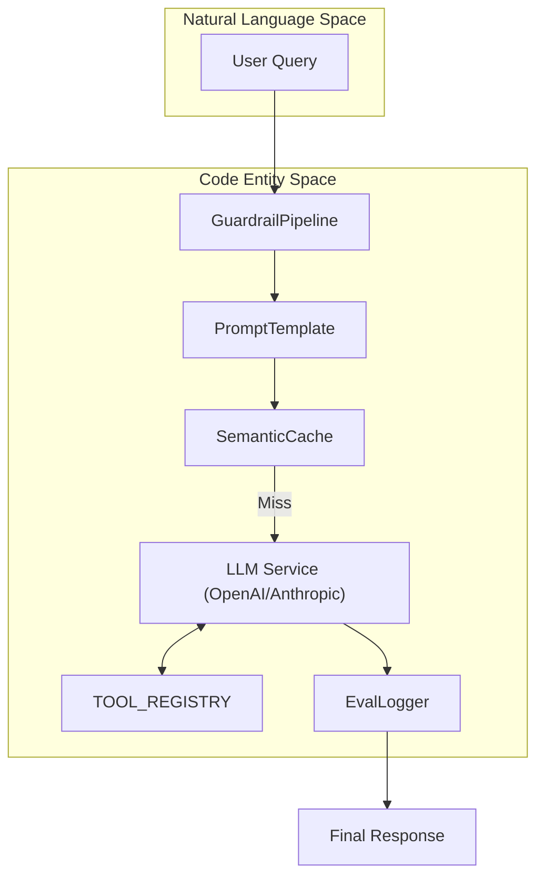
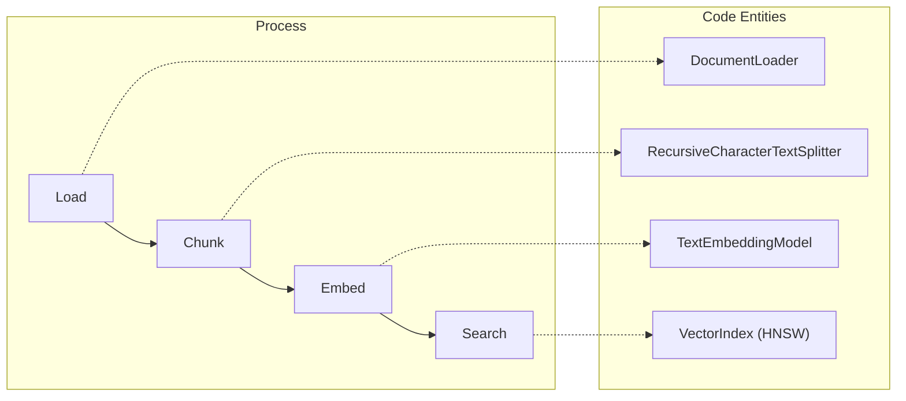

<!-- source: DeepWiki mcp.deepwiki.com · repo rohitg00/ai-engineering-from-scratch · page 12 Phase 11: LLM Engineering · fetched 2026-10-30 -->

# Phase 11: LLM Engineering

Relevant source files

The following files were used as context for generating this wiki page:

- [phases/11-llm-engineering/01-prompt-engineering/docs/en.md](phases/11-llm-engineering/01-prompt-engineering/docs/en.md)
- [phases/11-llm-engineering/02-few-shot-cot/docs/en.md](phases/11-llm-engineering/02-few-shot-cot/docs/en.md)
- [phases/11-llm-engineering/03-structured-outputs/code/main.py](phases/11-llm-engineering/03-structured-outputs/code/main.py)
- [phases/11-llm-engineering/03-structured-outputs/docs/en.md](phases/11-llm-engineering/03-structured-outputs/docs/en.md)
- [phases/11-llm-engineering/03-structured-outputs/outputs/prompt-structured-extractor.md](phases/11-llm-engineering/03-structured-outputs/outputs/prompt-structured-extractor.md)
- [phases/11-llm-engineering/03-structured-outputs/outputs/skill-structured-outputs.md](phases/11-llm-engineering/03-structured-outputs/outputs/skill-structured-outputs.md)
- [phases/11-llm-engineering/04-embeddings/docs/en.md](phases/11-llm-engineering/04-embeddings/docs/en.md)
- [phases/11-llm-engineering/06-rag/code/main.py](phases/11-llm-engineering/06-rag/code/main.py)
- [phases/11-llm-engineering/06-rag/docs/en.md](phases/11-llm-engineering/06-rag/docs/en.md)
- [phases/11-llm-engineering/06-rag/outputs/prompt-rag-architect.md](phases/11-llm-engineering/06-rag/outputs/prompt-rag-architect.md)
- [phases/11-llm-engineering/06-rag/outputs/skill-rag-pipeline.md](phases/11-llm-engineering/06-rag/outputs/skill-rag-pipeline.md)
- [phases/11-llm-engineering/07-advanced-rag/code/main.py](phases/11-llm-engineering/07-advanced-rag/code/main.py)
- [phases/11-llm-engineering/07-advanced-rag/docs/en.md](phases/11-llm-engineering/07-advanced-rag/docs/en.md)
- [phases/11-llm-engineering/07-advanced-rag/outputs/prompt-advanced-rag-debugger.md](phases/11-llm-engineering/07-advanced-rag/outputs/prompt-advanced-rag-debugger.md)
- [phases/11-llm-engineering/07-advanced-rag/outputs/skill-advanced-rag.md](phases/11-llm-engineering/07-advanced-rag/outputs/skill-advanced-rag.md)
- [phases/11-llm-engineering/08-fine-tuning-lora/docs/en.md](phases/11-llm-engineering/08-fine-tuning-lora/docs/en.md)
- [phases/11-llm-engineering/09-function-calling/docs/en.md](phases/11-llm-engineering/09-function-calling/docs/en.md)
- [phases/11-llm-engineering/10-evaluation/docs/en.md](phases/11-llm-engineering/10-evaluation/docs/en.md)
- [phases/11-llm-engineering/11-caching-cost/docs/en.md](phases/11-llm-engineering/11-caching-cost/docs/en.md)
- [phases/11-llm-engineering/12-guardrails/docs/en.md](phases/11-llm-engineering/12-guardrails/docs/en.md)
- [phases/11-llm-engineering/13-production-app/docs/en.md](phases/11-llm-engineering/13-production-app/docs/en.md)

Phase 11 marks the transition from understanding how Large Language Models (LLMs) are built to mastering how they are engineered into production-grade systems. While previous phases covered the mathematical foundations and the architecture of transformers, LLM Engineering focuses on the "Nervous System" [phases/11-llm-engineering/09-function-calling/docs/en.md:3-3]() that connects the model's "brain" to real-world data, tools, and users.

This phase covers 17 lessons, moving from basic prompting techniques to complex multi-component architectures capable of handling 10,000+ users while maintaining strict unit economics [phases/11-llm-engineering/11-caching-cost/docs/en.md:3-3]().

### From Research to Production
The shift from a "research" model to a "production" application requires moving beyond "evaluating by vibes" [phases/11-llm-engineering/10-evaluation/docs/en.md:23-24](). It involves implementing rigorous engineering patterns: structured outputs for API reliability, Retrieval-Augmented Generation (RAG) for knowledge grounding, and guardrails for safety.

The diagram below illustrates how raw LLM capabilities are wrapped in engineering layers to create a `ProductionLLMService`.

**LLM Production Service Architecture**

Sources: [phases/11-llm-engineering/13-production-app/docs/en.md:41-61](), [phases/11-llm-engineering/12-guardrails/docs/en.md:42-50](), [phases/11-llm-engineering/09-function-calling/docs/en.md:38-53]()

---

## Sub-Topic Overview

### 1. Prompting, Structured Outputs & RAG
The first half of Phase 11 focuses on the fundamental patterns of LLM interaction. It establishes that prompt engineering is not about "tricks" but about instruction clarity and reasoning strategies like Chain-of-Thought (CoT) [phases/11-llm-engineering/01-prompt-engineering/docs/en.md:3-3](). 

Key concepts include:
*   **Structured Outputs**: Using JSON Schema and Pydantic models to force the LLM to act as a reliable API [phases/11-llm-engineering/03-structured-outputs/docs/en.md:3-3]().
*   **RAG (Retrieval-Augmented Generation)**: Grounding models in external data (company wikis, codebases) to prevent hallucinations and provide auditability [phases/11-llm-engineering/06-rag/docs/en.md:3-3]().
*   **Advanced RAG**: Moving beyond basic vector search to hybrid search (BM25 + Semantic) and reranking using cross-encoders [phases/11-llm-engineering/07-advanced-rag/docs/en.md:32-38]().

For details on these patterns, see **[Prompting, Structured Outputs & RAG](#12.1)**.

### 2. Fine-Tuning, Function Calling & Production Patterns
The second half of the phase focuses on agency, optimization, and safety. This is where models gain the ability to "act" via function calling and where developers optimize for cost and latency.

Key concepts include:
*   **LoRA & QLoRA**: Fine-tuning models on consumer hardware by training less than 1% of parameters [phases/11-llm-engineering/08-fine-tuning-lora/docs/en.md:3-3]().
*   **Function Calling**: Connecting the LLM to external tools (APIs, databases) via the `TOOL_REGISTRY` [phases/11-llm-engineering/09-function-calling/docs/en.md:3-3]().
*   **Optimization**: Implementing `SemanticCache` and `CostTracker` to manage the "math that kills startups" [phases/11-llm-engineering/11-caching-cost/docs/en.md:26-35]().
*   **Guardrails**: Protecting against prompt injection and PII leaks using a "Guardrail Sandwich" architecture [phases/11-llm-engineering/12-guardrails/docs/en.md:38-40]().

For details on these patterns, see **[Fine-Tuning, Function Calling & Production Patterns](#12.2)**.

---

## Bridging Code and Concepts

LLM Engineering requires mapping abstract concepts like "Retrieval" or "Reasoning" into concrete code entities. The following diagram maps the RAG pipeline to the classes and functions implemented in this phase.

**RAG Pipeline: Code Entity Mapping**

Sources: [phases/11-llm-engineering/06-rag/docs/en.md:32-54](), [phases/11-llm-engineering/07-advanced-rag/docs/en.md:76-84](), [phases/11-llm-engineering/04-embeddings/docs/en.md:62-78]()

### Core Component Summary

| Component | Code Entity / Symbol | Purpose |
| :--- | :--- | :--- |
| **Prompting** | `PromptTemplate` | Versioned management of instructions [phases/11-llm-engineering/13-production-app/docs/en.md:69-80](). |
| **Extraction** | `extract_with_retry` | Pydantic-based validation of LLM JSON [phases/11-llm-engineering/03-structured-outputs/docs/en.md:89-99](). |
| **Retrieval** | `HybridSearcher` | Merging BM25 and Vector scores via RRF [phases/11-llm-engineering/07-advanced-rag/docs/en.md:51-67](). |
| **Tooling** | `run_function_calling_loop` | Multi-turn agent execution cycle [phases/11-llm-engineering/09-function-calling/docs/en.md:38-53](). |
| **Safety** | `GuardrailPipeline` | Input/Output filtering for injections/PII [phases/11-llm-engineering/12-guardrails/docs/en.md:42-50](). |
| **Economics** | `CostTracker` | Real-time token accounting per request [phases/11-llm-engineering/11-caching-cost/docs/en.md:135-139](). |

Sources: [phases/11-llm-engineering/13-production-app/docs/en.md:69-80](), [phases/11-llm-engineering/07-advanced-rag/docs/en.md:51-67](), [phases/11-llm-engineering/12-guardrails/docs/en.md:42-50]()

---

