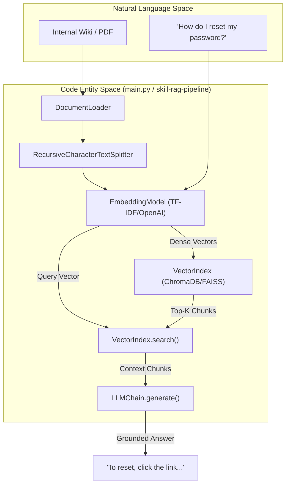
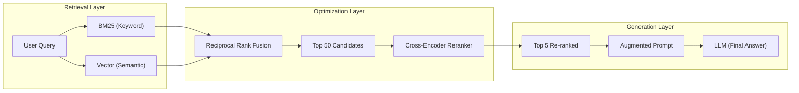

<!-- source: DeepWiki mcp.deepwiki.com · repo rohitg00/ai-engineering-from-scratch · page 12.1 Prompting, Structured Outputs & RAG · fetched 2026-10-30 -->

# Prompting, Structured Outputs & RAG

Relevant source files

The following files were used as context for generating this wiki page:

- [phases/11-llm-engineering/01-prompt-engineering/docs/en.md](phases/11-llm-engineering/01-prompt-engineering/docs/en.md)
- [phases/11-llm-engineering/02-few-shot-cot/docs/en.md](phases/11-llm-engineering/02-few-shot-cot/docs/en.md)
- [phases/11-llm-engineering/03-structured-outputs/code/main.py](phases/11-llm-engineering/03-structured-outputs/code/main.py)
- [phases/11-llm-engineering/03-structured-outputs/docs/en.md](phases/11-llm-engineering/03-structured-outputs/docs/en.md)
- [phases/11-llm-engineering/03-structured-outputs/outputs/prompt-structured-extractor.md](phases/11-llm-engineering/03-structured-outputs/outputs/prompt-structured-extractor.md)
- [phases/11-llm-engineering/03-structured-outputs/outputs/skill-structured-outputs.md](phases/11-llm-engineering/03-structured-outputs/outputs/skill-structured-outputs.md)
- [phases/11-llm-engineering/04-embeddings/docs/en.md](phases/11-llm-engineering/04-embeddings/docs/en.md)
- [phases/11-llm-engineering/06-rag/code/main.py](phases/11-llm-engineering/06-rag/code/main.py)
- [phases/11-llm-engineering/06-rag/docs/en.md](phases/11-llm-engineering/06-rag/docs/en.md)
- [phases/11-llm-engineering/06-rag/outputs/prompt-rag-architect.md](phases/11-llm-engineering/06-rag/outputs/prompt-rag-architect.md)
- [phases/11-llm-engineering/06-rag/outputs/skill-rag-pipeline.md](phases/11-llm-engineering/06-rag/outputs/skill-rag-pipeline.md)
- [phases/11-llm-engineering/07-advanced-rag/code/main.py](phases/11-llm-engineering/07-advanced-rag/code/main.py)
- [phases/11-llm-engineering/07-advanced-rag/docs/en.md](phases/11-llm-engineering/07-advanced-rag/docs/en.md)
- [phases/11-llm-engineering/07-advanced-rag/outputs/prompt-advanced-rag-debugger.md](phases/11-llm-engineering/07-advanced-rag/outputs/prompt-advanced-rag-debugger.md)
- [phases/11-llm-engineering/07-advanced-rag/outputs/skill-advanced-rag.md](phases/11-llm-engineering/07-advanced-rag/outputs/skill-advanced-rag.md)
- [phases/11-llm-engineering/08-fine-tuning-lora/docs/en.md](phases/11-llm-engineering/08-fine-tuning-lora/docs/en.md)
- [phases/11-llm-engineering/09-function-calling/docs/en.md](phases/11-llm-engineering/09-function-calling/docs/en.md)
- [phases/11-llm-engineering/10-evaluation/docs/en.md](phases/11-llm-engineering/10-evaluation/docs/en.md)
- [phases/11-llm-engineering/11-caching-cost/docs/en.md](phases/11-llm-engineering/11-caching-cost/docs/en.md)
- [phases/11-llm-engineering/12-guardrails/docs/en.md](phases/11-llm-engineering/12-guardrails/docs/en.md)
- [phases/11-llm-engineering/13-production-app/docs/en.md](phases/11-llm-engineering/13-production-app/docs/en.md)

This section covers the transition from LLM research to LLM engineering. It focuses on the mechanics of controlling model behavior through prompt engineering, ensuring reliability through structured outputs, and grounding model knowledge in external data via Retrieval-Augmented Generation (RAG).

## Prompt Engineering & Reasoning Strategies

Prompt engineering is the primary interface for activating specific capabilities within a 200B+ parameter model. It moves beyond simple "texting" to precise instruction and reasoning orchestration [phases/11-llm-engineering/01-prompt-engineering/docs/en.md:1-5]().

### Core Prompt Anatomy
Every LLM API call consists of three primary components that influence the model's output distribution [phases/11-llm-engineering/01-prompt-engineering/docs/en.md:42-60]():

| Component | Role | Priority |
| :--- | :--- | :--- |
| **System Message** | Sets identity, behavioral rules, and constraints. | Highest |
| **User Message** | The specific task or question for the current turn. | Variable |
| **Assistant Prefill** | Partial response (e.g., `{"`) used to steer formatting. | High (Format) |

### Reasoning Patterns: CoT & Few-Shot
Reasoning strategies bridge the gap between mediocre and high-accuracy performance. By forcing the model to generate intermediate tokens, the effective computation depth increases [phases/11-llm-engineering/02-few-shot-cot/docs/en.md:21-25]().

*   **Few-Shot Prompting**: Providing 3-5 demonstrations of the task. Examples act as compressed instructions that models pattern-match more reliably than abstract descriptions [phases/11-llm-engineering/02-few-shot-cot/docs/en.md:31-35]().
*   **Chain-of-Thought (CoT)**: Using "Let's think step by step" to externalize intermediate reasoning. This is critical for multi-step arithmetic and symbolic reasoning [phases/11-llm-engineering/02-few-shot-cot/docs/en.md:65-87]().
*   **Self-Consistency**: Sampling multiple reasoning paths and taking a majority vote on the final answer to cancel out individual path errors [phases/11-llm-engineering/02-few-shot-cot/docs/en.md:110-113]().

**Sources:** [phases/11-llm-engineering/01-prompt-engineering/docs/en.md:42-67](), [phases/11-llm-engineering/02-few-shot-cot/docs/en.md:21-113]()

---

## Structured Outputs & Schema Validation

Structured outputs provide a bridge between natural language and typed data, ensuring LLM responses can be reliably consumed by application code [phases/11-llm-engineering/03-structured-outputs/docs/en.md:1-4]().

### The Reliability Spectrum
Reliability increases as control moves from the prompt level to the token-decoding level [phases/11-llm-engineering/03-structured-outputs/docs/en.md:34-59]():

1.  **Prompt-based**: "Respond in JSON." (~90% reliable).
2.  **JSON Mode**: API guarantees valid JSON syntax but not specific keys.
3.  **Schema Mode**: API guarantees output matches a provided **JSON Schema**.
4.  **Constrained Decoding**: Token-level enforcement where invalid tokens are masked out during generation (100% reliable).

### Pydantic Pattern & Extraction
In the Python implementation, Pydantic models are used to define the "contract." The `skill-structured-outputs` artifact demonstrates the `extract_with_retry` pattern, where malformed outputs are caught by Pydantic validation and fed back to the model for correction [phases/11-llm-engineering/03-structured-outputs/docs/en.md:85-100]().

**Sources:** [phases/11-llm-engineering/03-structured-outputs/docs/en.md:34-100](), [phases/11-llm-engineering/03-structured-outputs/outputs/skill-structured-outputs.md]()

---

## Retrieval-Augmented Generation (RAG)

RAG grounds LLM responses in specific, up-to-date documents by retrieving relevant context and injecting it into the prompt [phases/11-llm-engineering/06-rag/docs/en.md:3-4]().

### The RAG Pipeline
The pipeline consists of four main stages: Query → Retrieve → Augment → Generate [phases/11-llm-engineering/06-rag/docs/en.md:30-56]().

#### Data Flow: Natural Language to Code Entities
This diagram maps the RAG process to the specific classes and functions used in the `skill-rag-pipeline` implementation.

**RAG Implementation Architecture**

**Sources:** [phases/11-llm-engineering/06-rag/docs/en.md:30-56](), [phases/11-llm-engineering/06-rag/code/main.py]()

### Embeddings & Vector Similarity
Embeddings convert discrete text into continuous vectors where semantic similarity is measured via math [phases/11-llm-engineering/04-embeddings/docs/en.md:3-4]().
*   **Cosine Similarity**: Measures the angle between vectors; the standard for RAG as it ignores document length [phases/11-llm-engineering/04-embeddings/docs/en.md:101-105]().
*   **VectorIndex**: A local or hosted database (e.g., ChromaDB) that uses HNSW (Hierarchical Navigable Small World) for fast approximate nearest neighbor search [phases/11-llm-engineering/04-embeddings/docs/en.md:9-15]().

---

## Advanced RAG & Retrieval Optimization

Basic RAG fails on ambiguous queries or large corpora. Advanced RAG introduces hybrid retrieval and reranking [phases/11-llm-engineering/07-advanced-rag/docs/en.md:3-4]().

### Hybrid Search & Reranking
1.  **Hybrid Search**: Combines **BM25** (keyword matching) with **Semantic Search** (vector similarity) [phases/11-llm-engineering/07-advanced-rag/docs/en.md:32-47]().
2.  **Reciprocal Rank Fusion (RRF)**: Merges the two ranked lists into a single score: $RRF\_score(d) = \sum \frac{1}{k + rank(d)}$ [phases/11-llm-engineering/07-advanced-rag/docs/en.md:51-66]().
3.  **Cross-Encoder Reranking**: A slower, more precise model evaluates the top-50 candidates to select the final top-5 based on fine-grained interaction between query and document [phases/11-llm-engineering/07-advanced-rag/docs/en.md:68-84]().

### Advanced Chunking Patterns
*   **Parent-Document Retrieval**: Retrieve small chunks for better vector matching, but provide the larger parent document to the LLM for context [phases/11-llm-engineering/07-advanced-rag/docs/en.md:13-16]().
*   **Context Engineering**: Mitigating "lost-in-the-middle" phenomena by managing the `ContextBudget` and placing the most relevant information at the beginning or end of the prompt [phases/11-llm-engineering/01-prompt-engineering/docs/en.md:36-39]().

**Advanced Retrieval Data Flow**

**Sources:** [phases/11-llm-engineering/07-advanced-rag/docs/en.md:32-84](), [phases/11-llm-engineering/07-advanced-rag/outputs/skill-advanced-rag.md]()

---

## Production LLM Engineering

Moving to production requires wiring these components into a resilient service [phases/11-llm-engineering/13-production-app/docs/en.md:3-4]().

### Key Production Components
*   **Function Calling**: Connecting the LLM to external tools (APIs, DBs) via a structured JSON-RPC-like loop [phases/11-llm-engineering/09-function-calling/docs/en.md:3-4]().
*   **Guardrails**: A "sandwich" architecture that validates input (detecting prompt injection) and output (filtering PII or hallucinations) [phases/11-llm-engineering/12-guardrails/docs/en.md:38-52]().
*   **Semantic Caching**: Reducing costs by hashing queries or using embedding similarity to serve cached responses for repeated intents [phases/11-llm-engineering/11-caching-cost/docs/en.md:77-91]().
*   **Evaluation (LLM-as-Judge)**: Using a strong model (e.g., GPT-5 or Claude Opus) to score the performance of a smaller production model against a specific rubric [phases/11-llm-engineering/10-evaluation/docs/en.md:77-104]().

**Sources:** [phases/11-llm-engineering/13-production-app/docs/en.md:37-65](), [phases/11-llm-engineering/12-guardrails/docs/en.md:38-52](), [phases/11-llm-engineering/11-caching-cost/docs/en.md:77-91]()

---

