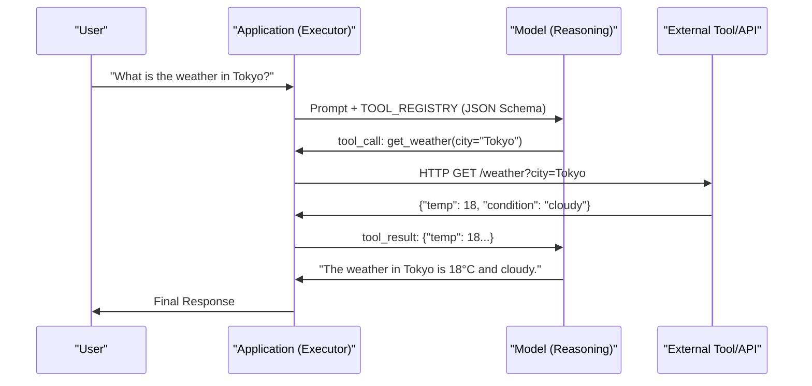
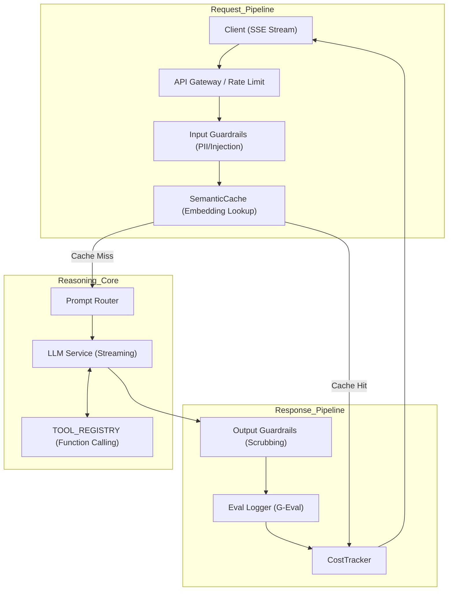

<!-- source: DeepWiki mcp.deepwiki.com · repo rohitg00/ai-engineering-from-scratch · page 12.2 Fine-Tuning, Function Calling & Production Patterns · fetched 2026-10-30 -->

# Fine-Tuning, Function Calling & Production Patterns

Relevant source files

The following files were used as context for generating this wiki page:

- [.github/FUNDING.yml](.github/FUNDING.yml)
- [SPONSORS.md](SPONSORS.md)
- [phases/08-generative-ai/19-visual-autoregressive-var/code/main.py](phases/08-generative-ai/19-visual-autoregressive-var/code/main.py)
- [phases/08-generative-ai/19-visual-autoregressive-var/outputs/skill-var-tokenizer-designer.md](phases/08-generative-ai/19-visual-autoregressive-var/outputs/skill-var-tokenizer-designer.md)
- [phases/10-llms-from-scratch/25-speculative-decoding/code/main.py](phases/10-llms-from-scratch/25-speculative-decoding/code/main.py)
- [phases/10-llms-from-scratch/25-speculative-decoding/outputs/skill-speculative-tuning.md](phases/10-llms-from-scratch/25-speculative-decoding/outputs/skill-speculative-tuning.md)
- [phases/10-llms-from-scratch/34-gradient-checkpointing/outputs/skill-checkpointing-planner.md](phases/10-llms-from-scratch/34-gradient-checkpointing/outputs/skill-checkpointing-planner.md)
- [phases/11-llm-engineering/01-prompt-engineering/docs/en.md](phases/11-llm-engineering/01-prompt-engineering/docs/en.md)
- [phases/11-llm-engineering/02-few-shot-cot/docs/en.md](phases/11-llm-engineering/02-few-shot-cot/docs/en.md)
- [phases/11-llm-engineering/03-structured-outputs/code/main.py](phases/11-llm-engineering/03-structured-outputs/code/main.py)
- [phases/11-llm-engineering/03-structured-outputs/docs/en.md](phases/11-llm-engineering/03-structured-outputs/docs/en.md)
- [phases/11-llm-engineering/03-structured-outputs/outputs/prompt-structured-extractor.md](phases/11-llm-engineering/03-structured-outputs/outputs/prompt-structured-extractor.md)
- [phases/11-llm-engineering/03-structured-outputs/outputs/skill-structured-outputs.md](phases/11-llm-engineering/03-structured-outputs/outputs/skill-structured-outputs.md)
- [phases/11-llm-engineering/04-embeddings/docs/en.md](phases/11-llm-engineering/04-embeddings/docs/en.md)
- [phases/11-llm-engineering/08-fine-tuning-lora/docs/en.md](phases/11-llm-engineering/08-fine-tuning-lora/docs/en.md)
- [phases/11-llm-engineering/09-function-calling/docs/en.md](phases/11-llm-engineering/09-function-calling/docs/en.md)
- [phases/11-llm-engineering/10-evaluation/docs/en.md](phases/11-llm-engineering/10-evaluation/docs/en.md)
- [phases/11-llm-engineering/11-caching-cost/docs/en.md](phases/11-llm-engineering/11-caching-cost/docs/en.md)
- [phases/11-llm-engineering/12-guardrails/docs/en.md](phases/11-llm-engineering/12-guardrails/docs/en.md)
- [phases/11-llm-engineering/13-production-app/docs/en.md](phases/11-llm-engineering/13-production-app/docs/en.md)
- [phases/11-llm-engineering/16-langgraph-state-machines/outputs/skill-stategraph-designer.md](phases/11-llm-engineering/16-langgraph-state-machines/outputs/skill-stategraph-designer.md)
- [phases/11-llm-engineering/17-agent-framework-tradeoffs/assets/framework-matrix.svg](phases/11-llm-engineering/17-agent-framework-tradeoffs/assets/framework-matrix.svg)
- [phases/11-llm-engineering/17-agent-framework-tradeoffs/code/main.py](phases/11-llm-engineering/17-agent-framework-tradeoffs/code/main.py)
- [phases/11-llm-engineering/17-agent-framework-tradeoffs/docs/en.md](phases/11-llm-engineering/17-agent-framework-tradeoffs/docs/en.md)
- [phases/11-llm-engineering/17-agent-framework-tradeoffs/outputs/skill-framework-picker.md](phases/11-llm-engineering/17-agent-framework-tradeoffs/outputs/skill-framework-picker.md)
- [phases/11-llm-engineering/17-agent-framework-tradeoffs/quiz.json](phases/11-llm-engineering/17-agent-framework-tradeoffs/quiz.json)

This page details the transition from foundational LLM usage to production-grade engineering. It covers the technical implementation of parameter-efficient fine-tuning (LoRA/QLoRA), the mechanics of connecting models to external tools via function calling, and the architectural patterns required to build resilient, cost-optimized, and safe LLM applications.

## Fine-Tuning with LoRA & QLoRA

Full parameter fine-tuning of modern LLMs is computationally prohibitive for most organizations, requiring massive VRAM for weights, gradients, and optimizer states [phases/11-llm-engineering/08-fine-tuning-lora/docs/en.md:22-26](). **LoRA (Low-Rank Adaptation)** solves this by freezing the pretrained model weights ($W$) and injecting trainable low-rank decomposition matrices ($A$ and $B$) into the attention layers [phases/11-llm-engineering/08-fine-tuning-lora/docs/en.md:36-50]().

### Mathematical Foundation
For a weight matrix $W \in \mathbb{R}^{d \times d}$, LoRA computes the forward pass as:
$$y = Wx + \frac{\alpha}{r}BAx$$
Where $B \in \mathbb{R}^{d \times r}$ and $A \in \mathbb{R}^{r \times d}$ with rank $r \ll d$ [phases/11-llm-engineering/08-fine-tuning-lora/docs/en.md:49-83](). This reduces trainable parameters by over 99% for a typical 7B model [phases/11-llm-engineering/08-fine-tuning-lora/docs/en.md:55-59]().

### QLoRA & NF4 Quantization
**QLoRA** further reduces memory requirements by quantizing the base model to 4-bit using the **Normal Float 4-bit (NF4)** data type [phases/11-llm-engineering/08-fine-tuning-lora/docs/en.md:120-134](). NF4 is information-theoretically optimal for normally distributed weights, allowing a 7B model to be fine-tuned on a single consumer GPU (e.g., RTX 3090) [phases/11-llm-engineering/08-fine-tuning-lora/docs/en.md:130-135]().

Sources: [phases/11-llm-engineering/08-fine-tuning-lora/docs/en.md:1-140]()

## Function Calling & Tool Use

Function calling (or Tool Use) allows LLMs to interact with the physical world by generating structured JSON that describes an action to be taken by the application code [phases/11-llm-engineering/09-function-calling/docs/en.md:3-28]().

### The Function Calling Loop
The system operates as a 5-step cycle where the model acts as the "brain" and the application code acts as the "hands" [phases/11-llm-engineering/09-function-calling/docs/en.md:3-3]().

**Function Calling Data Flow**

Sources: [phases/11-llm-engineering/09-function-calling/docs/en.md:38-53]()

### Implementation Details
*   **Tool Definitions**: Tools are defined using JSON Schema, where the `description` field serves as a prompt for the model to understand when to invoke the tool [phases/11-llm-engineering/09-function-calling/docs/en.md:59-88]().
*   **Parallel Calling**: Modern models (GPT-4o, Claude 3.5) can output multiple tool calls in a single turn, reducing round-trip latency [phases/11-llm-engineering/09-function-calling/docs/en.md:113-125]().

Sources: [phases/11-llm-engineering/09-function-calling/docs/en.md:59-125]()

## Production Architecture & Guardrails

Transitioning from a prototype to a production service requires a robust middleware stack to handle failures, costs, and safety [phases/11-llm-engineering/13-production-app/docs/en.md:3-33]().

### Production LLM Service Components
The `ProductionLLMService` integrates several critical modules:
1.  **SemanticCache**: Uses embeddings to find similar previous queries and return cached results, bypassing the LLM for 40-60% of redundant traffic [phases/11-llm-engineering/11-caching-cost/docs/en.md:79-92]().
2.  **GuardrailPipeline**: Implements a "Guardrail Sandwich" [phases/11-llm-engineering/12-guardrails/docs/en.md:38-50]().
    *   **Input Guardrails**: Detect prompt injection and PII using classifiers like `LlamaGuard` [phases/11-llm-engineering/12-guardrails/docs/en.md:72-83]().
    *   **Output Guardrails**: Scrub PII and validate JSON structure before the user sees it [phases/11-llm-engineering/12-guardrails/docs/en.md:85-96]().
3.  **CostTracker**: Accounts for tokens across different providers (OpenAI, Anthropic, Gemini) and implements budget alerts [phases/11-llm-engineering/11-caching-cost/docs/en.md:135-139]().

**Production Application Architecture**

Sources: [phases/11-llm-engineering/13-production-app/docs/en.md:41-61](), [phases/11-llm-engineering/11-caching-cost/docs/en.md:83-92](), [phases/11-llm-engineering/12-guardrails/docs/en.md:42-50]()

## LLM Evaluation (G-Eval & LLM-as-Judge)

Evaluation moves away from "vibes" toward automated scoring using strong models as judges [phases/11-llm-engineering/10-evaluation/docs/en.md:3-28]().

*   **G-Eval**: Uses rubrics with anchored descriptions (1-5 scales) to reduce judge variance [phases/11-llm-engineering/10-evaluation/docs/en.md:91-104]().
*   **Taxonomy**:
    *   **Automated Metrics**: BLEU/ROUGE (Fast, low correlation) [phases/11-llm-engineering/10-evaluation/docs/en.md:60-61]().
    *   **LLM-as-Judge**: GPT-5-mini or Claude Opus (High correlation, captures nuance) [phases/11-llm-engineering/10-evaluation/docs/en.md:62-63]().
    *   **RAGAS**: Specific metrics for Faithfulness and Answer Relevance in RAG pipelines [phases/11-llm-engineering/10-evaluation/docs/en.md:73-73]().

Sources: [phases/11-llm-engineering/10-evaluation/docs/en.md:32-104]()

## Agent Framework Tradeoffs

Choosing a framework depends on the required state management and branching logic [phases/11-llm-engineering/17-agent-framework-tradeoffs/docs/en.md:3-16]().

| Framework | Core Abstraction | Best Use Case |
| :--- | :--- | :--- |
| **LangGraph** | `StateGraph` | Deterministic workflows with explicit state and time-travel debugging [phases/11-llm-engineering/17-agent-framework-tradeoffs/docs/en.md:26-26](). |
| **CrewAI** | `Crew` / Roles | Persona-driven hierarchical workflows (Manager -> Researcher) [phases/11-llm-engineering/17-agent-framework-tradeoffs/docs/en.md:27-27](). |
| **AutoGen** | `ConversableAgent` | Emergent dialogue (Proposer-Critic) and multi-agent chat [phases/11-llm-engineering/17-agent-framework-tradeoffs/docs/en.md:28-28](). |
| **Agno** | `Agent` | Lightweight single agents with built-in storage drivers (SQLite/Postgres) [phases/11-llm-engineering/17-agent-framework-tradeoffs/docs/en.md:29-29](). |

### State & Persistence
*   **LangGraph**: Uses a first-class checkpointer (SQLite/Redis) for "time-travel" debugging and human-in-the-loop interrupts [phases/11-llm-engineering/17-agent-framework-tradeoffs/docs/en.md:44-44]().
*   **Agno**: Attaches storage drivers directly to the `Agent` class for session memory persistence [phases/11-llm-engineering/17-agent-framework-tradeoffs/docs/en.md:47-47]().

Sources: [phases/11-llm-engineering/17-agent-framework-tradeoffs/docs/en.md:24-56](), [phases/11-llm-engineering/17-agent-framework-tradeoffs/quiz.json:1-65]()

---

