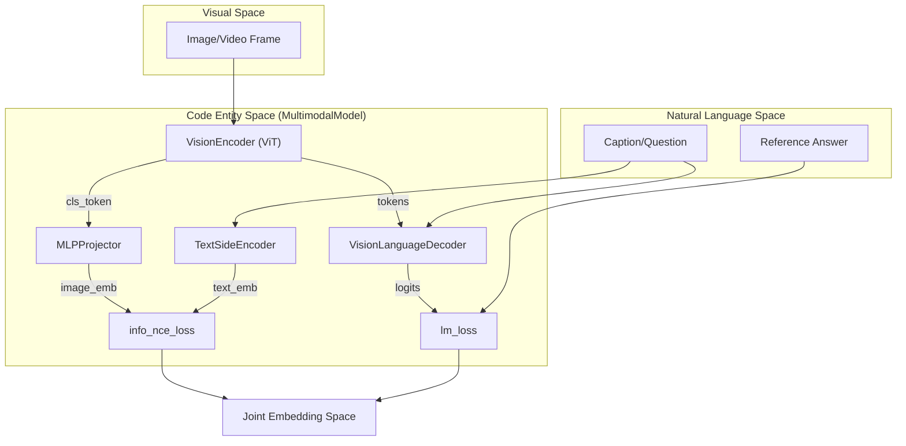
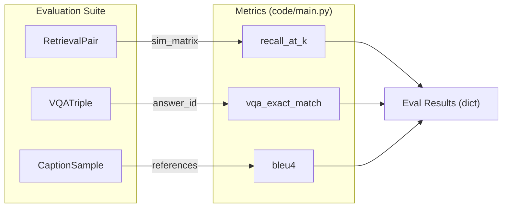

<!-- source: DeepWiki mcp.deepwiki.com · repo rohitg00/ai-engineering-from-scratch · page 13 Phase 12: Multimodal AI · fetched 2026-10-30 -->

# Phase 12: Multimodal AI

Relevant source files

The following files were used as context for generating this wiki page:

- [phases/19-capstone-projects/62-vision-language-pretraining/code/main.py](phases/19-capstone-projects/62-vision-language-pretraining/code/main.py)
- [phases/19-capstone-projects/62-vision-language-pretraining/code/test_main.py](phases/19-capstone-projects/62-vision-language-pretraining/code/test_main.py)
- [phases/19-capstone-projects/62-vision-language-pretraining/docs/en.md](phases/19-capstone-projects/62-vision-language-pretraining/docs/en.md)
- [phases/19-capstone-projects/62-vision-language-pretraining/quiz.json](phases/19-capstone-projects/62-vision-language-pretraining/quiz.json)
- [phases/19-capstone-projects/63-multimodal-eval/code/main.py](phases/19-capstone-projects/63-multimodal-eval/code/main.py)
- [phases/19-capstone-projects/63-multimodal-eval/code/test_main.py](phases/19-capstone-projects/63-multimodal-eval/code/test_main.py)
- [phases/19-capstone-projects/63-multimodal-eval/docs/en.md](phases/19-capstone-projects/63-multimodal-eval/docs/en.md)
- [phases/19-capstone-projects/63-multimodal-eval/quiz.json](phases/19-capstone-projects/63-multimodal-eval/quiz.json)

Phase 12 covers the engineering of models that process and generate data across multiple modalities, including text, images, video, and audio. The curriculum transitions from specialized encoders to unified "any-to-any" architectures, where different data types are fused into a shared semantic space or a single token stream.

### Multimodal System Architecture

The following diagram illustrates how disparate modalities are unified into a "Code Entity Space" using the architectural patterns found in the `MultimodalModel` [phases/19-capstone-projects/62-vision-language-pretraining/code/main.py:130-161]().

Sources: [phases/19-capstone-projects/62-vision-language-pretraining/code/main.py:130-190](), [phases/19-capstone-projects/62-vision-language-pretraining/docs/en.md:25-41]()

---

## 13.1 Vision-Language Models: CLIP to LLaVA

This section covers the evolution of Vision-Language Models (VLMs) from contrastive dual-encoders to generative instruction-tuned models. The focus is on modality alignment—the process of mapping visual features into the LLM's input space using projection layers and cross-attention.

Key concepts include:
*   **Contrastive Pretraining:** Using the `info_nce_loss` [phases/19-capstone-projects/62-vision-language-pretraining/code/main.py:73-95]() to align image and text embeddings.
*   **Visual Instruction Tuning:** Training the `VisionLanguageDecoder` [phases/19-capstone-projects/62-vision-language-pretraining/code/main.py:159]() to follow text instructions conditioned on visual input.
*   **Modality Bridges:** Implementing components like the `MLPProjector` [phases/19-capstone-projects/62-vision-language-pretraining/code/main.py:146]() to translate between hidden dimensions.

For details, see [Vision-Language Models: CLIP to LLaVA](#13.1).

Sources: [phases/19-capstone-projects/62-vision-language-pretraining/docs/en.md:43-57](), [phases/19-capstone-projects/62-vision-language-pretraining/code/main.py:73-95]()

---

## 13.2 Unified & Any-to-Any Multimodal Architectures

This section explores advanced architectures that treat all modalities as a unified sequence of tokens. It covers "omni" models capable of streaming any-to-any (text-to-video, audio-to-text, etc.) and embodied AI where models act as Vision-Language-Action (VLA) agents.

Topics include:
*   **Early Fusion:** Architectures like Chameleon where images are tokenized into discrete visual words and interleaved with text.
*   **Audio & Video:** Temporal grounding in video-language models and the integration of neural audio codecs.
*   **Multimodal RAG:** Using vision-native retrieval (e.g., ColPali) to search through document screenshots and diagrams without OCR.

For details, see [Unified & Any-to-Any Multimodal Architectures](#13.2).

---

## Evaluation and Benchmarking

Multimodal models require diverse evaluation surfaces to measure ranking, generation, and reasoning capabilities. The `evaluate` function [phases/19-capstone-projects/63-multimodal-eval/code/main.py:213-239]() implements three primary metrics.

| Metric | Code Implementation | Purpose |
| :--- | :--- | :--- |
| **Recall@K** | `recall_at_k` | Measures retrieval performance in the joint embedding space. |
| **VQA Exact Match** | `vqa_exact_match` | Measures accuracy of predicted answers for visual questions. |
| **BLEU-4** | `bleu4` | Evaluates the quality of generated captions against references. |

### Evaluation Flow

Sources: [phases/19-capstone-projects/63-multimodal-eval/code/main.py:51-123](), [phases/19-capstone-projects/63-multimodal-eval/docs/en.md:29-40]()

Sources: [phases/19-capstone-projects/63-multimodal-eval/code/main.py:77-170](), [phases/19-capstone-projects/63-multimodal-eval/docs/en.md:19-25]()

---

