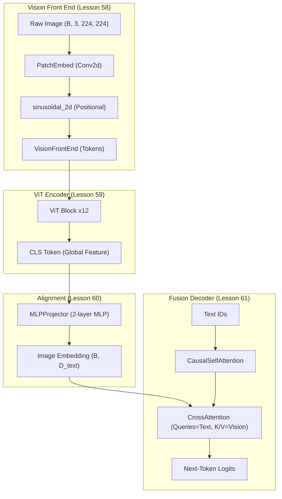
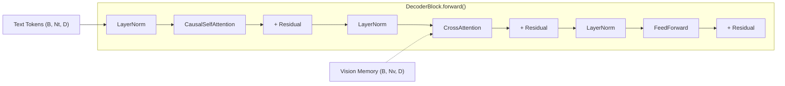

<!-- source: DeepWiki mcp.deepwiki.com · repo rohitg00/ai-engineering-from-scratch · page 13.1 Vision-Language Models: CLIP to LLaVA · fetched 2026-10-30 -->

# Vision-Language Models: CLIP to LLaVA

Relevant source files

The following files were used as context for generating this wiki page:

- [phases/19-capstone-projects/58-vision-encoder-patches/code/main.py](phases/19-capstone-projects/58-vision-encoder-patches/code/main.py)
- [phases/19-capstone-projects/58-vision-encoder-patches/code/test_main.py](phases/19-capstone-projects/58-vision-encoder-patches/code/test_main.py)
- [phases/19-capstone-projects/58-vision-encoder-patches/docs/en.md](phases/19-capstone-projects/58-vision-encoder-patches/docs/en.md)
- [phases/19-capstone-projects/58-vision-encoder-patches/quiz.json](phases/19-capstone-projects/58-vision-encoder-patches/quiz.json)
- [phases/19-capstone-projects/59-vit-transformer/code/main.py](phases/19-capstone-projects/59-vit-transformer/code/main.py)
- [phases/19-capstone-projects/59-vit-transformer/code/test_main.py](phases/19-capstone-projects/59-vit-transformer/code/test_main.py)
- [phases/19-capstone-projects/59-vit-transformer/docs/en.md](phases/19-capstone-projects/59-vit-transformer/docs/en.md)
- [phases/19-capstone-projects/59-vit-transformer/quiz.json](phases/19-capstone-projects/59-vit-transformer/quiz.json)
- [phases/19-capstone-projects/60-projection-layer-modality-align/code/main.py](phases/19-capstone-projects/60-projection-layer-modality-align/code/main.py)
- [phases/19-capstone-projects/60-projection-layer-modality-align/code/test_main.py](phases/19-capstone-projects/60-projection-layer-modality-align/code/test_main.py)
- [phases/19-capstone-projects/60-projection-layer-modality-align/docs/en.md](phases/19-capstone-projects/60-projection-layer-modality-align/docs/en.md)
- [phases/19-capstone-projects/60-projection-layer-modality-align/quiz.json](phases/19-capstone-projects/60-projection-layer-modality-align/quiz.json)
- [phases/19-capstone-projects/61-cross-attention-fusion/code/main.py](phases/19-capstone-projects/61-cross-attention-fusion/code/main.py)
- [phases/19-capstone-projects/61-cross-attention-fusion/code/test_main.py](phases/19-capstone-projects/61-cross-attention-fusion/code/test_main.py)
- [phases/19-capstone-projects/61-cross-attention-fusion/docs/en.md](phases/19-capstone-projects/61-cross-attention-fusion/docs/en.md)
- [phases/19-capstone-projects/61-cross-attention-fusion/quiz.json](phases/19-capstone-projects/61-cross-attention-fusion/quiz.json)
- [phases/19-capstone-projects/62-vision-language-pretraining/code/main.py](phases/19-capstone-projects/62-vision-language-pretraining/code/main.py)
- [phases/19-capstone-projects/62-vision-language-pretraining/code/test_main.py](phases/19-capstone-projects/62-vision-language-pretraining/code/test_main.py)
- [phases/19-capstone-projects/62-vision-language-pretraining/docs/en.md](phases/19-capstone-projects/62-vision-language-pretraining/docs/en.md)
- [phases/19-capstone-projects/62-vision-language-pretraining/quiz.json](phases/19-capstone-projects/62-vision-language-pretraining/quiz.json)
- [phases/19-capstone-projects/63-multimodal-eval/code/main.py](phases/19-capstone-projects/63-multimodal-eval/code/main.py)
- [phases/19-capstone-projects/63-multimodal-eval/code/test_main.py](phases/19-capstone-projects/63-multimodal-eval/code/test_main.py)
- [phases/19-capstone-projects/63-multimodal-eval/docs/en.md](phases/19-capstone-projects/63-multimodal-eval/docs/en.md)
- [phases/19-capstone-projects/63-multimodal-eval/quiz.json](phases/19-capstone-projects/63-multimodal-eval/quiz.json)

This page covers the technical evolution and implementation of Vision-Language Models (VLMs) as explored in Phase 12 and the Capstone series (Phase 19). It details the architectural components required to bridge visual perception with linguistic reasoning, moving from contrastive alignment (CLIP) to generative instruction tuning (LLaVA).

## Overview of the VLM Pipeline

A modern Vision-Language Model typically consists of three primary components:
1.  **Vision Encoder**: A Vision Transformer (ViT) that tokenizes images into patch embeddings.
2.  **Projection Layer**: A bridge (usually a multi-layer MLP) that aligns visual features with the text decoder's embedding space.
3.  **Language Decoder**: A transformer capable of cross-attending to visual tokens to generate text or perform reasoning.

### Data Flow Architecture
The following diagram illustrates the path from raw pixels to generated text, mapping system concepts to specific code entities found in the Capstone series.

**Visual-Linguistic Fusion Flow**

Sources: [phases/19-capstone-projects/58-vision-encoder-patches/docs/en.md:25-34](), [phases/19-capstone-projects/59-vit-transformer/docs/en.md:26-33](), [phases/19-capstone-projects/60-projection-layer-modality-align/docs/en.md:25-36](), [phases/19-capstone-projects/61-cross-attention-fusion/docs/en.md:26-35]()

---

## 1. Vision Tokenization: Patch Embedding
Unlike text, which is discrete, images are continuous grids. The `VisionFrontEnd` [phases/19-capstone-projects/58-vision-encoder-patches/code/main.py:105-129]() converts pixels into a sequence of vectors.

*   **Patching**: The `PatchEmbed` class [phases/19-capstone-projects/58-vision-encoder-patches/code/main.py:69-102]() uses a `Conv2d` with a stride equal to the patch size (e.g., 16x16). This is numerically equivalent to flattening a patch and applying a linear projection [phases/19-capstone-projects/58-vision-encoder-patches/docs/en.md:44-47]().
*   **2D Position**: Because transformers are permutation-invariant, `sinusoidal_2d` [phases/19-capstone-projects/58-vision-encoder-patches/code/main.py:42-66]() injects spatial information. Half the embedding dimension encodes the row index, and half encodes the column index [phases/19-capstone-projects/58-vision-encoder-patches/docs/en.md:48-51]().

Sources: [phases/19-capstone-projects/58-vision-encoder-patches/docs/en.md:17-22](), [phases/19-capstone-projects/58-vision-encoder-patches/code/main.py:42-102]()

---

## 2. Modality Alignment & The Projection Layer
The visual features from a pre-trained ViT do not naturally reside in the same vector space as a language model's word embeddings. The `MLPProjector` [phases/19-capstone-projects/60-projection-layer-modality-align/code/main.py:61-71]() acts as the bridge.

| Feature | Specification | Role |
| :--- | :--- | :--- |
| **Input Dim** | `vision_hidden` (e.g., 768) | Output of the ViT encoder. |
| **Hidden Dim** | `projection_hidden` (e.g., 1024) | Expansion for non-linear mapping. |
| **Output Dim** | `text_hidden` (e.g., 512) | Matches LLM embedding dimension. |
| **Activation** | GELU | Provides the "non-linear bend" for basis alignment. |

During the **Alignment Phase**, the vision encoder and text table are typically frozen using the `freeze()` utility [phases/19-capstone-projects/60-projection-layer-modality-align/code/main.py:124-127](), and only the projector is trained using a `cosine_alignment_loss` [phases/19-capstone-projects/60-projection-layer-modality-align/code/main.py:113-122]().

Sources: [phases/19-capstone-projects/60-projection-layer-modality-align/docs/en.md:42-61](), [phases/19-capstone-projects/60-projection-layer-modality-align/code/main.py:61-122]()

---

## 3. Cross-Attention Fusion
To ground text generation in visual content, the decoder utilizes `CrossAttention` [phases/19-capstone-projects/61-cross-attention-fusion/code/main.py:80-132](). This is the "late fusion" pattern popularized by Flamingo.

### Masking Discipline
A critical implementation detail is the separation of masks within the `DecoderBlock` [phases/19-capstone-projects/61-cross-attention-fusion/code/main.py:146-163]():
1.  **Causal Mask**: Applied to `CausalSelfAttention` [phases/19-capstone-projects/61-cross-attention-fusion/code/main.py:53-78]() to prevent text tokens from looking ahead in time.
2.  **No Mask**: Cross-attention typically uses no mask because the entire image is visible to every text token [phases/19-capstone-projects/61-cross-attention-fusion/docs/en.md:57-60]().

**Decoder Block Logic Space**

Sources: [phases/19-capstone-projects/61-cross-attention-fusion/docs/en.md:67-80](), [phases/19-capstone-projects/61-cross-attention-fusion/code/main.py:146-163]()

---

## 4. Multi-Objective Pretraining (CLIP to CoCa)
State-of-the-art VLMs often combine two distinct training objectives in a single `MultimodalModel` [phases/19-capstone-projects/62-vision-language-pretraining/code/main.py:130-190]().

1.  **Contrastive Loss (InfoNCE)**:
    *   **Function**: `info_nce_loss` [phases/19-capstone-projects/62-vision-language-pretraining/code/main.py:73-95]().
    *   **Goal**: Pull matching image-text pairs together and push mismatched pairs apart in the joint embedding space.
    *   **Learned Temperature**: A `log_tau` parameter [phases/19-capstone-projects/62-vision-language-pretraining/code/main.py:161]() controls the softmax peakiness.

2.  **Generative Loss (LM)**:
    *   **Function**: `lm_loss` [phases/19-capstone-projects/62-vision-language-pretraining/code/main.py:98-111]().
    *   **Goal**: Next-token prediction conditioned on image tokens.
    *   **Masking**: Uses `ignore_index=PAD_ID` to skip padding tokens during loss calculation.

Sources: [phases/19-capstone-projects/62-vision-language-pretraining/docs/en.md:43-57](), [phases/19-capstone-projects/62-vision-language-pretraining/code/main.py:73-111]()

---

## 5. Evaluation Surfaces
Evaluating VLMs requires measuring both retrieval (ranking) and generation (reasoning) capabilities.

| Metric | Implementation | Target Task |
| :--- | :--- | :--- |
| **Recall@K** | `recall_at_k()` [phases/19-capstone-projects/63-multimodal-eval/code/main.py:77-97]() | Image-to-Text / Text-to-Image retrieval. |
| **VQA EM** | `vqa_exact_match()` [phases/19-capstone-projects/63-multimodal-eval/code/main.py:100-106]() | Visual Question Answering accuracy. |
| **BLEU-4** | `bleu4()` [phases/19-capstone-projects/63-multimodal-eval/code/main.py:122-170]() | Image Captioning quality vs. references. |

### Retrieval Logic
Recall@K is computed from a similarity matrix `S = I T^T`. For each row, the model checks if the ground-truth diagonal index is within the `topk` indices [phases/19-capstone-projects/63-multimodal-eval/docs/en.md:42-45]().

Sources: [phases/19-capstone-projects/63-multimodal-eval/docs/en.md:17-25](), [phases/19-capstone-projects/63-multimodal-eval/code/main.py:77-170]()

---

