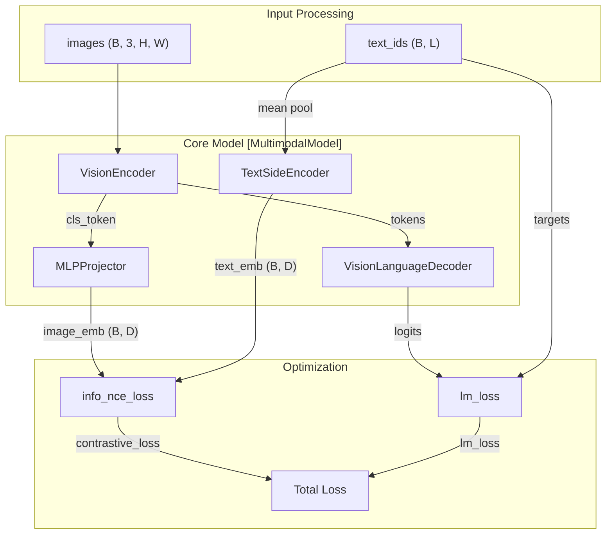
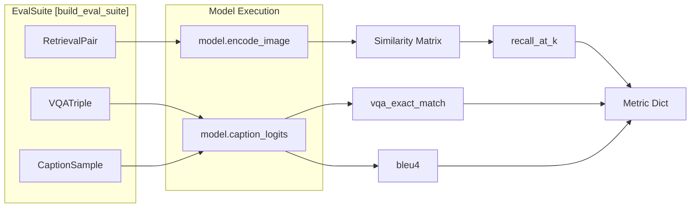

<!-- source: DeepWiki mcp.deepwiki.com · repo rohitg00/ai-engineering-from-scratch · page 13.2 Unified & Any-to-Any Multimodal Architectures · fetched 2026-10-30 -->

# Unified & Any-to-Any Multimodal Architectures

Relevant source files

The following files were used as context for generating this wiki page:

- [phases/19-capstone-projects/62-vision-language-pretraining/code/main.py](phases/19-capstone-projects/62-vision-language-pretraining/code/main.py)
- [phases/19-capstone-projects/62-vision-language-pretraining/code/test_main.py](phases/19-capstone-projects/62-vision-language-pretraining/code/test_main.py)
- [phases/19-capstone-projects/62-vision-language-pretraining/docs/en.md](phases/19-capstone-projects/62-vision-language-pretraining/docs/en.md)
- [phases/19-capstone-projects/62-vision-language-pretraining/quiz.json](phases/19-capstone-projects/62-vision-language-pretraining/quiz.json)
- [phases/19-capstone-projects/63-multimodal-eval/code/main.py](phases/19-capstone-projects/63-multimodal-eval/code/main.py)
- [phases/19-capstone-projects/63-multimodal-eval/code/test_main.py](phases/19-capstone-projects/63-multimodal-eval/code/test_main.py)
- [phases/19-capstone-projects/63-multimodal-eval/docs/en.md](phases/19-capstone-projects/63-multimodal-eval/docs/en.md)
- [phases/19-capstone-projects/63-multimodal-eval/quiz.json](phases/19-capstone-projects/63-multimodal-eval/quiz.json)

This page covers the architectural evolution of multimodal systems from discrete "bridge" models to unified, any-to-any streaming and generative architectures. It details the implementation of joint pretraining objectives, early-fusion tokenization, and the evaluation surfaces required to measure performance across retrieval, generation, and reasoning tasks.

## Multi-Objective Pretraining

Modern multimodal models, such as CoCa and BLIP, utilize a multi-task objective to learn both discriminative (ranking) and generative (captioning) capabilities in a single pass [phases/19-capstone-projects/62-vision-language-pretraining/docs/en.md:19-21](). This is achieved by combining **InfoNCE Contrastive Loss** with **Autoregressive Language Modeling (LM) Loss**.

### Loss Functions and Data Flow

1.  **InfoNCE Loss**: Treats matching image-text pairs as positives and all others in a batch as negatives [phases/19-capstone-projects/62-vision-language-pretraining/docs/en.md:21-22](). It operates on a similarity matrix $S = I T^T / \tau$, where $\tau$ is a learned temperature parameter [phases/19-capstone-projects/62-vision-language-pretraining/docs/en.md:45-47]().
2.  **LM Loss**: Standard next-token prediction conditioned on the visual features provided via cross-attention [phases/19-capstone-projects/62-vision-language-pretraining/docs/en.md:51-54]().
3.  **Unified Gradient**: The `total_loss` is a weighted sum: `contrastive + lm_weight * lm` [phases/19-capstone-projects/62-vision-language-pretraining/docs/en.md:57-58]().

### Unified Training Architecture
The following diagram illustrates the data flow within the `MultimodalModel` [phases/19-capstone-projects/62-vision-language-pretraining/code/main.py:130-161]() during a pretraining step.

**Multimodal Pretraining Pipeline**

**Sources:** [phases/19-capstone-projects/62-vision-language-pretraining/docs/en.md:25-41](), [phases/19-capstone-projects/62-vision-language-pretraining/code/main.py:170-189]()

## Evaluation Surfaces

Evaluating "Any-to-Any" models requires measuring three distinct capabilities: retrieval (ranking), visual question answering (VQA), and captioning (generation).

### Metric Implementations

| Metric | Code Entity | Implementation Detail |
| :--- | :--- | :--- |
| **Recall@K** | `recall_at_k` | Fraction of rows in the `(N, N)` similarity matrix where the diagonal index is in the top K [phases/19-capstone-projects/63-multimodal-eval/code/main.py:77-97](). |
| **VQA EM** | `vqa_exact_match` | Boolean equality check between predicted answer token and reference [phases/19-capstone-projects/63-multimodal-eval/code/main.py:100-106](). |
| **BLEU-4** | `bleu4` | Geometric mean of 1- to 4-gram precisions with a Brevity Penalty (BP) [phases/19-capstone-projects/63-multimodal-eval/code/main.py:122-170](). |

### Retrieval and Generation Evaluation
The `evaluate` function [phases/19-capstone-projects/63-multimodal-eval/code/main.py:213-247]() orchestrates these metrics by processing an `EvalSuite` [phases/19-capstone-projects/63-multimodal-eval/code/main.py:71-75]().

**Evaluation Data Flow**

**Sources:** [phases/19-capstone-projects/63-multimodal-eval/docs/en.md:29-40](), [phases/19-capstone-projects/63-multimodal-eval/code/main.py:213-247]()

## Advanced Unified Architectures

The curriculum covers several cutting-edge paradigms for multimodal unification:

### Early-Fusion & Discrete Diffusion
*   **Chameleon**: Uses a unified vocabulary where images are quantized into discrete tokens, allowing a single transformer to perform next-token prediction across modalities.
*   **Show-o**: Combines autoregressive modeling for text with discrete diffusion for image generation within a single transformer backbone.
*   **Transfusion**: Merges autoregressive language modeling with continuous diffusion (using a standard diffusion loss) for image patches.

### Decoupled & Omni Models
*   **Janus-Pro**: Decouples visual encoding for understanding and generation to avoid interference between the two tasks.
*   **MIO (Any-to-Any Streaming)**: Focuses on the temporal alignment of interleaved data for real-time streaming.
*   **Thinker-Talker (Omni)**: Implements native audio-language modeling, moving beyond Whisper-style modularity to a single unified "omni" state.

### Embodied & Vision-Native RAG
*   **OpenVLA & π0**: Vision-Language-Action models that map visual observations directly to robot control primitives.
*   **ColPali**: A vision-native RAG approach that uses late-interaction (ColBERT-style) on document patches rather than OCR-based text extraction.

**Sources:** [phases/19-capstone-projects/62-vision-language-pretraining/docs/en.md:89-96](), [phases/19-capstone-projects/63-multimodal-eval/docs/en.md:106-112]()

---

