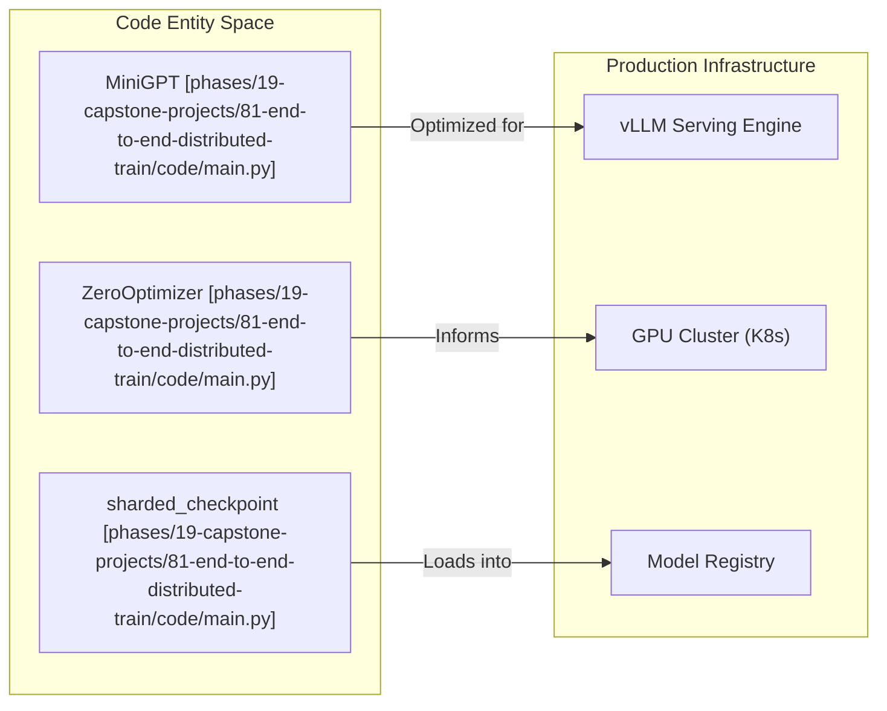
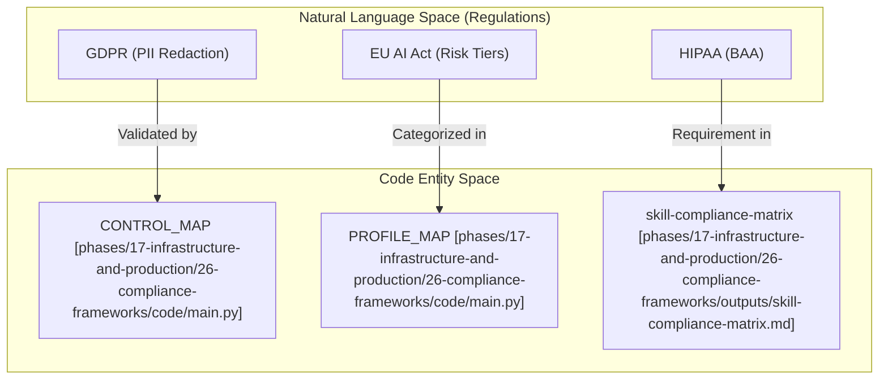

<!-- source: DeepWiki mcp.deepwiki.com · repo rohitg00/ai-engineering-from-scratch · page 14 Phase 17: Infrastructure & Production · fetched 2026-10-30 -->

# Phase 17: Infrastructure & Production

Relevant source files

The following files were used as context for generating this wiki page:

- [phases/17-infrastructure-and-production/26-compliance-frameworks/assets/frameworks.svg](phases/17-infrastructure-and-production/26-compliance-frameworks/assets/frameworks.svg)
- [phases/17-infrastructure-and-production/26-compliance-frameworks/code/main.py](phases/17-infrastructure-and-production/26-compliance-frameworks/code/main.py)
- [phases/17-infrastructure-and-production/26-compliance-frameworks/docs/en.md](phases/17-infrastructure-and-production/26-compliance-frameworks/docs/en.md)
- [phases/17-infrastructure-and-production/26-compliance-frameworks/notebook/.gitkeep](phases/17-infrastructure-and-production/26-compliance-frameworks/notebook/.gitkeep)
- [phases/17-infrastructure-and-production/26-compliance-frameworks/outputs/skill-compliance-matrix.md](phases/17-infrastructure-and-production/26-compliance-frameworks/outputs/skill-compliance-matrix.md)
- [phases/19-capstone-projects/81-end-to-end-distributed-train/code/main.py](phases/19-capstone-projects/81-end-to-end-distributed-train/code/main.py)
- [phases/19-capstone-projects/81-end-to-end-distributed-train/docs/en.md](phases/19-capstone-projects/81-end-to-end-distributed-train/docs/en.md)
- [phases/19-capstone-projects/81-end-to-end-distributed-train/quiz.json](phases/19-capstone-projects/81-end-to-end-distributed-train/quiz.json)
- [phases/19-capstone-projects/81-end-to-end-distributed-train/tests/test_e2e.py](phases/19-capstone-projects/81-end-to-end-distributed-train/tests/test_e2e.py)

Phase 17 covers the transition of AI models from experimental notebooks to scalable, resilient, and compliant production environments. This 28-lesson phase focuses on the "last mile" of AI engineering: optimizing inference performance, managing GPU clusters, implementing observability, and navigating the complex landscape of global AI regulations.

## LLM Serving & Inference Optimization

This section addresses the technical challenges of deploying LLMs at scale. It covers the mechanics of modern inference engines like vLLM and SGLang, as well as the hardware-level optimizations required for high-throughput serving.

Key topics include:
*   **Managed Platforms & Economics:** Evaluating the cost-efficiency of inference platforms and GPU providers.
*   **Inference Architectures:** Implementing disaggregated prefill-decode architectures and speculative decoding (e.g., EAGLE3).
*   **Optimization Techniques:** Utilizing RadixAttention in SGLang, TensorRT-LLM for Blackwell architectures, and production-grade quantization.
*   **Scaling & Locality:** Managing multi-region KV cache locality and cold-start mitigation in Kubernetes-based GPU autoscaling.

For details, see [LLM Serving & Inference Optimization](#14.1).

### Infrastructure Component Mapping
The following diagram bridges the conceptual serving infrastructure to the code entities and patterns explored in the curriculum, specifically highlighting the transition from distributed training primitives to production serving.

Sources: [phases/19-capstone-projects/81-end-to-end-distributed-train/code/main.py:1-118](), [phases/19-capstone-projects/81-end-to-end-distributed-train/docs/en.md:88-96]()

## Production Operations, Observability & FinOps

Shipping a model is only the beginning. This section focuses on the operational excellence required to maintain AI systems in the wild, ensuring they are observable, secure, and cost-effective.

Key topics include:
*   **Observability:** Implementing traces, metrics, and dashboards specifically for LLM behavior and "goodput" metrics.
*   **Traffic Management:** Deploying AI gateways for model routing, shadow deployments, and A/B testing LLM features.
*   **FinOps:** Tracking costs via semantic caching and batch APIs to optimize token spend.
*   **Compliance & Safety:** Navigating the **EU AI Act**, **SOC 2 Type II**, and **HIPAA** frameworks. This includes implementing real-time PII redaction at the inference layer.

For details, see [Production Operations, Observability & FinOps](#14.2).

### Compliance & Governance Mapping
This diagram maps the regulatory requirements to the programmatic checks and data structures defined in the `compliance-frameworks` toolkit.

Sources: [phases/17-infrastructure-and-production/26-compliance-frameworks/code/main.py:10-32](), [phases/17-infrastructure-and-production/26-compliance-frameworks/outputs/skill-compliance-matrix.md:1-32]()

## Key Compliance Metrics & Frameworks

The production phase emphasizes that compliance is a technical constraint, not just a legal one. The following table summarizes the primary frameworks covered:

| Framework | Primary Enforcement | Key Requirement |
| :--- | :--- | :--- |
| **EU AI Act** | August 2, 2026 | Risk tier classification and conformity assessments [phases/17-infrastructure-and-production/26-compliance-frameworks/docs/en.md:37-48]() |
| **GDPR** | Active | Real-time PII redaction; post-processing is insufficient [phases/17-infrastructure-and-production/26-compliance-frameworks/docs/en.md:48-57]() |
| **SOC 2 Type II** | 6-12 month audit | Evidence of operated controls (access logs, change mgmt) [phases/17-infrastructure-and-production/26-compliance-frameworks/docs/en.md:62-70]() |
| **HIPAA** | Active | Signed Business Associate Agreement (BAA) for PHI [phases/17-infrastructure-and-production/26-compliance-frameworks/docs/en.md:58-61]() |

Sources: [phases/17-infrastructure-and-production/26-compliance-frameworks/docs/en.md:25-36](), [phases/17-infrastructure-and-production/26-compliance-frameworks/code/main.py:10-32]()

## Toolkit Artifacts
Phase 17 generates several critical artifacts for the `outputs/` directory:
*   `skill-compliance-matrix.md`: A tool for generating required-framework matrices based on customer profiles [phases/17-infrastructure-and-production/26-compliance-frameworks/outputs/skill-compliance-matrix.md:1-8]().
*   `ProductionLLMService`: (Planned) A reference implementation for a production-ready streaming service with fallback chains.

Sources: [phases/17-infrastructure-and-production/26-compliance-frameworks/outputs/skill-compliance-matrix.md:1-8]()

---

