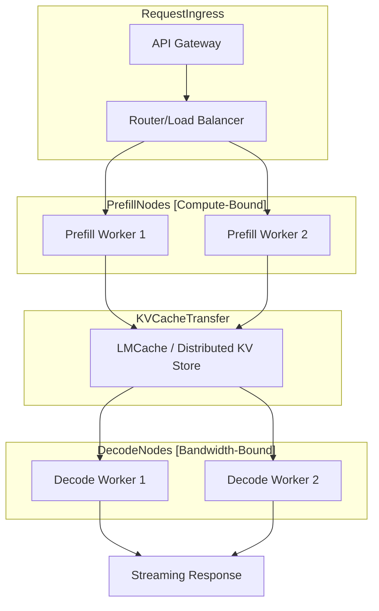
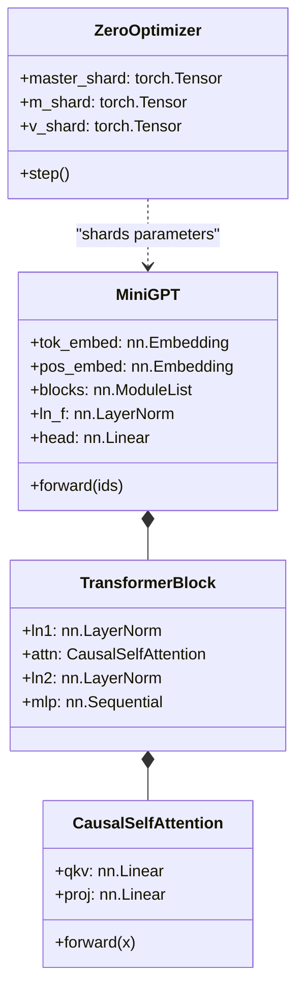

<!-- source: DeepWiki mcp.deepwiki.com · repo rohitg00/ai-engineering-from-scratch · page 14.1 LLM Serving & Inference Optimization · fetched 2026-10-30 -->

# LLM Serving & Inference Optimization

Relevant source files

The following files were used as context for generating this wiki page:

- [phases/17-infrastructure-and-production/26-compliance-frameworks/assets/frameworks.svg](phases/17-infrastructure-and-production/26-compliance-frameworks/assets/frameworks.svg)
- [phases/17-infrastructure-and-production/26-compliance-frameworks/code/main.py](phases/17-infrastructure-and-production/26-compliance-frameworks/code/main.py)
- [phases/17-infrastructure-and-production/26-compliance-frameworks/docs/en.md](phases/17-infrastructure-and-production/26-compliance-frameworks/docs/en.md)
- [phases/17-infrastructure-and-production/26-compliance-frameworks/notebook/.gitkeep](phases/17-infrastructure-and-production/26-compliance-frameworks/notebook/.gitkeep)
- [phases/17-infrastructure-and-production/26-compliance-frameworks/outputs/skill-compliance-matrix.md](phases/17-infrastructure-and-production/26-compliance-frameworks/outputs/skill-compliance-matrix.md)
- [phases/19-capstone-projects/81-end-to-end-distributed-train/code/main.py](phases/19-capstone-projects/81-end-to-end-distributed-train/code/main.py)
- [phases/19-capstone-projects/81-end-to-end-distributed-train/docs/en.md](phases/19-capstone-projects/81-end-to-end-distributed-train/docs/en.md)
- [phases/19-capstone-projects/81-end-to-end-distributed-train/quiz.json](phases/19-capstone-projects/81-end-to-end-distributed-train/quiz.json)
- [phases/19-capstone-projects/81-end-to-end-distributed-train/tests/test_e2e.py](phases/19-capstone-projects/81-end-to-end-distributed-train/tests/test_e2e.py)

This section covers the infrastructure and architectural patterns required to deploy Large Language Models (LLMs) at scale. It details the transition from single-node execution to distributed, high-throughput serving systems, focusing on inference platform economics, GPU orchestration, and specialized optimizations like speculative decoding and disaggregated architectures.

## High-Level Serving Architecture

Modern LLM serving has evolved from simple model-wrapping APIs to complex systems that separate the two distinct phases of transformer inference: **Prefill** (processing input tokens) and **Decode** (generating output tokens one-by-one).

### Disaggregated Prefill-Decode Architecture
The disaggregated architecture separates compute resources based on their performance characteristics. Prefill is compute-bound (benefiting from high TFLOPS), while Decode is memory-bandwidth bound (benefiting from high HBM bandwidth).

**Sources:**
- [phases/17-infrastructure-and-production/26-compliance-frameworks/docs/en.md:1-10]() (Context on production standards)
- [phases/19-capstone-projects/81-end-to-end-distributed-train/docs/en.md:25-33]() (Diagram logic for distributed coordination)

---

## Inference Optimization Techniques

Optimizing LLM inference requires addressing the "Memory Wall" and the sequential nature of autoregressive decoding.

### 1. vLLM & PagedAttention
vLLM introduced **PagedAttention**, which manages the Key-Value (KV) cache as non-contiguous blocks, similar to virtual memory in operating systems. This eliminates internal fragmentation and allows for efficient memory sharing during parallel sampling or beam search.

### 2. Speculative Decoding (EAGLE-3)
Speculative decoding uses a smaller, faster "draft model" to predict multiple future tokens, which the larger "target model" then verifies in a single forward pass. EAGLE-3 improves this by using feature-level speculation rather than token-level, significantly increasing the acceptance rate.

### 3. SGLang & RadixAttention
SGLang implements **RadixAttention**, a mechanism that treats the KV cache as a radix tree. This allows for prefix caching across different requests—if multiple users share the same system prompt, the KV cache for that prompt is computed once and reused, drastically reducing prefill time.

### 4. Quantization (FP8, INT4, NF4)
Production quantization reduces model precision to fit larger models on fewer GPUs or increase throughput.
*   **FP8:** Supported natively on Blackwell/H100, maintaining high accuracy with reduced memory.
*   **NF4 (NormalFloat 4):** Optimized for LoRA fine-tuning and inference [phases/19-capstone-projects/81-end-to-end-distributed-train/code/main.py:124-124]().

---

## Distributed Training & Serving Composition

Inference at scale often borrows primitives from distributed training, such as sharding and collective operations. The `ZeroOptimizer` pattern, while primarily for training, informs how model weights are partitioned across inference nodes to handle models that exceed a single GPU's memory.

### Distributed GPT Implementation
The codebase demonstrates a `MiniGPT` architecture [phases/19-capstone-projects/81-end-to-end-distributed-train/code/main.py:95-116]() designed to be trained and served across multiple ranks using `DDP` (Distributed Data Parallel) and `ZeRO-1` (Zero Redundancy Optimizer).

**Sources:**
- [phases/19-capstone-projects/81-end-to-end-distributed-train/code/main.py:51-74]() (CausalSelfAttention definition)
- [phases/19-capstone-projects/81-end-to-end-distributed-train/code/main.py:77-92]() (TransformerBlock definition)
- [phases/19-capstone-projects/81-end-to-end-distributed-train/code/main.py:95-116]() (MiniGPT definition)
- [phases/19-capstone-projects/81-end-to-end-distributed-train/code/main.py:145-194]() (ZeroOptimizer implementation)

---

## Production Metrics & Invariants

Shipping LLMs requires moving beyond simple "accuracy" to system-level metrics, often referred to as "Goodput."

| Metric | Definition | Production Target |
| :--- | :--- | :--- |
| **TTFT** | Time to First Token (Latency of Prefill) | < 200ms |
| **TPOT** | Time per Output Token (Decode Latency) | < 50ms |
| **Goodput** | Successful tokens generated per second | Maximize per $ cost |
| **KV Locality** | Percentage of KV cache hits in multi-region | > 80% |

### System Invariants
When deploying distributed serving stacks, the following invariants must be verified:
1.  **Parameter Norm Sync:** Every rank must hold the same parameter norm after a synchronization step [phases/19-capstone-projects/81-end-to-end-distributed-train/tests/test_e2e.py:37-42]().
2.  **Memory Sharding Formula:** Optimizer memory should strictly follow the ZeRO formula ($12P/N$ bytes) [phases/19-capstone-projects/81-end-to-end-distributed-train/tests/test_e2e.py:44-50]().
3.  **Deterministic Resumption:** Sharded checkpoints must reload byte-equal to ensure serving consistency [phases/19-capstone-projects/81-end-to-end-distributed-train/tests/test_e2e.py:52-54]().

**Sources:**
- [phases/19-capstone-projects/81-end-to-end-distributed-train/docs/en.md:17-22]() (Problem definition and invariants)
- [phases/19-capstone-projects/81-end-to-end-distributed-train/tests/test_e2e.py:37-54]() (Invariant test implementations)

---

## Compliance & Governance in Serving

Serving LLMs in production involves strict adherence to regional and industry frameworks. This is not just a policy issue but a technical one (e.g., real-time PII redaction).

### Compliance Framework Matrix
A `CONTROL_MAP` [phases/17-infrastructure-and-production/26-compliance-frameworks/code/main.py:10-21]() defines how technical controls map to regulatory requirements:

| Technical Control | Satisfied Frameworks |
| :--- | :--- |
| **Access Logging** | ISO 27001, GDPR Art. 32, HIPAA, SOC 2 |
| **Inference-time Redaction** | GDPR Art. 25, EU AI Act Art. 10 |
| **Secrets Management** | PCI DSS Req. 8, SOC 2 CC6.1 |

### EU AI Act Timeline
Infrastructure must be prepared for the **EU AI Act** enforcement:
*   **August 1, 2024:** In force.
*   **August 2, 2026:** High-risk system enforcement (requires conformity assessments and logging) [phases/17-infrastructure-and-production/26-compliance-frameworks/docs/en.md:37-43]().

**Sources:**
- [phases/17-infrastructure-and-production/26-compliance-frameworks/code/main.py:10-32]() (Compliance mapping code)
- [phases/17-infrastructure-and-production/26-compliance-frameworks/docs/en.md:25-35]() (Framework descriptions)
- [phases/17-infrastructure-and-production/26-compliance-frameworks/outputs/skill-compliance-matrix.md:1-32]() (Compliance matrix skill)

---

