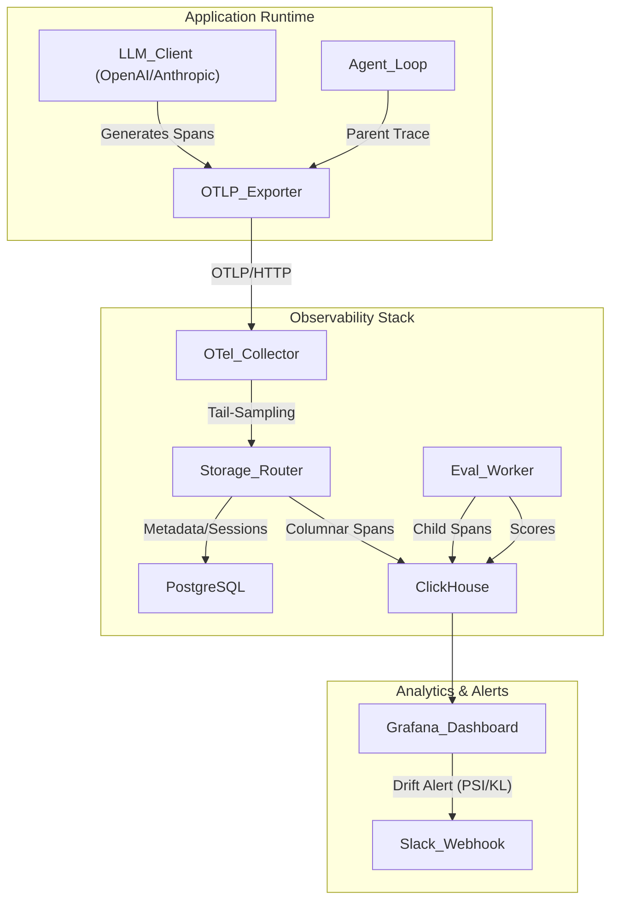
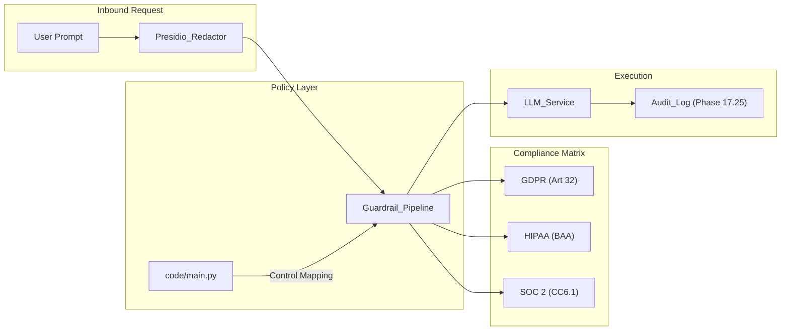

<!-- source: DeepWiki mcp.deepwiki.com · repo rohitg00/ai-engineering-from-scratch · page 14.2 Production Operations, Observability & FinOps · fetched 2026-10-30 -->

# Production Operations, Observability & FinOps

Relevant source files

The following files were used as context for generating this wiki page:

- [phases/17-infrastructure-and-production/26-compliance-frameworks/assets/frameworks.svg](phases/17-infrastructure-and-production/26-compliance-frameworks/assets/frameworks.svg)
- [phases/17-infrastructure-and-production/26-compliance-frameworks/code/main.py](phases/17-infrastructure-and-production/26-compliance-frameworks/code/main.py)
- [phases/17-infrastructure-and-production/26-compliance-frameworks/docs/en.md](phases/17-infrastructure-and-production/26-compliance-frameworks/docs/en.md)
- [phases/17-infrastructure-and-production/26-compliance-frameworks/notebook/.gitkeep](phases/17-infrastructure-and-production/26-compliance-frameworks/notebook/.gitkeep)
- [phases/17-infrastructure-and-production/26-compliance-frameworks/outputs/skill-compliance-matrix.md](phases/17-infrastructure-and-production/26-compliance-frameworks/outputs/skill-compliance-matrix.md)
- [phases/19-capstone-projects/01-terminal-native-coding-agent/quiz.json](phases/19-capstone-projects/01-terminal-native-coding-agent/quiz.json)
- [phases/19-capstone-projects/02-rag-over-codebase/quiz.json](phases/19-capstone-projects/02-rag-over-codebase/quiz.json)
- [phases/19-capstone-projects/03-realtime-voice-assistant/quiz.json](phases/19-capstone-projects/03-realtime-voice-assistant/quiz.json)
- [phases/19-capstone-projects/04-multimodal-document-qa/quiz.json](phases/19-capstone-projects/04-multimodal-document-qa/quiz.json)
- [phases/19-capstone-projects/05-autonomous-research-agent/quiz.json](phases/19-capstone-projects/05-autonomous-research-agent/quiz.json)
- [phases/19-capstone-projects/06-devops-troubleshooting-agent/quiz.json](phases/19-capstone-projects/06-devops-troubleshooting-agent/quiz.json)
- [phases/19-capstone-projects/07-end-to-end-fine-tuning-pipeline/quiz.json](phases/19-capstone-projects/07-end-to-end-fine-tuning-pipeline/quiz.json)
- [phases/19-capstone-projects/08-production-rag-chatbot/quiz.json](phases/19-capstone-projects/08-production-rag-chatbot/quiz.json)
- [phases/19-capstone-projects/09-code-migration-agent/quiz.json](phases/19-capstone-projects/09-code-migration-agent/quiz.json)
- [phases/19-capstone-projects/10-multi-agent-software-team/quiz.json](phases/19-capstone-projects/10-multi-agent-software-team/quiz.json)
- [phases/19-capstone-projects/11-llm-observability-dashboard/quiz.json](phases/19-capstone-projects/11-llm-observability-dashboard/quiz.json)

The final stage of the AI engineering lifecycle transitions from model development to sustainable production operations. This phase covers the infrastructure required to monitor, secure, and scale LLM applications while maintaining compliance and cost efficiency. It bridges the gap between raw inference and enterprise-grade service delivery through observability stacks, automated deployment strategies, and rigorous FinOps disciplines.

## LLM Observability & Tracing

Standard APM (Application Performance Monitoring) is insufficient for LLM applications due to the non-deterministic nature of model outputs and the complexity of multi-step chains. Modern LLM observability converges on the **OpenTelemetry GenAI semantic conventions** [phases/19-capstone-projects/11-llm-observability-dashboard/quiz.json:7-11]().

### Data Flow & Storage Architecture
Production observability requires a bifurcated storage strategy to handle both high-volume telemetry and application state.
*   **ClickHouse**: Utilized for columnar analytics over spans and traces [phases/19-capstone-projects/11-llm-observability-dashboard/quiz.json:19-28](). Eval results are written as child spans directly into ClickHouse to link scores to the original LLM call [phases/19-capstone-projects/11-llm-observability-dashboard/quiz.json:79-88]().
*   **PostgreSQL**: Stores relational metadata including users, sessions, and application configuration [phases/19-capstone-projects/11-llm-observability-dashboard/quiz.json:19-28]().

### Trace Lifecycle
1.  **Ingestion**: Spans are produced by SDKs (OpenAI, Anthropic, vLLM, etc.) using OTLP HTTP [phases/19-capstone-projects/11-llm-observability-dashboard/quiz.json:67-76]().
2.  **Tail-Sampling**: An OpenTelemetry Collector processor decides which traces to keep (e.g., keeping all errors while sampling only a fraction of successful traces) [phases/19-capstone-projects/11-llm-observability-dashboard/quiz.json:30-40]().
3.  **Analysis**: The system computes drift using PSI (Population Stability Index) or KL divergence on pooled prompt embeddings to detect week-over-week performance degradation [phases/19-capstone-projects/11-llm-observability-dashboard/quiz.json:41-52]().

**Sources:** [phases/19-capstone-projects/11-llm-observability-dashboard/quiz.json:1-90]()

## Deployment Strategies & SRE for AI

Reliable AI deployment utilizes progressive delivery patterns to mitigate the risk of model regression or hallucination spikes.

### Deployment Patterns
*   **Shadow Deployments**: Running a new model version in parallel with production, processing real traffic but discarding outputs to compare performance without user impact.
*   **Canary/Progressive Rollouts**: Gradually shifting traffic to a new model while monitoring "Goodput" and error rates.
*   **A/B Testing**: Comparing two different prompts or model versions (e.g., GPT-4o vs. Claude 3.5 Sonnet) against business KPIs.

### Verification Gates
Production pipelines include automated gates to prevent regressions:
*   **Correctness Rubrics**: Deliverables are gated by golden sets (e.g., 200 expert-labeled Q&A pairs) [phases/19-capstone-projects/08-production-rag-chatbot/quiz.json:65-75]().
*   **Coverage Gates**: In code migration agents, if test coverage drops more than ~2%, the deployment is automatically halted and classified as a `coverage_regression` [phases/19-capstone-projects/09-code-migration-agent/quiz.json:42-51]().
*   **Audit Logs**: Recording not just executed commands, but also those the agent *considered*, allows SREs to catch "near-miss" destructive actions [phases/19-capstone-projects/06-devops-troubleshooting-agent/quiz.json:41-52]().

**Sources:** [phases/19-capstone-projects/08-production-rag-chatbot/quiz.json:1-90](), [phases/19-capstone-projects/09-code-migration-agent/quiz.json:1-90](), [phases/19-capstone-projects/06-devops-troubleshooting-agent/quiz.json:1-90]()

## FinOps & Cost Optimization

Managing LLM costs requires moving beyond simple token counting to active cache management and budget enforcement.

### Prompt Semantic Caching
Semantic caching significantly reduces costs in regulated domains where system prompts and policies are stable.
*   **Prefix Discounting**: By using prompt caching, stable prefixes (system prompts, static policies) can cut per-query costs by 3-5x at 60-80% hit rates [phases/19-capstone-projects/08-production-rag-chatbot/quiz.json:5-15]().
*   **Request Structure**: The cache header contains static policies, while the uncached suffix contains the specific user question [phases/19-capstone-projects/08-production-rag-chatbot/quiz.json:17-28]().

### Budget Discipline
Agents must operate within strict financial and temporal envelopes:
*   **Hard Budgets**: Capstone projects enforce hard limits (e.g., $30 per research paper or $8 per code migration) [phases/19-capstone-projects/05-autonomous-research-agent/quiz.json:53-64](), [phases/19-capstone-projects/09-code-migration-agent/quiz.json:29-40]().
*   **Context Compaction**: To prevent runaway costs in long-running agent sessions, the `PreCompact` hook summarizes older turns once a token threshold (e.g., 150k tokens) is hit [phases/19-capstone-projects/01-terminal-native-coding-agent/quiz.json:53-64]().

**Sources:** [phases/19-capstone-projects/08-production-rag-chatbot/quiz.json:1-90](), [phases/19-capstone-projects/05-autonomous-research-agent/quiz.json:1-90](), [phases/19-capstone-projects/01-terminal-native-coding-agent/quiz.json:1-90]()

## Compliance & Security

Enterprise AI deployment requires navigating a complex matrix of global regulations and security standards.

### Compliance Frameworks (2026 Standard)
| Framework | Scope | Key LLM Requirement |
| :--- | :--- | :--- |
| **EU AI Act** | EU Users | Risk classification; high-risk systems require conformity assessments [phases/17-infrastructure-and-production/26-compliance-frameworks/docs/en.md:33](). |
| **GDPR** | EU Users | Real-time PII redaction at the inference layer is the defensible standard [phases/17-infrastructure-and-production/26-compliance-frameworks/docs/en.md:14-15](). |
| **HIPAA** | US Healthcare | Requires a signed Business Associate Agreement (BAA) before sending PHI [phases/17-infrastructure-and-production/26-compliance-frameworks/docs/en.md:30](). |
| **SOC 2 Type II** | B2B SaaS | Requires 6-12 months of audited operational controls [phases/17-infrastructure-and-production/26-compliance-frameworks/docs/en.md:29](). |

### Security Controls
*   **Real-time Redaction**: Post-processing PII cleanup is insufficient for GDPR; redaction must occur *before* the LLM call using entity recognition [phases/17-infrastructure-and-production/26-compliance-frameworks/docs/en.md:48-55]().
*   **RBAC Surface**: Troubleshooting agents should be read-only by default, with destructive verbs gated behind human approval tokens [phases/19-capstone-projects/06-devops-troubleshooting-agent/quiz.json:5-16]().
*   **Sandbox Isolation**: Experimentation agents are confined to sandboxes with `--network=none` to prevent data exfiltration [phases/19-capstone-projects/05-autonomous-research-agent/quiz.json:17-27]().

**Sources:** [phases/17-infrastructure-and-production/26-compliance-frameworks/docs/en.md:1-105](), [phases/19-capstone-projects/06-devops-troubleshooting-agent/quiz.json:1-90](), [phases/19-capstone-projects/05-autonomous-research-agent/quiz.json:1-90]()

## System Architecture Diagrams

### Observability & Evaluation Pipeline
This diagram maps the flow of telemetry from code entities to the analytics tier.

**Sources:** [phases/19-capstone-projects/11-llm-observability-dashboard/quiz.json:1-90](), [phases/19-capstone-projects/08-production-rag-chatbot/quiz.json:53-64]()

### Compliance Mapping & Enforcement
This diagram shows how policy code (`main.py`) and infrastructure gates enforce compliance.

**Sources:** [phases/17-infrastructure-and-production/26-compliance-frameworks/docs/en.md:1-105](), [phases/17-infrastructure-and-production/26-compliance-frameworks/code/main.py:1-10]()

## Skill-Compliance-Matrix Output
The `skill-compliance-matrix.md` artifact provides a mapping of technical controls to regulatory requirements, enabling automated audit preparation.

| Control | Implementation Entity | Frameworks |
| :--- | :--- | :--- |
| **Access Logging** | `ProductionLLMService` | ISO 27001, GDPR Art. 32, HIPAA |
| **PII Redaction** | `Presidio_Redactor` | GDPR, EU AI Act |
| **Change Management** | CI/CD + `Lesson_Contract` | SOC 2 Type II, PCI DSS |
| **Secrets Management** | `Secrets_Manager` | ISO 27001, SOC 2 CC6.1 |

**Sources:** [phases/17-infrastructure-and-production/26-compliance-frameworks/docs/en.md:71-81](), [phases/17-infrastructure-and-production/26-compliance-frameworks/outputs/skill-compliance-matrix.md]()

---

