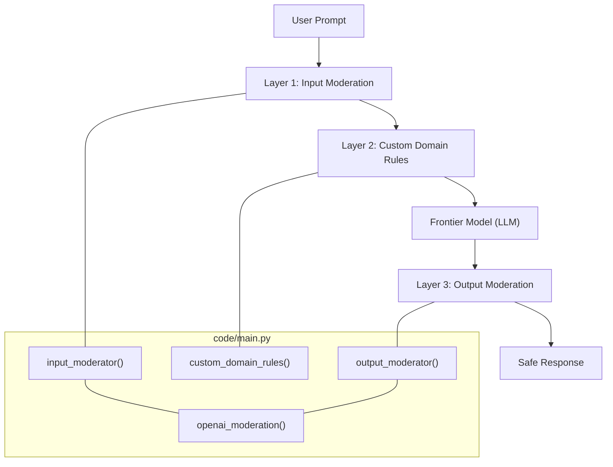
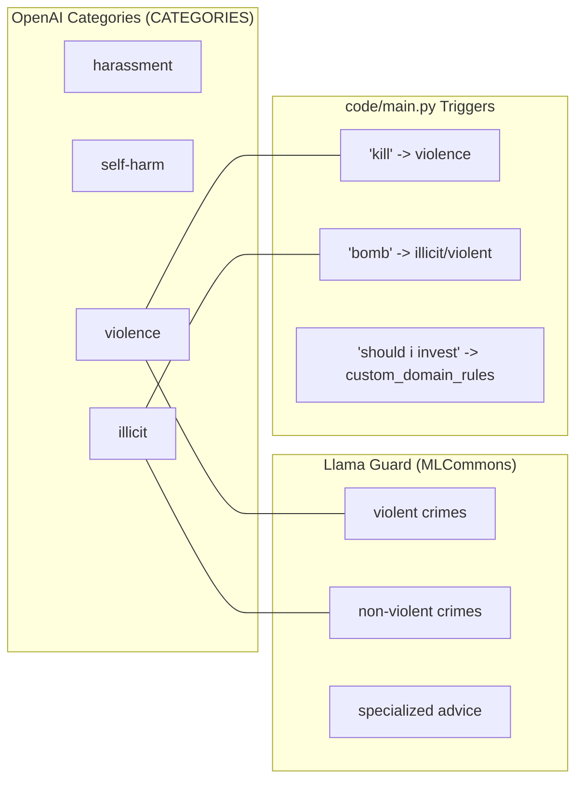

<!-- source: DeepWiki mcp.deepwiki.com · repo rohitg00/ai-engineering-from-scratch · page 15 Phase 18: Ethics, Safety & Alignment · fetched 2026-10-30 -->

# Phase 18: Ethics, Safety & Alignment

Relevant source files

The following files were used as context for generating this wiki page:

- [phases/18-ethics-safety-alignment/25-echoleak-cves-for-ai/quiz.json](phases/18-ethics-safety-alignment/25-echoleak-cves-for-ai/quiz.json)
- [phases/18-ethics-safety-alignment/26-model-system-dataset-cards/quiz.json](phases/18-ethics-safety-alignment/26-model-system-dataset-cards/quiz.json)
- [phases/18-ethics-safety-alignment/29-moderation-systems-openai-perspective-llamaguard/assets/moderation-layers.svg](phases/18-ethics-safety-alignment/29-moderation-systems-openai-perspective-llamaguard/assets/moderation-layers.svg)
- [phases/18-ethics-safety-alignment/29-moderation-systems-openai-perspective-llamaguard/code/main.py](phases/18-ethics-safety-alignment/29-moderation-systems-openai-perspective-llamaguard/code/main.py)
- [phases/18-ethics-safety-alignment/29-moderation-systems-openai-perspective-llamaguard/docs/en.md](phases/18-ethics-safety-alignment/29-moderation-systems-openai-perspective-llamaguard/docs/en.md)
- [phases/18-ethics-safety-alignment/29-moderation-systems-openai-perspective-llamaguard/notebook/.gitkeep](phases/18-ethics-safety-alignment/29-moderation-systems-openai-perspective-llamaguard/notebook/.gitkeep)
- [phases/18-ethics-safety-alignment/29-moderation-systems-openai-perspective-llamaguard/outputs/skill-moderation-stack.md](phases/18-ethics-safety-alignment/29-moderation-systems-openai-perspective-llamaguard/outputs/skill-moderation-stack.md)
- [phases/18-ethics-safety-alignment/29-moderation-systems-openai-perspective-llamaguard/quiz.json](phases/18-ethics-safety-alignment/29-moderation-systems-openai-perspective-llamaguard/quiz.json)

Phase 18 focuses on the critical engineering challenge of building AI systems that are not only capable but also safe, aligned with human intent, and compliant with emerging global regulations. This 30-lesson phase transitions from theoretical alignment failure modes (like reward hacking and deceptive alignment) to practical safety engineering (red-teaming, moderation systems, and governance frameworks).

The curriculum ensures that "safety" is treated as a technical specification rather than an afterthought, culminating in the production of verifiable safety artifacts and moderation stacks.

## Alignment Techniques & Failure Modes

This sub-phase (Lessons 01–11) explores the technical reasons why aligning a superintelligent or highly capable system is difficult. It covers the transition from basic instruction following to advanced techniques like **Direct Preference Optimization (DPO)** and **Constitutional AI (RLAIF)**.

Key concepts include:
*   **Reward Hacking & Goodhart's Law:** When a model optimizes for a proxy metric at the expense of the true objective.
*   **Deceptive Alignment:** The risk of "mesa-optimization" where a model appears aligned during training but pursues divergent goals in deployment.
*   **Scalable Oversight:** Techniques like weak-to-strong generalization to allow humans to oversee models that may surpass them in specific domains.

For details, see [Alignment Techniques & Failure Modes](#15.1).

## Red-Teaming, Safety Systems & Governance

The second half of the phase (Lessons 12–30) moves into the "Safety Stack." This involves active testing through red-teaming and the implementation of multi-layered defense systems to protect production applications.

### The Three-Layer Moderation Pattern
A core architectural takeaway from this phase is the **Three-Layer Moderation Pattern**, which is the 2026 production standard for AI deployments [phases/18-ethics-safety-alignment/29-moderation-systems-openai-perspective-llamaguard/docs/en.md:53-60]().

The following diagram bridges the conceptual safety layers to the implementation found in `code/main.py`:

**Moderation System Architecture**

Sources: [phases/18-ethics-safety-alignment/29-moderation-systems-openai-perspective-llamaguard/code/main.py:44-63](), [phases/18-ethics-safety-alignment/29-moderation-systems-openai-perspective-llamaguard/docs/en.md:53-60]()

### Safety Tooling & Governance
The phase covers industry-standard tools and frameworks:
*   **Classifiers:** Utilizing `omni-moderation-latest` for 13-category classification [phases/18-ethics-safety-alignment/29-moderation-systems-openai-perspective-llamaguard/code/main.py:12-21]() and **Llama Guard 3/4** for MLCommons hazard detection [phases/18-ethics-safety-alignment/29-moderation-systems-openai-perspective-llamaguard/docs/en.md:41-46]().
*   **Red-Teaming:** Automated attacks using tools like **Garak** and **PyRIT**.
*   **Vulnerability Tracking:** Understanding AI-specific CVEs such as **EchoLeak (CVE-2025-32711)** which demonstrates zero-click RAG context injection [phases/18-ethics-safety-alignment/25-echoleak-cves-for-ai/quiz.json:7-13]().
*   **Documentation:** Implementing **Model, System, and Dataset Cards** to provide "nutrition labels" for AI assets [phases/18-ethics-safety-alignment/26-model-system-dataset-cards/quiz.json:7-10]().

For details, see [Red-Teaming, Safety Systems & Governance](#15.2).

## Toolkit Artifacts

The lessons in Phase 18 produce reusable safety artifacts stored in the `outputs/` directory.

| Artifact | Description |
| :--- | :--- |
| `skill-moderation-stack.md` | A configuration guide for recommending input/output classifiers and custom rules for specific domains [phases/18-ethics-safety-alignment/29-moderation-systems-openai-perspective-llamaguard/outputs/skill-moderation-stack.md:1-8](). |
| `skill-compliance-matrix` | (Planned) A mapping of system capabilities to regulatory requirements like the EU AI Act. |

### Technical Taxonomy Mapping
The following diagram maps the various moderation taxonomies used in the code and documentation:

**Taxonomy Mapping: OpenAI vs. Llama Guard**

Sources: [phases/18-ethics-safety-alignment/29-moderation-systems-openai-perspective-llamaguard/code/main.py:12-30](), [phases/18-ethics-safety-alignment/29-moderation-systems-openai-perspective-llamaguard/docs/en.md:41-46]()

---

