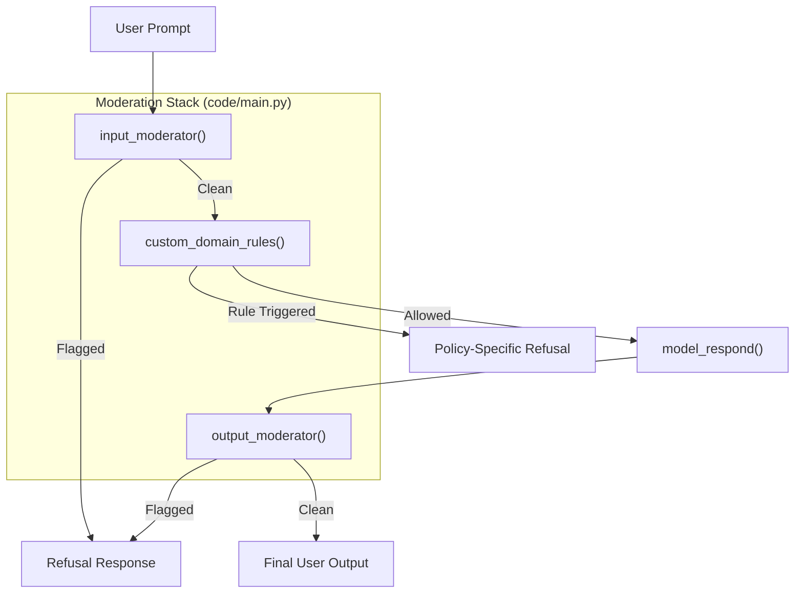
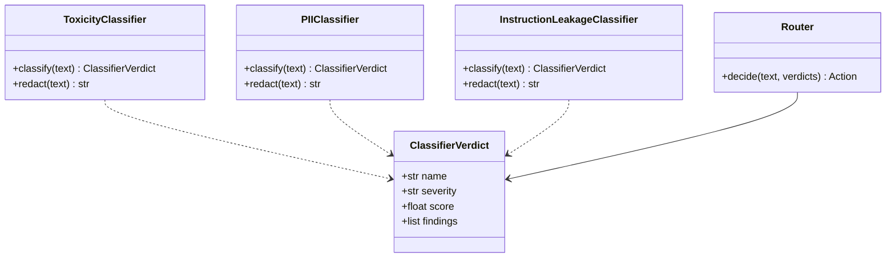

<!-- source: DeepWiki mcp.deepwiki.com · repo rohitg00/ai-engineering-from-scratch · page 15.2 Red-Teaming, Safety Systems & Governance · fetched 2026-10-30 -->

# Red-Teaming, Safety Systems & Governance

Relevant source files

The following files were used as context for generating this wiki page:

- [phases/18-ethics-safety-alignment/25-echoleak-cves-for-ai/quiz.json](phases/18-ethics-safety-alignment/25-echoleak-cves-for-ai/quiz.json)
- [phases/18-ethics-safety-alignment/26-model-system-dataset-cards/quiz.json](phases/18-ethics-safety-alignment/26-model-system-dataset-cards/quiz.json)
- [phases/18-ethics-safety-alignment/29-moderation-systems-openai-perspective-llamaguard/assets/moderation-layers.svg](phases/18-ethics-safety-alignment/29-moderation-systems-openai-perspective-llamaguard/assets/moderation-layers.svg)
- [phases/18-ethics-safety-alignment/29-moderation-systems-openai-perspective-llamaguard/code/main.py](phases/18-ethics-safety-alignment/29-moderation-systems-openai-perspective-llamaguard/code/main.py)
- [phases/18-ethics-safety-alignment/29-moderation-systems-openai-perspective-llamaguard/docs/en.md](phases/18-ethics-safety-alignment/29-moderation-systems-openai-perspective-llamaguard/docs/en.md)
- [phases/18-ethics-safety-alignment/29-moderation-systems-openai-perspective-llamaguard/notebook/.gitkeep](phases/18-ethics-safety-alignment/29-moderation-systems-openai-perspective-llamaguard/notebook/.gitkeep)
- [phases/18-ethics-safety-alignment/29-moderation-systems-openai-perspective-llamaguard/outputs/skill-moderation-stack.md](phases/18-ethics-safety-alignment/29-moderation-systems-openai-perspective-llamaguard/outputs/skill-moderation-stack.md)
- [phases/18-ethics-safety-alignment/29-moderation-systems-openai-perspective-llamaguard/quiz.json](phases/18-ethics-safety-alignment/29-moderation-systems-openai-perspective-llamaguard/quiz.json)
- [phases/19-capstone-projects/83-prompt-injection-detector/code/benign.py](phases/19-capstone-projects/83-prompt-injection-detector/code/benign.py)
- [phases/19-capstone-projects/83-prompt-injection-detector/code/main.py](phases/19-capstone-projects/83-prompt-injection-detector/code/main.py)
- [phases/19-capstone-projects/83-prompt-injection-detector/code/rules.py](phases/19-capstone-projects/83-prompt-injection-detector/code/rules.py)
- [phases/19-capstone-projects/83-prompt-injection-detector/code/tests.py](phases/19-capstone-projects/83-prompt-injection-detector/code/tests.py)
- [phases/19-capstone-projects/83-prompt-injection-detector/docs/en.md](phases/19-capstone-projects/83-prompt-injection-detector/docs/en.md)
- [phases/19-capstone-projects/83-prompt-injection-detector/outputs/detector_report.json](phases/19-capstone-projects/83-prompt-injection-detector/outputs/detector_report.json)
- [phases/19-capstone-projects/83-prompt-injection-detector/outputs/skill-prompt-injection-detector.md](phases/19-capstone-projects/83-prompt-injection-detector/outputs/skill-prompt-injection-detector.md)
- [phases/19-capstone-projects/83-prompt-injection-detector/quiz.json](phases/19-capstone-projects/83-prompt-injection-detector/quiz.json)
- [phases/19-capstone-projects/84-refusal-evaluation/code/main.py](phases/19-capstone-projects/84-refusal-evaluation/code/main.py)
- [phases/19-capstone-projects/84-refusal-evaluation/code/mock_llm.py](phases/19-capstone-projects/84-refusal-evaluation/code/mock_llm.py)
- [phases/19-capstone-projects/84-refusal-evaluation/code/prompts.py](phases/19-capstone-projects/84-refusal-evaluation/code/prompts.py)
- [phases/19-capstone-projects/84-refusal-evaluation/code/tests.py](phases/19-capstone-projects/84-refusal-evaluation/code/tests.py)
- [phases/19-capstone-projects/84-refusal-evaluation/docs/en.md](phases/19-capstone-projects/84-refusal-evaluation/docs/en.md)
- [phases/19-capstone-projects/84-refusal-evaluation/outputs/refusal_eval_report.json](phases/19-capstone-projects/84-refusal-evaluation/outputs/refusal_eval_report.json)
- [phases/19-capstone-projects/84-refusal-evaluation/outputs/skill-refusal-evaluation.md](phases/19-capstone-projects/84-refusal-evaluation/outputs/skill-refusal-evaluation.md)
- [phases/19-capstone-projects/84-refusal-evaluation/quiz.json](phases/19-capstone-projects/84-refusal-evaluation/quiz.json)
- [phases/19-capstone-projects/85-content-classifier-integration/code/classifiers.py](phases/19-capstone-projects/85-content-classifier-integration/code/classifiers.py)
- [phases/19-capstone-projects/85-content-classifier-integration/code/main.py](phases/19-capstone-projects/85-content-classifier-integration/code/main.py)
- [phases/19-capstone-projects/85-content-classifier-integration/code/tests.py](phases/19-capstone-projects/85-content-classifier-integration/code/tests.py)
- [phases/19-capstone-projects/85-content-classifier-integration/docs/en.md](phases/19-capstone-projects/85-content-classifier-integration/docs/en.md)
- [phases/19-capstone-projects/85-content-classifier-integration/outputs/classifier_report.json](phases/19-capstone-projects/85-content-classifier-integration/outputs/classifier_report.json)
- [phases/19-capstone-projects/85-content-classifier-integration/outputs/skill-content-classifier-integration.md](phases/19-capstone-projects/85-content-classifier-integration/outputs/skill-content-classifier-integration.md)
- [phases/19-capstone-projects/85-content-classifier-integration/quiz.json](phases/19-capstone-projects/85-content-classifier-integration/quiz.json)
- [phases/19-capstone-projects/87-end-to-end-safety-gate/code/main.py](phases/19-capstone-projects/87-end-to-end-safety-gate/code/main.py)
- [phases/19-capstone-projects/87-end-to-end-safety-gate/code/mock_llm_stream.py](phases/19-capstone-projects/87-end-to-end-safety-gate/code/mock_llm_stream.py)
- [phases/19-capstone-projects/87-end-to-end-safety-gate/code/safety_gate.py](phases/19-capstone-projects/87-end-to-end-safety-gate/code/safety_gate.py)
- [phases/19-capstone-projects/87-end-to-end-safety-gate/code/tests.py](phases/19-capstone-projects/87-end-to-end-safety-gate/code/tests.py)
- [phases/19-capstone-projects/87-end-to-end-safety-gate/docs/en.md](phases/19-capstone-projects/87-end-to-end-safety-gate/docs/en.md)
- [phases/19-capstone-projects/87-end-to-end-safety-gate/outputs/gate_trace.json](phases/19-capstone-projects/87-end-to-end-safety-gate/outputs/gate_trace.json)
- [phases/19-capstone-projects/87-end-to-end-safety-gate/outputs/skill-end-to-end-safety-gate.md](phases/19-capstone-projects/87-end-to-end-safety-gate/outputs/skill-end-to-end-safety-gate.md)
- [phases/19-capstone-projects/87-end-to-end-safety-gate/quiz.json](phases/19-capstone-projects/87-end-to-end-safety-gate/quiz.json)

The **Ethics, Safety & Alignment** phase (Phase 18) culminates in the deployment of robust safety systems and governance frameworks. This section covers the technical implementation of red-teaming methodologies, automated moderation stacks, and the evaluation of frontier safety risks. It bridges theoretical alignment research with production-grade safety engineering, focusing on defending against adversarial attacks like many-shot jailbreaking, indirect prompt injection, and visual ASCII-based bypasses.

## The Three-Layer Moderation Pattern

Production safety systems in the 2026 paradigm utilize a layered defense strategy to operationalize safety policies [phases/18-ethics-safety-alignment/29-moderation-systems-openai-perspective-llamaguard/docs/en.md:1-3](). This pattern ensures that neither input-side bypasses nor output-side hallucinations compromise the system's integrity.

1.  **Input Moderation:** Classifies the user's prompt before generation to reject harmful intents early [phases/18-ethics-safety-alignment/29-moderation-systems-openai-perspective-llamaguard/docs/en.md:55-55]().
2.  **Custom Domain Rules:** Applies business-specific logic (e.g., refusing financial or medical advice) using regex or specialized classifiers [phases/18-ethics-safety-alignment/29-moderation-systems-openai-perspective-llamaguard/code/main.py:56-63]().
3.  **Output Moderation:** Inspects the model's generated text before delivery to the user to catch failures like instruction leakage or PII disclosure [phases/18-ethics-safety-alignment/29-moderation-systems-openai-perspective-llamaguard/docs/en.md:56-56]().

### Data Flow: Moderation Harness
The following diagram illustrates how a request flows through the `Three-Layer Moderation Harness` implemented in `code/main.py`.

Sources: [phases/18-ethics-safety-alignment/29-moderation-systems-openai-perspective-llamaguard/code/main.py:73-98](), [phases/18-ethics-safety-alignment/29-moderation-systems-openai-perspective-llamaguard/docs/en.md:53-60]()

## Content Classifier Integration

The system implements a sophisticated `Router` that aggregates verdicts from multiple specialized classifiers. This allows for granular actions beyond simple blocking, such as redaction or soft warnings [phases/19-capstone-projects/85-content-classifier-integration/docs/en.md:16-17]().

### Classifier Severity and Actions
The `Router.decide()` function maps the maximum severity found across all classifiers to a specific action [phases/19-capstone-projects/85-content-classifier-integration/code/main.py:51-51]().

| Severity | Action | Effect |
| :--- | :--- | :--- |
| **High** | `block` | Output replaced by a policy refusal message |
| **Medium** | `redact` | Per-classifier redactors applied (e.g., `[redacted-email]`) |
| **Low** | `warn` | Output delivered with an appended safety notice |
| **None** | `log` | Output delivered unchanged; verdict recorded in traces |

Sources: [phases/19-capstone-projects/85-content-classifier-integration/outputs/skill-content-classifier-integration.md:24-31](), [phases/19-capstone-projects/85-content-classifier-integration/docs/en.md:20-27]()

### Implementation: `ClassifierVerdict` and `Router`
The system uses the `ClassifierVerdict` dataclass to standardize findings across rule-based and neural detectors [phases/19-capstone-projects/85-content-classifier-integration/code/classifiers.py:19-24]().

Sources: [phases/19-capstone-projects/85-content-classifier-integration/code/classifiers.py:48-206](), [phases/19-capstone-projects/85-content-classifier-integration/docs/en.md:49-51]()

## Red-Teaming & Adversarial Defense

The curriculum covers automated and manual red-teaming techniques to stress-test these safety systems. Key focus areas include:

*   **Prompt Injection Detection:** Using the `ToxicityClassifier` with negation-window checks (e.g., distinguishing "you are stupid" from "you are not stupid") [phases/19-capstone-projects/85-content-classifier-integration/code/classifiers.py:56-67]().
*   **Instruction Leakage:** Detecting system prompt echoes via trigram cosine similarity in the `InstructionLeakageClassifier` [phases/19-capstone-projects/85-content-classifier-integration/code/classifiers.py:176-199]().
*   **EchoLeak (CVE-2025-32711):** Analysis of zero-click AI command-injection flaws where RAG context is used to exfiltrate information [phases/18-ethics-safety-alignment/25-echoleak-cves-for-ai/quiz.json:7-13]().

### Safety Gate Evaluation
The `gate_trace.json` artifact provides a detailed log of how the safety system handles different attack categories, including role-play, context-smuggling, and encoding tricks [phases/19-capstone-projects/87-end-to-end-safety-gate/outputs/gate_trace.json:13-48]().

| Category | Blocked | Redacted | Allowed |
| :--- | :--- | :--- | :--- |
| **Role-play** | 1 | 4 | 3 |
| **Encoding-trick** | 3 | 3 | 2 |
| **Prefix-injection** | 3 | 4 | 2 |
| **Benign** | 0 | 0 | 10 |

Sources: [phases/19-capstone-projects/87-end-to-end-safety-gate/outputs/gate_trace.json:1-49]()

## Governance & Documentation

Governance is operationalized through standardized documentation artifacts that ensure transparency and accountability.

*   **Model/System/Dataset Cards:** Acting as "nutrition labels" for AI, these documents detail training data, intended use, and ethical considerations [phases/18-ethics-safety-alignment/26-model-system-dataset-cards/quiz.json:7-12]().
*   **System Cards:** Unlike Model Cards, these cover the entire end-to-end system, including the safety stack and deployment context [phases/18-ethics-safety-alignment/26-model-system-dataset-cards/quiz.json:43-51]().
*   **Laminator:** Provides verifiable attestations via cryptographic signatures to prove claims made within these cards [phases/18-ethics-safety-alignment/26-model-system-dataset-cards/quiz.json:67-74]().

### Regulatory Frameworks
The curriculum tracks global regulatory requirements, such as the **EU AI Act** and **US Executive Orders**, which increasingly mandate the use of these safety systems and documentation standards [phases/18-ethics-safety-alignment/29-moderation-systems-openai-perspective-llamaguard/docs/en.md:71-71]().

## Refusal Evaluation Metrics

To ensure a model is neither over-cautious nor under-aligned, the system uses a dual-metric approach:

1.  **Under-refusal Rate:** Frequency of the model answering unsafe prompts [phases/19-capstone-projects/84-refusal-evaluation/docs/en.md:65-65]().
2.  **Over-refusal Rate:** Frequency of the model refusing benign, safe prompts [phases/19-capstone-projects/84-refusal-evaluation/docs/en.md:66-66]().
3.  **Expected Calibration Error (ECE):** Measures the gap between the model's stated confidence and its actual accuracy in safety decisions [phases/19-capstone-projects/84-refusal-evaluation/docs/en.md:67-67]().

Sources: [phases/19-capstone-projects/84-refusal-evaluation/docs/en.md:27-30](), [phases/19-capstone-projects/84-refusal-evaluation/code/prompts.py:11-62]()

---

