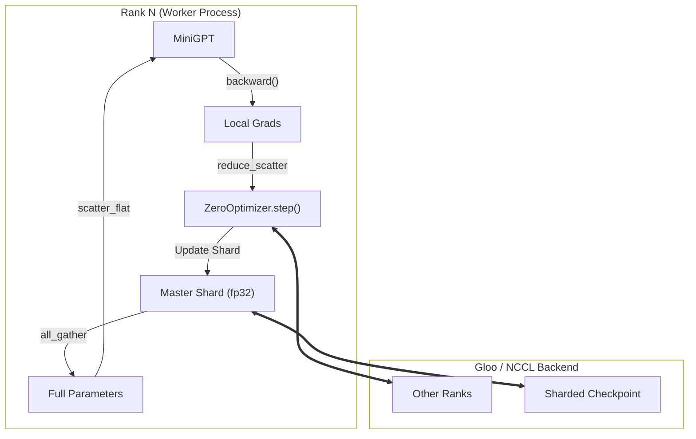

<!-- source: DeepWiki mcp.deepwiki.com · repo rohitg00/ai-engineering-from-scratch · page 16 Phase 19: Capstone Projects · fetched 2026-10-30 -->

# Phase 19: Capstone Projects

Relevant source files

The following files were used as context for generating this wiki page:

- [phases/19-capstone-projects/01-terminal-native-coding-agent/quiz.json](phases/19-capstone-projects/01-terminal-native-coding-agent/quiz.json)
- [phases/19-capstone-projects/02-rag-over-codebase/quiz.json](phases/19-capstone-projects/02-rag-over-codebase/quiz.json)
- [phases/19-capstone-projects/03-realtime-voice-assistant/quiz.json](phases/19-capstone-projects/03-realtime-voice-assistant/quiz.json)
- [phases/19-capstone-projects/04-multimodal-document-qa/quiz.json](phases/19-capstone-projects/04-multimodal-document-qa/quiz.json)
- [phases/19-capstone-projects/05-autonomous-research-agent/quiz.json](phases/19-capstone-projects/05-autonomous-research-agent/quiz.json)
- [phases/19-capstone-projects/06-devops-troubleshooting-agent/quiz.json](phases/19-capstone-projects/06-devops-troubleshooting-agent/quiz.json)
- [phases/19-capstone-projects/07-end-to-end-fine-tuning-pipeline/quiz.json](phases/19-capstone-projects/07-end-to-end-fine-tuning-pipeline/quiz.json)
- [phases/19-capstone-projects/08-production-rag-chatbot/quiz.json](phases/19-capstone-projects/08-production-rag-chatbot/quiz.json)
- [phases/19-capstone-projects/09-code-migration-agent/quiz.json](phases/19-capstone-projects/09-code-migration-agent/quiz.json)
- [phases/19-capstone-projects/10-multi-agent-software-team/quiz.json](phases/19-capstone-projects/10-multi-agent-software-team/quiz.json)
- [phases/19-capstone-projects/11-llm-observability-dashboard/quiz.json](phases/19-capstone-projects/11-llm-observability-dashboard/quiz.json)
- [phases/19-capstone-projects/81-end-to-end-distributed-train/code/main.py](phases/19-capstone-projects/81-end-to-end-distributed-train/code/main.py)
- [phases/19-capstone-projects/81-end-to-end-distributed-train/docs/en.md](phases/19-capstone-projects/81-end-to-end-distributed-train/docs/en.md)
- [phases/19-capstone-projects/81-end-to-end-distributed-train/quiz.json](phases/19-capstone-projects/81-end-to-end-distributed-train/quiz.json)
- [phases/19-capstone-projects/81-end-to-end-distributed-train/tests/test_e2e.py](phases/19-capstone-projects/81-end-to-end-distributed-train/tests/test_e2e.py)

Phase 19 represents the final integration stage of the AI Engineering curriculum. This phase consists of 87 lessons divided into three major tracks: Applied AI Projects, LLM Construction from scratch, and Distributed Systems. Each project is designed to synthesize the mathematical foundations, deep learning core, and agent engineering patterns developed in Phases 0 through 18 into production-grade systems.

## Capstone Tracks Overview

The capstone curriculum is organized into three distinct specializations that reflect the primary roles in the AI industry: AI Application Engineer, Research Scientist, and ML Infrastructure Engineer.

| Track | Focus | Key Technologies | Lesson Count |
|:---|:---|:---|:---|
| **Track A: Applied AI** | End-to-end agents and RAG systems | TypeScript, Python, MCP, vLLM | 17 Projects |
| **Track B: LLM Foundations** | Building the model and research loop | PyTorch, HDF5, LaTeX, CUDA | 28 Projects |
| **Track C: Dist. Training & Eval** | Scaling and safety infrastructure | Gloo, ZeRO, FSDP, NCCL | 30 Projects |

---

## Applied AI Capstones (Projects 01–17)

This track focuses on building autonomous systems that interact with real-world environments. These projects integrate tool-calling, multimodal perception, and production-grade observability.

*   **Autonomous Software Engineering:** Includes a terminal-native coding agent capable of solving `SWE-bench` issues and a multi-agent software team with dedicated roles for Architect, Coder, and Reviewer [phases/19-capstone-projects/10-multi-agent-software-team/quiz.json:19-24]().
*   **Multimodal & Real-time Systems:** Projects covering real-time voice assistants using WebRTC and VAD [phases/19-capstone-projects/03-realtime-voice-assistant/quiz.json:12-26]() and vision-first document QA systems using ColPali-style late interaction [phases/19-capstone-projects/04-multimodal-document-qa:7-12]().
*   **Production Operations:** Implementation of LLM observability dashboards using OpenTelemetry and ClickHouse [phases/19-capstone-projects/11-llm-observability-dashboard/quiz.json:7-25](), and DevOps troubleshooting agents for Kubernetes clusters [phases/19-capstone-projects/06-devops-troubleshooting-agent/quiz.json:3-15]().

For details, see [Applied AI Capstones (Projects 01–17)](#16.1).

---

## LLM From-Scratch Capstone Series (Projects 30–57)

This track follows the path of a research scientist, building a GPT-style model from the tokenizer up to an autonomous research agent that writes its own papers.

*   **The Transformer Stack:** Implementing the BPE tokenizer, positional embeddings, and multi-head self-attention [phases/19-capstone-projects/81-end-to-end-distributed-train/code/main.py:51-74]().
*   **Training & Alignment:** Moving from SFT (Supervised Fine-Tuning) to DPO (Direct Preference Optimization) to align model behavior with human preferences [phases/19-capstone-projects/07-end-to-end-fine-tuning-pipeline/quiz.json:19-26]().
*   **The AI Scientist:** A sub-series building an agent that performs best-first tree search over experiment nodes, executes code in sandboxed environments, and compiles LaTeX drafts [phases/19-capstone-projects/05-autonomous-research-agent/quiz.json:7-39]().

For details, see [LLM From-Scratch Capstone Series (Projects 30–57)](#16.2).

---

## Distributed Training & Evaluation (Projects 58–87)

This track focuses on the infrastructure required to train and validate large-scale models across multiple GPUs and ranks.

### Distributed Training Architecture
The core of this track is the `End-to-End Distributed Training` assembly. It integrates the `Gloo` backend for collective operations with `ZeRO-1` optimizer state sharding to reduce memory overhead [phases/19-capstone-projects/81-end-to-end-distributed-train/code/main.py:1-10]().

**Distributed Training Data Flow**
The following diagram illustrates how the `ZeroOptimizer` coordinates gradients and parameters across multiple ranks.

Sources: [phases/19-capstone-projects/81-end-to-end-distributed-train/docs/en.md:25-33](), [phases/19-capstone-projects/81-end-to-end-distributed-train/code/main.py:145-194]()

### Evaluation and Safety
The track concludes with a comprehensive evaluation and safety suite:
*   **Eval Runner:** A system for calculating perplexity, code execution metrics, and leaderboard aggregation.
*   **Safety Gate:** Integration of constitutional rules and jailbreak detectors (e.g., LlamaGuard) into the inference pipeline [phases/19-capstone-projects/08-production-rag-chatbot/quiz.json:43-51]().

**System Component Mapping**
This table bridges the high-level project concepts to the specific implementation entities in the codebase.

| Project Concept | Code Entity / File | Role |
|:---|:---|:---|
| Model Architecture | `MiniGPT` [phases/19-capstone-projects/81-end-to-end-distributed-train/code/main.py:95]() | 2-layer Transformer for training verification |
| Memory Sharding | `ZeroOptimizer` [phases/19-capstone-projects/81-end-to-end-distributed-train/code/main.py:145]() | Implements ZeRO-1 sharded Adam |
| Parameter Sync | `dist.all_gather` [phases/19-capstone-projects/81-end-to-end-distributed-train/code/main.py:191]() | Reconstructs full params after shard update |
| Persistence | `load_sharded` [phases/19-capstone-projects/81-end-to-end-distributed-train/tests/test_e2e.py:21]() | Handles rank-specific checkpoint reloading |

For details, see [Distributed Training & Evaluation Capstone Series (Projects 58–87)](#16.3).

Sources: [phases/19-capstone-projects/81-end-to-end-distributed-train/docs/en.md:1-21](), [phases/19-capstone-projects/81-end-to-end-distributed-train/code/main.py:1-45]()

---

