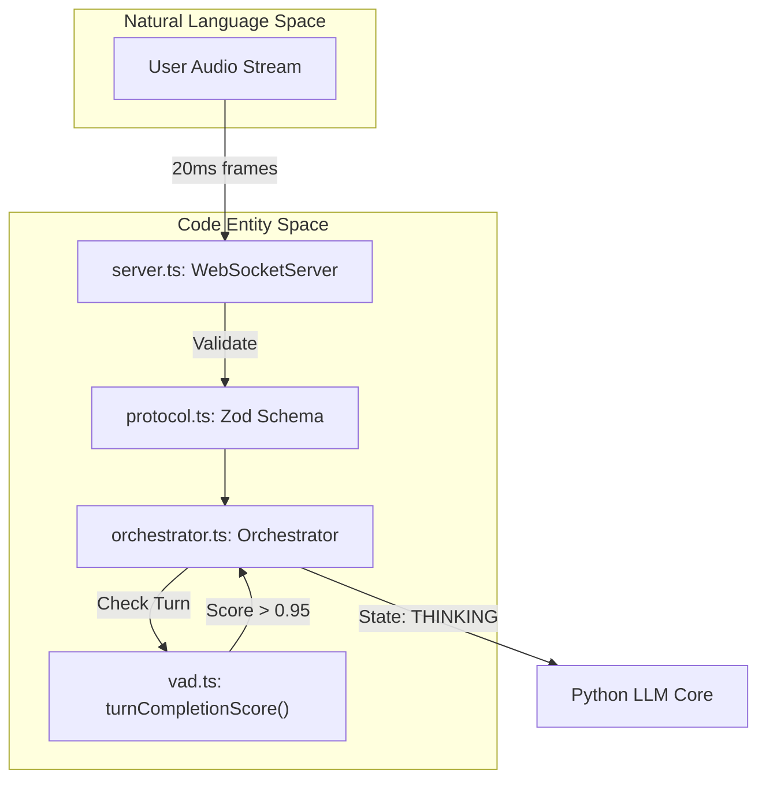
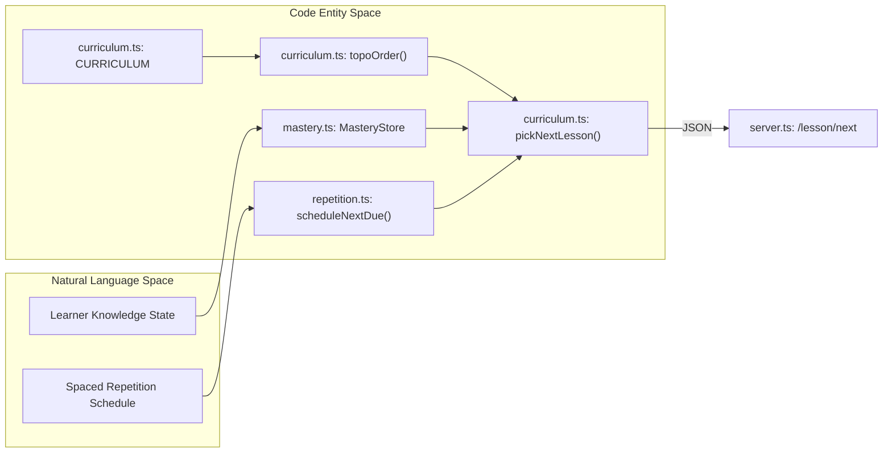

<!-- source: DeepWiki mcp.deepwiki.com · repo rohitg00/ai-engineering-from-scratch · page 16.1 Applied AI Capstones (Projects 01–17) · fetched 2026-10-30 -->

# Applied AI Capstones (Projects 01–17)

Relevant source files

The following files were used as context for generating this wiki page:

- [phases/19-capstone-projects/01-terminal-native-coding-agent/quiz.json](phases/19-capstone-projects/01-terminal-native-coding-agent/quiz.json)
- [phases/19-capstone-projects/02-rag-over-codebase/quiz.json](phases/19-capstone-projects/02-rag-over-codebase/quiz.json)
- [phases/19-capstone-projects/03-realtime-voice-assistant/code/ts/README.md](phases/19-capstone-projects/03-realtime-voice-assistant/code/ts/README.md)
- [phases/19-capstone-projects/03-realtime-voice-assistant/code/ts/package.json](phases/19-capstone-projects/03-realtime-voice-assistant/code/ts/package.json)
- [phases/19-capstone-projects/03-realtime-voice-assistant/code/ts/src/index.ts](phases/19-capstone-projects/03-realtime-voice-assistant/code/ts/src/index.ts)
- [phases/19-capstone-projects/03-realtime-voice-assistant/code/ts/src/orchestrator.ts](phases/19-capstone-projects/03-realtime-voice-assistant/code/ts/src/orchestrator.ts)
- [phases/19-capstone-projects/03-realtime-voice-assistant/code/ts/src/protocol.ts](phases/19-capstone-projects/03-realtime-voice-assistant/code/ts/src/protocol.ts)
- [phases/19-capstone-projects/03-realtime-voice-assistant/code/ts/src/server.ts](phases/19-capstone-projects/03-realtime-voice-assistant/code/ts/src/server.ts)
- [phases/19-capstone-projects/03-realtime-voice-assistant/code/ts/src/types.ts](phases/19-capstone-projects/03-realtime-voice-assistant/code/ts/src/types.ts)
- [phases/19-capstone-projects/03-realtime-voice-assistant/code/ts/src/vad.ts](phases/19-capstone-projects/03-realtime-voice-assistant/code/ts/src/vad.ts)
- [phases/19-capstone-projects/03-realtime-voice-assistant/code/ts/tests/orchestrator.test.ts](phases/19-capstone-projects/03-realtime-voice-assistant/code/ts/tests/orchestrator.test.ts)
- [phases/19-capstone-projects/03-realtime-voice-assistant/code/ts/tests/protocol.test.ts](phases/19-capstone-projects/03-realtime-voice-assistant/code/ts/tests/protocol.test.ts)
- [phases/19-capstone-projects/03-realtime-voice-assistant/quiz.json](phases/19-capstone-projects/03-realtime-voice-assistant/quiz.json)
- [phases/19-capstone-projects/04-multimodal-document-qa/quiz.json](phases/19-capstone-projects/04-multimodal-document-qa/quiz.json)
- [phases/19-capstone-projects/05-autonomous-research-agent/quiz.json](phases/19-capstone-projects/05-autonomous-research-agent/quiz.json)
- [phases/19-capstone-projects/06-devops-troubleshooting-agent/code/ts/README.md](phases/19-capstone-projects/06-devops-troubleshooting-agent/code/ts/README.md)
- [phases/19-capstone-projects/06-devops-troubleshooting-agent/code/ts/package.json](phases/19-capstone-projects/06-devops-troubleshooting-agent/code/ts/package.json)
- [phases/19-capstone-projects/06-devops-troubleshooting-agent/code/ts/src/agent.ts](phases/19-capstone-projects/06-devops-troubleshooting-agent/code/ts/src/agent.ts)
- [phases/19-capstone-projects/06-devops-troubleshooting-agent/code/ts/src/blocks.ts](phases/19-capstone-projects/06-devops-troubleshooting-agent/code/ts/src/blocks.ts)
- [phases/19-capstone-projects/06-devops-troubleshooting-agent/code/ts/src/index.ts](phases/19-capstone-projects/06-devops-troubleshooting-agent/code/ts/src/index.ts)
- [phases/19-capstone-projects/06-devops-troubleshooting-agent/code/ts/src/server.ts](phases/19-capstone-projects/06-devops-troubleshooting-agent/code/ts/src/server.ts)
- [phases/19-capstone-projects/06-devops-troubleshooting-agent/code/ts/src/slack_verify.ts](phases/19-capstone-projects/06-devops-troubleshooting-agent/code/ts/src/slack_verify.ts)
- [phases/19-capstone-projects/06-devops-troubleshooting-agent/code/ts/src/types.ts](phases/19-capstone-projects/06-devops-troubleshooting-agent/code/ts/src/types.ts)
- [phases/19-capstone-projects/06-devops-troubleshooting-agent/code/ts/tests/agent.test.ts](phases/19-capstone-projects/06-devops-troubleshooting-agent/code/ts/tests/agent.test.ts)
- [phases/19-capstone-projects/06-devops-troubleshooting-agent/code/ts/tests/server.test.ts](phases/19-capstone-projects/06-devops-troubleshooting-agent/code/ts/tests/server.test.ts)
- [phases/19-capstone-projects/06-devops-troubleshooting-agent/quiz.json](phases/19-capstone-projects/06-devops-troubleshooting-agent/quiz.json)
- [phases/19-capstone-projects/07-end-to-end-fine-tuning-pipeline/quiz.json](phases/19-capstone-projects/07-end-to-end-fine-tuning-pipeline/quiz.json)
- [phases/19-capstone-projects/08-production-rag-chatbot/quiz.json](phases/19-capstone-projects/08-production-rag-chatbot/quiz.json)
- [phases/19-capstone-projects/09-code-migration-agent/quiz.json](phases/19-capstone-projects/09-code-migration-agent/quiz.json)
- [phases/19-capstone-projects/10-multi-agent-software-team/quiz.json](phases/19-capstone-projects/10-multi-agent-software-team/quiz.json)
- [phases/19-capstone-projects/11-llm-observability-dashboard/quiz.json](phases/19-capstone-projects/11-llm-observability-dashboard/quiz.json)
- [phases/19-capstone-projects/12-video-understanding-pipeline/code/ts/README.md](phases/19-capstone-projects/12-video-understanding-pipeline/code/ts/README.md)
- [phases/19-capstone-projects/12-video-understanding-pipeline/code/ts/package.json](phases/19-capstone-projects/12-video-understanding-pipeline/code/ts/package.json)
- [phases/19-capstone-projects/12-video-understanding-pipeline/code/ts/src/index.ts](phases/19-capstone-projects/12-video-understanding-pipeline/code/ts/src/index.ts)
- [phases/19-capstone-projects/12-video-understanding-pipeline/code/ts/src/jobs.ts](phases/19-capstone-projects/12-video-understanding-pipeline/code/ts/src/jobs.ts)
- [phases/19-capstone-projects/12-video-understanding-pipeline/code/ts/src/server.ts](phases/19-capstone-projects/12-video-understanding-pipeline/code/ts/src/server.ts)
- [phases/19-capstone-projects/12-video-understanding-pipeline/code/ts/src/stages.ts](phases/19-capstone-projects/12-video-understanding-pipeline/code/ts/src/stages.ts)
- [phases/19-capstone-projects/12-video-understanding-pipeline/code/ts/src/types.ts](phases/19-capstone-projects/12-video-understanding-pipeline/code/ts/src/types.ts)
- [phases/19-capstone-projects/12-video-understanding-pipeline/code/ts/tests/stages.test.ts](phases/19-capstone-projects/12-video-understanding-pipeline/code/ts/tests/stages.test.ts)
- [phases/19-capstone-projects/12-video-understanding-pipeline/code/ts/tsconfig.json](phases/19-capstone-projects/12-video-understanding-pipeline/code/ts/tsconfig.json)
- [phases/19-capstone-projects/13-mcp-server-with-registry/code/ts/README.md](phases/19-capstone-projects/13-mcp-server-with-registry/code/ts/README.md)
- [phases/19-capstone-projects/13-mcp-server-with-registry/code/ts/package.json](phases/19-capstone-projects/13-mcp-server-with-registry/code/ts/package.json)
- [phases/19-capstone-projects/13-mcp-server-with-registry/code/ts/src/index.ts](phases/19-capstone-projects/13-mcp-server-with-registry/code/ts/src/index.ts)
- [phases/19-capstone-projects/13-mcp-server-with-registry/code/ts/src/protocol.ts](phases/19-capstone-projects/13-mcp-server-with-registry/code/ts/src/protocol.ts)
- [phases/19-capstone-projects/13-mcp-server-with-registry/code/ts/src/tools.ts](phases/19-capstone-projects/13-mcp-server-with-registry/code/ts/src/tools.ts)
- [phases/19-capstone-projects/13-mcp-server-with-registry/code/ts/src/transport.ts](phases/19-capstone-projects/13-mcp-server-with-registry/code/ts/src/transport.ts)
- [phases/19-capstone-projects/13-mcp-server-with-registry/code/ts/src/types.ts](phases/19-capstone-projects/13-mcp-server-with-registry/code/ts/src/types.ts)
- [phases/19-capstone-projects/13-mcp-server-with-registry/code/ts/tests/protocol.test.ts](phases/19-capstone-projects/13-mcp-server-with-registry/code/ts/tests/protocol.test.ts)
- [phases/19-capstone-projects/13-mcp-server-with-registry/code/ts/tsconfig.json](phases/19-capstone-projects/13-mcp-server-with-registry/code/ts/tsconfig.json)
- [phases/19-capstone-projects/16-github-issue-to-pr-agent/code/ts/README.md](phases/19-capstone-projects/16-github-issue-to-pr-agent/code/ts/README.md)
- [phases/19-capstone-projects/16-github-issue-to-pr-agent/code/ts/package.json](phases/19-capstone-projects/16-github-issue-to-pr-agent/code/ts/package.json)
- [phases/19-capstone-projects/16-github-issue-to-pr-agent/code/ts/src/agent.ts](phases/19-capstone-projects/16-github-issue-to-pr-agent/code/ts/src/agent.ts)
- [phases/19-capstone-projects/16-github-issue-to-pr-agent/code/ts/src/index.ts](phases/19-capstone-projects/16-github-issue-to-pr-agent/code/ts/src/index.ts)
- [phases/19-capstone-projects/16-github-issue-to-pr-agent/code/ts/src/router.ts](phases/19-capstone-projects/16-github-issue-to-pr-agent/code/ts/src/router.ts)
- [phases/19-capstone-projects/16-github-issue-to-pr-agent/code/ts/src/server.ts](phases/19-capstone-projects/16-github-issue-to-pr-agent/code/ts/src/server.ts)
- [phases/19-capstone-projects/16-github-issue-to-pr-agent/code/ts/src/types.ts](phases/19-capstone-projects/16-github-issue-to-pr-agent/code/ts/src/types.ts)
- [phases/19-capstone-projects/16-github-issue-to-pr-agent/code/ts/src/verify.ts](phases/19-capstone-projects/16-github-issue-to-pr-agent/code/ts/src/verify.ts)
- [phases/19-capstone-projects/16-github-issue-to-pr-agent/code/ts/tests/verify.test.ts](phases/19-capstone-projects/16-github-issue-to-pr-agent/code/ts/tests/verify.test.ts)
- [phases/19-capstone-projects/16-github-issue-to-pr-agent/code/ts/tsconfig.json](phases/19-capstone-projects/16-github-issue-to-pr-agent/code/ts/tsconfig.json)
- [phases/19-capstone-projects/17-personal-ai-tutor/code/ts/README.md](phases/19-capstone-projects/17-personal-ai-tutor/code/ts/README.md)
- [phases/19-capstone-projects/17-personal-ai-tutor/code/ts/package.json](phases/19-capstone-projects/17-personal-ai-tutor/code/ts/package.json)
- [phases/19-capstone-projects/17-personal-ai-tutor/code/ts/src/curriculum.ts](phases/19-capstone-projects/17-personal-ai-tutor/code/ts/src/curriculum.ts)
- [phases/19-capstone-projects/17-personal-ai-tutor/code/ts/src/index.ts](phases/19-capstone-projects/17-personal-ai-tutor/code/ts/src/index.ts)
- [phases/19-capstone-projects/17-personal-ai-tutor/code/ts/src/mastery.ts](phases/19-capstone-projects/17-personal-ai-tutor/code/ts/src/mastery.ts)
- [phases/19-capstone-projects/17-personal-ai-tutor/code/ts/src/repetition.ts](phases/19-capstone-projects/17-personal-ai-tutor/code/ts/src/repetition.ts)
- [phases/19-capstone-projects/17-personal-ai-tutor/code/ts/src/server.ts](phases/19-capstone-projects/17-personal-ai-tutor/code/ts/src/server.ts)
- [phases/19-capstone-projects/17-personal-ai-tutor/code/ts/src/types.ts](phases/19-capstone-projects/17-personal-ai-tutor/code/ts/src/types.ts)
- [phases/19-capstone-projects/17-personal-ai-tutor/code/ts/tests/curriculum.test.ts](phases/19-capstone-projects/17-personal-ai-tutor/code/ts/tests/curriculum.test.ts)
- [phases/19-capstone-projects/17-personal-ai-tutor/code/ts/tsconfig.json](phases/19-capstone-projects/17-personal-ai-tutor/code/ts/tsconfig.json)

This section covers the first 17 capstone projects in Phase 19. These projects represent the "Applied AI" track, focusing on integrating TypeScript/Node.js frontends and middleware with Python-based AI cores. Each project addresses a high-impact industry use case, ranging from autonomous DevOps agents to realtime multimodal pipelines.

## Project 03: Realtime Voice Assistant
This project implements a low-latency voice assistant capable of handling streaming audio, Voice Activity Detection (VAD), and barge-in logic. It utilizes a state-machine orchestrator to manage transitions between listening and speaking.

### Implementation Details
- **Orchestrator**: Manages states: `IDLE` → `LISTENING` → `WAITING` → `THINKING` → `SPEAKING` [phases/19-capstone-projects/03-realtime-voice-assistant/code/ts/README.md:13-13]().
- **VAD Logic**: Uses a `turnCompletionScore` function to determine if a user has finished speaking based on punctuation and word count [phases/19-capstone-projects/03-realtime-voice-assistant/code/ts/src/vad.ts:3-12]().
- **Synthetic Audio**: The `synthCall` function generates 20ms audio frames for testing the pipeline without a live microphone [phases/19-capstone-projects/03-realtime-voice-assistant/code/ts/src/vad.ts:14-37]().

### Data Flow: Voice Orchestration
The diagram below shows how audio frames move from the client to the state machine.

Sources: [phases/19-capstone-projects/03-realtime-voice-assistant/code/ts/README.md:10-21](), [phases/19-capstone-projects/03-realtime-voice-assistant/code/ts/src/vad.ts:3-37]()

---

## Project 12: Video Understanding Pipeline
A multimodal pipeline for indexing and querying video content. The TypeScript dashboard manages the job lifecycle across four distinct stages: chunk, embed, index, and QA.

### Key Components
- **JobStore**: A central registry that tracks video processing jobs and advances their states [phases/19-capstone-projects/12-video-understanding-pipeline/code/ts/src/jobs.ts:5-18]().
- **Stage Management**: The `STAGES` array defines the pipeline flow, while `advanceJob` simulates the transition from pending to finished [phases/19-capstone-projects/12-video-understanding-pipeline/code/ts/src/jobs.ts:1-3]().
- **API Surface**: Exposes `GET /jobs` and `GET /job/:id` for frontend observability [phases/19-capstone-projects/12-video-understanding-pipeline/code/ts/src/server.ts:12-12]().

Sources: [phases/19-capstone-projects/12-video-understanding-pipeline/code/ts/src/jobs.ts:5-45](), [phases/19-capstone-projects/12-video-understanding-pipeline/code/ts/README.md:1-18]()

---

## Project 13: Internal MCP Server
A hand-rolled implementation of the Model Context Protocol (MCP) using JSON-RPC 2.0 over standard I/O. This project avoids high-level SDKs to demonstrate the underlying transport mechanics.

### Protocol Implementation
- **Transport**: Implements a `readline` loop for `stdin` to handle newline-delimited JSON [phases/19-capstone-projects/13-mcp-server-with-registry/code/ts/README.md:13-13]().
- **Tool Registry**: Includes three mock incident tools (e.g., `get_incident_logs`) and their executors [phases/19-capstone-projects/13-mcp-server-with-registry/code/ts/README.md:15-15]().
- **JSON-RPC**: Handles `initialize`, `tools/list`, and `tools/call` methods natively [phases/19-capstone-projects/13-mcp-server-with-registry/code/ts/README.md:14-14]().

Sources: [phases/19-capstone-projects/13-mcp-server-with-registry/code/ts/README.md:1-20]()

---

## Project 16: GitHub Issue-to-PR Agent
An autonomous agent that listens for GitHub `issues.opened` events and dispatches a coding agent to generate a Pull Request.

### Webhook Architecture
- **Signature Verification**: The `verifySignature` function uses HMAC SHA-256 to validate payloads against the `GH_WEBHOOK_SECRET` [phases/19-capstone-projects/16-github-issue-to-pr-agent/code/ts/src/index.ts:25-25]().
- **Routing**: The `route()` function in `router.ts` filters events, specifically looking for `action: "opened"` on the `issues` event type [phases/19-capstone-projects/16-github-issue-to-pr-agent/code/ts/src/index.ts:31-31]().
- **Audit Log**: Every delivery is recorded in an `AuditLog` class for observability [phases/19-capstone-projects/16-github-issue-to-pr-agent/code/ts/src/index.ts:36-36]().

Sources: [phases/19-capstone-projects/16-github-issue-to-pr-agent/code/ts/src/index.ts:1-86](), [phases/19-capstone-projects/16-github-issue-to-pr-agent/code/ts/README.md:1-17]()

---

## Project 17: Personal AI Tutor
An adaptive learning system using Bayesian Knowledge Tracing (BKT) and Spaced Repetition (FSRS-lite) to guide students through a curriculum DAG.

### Logic & Scheduling
- **Curriculum DAG**: Defined in `CURRICULUM` as a set of lessons with prerequisite dependencies [phases/19-capstone-projects/17-personal-ai-tutor/code/ts/src/curriculum.ts:4-14]().
- **Topological Sort**: Uses Kahn's algorithm in `topoOrder()` to determine the valid sequence of lessons [phases/19-capstone-projects/17-personal-ai-tutor/code/ts/src/curriculum.ts:20-61]().
- **Next-Lesson Picker**: The `pickNextLesson` function prioritizes `new_eligible` lessons (where prerequisites are met) and `review_overdue` lessons based on mastery scores [phases/19-capstone-projects/17-personal-ai-tutor/code/ts/src/curriculum.ts:64-90]().
- **Mastery Tracking**: The `MasteryStore` records success/failure and updates the Bayesian score and next due date [phases/19-capstone-projects/17-personal-ai-tutor/code/ts/src/index.ts:39-43]().

### Data Flow: Curriculum Mastery
The diagram below maps the pedagogical concepts to the codebase implementation.

Sources: [phases/19-capstone-projects/17-personal-ai-tutor/code/ts/src/curriculum.ts:4-90](), [phases/19-capstone-projects/17-personal-ai-tutor/code/ts/src/index.ts:8-56](), [phases/19-capstone-projects/17-personal-ai-tutor/code/ts/README.md:1-20]()

---

## Summary of Projects 01–17

| Project | Key Tech Stack | Primary Logic |
| :--- | :--- | :--- |
| **01 Coding Agent** | Python / CLI | SWE-bench style terminal interaction |
| **02 RAG over Code** | Vector DB / TS | Codebase embedding and retrieval |
| **03 Voice Assistant** | WebSockets / VAD | Realtime turn-taking and barge-in |
| **06 DevOps Agent** | Hono / Agent Loop | Automated log analysis and troubleshooting |
| **12 Video Pipeline** | VideoDB / Hono | Temporal grounding and multi-stage processing |
| **13 MCP Server** | JSON-RPC / Stdio | Tool discovery and execution protocol |
| **16 GitHub Agent** | HMAC / Webhooks | Event-driven PR generation |
| **17 AI Tutor** | DAG / BKT / FSRS | Adaptive curriculum walking |

Sources: [phases/19-capstone-projects/03-realtime-voice-assistant/code/ts/README.md:1-15](), [phases/19-capstone-projects/12-video-understanding-pipeline/code/ts/README.md:1-15](), [phases/19-capstone-projects/13-mcp-server-with-registry/code/ts/README.md:1-10](), [phases/19-capstone-projects/16-github-issue-to-pr-agent/code/ts/README.md:1-15](), [phases/19-capstone-projects/17-personal-ai-tutor/code/ts/README.md:1-15]()

---

