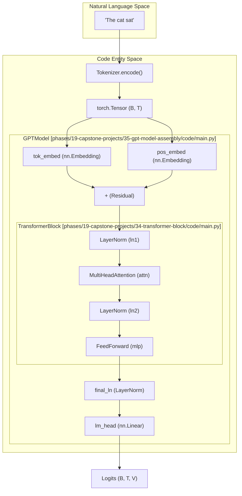
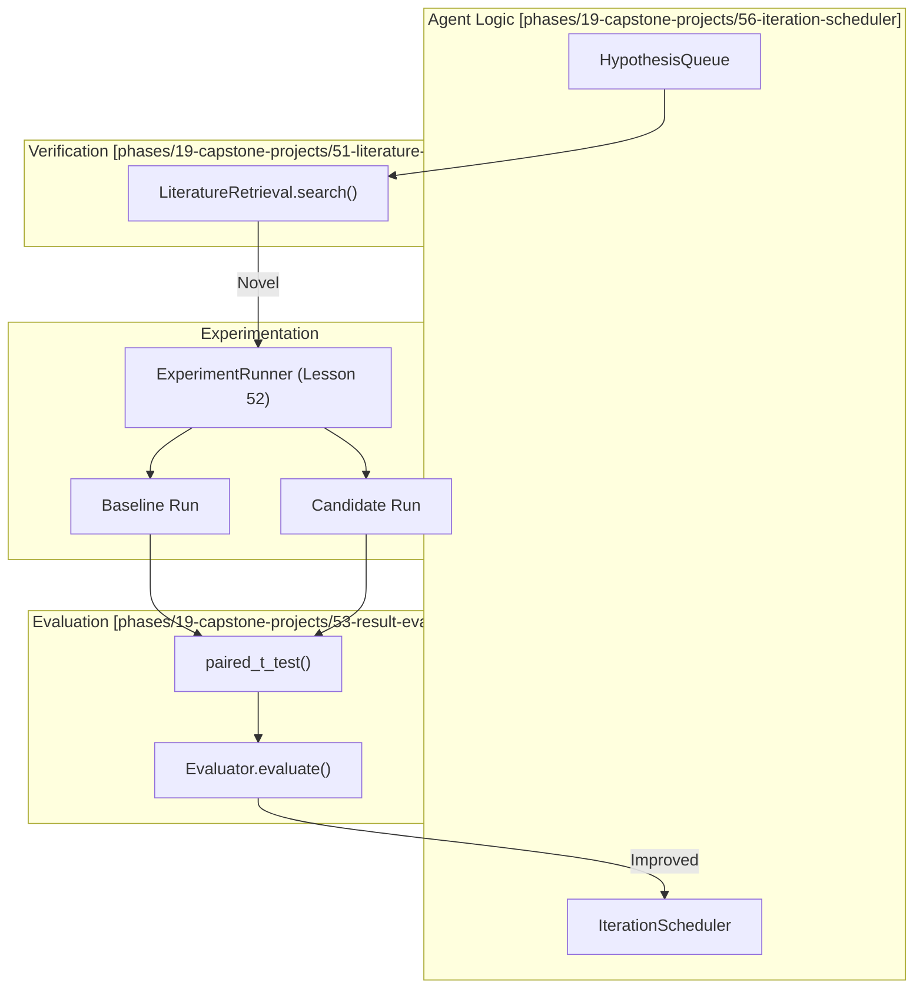

<!-- source: DeepWiki mcp.deepwiki.com · repo rohitg00/ai-engineering-from-scratch · page 16.2 LLM From-Scratch Capstone Series (Projects 30–57) · fetched 2026-10-30 -->

# LLM From-Scratch Capstone Series (Projects 30–57)

Relevant source files

The following files were used as context for generating this wiki page:

- [phases/19-capstone-projects/32-token-positional-embeddings/code/main.py](phases/19-capstone-projects/32-token-positional-embeddings/code/main.py)
- [phases/19-capstone-projects/32-token-positional-embeddings/code/tests/test_embeddings.py](phases/19-capstone-projects/32-token-positional-embeddings/code/tests/test_embeddings.py)
- [phases/19-capstone-projects/32-token-positional-embeddings/docs/en.md](phases/19-capstone-projects/32-token-positional-embeddings/docs/en.md)
- [phases/19-capstone-projects/32-token-positional-embeddings/quiz.json](phases/19-capstone-projects/32-token-positional-embeddings/quiz.json)
- [phases/19-capstone-projects/34-transformer-block/code/main.py](phases/19-capstone-projects/34-transformer-block/code/main.py)
- [phases/19-capstone-projects/34-transformer-block/code/tests/test_block.py](phases/19-capstone-projects/34-transformer-block/code/tests/test_block.py)
- [phases/19-capstone-projects/34-transformer-block/docs/en.md](phases/19-capstone-projects/34-transformer-block/docs/en.md)
- [phases/19-capstone-projects/34-transformer-block/quiz.json](phases/19-capstone-projects/34-transformer-block/quiz.json)
- [phases/19-capstone-projects/35-gpt-model-assembly/code/main.py](phases/19-capstone-projects/35-gpt-model-assembly/code/main.py)
- [phases/19-capstone-projects/35-gpt-model-assembly/code/tests/test_model.py](phases/19-capstone-projects/35-gpt-model-assembly/code/tests/test_model.py)
- [phases/19-capstone-projects/35-gpt-model-assembly/docs/en.md](phases/19-capstone-projects/35-gpt-model-assembly/docs/en.md)
- [phases/19-capstone-projects/35-gpt-model-assembly/quiz.json](phases/19-capstone-projects/35-gpt-model-assembly/quiz.json)
- [phases/19-capstone-projects/36-training-loop-eval/code/main.py](phases/19-capstone-projects/36-training-loop-eval/code/main.py)
- [phases/19-capstone-projects/36-training-loop-eval/code/tests/test_training.py](phases/19-capstone-projects/36-training-loop-eval/code/tests/test_training.py)
- [phases/19-capstone-projects/36-training-loop-eval/docs/en.md](phases/19-capstone-projects/36-training-loop-eval/docs/en.md)
- [phases/19-capstone-projects/36-training-loop-eval/outputs/losses.jsonl](phases/19-capstone-projects/36-training-loop-eval/outputs/losses.jsonl)
- [phases/19-capstone-projects/36-training-loop-eval/quiz.json](phases/19-capstone-projects/36-training-loop-eval/quiz.json)
- [phases/19-capstone-projects/37-loading-pretrained-weights/code/main.py](phases/19-capstone-projects/37-loading-pretrained-weights/code/main.py)
- [phases/19-capstone-projects/37-loading-pretrained-weights/code/tests/test_load.py](phases/19-capstone-projects/37-loading-pretrained-weights/code/tests/test_load.py)
- [phases/19-capstone-projects/37-loading-pretrained-weights/docs/en.md](phases/19-capstone-projects/37-loading-pretrained-weights/docs/en.md)
- [phases/19-capstone-projects/37-loading-pretrained-weights/quiz.json](phases/19-capstone-projects/37-loading-pretrained-weights/quiz.json)
- [phases/19-capstone-projects/39-instruction-tuning-sft/code/main.py](phases/19-capstone-projects/39-instruction-tuning-sft/code/main.py)
- [phases/19-capstone-projects/39-instruction-tuning-sft/code/tests/test_main.py](phases/19-capstone-projects/39-instruction-tuning-sft/code/tests/test_main.py)
- [phases/19-capstone-projects/39-instruction-tuning-sft/docs/en.md](phases/19-capstone-projects/39-instruction-tuning-sft/docs/en.md)
- [phases/19-capstone-projects/39-instruction-tuning-sft/quiz.json](phases/19-capstone-projects/39-instruction-tuning-sft/quiz.json)
- [phases/19-capstone-projects/40-dpo-from-scratch/code/main.py](phases/19-capstone-projects/40-dpo-from-scratch/code/main.py)
- [phases/19-capstone-projects/40-dpo-from-scratch/code/tests/test_main.py](phases/19-capstone-projects/40-dpo-from-scratch/code/tests/test_main.py)
- [phases/19-capstone-projects/40-dpo-from-scratch/docs/en.md](phases/19-capstone-projects/40-dpo-from-scratch/docs/en.md)
- [phases/19-capstone-projects/40-dpo-from-scratch/quiz.json](phases/19-capstone-projects/40-dpo-from-scratch/quiz.json)
- [phases/19-capstone-projects/43-hdf5-tokenized-corpus/code/main.py](phases/19-capstone-projects/43-hdf5-tokenized-corpus/code/main.py)
- [phases/19-capstone-projects/43-hdf5-tokenized-corpus/code/tests/__init__.py](phases/19-capstone-projects/43-hdf5-tokenized-corpus/code/tests/__init__.py)
- [phases/19-capstone-projects/43-hdf5-tokenized-corpus/code/tests/test_hdf5_corpus.py](phases/19-capstone-projects/43-hdf5-tokenized-corpus/code/tests/test_hdf5_corpus.py)
- [phases/19-capstone-projects/43-hdf5-tokenized-corpus/docs/en.md](phases/19-capstone-projects/43-hdf5-tokenized-corpus/docs/en.md)
- [phases/19-capstone-projects/43-hdf5-tokenized-corpus/quiz.json](phases/19-capstone-projects/43-hdf5-tokenized-corpus/quiz.json)
- [phases/19-capstone-projects/45-gradient-clipping-amp/code/main.py](phases/19-capstone-projects/45-gradient-clipping-amp/code/main.py)
- [phases/19-capstone-projects/45-gradient-clipping-amp/code/tests/__init__.py](phases/19-capstone-projects/45-gradient-clipping-amp/code/tests/__init__.py)
- [phases/19-capstone-projects/45-gradient-clipping-amp/code/tests/test_amp.py](phases/19-capstone-projects/45-gradient-clipping-amp/code/tests/test_amp.py)
- [phases/19-capstone-projects/45-gradient-clipping-amp/docs/en.md](phases/19-capstone-projects/45-gradient-clipping-amp/docs/en.md)
- [phases/19-capstone-projects/45-gradient-clipping-amp/quiz.json](phases/19-capstone-projects/45-gradient-clipping-amp/quiz.json)
- [phases/19-capstone-projects/51-literature-retrieval/code/main.py](phases/19-capstone-projects/51-literature-retrieval/code/main.py)
- [phases/19-capstone-projects/51-literature-retrieval/code/tests/test_retrieval.py](phases/19-capstone-projects/51-literature-retrieval/code/tests/test_retrieval.py)
- [phases/19-capstone-projects/51-literature-retrieval/docs/en.md](phases/19-capstone-projects/51-literature-retrieval/docs/en.md)
- [phases/19-capstone-projects/51-literature-retrieval/quiz.json](phases/19-capstone-projects/51-literature-retrieval/quiz.json)
- [phases/19-capstone-projects/53-result-evaluator/code/main.py](phases/19-capstone-projects/53-result-evaluator/code/main.py)
- [phases/19-capstone-projects/53-result-evaluator/code/tests/test_evaluator.py](phases/19-capstone-projects/53-result-evaluator/code/tests/test_evaluator.py)
- [phases/19-capstone-projects/53-result-evaluator/docs/en.md](phases/19-capstone-projects/53-result-evaluator/docs/en.md)
- [phases/19-capstone-projects/53-result-evaluator/quiz.json](phases/19-capstone-projects/53-result-evaluator/quiz.json)
- [phases/19-capstone-projects/55-critic-loop/code/main.py](phases/19-capstone-projects/55-critic-loop/code/main.py)
- [phases/19-capstone-projects/55-critic-loop/code/tests/test_critic_loop.py](phases/19-capstone-projects/55-critic-loop/code/tests/test_critic_loop.py)
- [phases/19-capstone-projects/55-critic-loop/docs/en.md](phases/19-capstone-projects/55-critic-loop/docs/en.md)
- [phases/19-capstone-projects/55-critic-loop/quiz.json](phases/19-capstone-projects/55-critic-loop/quiz.json)
- [phases/19-capstone-projects/56-iteration-scheduler/code/main.py](phases/19-capstone-projects/56-iteration-scheduler/code/main.py)
- [phases/19-capstone-projects/56-iteration-scheduler/code/tests/test_scheduler.py](phases/19-capstone-projects/56-iteration-scheduler/code/tests/test_scheduler.py)
- [phases/19-capstone-projects/56-iteration-scheduler/docs/en.md](phases/19-capstone-projects/56-iteration-scheduler/docs/en.md)
- [phases/19-capstone-projects/56-iteration-scheduler/quiz.json](phases/19-capstone-projects/56-iteration-scheduler/quiz.json)

The LLM From-Scratch Capstone Series provides a comprehensive, end-to-end implementation of a Large Language Model (LLM), moving from the mathematical foundations of self-attention to the engineering of distributed training and the orchestration of autonomous research agents. This series focuses on "white-box" implementation—every component, from the BPE tokenizer to the Direct Preference Optimization (DPO) loop, is built without relying on high-level abstractions like Hugging Face `transformers`.

## Core Architecture: The GPT Stack

The series implements a decoder-only transformer architecture aligned with the GPT-2 124M parameter specification [phases/19-capstone-projects/35-gpt-model-assembly/docs/en.md:12-16](). The model is composed of a token embedding layer, a learned positional embedding, and a stack of transformer blocks utilizing pre-layer normalization for training stability [phases/19-capstone-projects/34-transformer-block/code/main.py:133-142]().

### Transformer Block Mechanics
Each `TransformerBlock` consists of two primary sublayers: Multi-Head Causal Self-Attention and a Position-wise Feed-Forward Network (MLP) [phases/19-capstone-projects/34-transformer-block/code/main.py:144-151]().

*   **Pre-LN vs. Post-LN:** The implementation supports both. Pre-LN (LayerNorm before the sublayer) is used for modern LLMs as it allows gradients to propagate more cleanly through the residual stream, avoiding the need for complex warmup schedules [phases/19-capstone-projects/34-transformer-block/docs/en.md:58-59]().
*   **Fused QKV:** To optimize kernel launches, the `MultiHeadAttention` class uses a single `nn.Linear` to project inputs into Queries, Keys, and Values simultaneously [phases/19-capstone-projects/34-transformer-block/code/main.py:58-63]().
*   **Weight Tying:** The `GPTModel` ties the weights of the `lm_head` to the `tok_embed` table, reducing parameter count by approximately 38M in the 124M configuration [phases/19-capstone-projects/35-gpt-model-assembly/docs/en.md:45-48]().

### Data Flow: From Tokens to Logits
The following diagram bridges the Natural Language Space to the Code Entity Space during a forward pass.

**GPT Forward Pass Data Flow**

Sources: [phases/19-capstone-projects/35-gpt-model-assembly/code/main.py:123-172](), [phases/19-capstone-projects/34-transformer-block/code/main.py:133-160]()

---

## Training Infrastructure & Optimization

Training the model requires a robust pipeline handling data streaming, mixed-precision math, and numerical stability.

### Sharded HDF5 Tokenization
For large-scale pre-training, the series implements a streaming tokenization pipeline that produces sharded HDF5 files. This allows for `mmap` reads, enabling the training loop to access multi-gigabyte datasets without loading them entirely into RAM [phases/19-capstone-projects/43-hdf5-tokenized-corpus/code/main.py:1-9]().

*   **`HDF5ShardWriter`**: Buffers tokens to chunk size and resizes datasets in fixed strides [phases/19-capstone-projects/43-hdf5-tokenized-corpus/code/main.py:103-108]().
*   **`SlidingWindowDataloader`**: Yields (input, target) pairs where the target is the input shifted by one position [phases/19-capstone-projects/43-hdf5-tokenized-corpus/code/main.py:10]().

### Numerical Stability: AMP & Gradient Clipping
To prevent training divergence, the series implements Automatic Mixed Precision (AMP) and Global Gradient Clipping.

*   **`AmpTrainState`**: Orchestrates the `GradScaler` and `autocast` logic to maintain `float16` or `bfloat16` weights while protecting against underflow/overflow [phases/19-capstone-projects/45-gradient-clipping-amp/code/main.py:125-138]().
*   **`clip_global_l2_norm`**: Implements a manual L2 norm clipping that returns pre- and post-clip values for logging and forensics [phases/19-capstone-projects/45-gradient-clipping-amp/code/main.py:100-123]().

**Training Loop Components**
| Component | Implementation | Purpose |
| :--- | :--- | :--- |
| **Optimizer** | `AdamW` | Decoupled weight decay for non-bias/norm parameters [phases/19-capstone-projects/36-training-loop-eval/docs/en.md:51-54](). |
| **Scheduler** | `cosine_with_warmup` | Linear ramp to `max_lr` followed by cosine decay [phases/19-capstone-projects/36-training-loop-eval/code/main.py:255-274](). |
| **Precision** | `torch.amp.autocast` | Mixed precision training for speed and memory efficiency [phases/19-capstone-projects/45-gradient-clipping-amp/code/main.py:209-212](). |
| **Loss** | `calc_loss_batch` | Cross-entropy loss with flattened batch/sequence dimensions [phases/19-capstone-projects/36-training-loop-eval/code/main.py:207-217](). |

Sources: [phases/19-capstone-projects/36-training-loop-eval/code/main.py:1-14](), [phases/19-capstone-projects/45-gradient-clipping-amp/code/main.py:1-14]()

---

## Weight Management & Fine-Tuning

### Pretrained Weight Loading
The series includes a utility to load GPT-2 weights from `safetensors` files. This requires mapping OpenAI's naming conventions (e.g., `wte`, `h.N.attn.c_attn`) to the codebase's internal names (e.g., `tok_embed`, `blocks.N.attn.qkv`) [phases/19-capstone-projects/37-loading-pretrained-weights/docs/en.md:12-16]().

*   **Conv1D Transposition**: Published GPT-2 weights use a `Conv1D` layout; the loader automatically transposes these for `nn.Linear` compatibility [phases/19-capstone-projects/37-loading-pretrained-weights/code/main.py:177-179]().
*   **`LoadReport`**: Summarizes successful loads, missing keys, and shape mismatches [phases/19-capstone-projects/37-loading-pretrained-weights/code/main.py:157-171]().

### Post-Training: SFT & DPO
The transition from a base model to an assistant involves Supervised Fine-Tuning (SFT) and Direct Preference Optimization (DPO).
*   **DPO**: Implements the closed-form RLHF alternative, optimizing the model to prefer "chosen" over "rejected" completions by maximizing the log-likelihood ratio against a reference model [phases/19-capstone-projects/40-dpo-from-scratch/docs/en.md:1-10]().

Sources: [phases/19-capstone-projects/37-loading-pretrained-weights/code/main.py:1-15](), [phases/19-capstone-projects/40-dpo-from-scratch/code/main.py:1-10]()

---

## Autonomous Research Agent Sub-Series

The series culminates in an autonomous research agent (Projects 50–57) that performs scientific discovery via a closed-loop system.

### Hypothesis and Evaluation Loop
The agent generates hypotheses, retrieves literature to verify novelty, runs experiments, and evaluates results using statistical rigor.

*   **`LiteratureRetrieval`**: Searches external corpora to determine if a hypothesis is already settled [phases/19-capstone-projects/51-literature-retrieval/docs/en.md:1-10]().
*   **`ResultEvaluator`**: Performs a paired t-test over per-seed metrics (e.g., perplexity) to determine if a candidate model represents a statistically significant improvement over a baseline [phases/19-capstone-projects/53-result-evaluator/docs/en.md:17-32]().
*   **`Verdict`**: Emits a categorical decision (`improved`, `regressed`, `noise`, `failed`) based on direction-aware improvement and p-value thresholds [phases/19-capstone-projects/53-result-evaluator/code/main.py:54-67]().

**Research Agent Orchestration**

Sources: [phases/19-capstone-projects/53-result-evaluator/docs/en.md:125-141](), [phases/19-capstone-projects/56-iteration-scheduler/code/main.py:1-15]()

---

