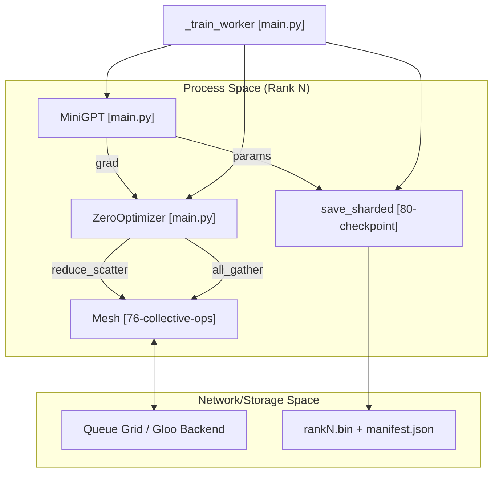
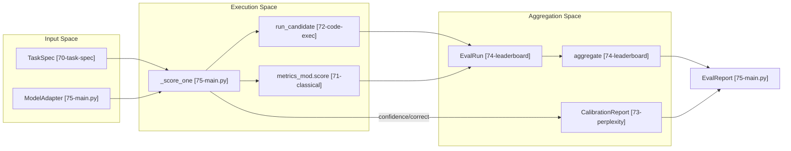

<!-- source: DeepWiki mcp.deepwiki.com · repo rohitg00/ai-engineering-from-scratch · page 16.3 Distributed Training & Evaluation Capstone Series (Projects 58–87) · fetched 2026-10-30 -->

# Distributed Training & Evaluation Capstone Series (Projects 58–87)

Relevant source files

The following files were used as context for generating this wiki page:

- [phases/19-capstone-projects/68-rag-eval-precision-recall/code/main.py](phases/19-capstone-projects/68-rag-eval-precision-recall/code/main.py)
- [phases/19-capstone-projects/68-rag-eval-precision-recall/code/tests/test_eval.py](phases/19-capstone-projects/68-rag-eval-precision-recall/code/tests/test_eval.py)
- [phases/19-capstone-projects/68-rag-eval-precision-recall/docs/en.md](phases/19-capstone-projects/68-rag-eval-precision-recall/docs/en.md)
- [phases/19-capstone-projects/68-rag-eval-precision-recall/quiz.json](phases/19-capstone-projects/68-rag-eval-precision-recall/quiz.json)
- [phases/19-capstone-projects/72-code-exec-metric/code/main.py](phases/19-capstone-projects/72-code-exec-metric/code/main.py)
- [phases/19-capstone-projects/72-code-exec-metric/code/tests/test_exec.py](phases/19-capstone-projects/72-code-exec-metric/code/tests/test_exec.py)
- [phases/19-capstone-projects/72-code-exec-metric/docs/en.md](phases/19-capstone-projects/72-code-exec-metric/docs/en.md)
- [phases/19-capstone-projects/72-code-exec-metric/quiz.json](phases/19-capstone-projects/72-code-exec-metric/quiz.json)
- [phases/19-capstone-projects/73-perplexity-calibration/code/main.py](phases/19-capstone-projects/73-perplexity-calibration/code/main.py)
- [phases/19-capstone-projects/73-perplexity-calibration/code/tests/test_calibration.py](phases/19-capstone-projects/73-perplexity-calibration/code/tests/test_calibration.py)
- [phases/19-capstone-projects/73-perplexity-calibration/docs/en.md](phases/19-capstone-projects/73-perplexity-calibration/docs/en.md)
- [phases/19-capstone-projects/73-perplexity-calibration/quiz.json](phases/19-capstone-projects/73-perplexity-calibration/quiz.json)
- [phases/19-capstone-projects/74-leaderboard-aggregation/code/main.py](phases/19-capstone-projects/74-leaderboard-aggregation/code/main.py)
- [phases/19-capstone-projects/74-leaderboard-aggregation/code/tests/test_leaderboard.py](phases/19-capstone-projects/74-leaderboard-aggregation/code/tests/test_leaderboard.py)
- [phases/19-capstone-projects/74-leaderboard-aggregation/docs/en.md](phases/19-capstone-projects/74-leaderboard-aggregation/docs/en.md)
- [phases/19-capstone-projects/74-leaderboard-aggregation/quiz.json](phases/19-capstone-projects/74-leaderboard-aggregation/quiz.json)
- [phases/19-capstone-projects/75-end-to-end-eval-runner/code/main.py](phases/19-capstone-projects/75-end-to-end-eval-runner/code/main.py)
- [phases/19-capstone-projects/75-end-to-end-eval-runner/code/tests/test_runner.py](phases/19-capstone-projects/75-end-to-end-eval-runner/code/tests/test_runner.py)
- [phases/19-capstone-projects/75-end-to-end-eval-runner/docs/en.md](phases/19-capstone-projects/75-end-to-end-eval-runner/docs/en.md)
- [phases/19-capstone-projects/75-end-to-end-eval-runner/quiz.json](phases/19-capstone-projects/75-end-to-end-eval-runner/quiz.json)
- [phases/19-capstone-projects/76-collective-ops-from-scratch/code/main.py](phases/19-capstone-projects/76-collective-ops-from-scratch/code/main.py)
- [phases/19-capstone-projects/76-collective-ops-from-scratch/docs/en.md](phases/19-capstone-projects/76-collective-ops-from-scratch/docs/en.md)
- [phases/19-capstone-projects/76-collective-ops-from-scratch/quiz.json](phases/19-capstone-projects/76-collective-ops-from-scratch/quiz.json)
- [phases/19-capstone-projects/76-collective-ops-from-scratch/tests/test_collectives.py](phases/19-capstone-projects/76-collective-ops-from-scratch/tests/test_collectives.py)
- [phases/19-capstone-projects/77-data-parallel-ddp/code/main.py](phases/19-capstone-projects/77-data-parallel-ddp/code/main.py)
- [phases/19-capstone-projects/77-data-parallel-ddp/docs/en.md](phases/19-capstone-projects/77-data-parallel-ddp/docs/en.md)
- [phases/19-capstone-projects/77-data-parallel-ddp/quiz.json](phases/19-capstone-projects/77-data-parallel-ddp/quiz.json)
- [phases/19-capstone-projects/77-data-parallel-ddp/tests/test_ddp.py](phases/19-capstone-projects/77-data-parallel-ddp/tests/test_ddp.py)
- [phases/19-capstone-projects/78-zero-parameter-sharding/code/main.py](phases/19-capstone-projects/78-zero-parameter-sharding/code/main.py)
- [phases/19-capstone-projects/78-zero-parameter-sharding/docs/en.md](phases/19-capstone-projects/78-zero-parameter-sharding/docs/en.md)
- [phases/19-capstone-projects/78-zero-parameter-sharding/quiz.json](phases/19-capstone-projects/78-zero-parameter-sharding/quiz.json)
- [phases/19-capstone-projects/78-zero-parameter-sharding/tests/test_zero.py](phases/19-capstone-projects/78-zero-parameter-sharding/tests/test_zero.py)
- [phases/19-capstone-projects/79-pipeline-parallel/code/main.py](phases/19-capstone-projects/79-pipeline-parallel/code/main.py)
- [phases/19-capstone-projects/79-pipeline-parallel/docs/en.md](phases/19-capstone-projects/79-pipeline-parallel/docs/en.md)
- [phases/19-capstone-projects/79-pipeline-parallel/quiz.json](phases/19-capstone-projects/79-pipeline-parallel/quiz.json)
- [phases/19-capstone-projects/79-pipeline-parallel/tests/test_pipeline.py](phases/19-capstone-projects/79-pipeline-parallel/tests/test_pipeline.py)
- [phases/19-capstone-projects/80-checkpoint-sharded-resume/code/main.py](phases/19-capstone-projects/80-checkpoint-sharded-resume/code/main.py)
- [phases/19-capstone-projects/80-checkpoint-sharded-resume/docs/en.md](phases/19-capstone-projects/80-checkpoint-sharded-resume/docs/en.md)
- [phases/19-capstone-projects/80-checkpoint-sharded-resume/quiz.json](phases/19-capstone-projects/80-checkpoint-sharded-resume/quiz.json)
- [phases/19-capstone-projects/80-checkpoint-sharded-resume/tests/test_checkpoint.py](phases/19-capstone-projects/80-checkpoint-sharded-resume/tests/test_checkpoint.py)
- [phases/19-capstone-projects/81-end-to-end-distributed-train/code/main.py](phases/19-capstone-projects/81-end-to-end-distributed-train/code/main.py)
- [phases/19-capstone-projects/81-end-to-end-distributed-train/docs/en.md](phases/19-capstone-projects/81-end-to-end-distributed-train/docs/en.md)
- [phases/19-capstone-projects/81-end-to-end-distributed-train/quiz.json](phases/19-capstone-projects/81-end-to-end-distributed-train/quiz.json)
- [phases/19-capstone-projects/81-end-to-end-distributed-train/tests/test_e2e.py](phases/19-capstone-projects/81-end-to-end-distributed-train/tests/test_e2e.py)
- [phases/19-capstone-projects/83-prompt-injection-detector/code/benign.py](phases/19-capstone-projects/83-prompt-injection-detector/code/benign.py)
- [phases/19-capstone-projects/83-prompt-injection-detector/code/main.py](phases/19-capstone-projects/83-prompt-injection-detector/code/main.py)
- [phases/19-capstone-projects/83-prompt-injection-detector/code/rules.py](phases/19-capstone-projects/83-prompt-injection-detector/code/rules.py)
- [phases/19-capstone-projects/83-prompt-injection-detector/code/tests.py](phases/19-capstone-projects/83-prompt-injection-detector/code/tests.py)
- [phases/19-capstone-projects/83-prompt-injection-detector/docs/en.md](phases/19-capstone-projects/83-prompt-injection-detector/docs/en.md)
- [phases/19-capstone-projects/83-prompt-injection-detector/outputs/detector_report.json](phases/19-capstone-projects/83-prompt-injection-detector/outputs/detector_report.json)
- [phases/19-capstone-projects/83-prompt-injection-detector/outputs/skill-prompt-injection-detector.md](phases/19-capstone-projects/83-prompt-injection-detector/outputs/skill-prompt-injection-detector.md)
- [phases/19-capstone-projects/83-prompt-injection-detector/quiz.json](phases/19-capstone-projects/83-prompt-injection-detector/quiz.json)
- [phases/19-capstone-projects/84-refusal-evaluation/code/main.py](phases/19-capstone-projects/84-refusal-evaluation/code/main.py)
- [phases/19-capstone-projects/84-refusal-evaluation/code/mock_llm.py](phases/19-capstone-projects/84-refusal-evaluation/code/mock_llm.py)
- [phases/19-capstone-projects/84-refusal-evaluation/code/prompts.py](phases/19-capstone-projects/84-refusal-evaluation/code/prompts.py)
- [phases/19-capstone-projects/84-refusal-evaluation/code/tests.py](phases/19-capstone-projects/84-refusal-evaluation/code/tests.py)
- [phases/19-capstone-projects/84-refusal-evaluation/docs/en.md](phases/19-capstone-projects/84-refusal-evaluation/docs/en.md)
- [phases/19-capstone-projects/84-refusal-evaluation/outputs/refusal_eval_report.json](phases/19-capstone-projects/84-refusal-evaluation/outputs/refusal_eval_report.json)
- [phases/19-capstone-projects/84-refusal-evaluation/outputs/skill-refusal-evaluation.md](phases/19-capstone-projects/84-refusal-evaluation/outputs/skill-refusal-evaluation.md)
- [phases/19-capstone-projects/84-refusal-evaluation/quiz.json](phases/19-capstone-projects/84-refusal-evaluation/quiz.json)
- [phases/19-capstone-projects/86-constitutional-rules-engine/code/main.py](phases/19-capstone-projects/86-constitutional-rules-engine/code/main.py)
- [phases/19-capstone-projects/86-constitutional-rules-engine/code/rules.yml](phases/19-capstone-projects/86-constitutional-rules-engine/code/rules.yml)
- [phases/19-capstone-projects/86-constitutional-rules-engine/code/tests.py](phases/19-capstone-projects/86-constitutional-rules-engine/code/tests.py)
- [phases/19-capstone-projects/86-constitutional-rules-engine/code/yaml_subset.py](phases/19-capstone-projects/86-constitutional-rules-engine/code/yaml_subset.py)
- [phases/19-capstone-projects/86-constitutional-rules-engine/docs/en.md](phases/19-capstone-projects/86-constitutional-rules-engine/docs/en.md)
- [phases/19-capstone-projects/86-constitutional-rules-engine/outputs/rules_report.json](phases/19-capstone-projects/86-constitutional-rules-engine/outputs/rules_report.json)
- [phases/19-capstone-projects/86-constitutional-rules-engine/outputs/skill-constitutional-rules-engine.md](phases/19-capstone-projects/86-constitutional-rules-engine/outputs/skill-constitutional-rules-engine.md)
- [phases/19-capstone-projects/86-constitutional-rules-engine/quiz.json](phases/19-capstone-projects/86-constitutional-rules-engine/quiz.json)
- [phases/19-capstone-projects/87-end-to-end-safety-gate/code/main.py](phases/19-capstone-projects/87-end-to-end-safety-gate/code/main.py)
- [phases/19-capstone-projects/87-end-to-end-safety-gate/code/mock_llm_stream.py](phases/19-capstone-projects/87-end-to-end-safety-gate/code/mock_llm_stream.py)
- [phases/19-capstone-projects/87-end-to-end-safety-gate/code/safety_gate.py](phases/19-capstone-projects/87-end-to-end-safety-gate/code/safety_gate.py)
- [phases/19-capstone-projects/87-end-to-end-safety-gate/code/tests.py](phases/19-capstone-projects/87-end-to-end-safety-gate/code/tests.py)
- [phases/19-capstone-projects/87-end-to-end-safety-gate/docs/en.md](phases/19-capstone-projects/87-end-to-end-safety-gate/docs/en.md)
- [phases/19-capstone-projects/87-end-to-end-safety-gate/outputs/gate_trace.json](phases/19-capstone-projects/87-end-to-end-safety-gate/outputs/gate_trace.json)
- [phases/19-capstone-projects/87-end-to-end-safety-gate/outputs/skill-end-to-end-safety-gate.md](phases/19-capstone-projects/87-end-to-end-safety-gate/outputs/skill-end-to-end-safety-gate.md)
- [phases/19-capstone-projects/87-end-to-end-safety-gate/quiz.json](phases/19-capstone-projects/87-end-to-end-safety-gate/quiz.json)

This section covers the final three tracks of Phase 19: **Distributed Training Infrastructure**, **Evaluation Frameworks**, and **Safety Systems**. These projects synthesize concepts from earlier phases—specifically mathematical optimization, transformer architectures, and LLM engineering—into production-grade systems built entirely from scratch.

## 1. Distributed Training Capstone (Projects 76–81)

This series implements the primitives of distributed deep learning, moving from basic socket-level communication to a fully sharded training loop capable of training a transformer across multiple processes.

### 1.1 Collective Operations & Mesh Networking
The foundation is a point-to-point `Mesh` class [phases/19-capstone-projects/76-collective-ops-from-scratch/code/main.py:38-51]() that simulates a network cluster using `multiprocessing.Queue`. It implements four core collective primitives:
*   **Ring AllReduce**: Implemented in two passes (reduce-scatter then allgather) [phases/19-capstone-projects/76-collective-ops-from-scratch/code/main.py:87-118]().
*   **Tree Broadcast**: Uses a $O(\log N)$ hop strategy where the set of ranks holding the value doubles each round [phases/19-capstone-projects/76-collective-ops-from-scratch/code/main.py:120-146]().
*   **AllGather**: Uses $N-1$ ring rotations to concatenate shards from all ranks [phases/19-capstone-projects/76-collective-ops-from-scratch/code/main.py:149-168]().
*   **Reduce-Scatter**: The first half of the ring algorithm, parking sums at specific ranks [phases/19-capstone-projects/76-collective-ops-from-scratch/code/main.py:171-198]().

### 1.2 Data Parallelism (DDP) & ZeRO-1
The `DistributedDataParallel` (DDP) wrapper ensures parameter synchronization across ranks by broadcasting initial weights and performing an `all_reduce` on gradients after the backward pass [phases/19-capstone-projects/77-data-parallel-ddp/code/main.py:59-88](). 

To optimize memory, the `ZeroOptimizer` (ZeRO Stage 1) shards the optimizer state (master parameters, momentum, and variance) across the world size [phases/19-capstone-projects/78-zero-parameter-sharding/code/main.py:98-129](). This reduces per-rank memory from $12P$ to $12P/N$ bytes (where $P$ is parameters and $N$ is ranks) [phases/19-capstone-projects/81-end-to-end-distributed-train/docs/en.md:21-21]().

### 1.3 Pipeline Parallelism & Sharded Checkpoints
Pipeline parallelism is implemented via a `GPipe` schedule, splitting a model into stages and microbatches to minimize the "bubble fraction" $(N-1)/(M+N-1)$ [phases/19-capstone-projects/79-pipeline-parallel/code/main.py:37-47](). 

The `save_sharded` function handles atomic writes of distributed state, producing a `manifest.json` that includes SHA256 hashes for each rank's binary shard to ensure data integrity during resume [phases/19-capstone-projects/80-checkpoint-sharded-resume/code/main.py:105-157]().

### Distributed Training Data Flow
The following diagram bridges the conceptual training loop to the implementation entities.

**Distributed Training System Architecture**

Sources: [phases/19-capstone-projects/81-end-to-end-distributed-train/code/main.py:60-66](), [phases/19-capstone-projects/76-collective-ops-from-scratch/code/main.py:38-51](), [phases/19-capstone-projects/80-checkpoint-sharded-resume/code/main.py:105-112]()

---

## 2. Evaluation Capstone (Projects 68–75)

The evaluation track builds a modular harness for benchmarking LLMs across diverse tasks, from code execution to perplexity calibration.

### 2.1 Task Specification & Metrics
Tasks are defined using a structured `TaskSpec` [phases/19-capstone-projects/75-end-to-end-eval-runner/code/main.py:45-45](). The runner supports:
*   **Classical Metrics**: Exact match, F1, BLEU-4, and ROUGE-L [phases/19-capstone-projects/75-end-to-end-eval-runner/docs/en.md:12-16]().
*   **Code Execution**: The `run_candidate` function extracts code from model responses and executes it in a sandboxed subprocess against unit test targets [phases/19-capstone-projects/72-code-exec-metric/code/main.py:50-80]().
*   **Perplexity & Calibration**: Calculates Expected Calibration Error (ECE) and Brier scores by comparing model `confidence` values against actual `correct` flags [phases/19-capstone-projects/75-end-to-end-eval-runner/code/main.py:190-205]().

### 2.2 Leaderboard Aggregation
The `aggregate` function processes `EvalRun` records to produce a ranked leaderboard [phases/19-capstone-projects/74-leaderboard-aggregation/docs/en.md:20-32](). It uses **Bootstrap Resampling** (default $B=1000$) to compute 95% confidence intervals on mean scores and pairwise differences [phases/19-capstone-projects/74-leaderboard-aggregation/docs/en.md:80-98]().

**Evaluation Runner Data Flow**

Sources: [phases/19-capstone-projects/75-end-to-end-eval-runner/code/main.py:105-134](), [phases/19-capstone-projects/74-leaderboard-aggregation/docs/en.md:38-50](), [phases/19-capstone-projects/72-code-exec-metric/code/main.py:50-55]()

---

## 3. Safety Capstone (Projects 82–87)

The safety track implements a "Constitutional Safety Gate" that sits between the LLM and the end user.

### 3.1 Safety Primitives
*   **Injection Detection**: The `PromptInjectionDetector` uses heuristic and model-based checks to identify adversarial attempts to override system instructions [phases/19-capstone-projects/83-prompt-injection-detector/code/main.py]().
*   **Refusal Evaluation**: A specialized metric that distinguishes between a model refusing a harmful request (good) vs. failing a difficult but safe request (bad) [phases/19-capstone-projects/84-refusal-evaluation/docs/en.md]().
*   **Rules Engine**: The `ConstitutionalRulesEngine` parses a `rules.yml` file to enforce specific constraints (e.g., "do not provide medical advice") using a YAML-subset parser [phases/19-capstone-projects/86-constitutional-rules-engine/code/yaml_subset.py]().

### 3.2 End-to-End Safety Gate
The `SafetyGate` class integrates these components into a unified pipeline. It processes streaming LLM outputs through a multi-stage filter:
1.  **Pre-flight**: Check prompt for injections.
2.  **Streaming Monitor**: Scan partial chunks for PII or prohibited content.
3.  **Post-flight**: Validate the full response against the constitutional rules engine [phases/19-capstone-projects/87-end-to-end-safety-gate/code/safety_gate.py]().

| Component | Code Entity | Role |
| :--- | :--- | :--- |
| Injection Check | `InjectionDetector` | Prevents instruction hijacking |
| Content Filter | `ContentClassifier` | Blocks toxic/harmful categories |
| Rules Engine | `ConstitutionalRulesEngine` | Validates alignment with specific "constitution" |
| Final Gate | `SafetyGate.verify()` | Final go/no-go decision before user delivery |

Sources: [phases/19-capstone-projects/87-end-to-end-safety-gate/code/safety_gate.py:10-45](), [phases/19-capstone-projects/86-constitutional-rules-engine/code/yaml_subset.py:1-20](), [phases/19-capstone-projects/83-prompt-injection-detector/code/main.py:5-15]()

---

