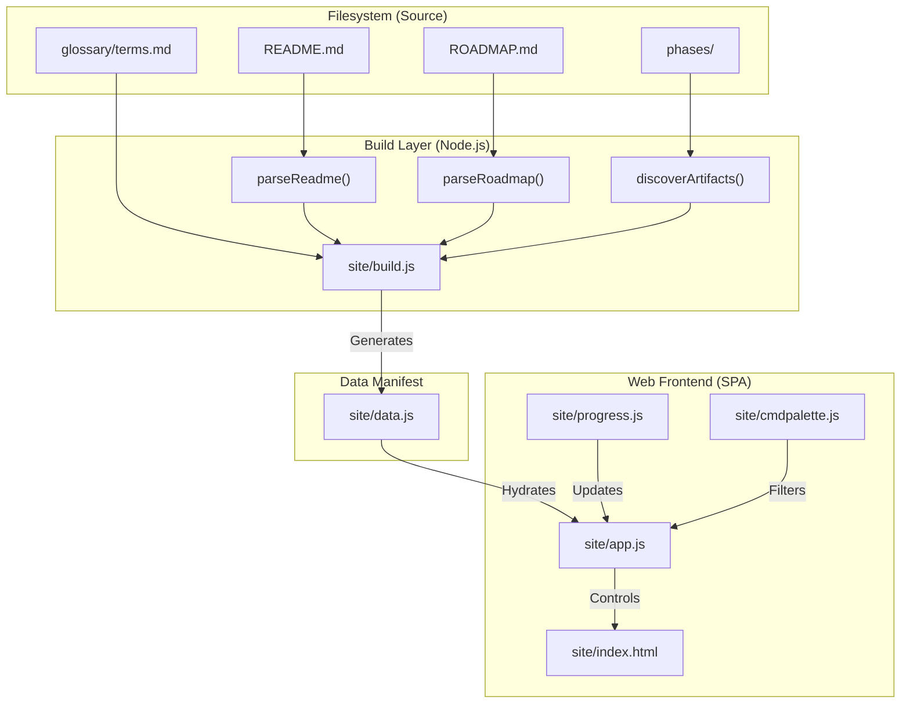
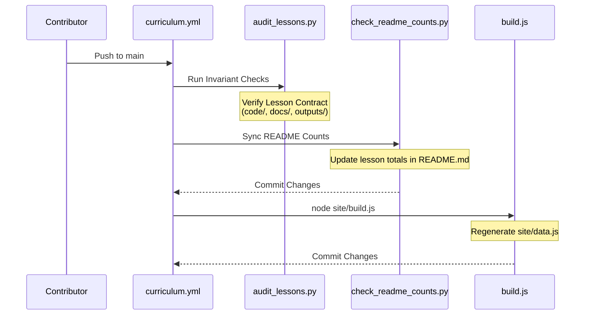

<!-- source: DeepWiki mcp.deepwiki.com · repo rohitg00/ai-engineering-from-scratch · page 17 Site & Build Infrastructure · fetched 2026-10-30 -->

# Site & Build Infrastructure

Relevant source files

The following files were used as context for generating this wiki page:

- [.github/workflows/curriculum.yml](.github/workflows/curriculum.yml)
- [.gitignore](.gitignore)
- [AGENTS.md](AGENTS.md)
- [README.md](README.md)
- [phases/14-agent-engineering/15-crewai-role-based-crews/code/main.py](phases/14-agent-engineering/15-crewai-role-based-crews/code/main.py)
- [phases/14-agent-engineering/15-crewai-role-based-crews/docs/en.md](phases/14-agent-engineering/15-crewai-role-based-crews/docs/en.md)
- [scripts/_lib.py](scripts/_lib.py)
- [scripts/build_catalog.py](scripts/build_catalog.py)
- [scripts/check_readme_counts.py](scripts/check_readme_counts.py)
- [scripts/install_skills.py](scripts/install_skills.py)
- [site/app.js](site/app.js)
- [site/build.js](site/build.js)
- [site/catalog.html](site/catalog.html)
- [site/cmdpalette.js](site/cmdpalette.js)
- [site/data.js](site/data.js)
- [site/glossary.html](site/glossary.html)
- [site/header.js](site/header.js)
- [site/index.html](site/index.html)
- [site/lesson.html](site/lesson.html)
- [site/prereqs.html](site/prereqs.html)
- [site/progress.js](site/progress.js)
- [site/robots.txt](site/robots.txt)
- [site/stats.json](site/stats.json)
- [site/style.css](site/style.css)
- [vercel.json](vercel.json)

The **AI Engineering from Scratch** repository uses a lightweight, custom-built infrastructure to manage a curriculum of over 500 lessons. This system transforms raw Markdown files and code directories into a high-performance Single Page Application (SPA) while maintaining strict content invariants through automated CI/CD pipelines.

The infrastructure is split into three primary domains:
1.  **Static Site Generation**: A Node.js build engine that extracts metadata from the repository structure.
2.  **Web Application**: A dependency-free SPA that provides an interactive learning experience, progress tracking, and search.
3.  **CI/CD Automation**: GitHub Actions and Python scripts that enforce the "Lesson Contract" and synchronize documentation.

## System Architecture Overview

The following diagram illustrates the relationship between the filesystem, the build process, and the live web application.

### Infrastructure Flow: From Code to Web

**Sources:** [site/build.js:1-18](), [site/app.js:13-23](), [site/data.js:1-4]()

---

## Static Site Generator (`site/build.js`)

The core of the build system is `site/build.js`, a script that executes during deployment and CI to generate the site's data manifest. It eliminates the need for a heavy framework by pre-calculating the curriculum structure.

*   **Roadmap Parsing**: The `parseRoadmap` function scans `ROADMAP.md` to extract the current status (✅, 🚧, ⬚) of every lesson [site/build.js:31-61]().
*   **Readme Extraction**: The `parseReadme` function identifies phase descriptions and lesson links, mapping them to their corresponding status from the roadmap [site/build.js:64-180]().
*   **Artifact Discovery**: The script crawls the `outputs/` directory within each lesson to populate the `ARTIFACTS` manifest used by the web frontend [site/build.js:183-206]().
*   **Output**: It produces `site/data.js`, which exports constants like `PHASES`, `GLOSSARY`, and `ARTIFACTS` [site/build.js:235-250]().

For details, see [Web Application & Static Site Generator](#17.1).

---

## Web Application & SPA

The frontend is a vanilla JavaScript SPA designed for speed and accessibility. It uses `localStorage` for state management and `IntersectionObserver` for performant UI animations.

| Component | File | Responsibility |
| :--- | :--- | :--- |
| **Main Logic** | `site/app.js` | Orchestrates theme toggling, phase rendering, and UI stats [site/app.js:1-100](). |
| **Lesson Loader** | `site/lesson.html` | A dynamic template that fetches and renders Markdown content via client-side routing [site/lesson.html:1-180](). |
| **Progress Tracking** | `site/progress.js` | Manages completion status using the `aifs:progress:v1` schema in `localStorage`. |
| **Search Engine** | `site/cmdpalette.js` | Implements a command palette with fuzzy scoring via `scoreItem`. |

For details, see [Web Application & Static Site Generator](#17.1).

---

## CI/CD & Automation Scripts

The repository uses a "Self-Healing" automation strategy. When contributors add lessons, the CI pipeline automatically updates counts and rebuilds the site manifest to prevent drift.

### Automation Lifecycle

**Sources:** [.github/workflows/curriculum.yml:33-148](), [scripts/audit_lessons.py:1-50]()

*   **Audit Job**: Enforces the "Lesson Contract" (e.g., every lesson must have an `en.md` and a `code/` directory) [.github/workflows/curriculum.yml:33-44]().
*   **README Sync**: The `check_readme_counts.py` script ensures the lesson totals displayed at the top of the repository match the actual filesystem [.github/workflows/curriculum.yml:46-63]().
*   **Site Rebuild**: On every push to `main`, the `site-rebuild` job triggers `build.js` to ensure the live website is synchronized with the latest content [.github/workflows/curriculum.yml:100-113]().

For details, see [CI/CD Automation & Curriculum Scripts](#17.2).

---

