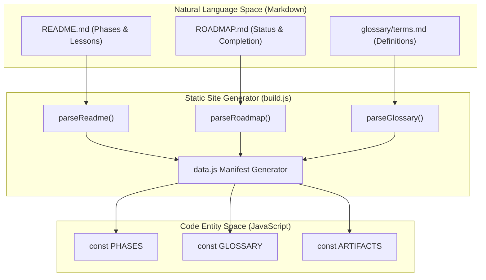
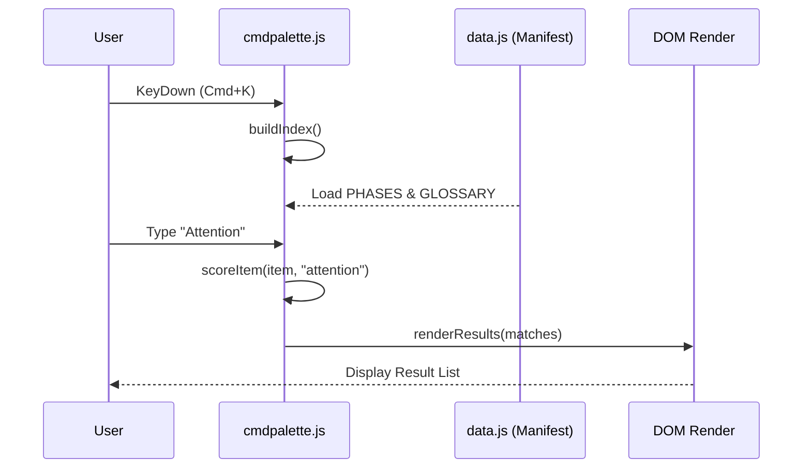

<!-- source: DeepWiki mcp.deepwiki.com · repo rohitg00/ai-engineering-from-scratch · page 17.1 Web Application & Static Site Generator · fetched 2026-10-30 -->

# Web Application & Static Site Generator

Relevant source files

The following files were used as context for generating this wiki page:

- [.gitignore](.gitignore)
- [README.md](README.md)
- [phases/07-transformers-deep-dive/02-self-attention-from-scratch/code/self_attention.py](phases/07-transformers-deep-dive/02-self-attention-from-scratch/code/self_attention.py)
- [phases/07-transformers-deep-dive/02-self-attention-from-scratch/docs/en.md](phases/07-transformers-deep-dive/02-self-attention-from-scratch/docs/en.md)
- [phases/07-transformers-deep-dive/02-self-attention-from-scratch/outputs/prompt-attention-explainer.md](phases/07-transformers-deep-dive/02-self-attention-from-scratch/outputs/prompt-attention-explainer.md)
- [phases/07-transformers-deep-dive/05-full-transformer/assets/full-transformer.svg](phases/07-transformers-deep-dive/05-full-transformer/assets/full-transformer.svg)
- [phases/07-transformers-deep-dive/05-full-transformer/code/main.py](phases/07-transformers-deep-dive/05-full-transformer/code/main.py)
- [phases/07-transformers-deep-dive/05-full-transformer/docs/en.md](phases/07-transformers-deep-dive/05-full-transformer/docs/en.md)
- [phases/07-transformers-deep-dive/05-full-transformer/notebook/.gitkeep](phases/07-transformers-deep-dive/05-full-transformer/notebook/.gitkeep)
- [phases/07-transformers-deep-dive/05-full-transformer/outputs/skill-transformer-block-reviewer.md](phases/07-transformers-deep-dive/05-full-transformer/outputs/skill-transformer-block-reviewer.md)
- [phases/07-transformers-deep-dive/12-kv-cache-flash-attention/assets/kv-cache-flash-attn.svg](phases/07-transformers-deep-dive/12-kv-cache-flash-attention/assets/kv-cache-flash-attn.svg)
- [phases/07-transformers-deep-dive/12-kv-cache-flash-attention/code/main.py](phases/07-transformers-deep-dive/12-kv-cache-flash-attention/code/main.py)
- [phases/07-transformers-deep-dive/12-kv-cache-flash-attention/docs/en.md](phases/07-transformers-deep-dive/12-kv-cache-flash-attention/docs/en.md)
- [phases/07-transformers-deep-dive/12-kv-cache-flash-attention/notebook/.gitkeep](phases/07-transformers-deep-dive/12-kv-cache-flash-attention/notebook/.gitkeep)
- [phases/07-transformers-deep-dive/12-kv-cache-flash-attention/outputs/skill-inference-optimizer.md](phases/07-transformers-deep-dive/12-kv-cache-flash-attention/outputs/skill-inference-optimizer.md)
- [site/app.js](site/app.js)
- [site/assets/figures/001-a-prompts.svg](site/assets/figures/001-a-prompts.svg)
- [site/assets/figures/001-b-skills.svg](site/assets/figures/001-b-skills.svg)
- [site/assets/figures/001-c-agents.svg](site/assets/figures/001-c-agents.svg)
- [site/assets/figures/001-d-mcp-servers.svg](site/assets/figures/001-d-mcp-servers.svg)
- [site/assets/figures/004-gaussian-kernel-blur.svg](site/assets/figures/004-gaussian-kernel-blur.svg)
- [site/assets/figures/005-transformer-attention-heads.svg](site/assets/figures/005-transformer-attention-heads.svg)
- [site/assets/figures/INDEX.md](site/assets/figures/INDEX.md)
- [site/build.js](site/build.js)
- [site/catalog.html](site/catalog.html)
- [site/cmdpalette.js](site/cmdpalette.js)
- [site/data.js](site/data.js)
- [site/figures.js](site/figures.js)
- [site/glossary.html](site/glossary.html)
- [site/header.js](site/header.js)
- [site/index.html](site/index.html)
- [site/lesson-figures.js](site/lesson-figures.js)
- [site/lesson.html](site/lesson.html)
- [site/prereqs.html](site/prereqs.html)
- [site/progress.js](site/progress.js)
- [site/robots.txt](site/robots.txt)
- [site/stats.json](site/stats.json)
- [site/style.css](site/style.css)
- [vercel.json](vercel.json)

This page documents the architecture of the **AI Engineering from Scratch** web presence, which functions as both a static site and a Single Page Application (SPA). The system is designed to be zero-dependency on the client side, using vanilla JavaScript to provide search, progress tracking, and interactive visualizations.

## System Architecture

The project utilizes a custom build pipeline that transforms the repository's Markdown content into a structured JSON-like manifest (`data.js`), which the frontend then consumes to render the interface dynamically.

### Build Pipeline (build.js)

The build script `site/build.js` is a Node.js utility that acts as the Static Site Generator (SSG). It runs during CI/CD to synchronize the web representation with the physical state of the repository.

| Function | Responsibility |
|:---|:---|
| `parseRoadmap` | Scans `ROADMAP.md` to extract completion statuses (✅, 🚧, ⬚) for every phase and lesson [site/build.js:31-61](). |
| `parseReadme` | Parses the main `README.md` to discover the hierarchy of phases, their descriptions, and the lessons contained within each [site/build.js:64-188](). |
| `extractLessonMeta` | (Implicit in parse logic) Extracts lesson types (Build/Learn) and language requirements (Python, Rust, etc.) from Markdown tables [site/build.js:135-165](). |
| `build` | The entry point that orchestrates file reading and writes the final `data.js` manifest [site/build.js:250-280](). |

**Sources:** `site/build.js`

### Data Flow: Markdown to Code Entities

The following diagram illustrates how natural language documentation in the repository is transformed into structured JavaScript constants used by the application.

**Sources:** [site/build.js:31-61](), [site/build.js:64-188](), [site/data.js:4-116]()

---

## Frontend Architecture (SPA)

The website is hosted as a set of static HTML files that use an SPA-like routing mechanism for lessons.

### Core Components
*   **index.html**: The landing page and curriculum overview [site/index.html:1-350]().
*   **lesson.html**: A generic template that dynamically loads lesson content based on the `?path=` URL parameter [site/lesson.html:1-240]().
*   **app.js**: The main application controller handling theme toggling, stats computation, and UI rendering [site/app.js:1-150]().

### Search & Command Palette
The search system is implemented in `site/cmdpalette.js`. It performs client-side fuzzy matching against the `PHASES`, `GLOSSARY`, and `ARTIFACTS` constants.

*   **Trigger**: Activated via `Cmd/Ctrl + K` or the search icon [site/cmdpalette.js:1-13]().
*   **Scoring**: The `scoreItem` function ranks results based on exact matches (200 pts), prefix matches (100 pts), and keyword density [site/cmdpalette.js:103-156]().

**Sources:** [site/cmdpalette.js:103-156](), [site/cmdpalette.js:33-100]()

---

## Progress Tracking System

User progress is persisted locally to allow learners to track their journey through the 503 lessons without requiring a backend account.

### LocalStorage Schema
The system uses a specific schema for progress: `aifs:progress:v1`.

*   **Key**: `aifs:progress:v1`
*   **Value**: A JSON object mapping lesson paths to completion status and timestamps.
*   **Sync**: `progress.js` implements a `StorageEvent` listener to ensure progress is synchronized across multiple open tabs.

### Key Functions
*   **isLessonComplete(path)**: Checks the local manifest for a specific lesson slug [site/app.js:57]().
*   **computeStats()**: Aggregates total completion percentage across all 20 phases to update the global progress bars [site/app.js:45-72]().

**Sources:** `site/app.js`, `site/progress.js`

---

## Interactive Visuals & Animations

The site features custom SVG-based animations to visualize complex AI concepts.

### SVG Library
The `site/assets/figures/` directory contains a library of hand-crafted SVGs for core concepts:
*   **001-a/b/c/d**: Icons for Prompts, Skills, Agents, and MCP servers [site/assets/figures/INDEX.md]().
*   **005-transformer-attention-heads.svg**: Visualization of multi-head attention mechanics.

### Reveal & Explode Logic
The site uses `IntersectionObserver` to trigger "reveal" animations as the user scrolls.
*   **Explode Animation**: Found in `site/app.js`, the `initScrollExplode` function manages the "Explode Animation" system, which creates parallax or scattering effects on specific visual elements as they enter the viewport [site/app.js:22]().
*   **Staggered Index**: `initStaggerIndex` applies CSS transition delays to list items (like the Phase grid) to create a cascading entrance effect [site/app.js:17]().

**Sources:** [site/app.js:13-23](), [site/style.css:173-197]()

---

## Deployment & Infrastructure

The site is optimized for deployment on Vercel.

*   **vercel.json**: Configures headers for security and clean URLs.
*   **Sitemap Generation**: `site/build.js` automatically generates `sitemap.xml` and `llms.txt` during the build process to assist search engines and LLM crawlers [site/build.js:275-280]().
*   **Asset Optimization**: CSS variables are used extensively for theme switching (Light/Dark mode) [site/style.css:1-73]().

**Sources:** `vercel.json`, `site/build.js`, `site/style.css`

---

