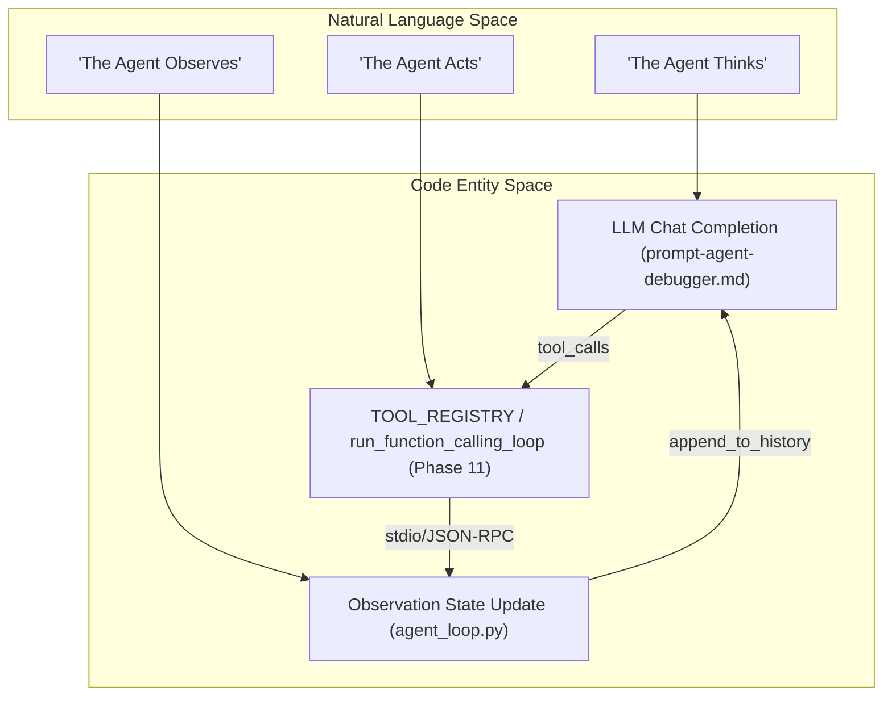
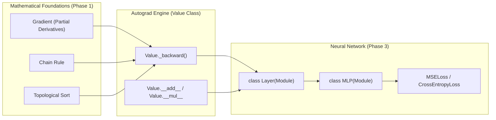

<!-- source: DeepWiki mcp.deepwiki.com · repo rohitg00/ai-engineering-from-scratch · page 18 AI Engineering Reference Glossary · fetched 2026-10-30 -->

# AI Engineering Reference Glossary

Relevant source files

The following files were used as context for generating this wiki page:

- [.gitignore](.gitignore)
- [README.md](README.md)
- [phases/01-math-foundations/04-calculus-for-ml/docs/en.md](phases/01-math-foundations/04-calculus-for-ml/docs/en.md)
- [phases/01-math-foundations/05-chain-rule-and-autodiff/docs/en.md](phases/01-math-foundations/05-chain-rule-and-autodiff/docs/en.md)
- [phases/03-deep-learning-core/03-backpropagation/docs/en.md](phases/03-deep-learning-core/03-backpropagation/docs/en.md)
- [phases/03-deep-learning-core/10-mini-framework/docs/en.md](phases/03-deep-learning-core/10-mini-framework/docs/en.md)
- [phases/03-deep-learning-core/11-intro-to-pytorch/docs/en.md](phases/03-deep-learning-core/11-intro-to-pytorch/docs/en.md)
- [phases/03-deep-learning-core/13-debugging-neural-networks/docs/en.md](phases/03-deep-learning-core/13-debugging-neural-networks/docs/en.md)
- [phases/05-nlp-foundations-to-advanced/08-cnns-rnns-for-text/docs/en.md](phases/05-nlp-foundations-to-advanced/08-cnns-rnns-for-text/docs/en.md)
- [phases/09-reinforcement-learning/06-policy-gradients-reinforce/assets/policy-gradient.svg](phases/09-reinforcement-learning/06-policy-gradients-reinforce/assets/policy-gradient.svg)
- [phases/09-reinforcement-learning/06-policy-gradients-reinforce/code/main.py](phases/09-reinforcement-learning/06-policy-gradients-reinforce/code/main.py)
- [phases/09-reinforcement-learning/06-policy-gradients-reinforce/docs/en.md](phases/09-reinforcement-learning/06-policy-gradients-reinforce/docs/en.md)
- [phases/09-reinforcement-learning/06-policy-gradients-reinforce/notebook/.gitkeep](phases/09-reinforcement-learning/06-policy-gradients-reinforce/notebook/.gitkeep)
- [phases/09-reinforcement-learning/06-policy-gradients-reinforce/outputs/skill-policy-gradient-trainer.md](phases/09-reinforcement-learning/06-policy-gradients-reinforce/outputs/skill-policy-gradient-trainer.md)
- [phases/09-reinforcement-learning/07-actor-critic-a2c-a3c/docs/en.md](phases/09-reinforcement-learning/07-actor-critic-a2c-a3c/docs/en.md)
- [phases/09-reinforcement-learning/08-ppo/docs/en.md](phases/09-reinforcement-learning/08-ppo/docs/en.md)
- [phases/09-reinforcement-learning/09-reward-modeling-rlhf/docs/en.md](phases/09-reinforcement-learning/09-reward-modeling-rlhf/docs/en.md)
- [phases/09-reinforcement-learning/12-rl-for-games/docs/en.md](phases/09-reinforcement-learning/12-rl-for-games/docs/en.md)
- [phases/10-llms-from-scratch/01-tokenizers/docs/en.md](phases/10-llms-from-scratch/01-tokenizers/docs/en.md)
- [phases/10-llms-from-scratch/02-building-a-tokenizer/docs/en.md](phases/10-llms-from-scratch/02-building-a-tokenizer/docs/en.md)
- [phases/10-llms-from-scratch/04-pre-training-mini-gpt/docs/en.md](phases/10-llms-from-scratch/04-pre-training-mini-gpt/docs/en.md)
- [phases/11-llm-engineering/05-context-engineering/docs/en.md](phases/11-llm-engineering/05-context-engineering/docs/en.md)
- [site/app.js](site/app.js)
- [site/build.js](site/build.js)
- [site/catalog.html](site/catalog.html)
- [site/cmdpalette.js](site/cmdpalette.js)
- [site/data.js](site/data.js)
- [site/glossary.html](site/glossary.html)
- [site/header.js](site/header.js)
- [site/index.html](site/index.html)
- [site/lesson.html](site/lesson.html)
- [site/prereqs.html](site/prereqs.html)
- [site/progress.js](site/progress.js)
- [site/robots.txt](site/robots.txt)
- [site/stats.json](site/stats.json)
- [site/style.css](site/style.css)
- [vercel.json](vercel.json)

This glossary provides a centralized reference for the terminology, jargon, and technical concepts used throughout the **AI Engineering from Scratch** curriculum. AI engineering often suffers from "semantic overload," where colloquial descriptions ("The AI is thinking") mask specific algorithmic implementations ("An autoregressive token sampling loop"). 

The purpose of this page is to bridge the gap between high-level intuition and low-level code. Each entry clarifies what people say versus what the code actually does, providing direct pointers to the implementation logic within this repository.

---

## 18.1 Core ML & Architecture Terms

Foundational terms in Machine Learning and Deep Learning form the "grammar" of the field. This section covers the standard industry definitions for models, training techniques, and architectural components as they are applied in the codebase.

### Key Concepts Overview
*   **Transformer & Attention**: The backbone of modern LLMs. In this repo, we move beyond the "focus" metaphor to implement the actual scaled dot-product math in `phases/07-transformers/02-self-attention/`.
*   **Training & Alignment**: Concepts like **Backpropagation**, **SFT** (Supervised Fine-Tuning), and **RLHF** (Reinforcement Learning from Human Feedback) describe how weights are updated.
*   **Inference Dynamics**: Terms like **Temperature**, **KV Cache**, and **Context Window** define how a model behaves during generation.

For a comprehensive list of 60+ foundational terms and common industry myths (e.g., "Temperature makes AI creative"), see the detailed breakdown in [Core ML & Architecture Terms](#18.1).

**Sources:** [README.md:67-71](), [phases/03-deep-learning-core/13-debugging-neural-networks/docs/en.md:53-64](), [phases/09-reinforcement-learning/09-reward-modeling-rlhf/docs/en.md:1-20]()

---

## 18.2 Codebase-Specific Jargon & Abbreviations

While standard ML terms are universal, this repository uses specific patterns and naming conventions to organize the "from scratch" journey. Understanding these is critical for navigating the `outputs/` directory and the `Phase` structure.

### The "Build It" Vocabulary
*   **The Agent Loop**: Not a sentient entity, but a specific `while` loop pattern where an LLM orchestrates tool calls, implemented in `agent_loop.py` and `agent_loop.ts`.
*   **Value Class**: The heart of our custom **Autograd Engine**, representing a single scalar value and its gradient [phases/01-math-foundations/05-chain-rule-and-autodiff/docs/en.md:1-15]().
*   **Toolkit Artifacts**: The reusable outputs of lessons, including `prompts`, `skills`, and `MCP servers` found in the root `outputs/` directory.
*   **Mathematical Primitives**: Specific implementations like **Deflation** (for SVD), **Topological Sort** (for backprop), and **Dual Numbers**.
*   **Lesson Contract**: The set of invariants enforced by CI (e.g., `curriculum.yml`) to ensure every lesson follows the 6-step lifecycle.

For the full dictionary of repo-specific terms and their corresponding file pointers, see [Codebase-Specific Jargon & Abbreviations](#18.2).

**Sources:** [README.md:87-111](), [site/data.js:4-100](), [site/build.js:31-61]()

---

## Bridging Natural Language to Code Space

The following diagrams illustrate how abstract AI concepts translate into concrete code entities within this repository.

### Diagram 1: The Anatomy of an Agent
This diagram maps the colloquial "Autonomous Agent" to the actual code loop implemented in Phase 14 and Phase 11.

**Sources:** [README.md:72-75](), [site/data.js:145-165]()

### Diagram 2: From Math to Neural Networks
This diagram shows how the mathematical foundations in Phase 1 manifest as the engine for Deep Learning in Phase 3.

**Sources:** [phases/03-deep-learning-core/13-debugging-neural-networks/docs/en.md:87-116](), [site/data.js:111-120]()

---

## Quick Reference Table

| Term | Colloquial Meaning | Technical Reality in Code |
| :--- | :--- | :--- |
| **Agent** | Autonomous entity | A `while` loop calling an LLM and tools [README.md:103-111](). |
| **Temperature** | Creativity knob | Scaling factor for `logits` before `softmax`. |
| **Embedding** | Word "meaning" | A dense vector in a learned continuous space. |
| **Context Window** | Memory | A fixed-size buffer that resets every API call. |
| **Backprop** | Learning | Applying the `chain rule` backward via `Value._backward()`. |
| **MCP** | Plugin system | Model Context Protocol (JSON-RPC) over `stdio`. |
| **SFT** | Training | Supervised Fine-Tuning on (Prompt, Response) pairs. |
| **NaN** | Error | Numerical instability (e.g., `log(0)`) in loss functions [phases/03-deep-learning-core/13-debugging-neural-networks/docs/en.md:75-86](). |

**Sources:** [README.md:152-160](), [site/data.js:43-46](), [phases/03-deep-learning-core/13-debugging-neural-networks/docs/en.md:53-86]()

---

