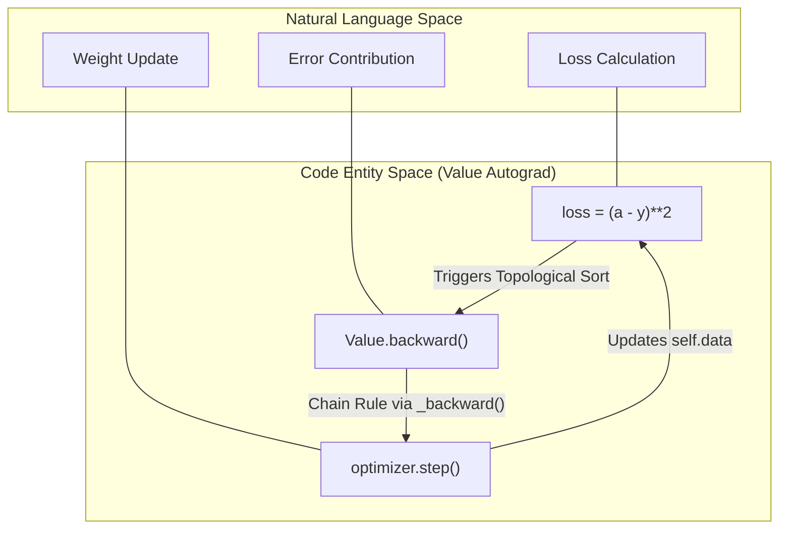
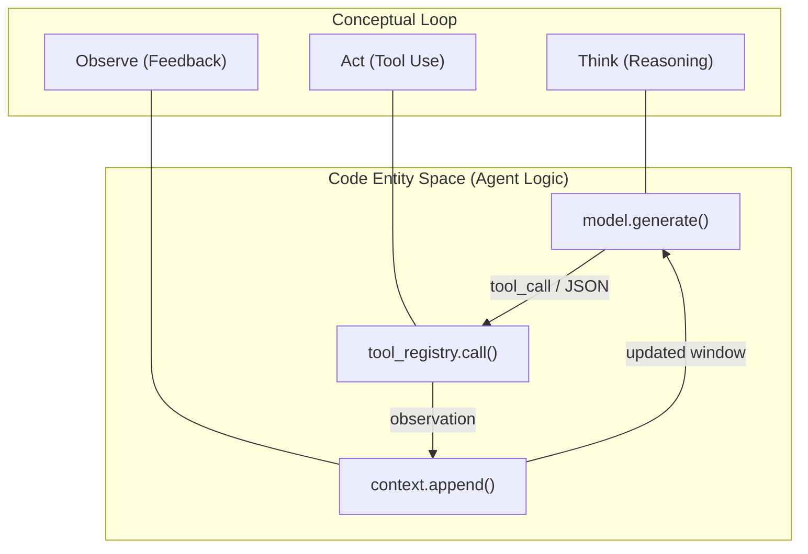

<!-- source: DeepWiki mcp.deepwiki.com · repo rohitg00/ai-engineering-from-scratch · page 18.1 Core ML & Architecture Terms · fetched 2026-10-30 -->

# Core ML & Architecture Terms

Relevant source files

The following files were used as context for generating this wiki page:

- [phases/01-math-foundations/04-calculus-for-ml/docs/en.md](phases/01-math-foundations/04-calculus-for-ml/docs/en.md)
- [phases/01-math-foundations/05-chain-rule-and-autodiff/docs/en.md](phases/01-math-foundations/05-chain-rule-and-autodiff/docs/en.md)
- [phases/03-deep-learning-core/03-backpropagation/docs/en.md](phases/03-deep-learning-core/03-backpropagation/docs/en.md)
- [phases/03-deep-learning-core/10-mini-framework/docs/en.md](phases/03-deep-learning-core/10-mini-framework/docs/en.md)
- [phases/03-deep-learning-core/11-intro-to-pytorch/docs/en.md](phases/03-deep-learning-core/11-intro-to-pytorch/docs/en.md)
- [phases/03-deep-learning-core/13-debugging-neural-networks/docs/en.md](phases/03-deep-learning-core/13-debugging-neural-networks/docs/en.md)
- [phases/05-nlp-foundations-to-advanced/08-cnns-rnns-for-text/docs/en.md](phases/05-nlp-foundations-to-advanced/08-cnns-rnns-for-text/docs/en.md)
- [phases/09-reinforcement-learning/06-policy-gradients-reinforce/assets/policy-gradient.svg](phases/09-reinforcement-learning/06-policy-gradients-reinforce/assets/policy-gradient.svg)
- [phases/09-reinforcement-learning/06-policy-gradients-reinforce/code/main.py](phases/09-reinforcement-learning/06-policy-gradients-reinforce/code/main.py)
- [phases/09-reinforcement-learning/06-policy-gradients-reinforce/docs/en.md](phases/09-reinforcement-learning/06-policy-gradients-reinforce/docs/en.md)
- [phases/09-reinforcement-learning/06-policy-gradients-reinforce/notebook/.gitkeep](phases/09-reinforcement-learning/06-policy-gradients-reinforce/notebook/.gitkeep)
- [phases/09-reinforcement-learning/06-policy-gradients-reinforce/outputs/skill-policy-gradient-trainer.md](phases/09-reinforcement-learning/06-policy-gradients-reinforce/outputs/skill-policy-gradient-trainer.md)
- [phases/09-reinforcement-learning/07-actor-critic-a2c-a3c/docs/en.md](phases/09-reinforcement-learning/07-actor-critic-a2c-a3c/docs/en.md)
- [phases/09-reinforcement-learning/08-ppo/docs/en.md](phases/09-reinforcement-learning/08-ppo/docs/en.md)
- [phases/09-reinforcement-learning/09-reward-modeling-rlhf/docs/en.md](phases/09-reinforcement-learning/09-reward-modeling-rlhf/docs/en.md)
- [phases/09-reinforcement-learning/12-rl-for-games/docs/en.md](phases/09-reinforcement-learning/12-rl-for-games/docs/en.md)
- [phases/10-llms-from-scratch/01-tokenizers/docs/en.md](phases/10-llms-from-scratch/01-tokenizers/docs/en.md)
- [phases/10-llms-from-scratch/02-building-a-tokenizer/docs/en.md](phases/10-llms-from-scratch/02-building-a-tokenizer/docs/en.md)
- [phases/10-llms-from-scratch/04-pre-training-mini-gpt/docs/en.md](phases/10-llms-from-scratch/04-pre-training-mini-gpt/docs/en.md)
- [phases/11-llm-engineering/01-prompt-engineering/docs/en.md](phases/11-llm-engineering/01-prompt-engineering/docs/en.md)
- [phases/11-llm-engineering/02-few-shot-cot/docs/en.md](phases/11-llm-engineering/02-few-shot-cot/docs/en.md)
- [phases/11-llm-engineering/03-structured-outputs/code/main.py](phases/11-llm-engineering/03-structured-outputs/code/main.py)
- [phases/11-llm-engineering/03-structured-outputs/docs/en.md](phases/11-llm-engineering/03-structured-outputs/docs/en.md)
- [phases/11-llm-engineering/03-structured-outputs/outputs/prompt-structured-extractor.md](phases/11-llm-engineering/03-structured-outputs/outputs/prompt-structured-extractor.md)
- [phases/11-llm-engineering/03-structured-outputs/outputs/skill-structured-outputs.md](phases/11-llm-engineering/03-structured-outputs/outputs/skill-structured-outputs.md)
- [phases/11-llm-engineering/04-embeddings/docs/en.md](phases/11-llm-engineering/04-embeddings/docs/en.md)
- [phases/11-llm-engineering/05-context-engineering/docs/en.md](phases/11-llm-engineering/05-context-engineering/docs/en.md)
- [phases/11-llm-engineering/08-fine-tuning-lora/docs/en.md](phases/11-llm-engineering/08-fine-tuning-lora/docs/en.md)
- [phases/11-llm-engineering/09-function-calling/docs/en.md](phases/11-llm-engineering/09-function-calling/docs/en.md)
- [phases/11-llm-engineering/10-evaluation/docs/en.md](phases/11-llm-engineering/10-evaluation/docs/en.md)
- [phases/11-llm-engineering/11-caching-cost/docs/en.md](phases/11-llm-engineering/11-caching-cost/docs/en.md)
- [phases/11-llm-engineering/12-guardrails/docs/en.md](phases/11-llm-engineering/12-guardrails/docs/en.md)
- [phases/11-llm-engineering/13-production-app/docs/en.md](phases/11-llm-engineering/13-production-app/docs/en.md)

This page defines the foundational machine learning and architectural concepts used throughout the **AI Engineering from Scratch** curriculum. It distinguishes between colloquial industry "hype" and the actual technical implementations found in the codebase.

The definitions below are categorized by their role in the AI stack, from low-level mathematical operations to high-level autonomous agent architectures.

---

## 1. Core Model Architectures

The structural blueprints of modern AI systems.

### Transformer
*   **What it actually means:** An architecture that uses self-attention mechanisms to process input data in parallel, rather than sequentially. It consists of an encoder, a decoder, or both [glossary/terms.md:111-112]().
*   **Implementation:** Found in Phase 7, Lesson 02. It replaces RNNs by treating input as a set and injecting order via positional encodings [glossary/myths.md:86-89]().

### GPT (Generative Pre-trained Transformer)
*   **What it actually means:** A specific decoder-only transformer architecture trained to predict the next token using large-scale text corpora [glossary/terms.md:111-112]().
*   **Components:** Generative (produces text), Pre-trained (initial weight training), Transformer (the mechanism) [glossary/myths.md:49-51]().
*   **Architecture Flow:** Token IDs → Embeddings → Transformer Blocks → Linear Head → Softmax [phases/10-llms-from-scratch/04-pre-training-mini-gpt/docs/en.md:48-72]().

### MoE (Mixture of Experts)
*   **What it actually means:** A sparse architecture where only a fraction of the model's parameters (the "experts") are activated for any given input token.
*   **Why it's used:** It allows for models with massive total parameter counts (e.g., 1T+) to have the inference latency and compute cost of much smaller models.

### Autoregressive
*   **What it actually means:** A model that predicts the next token conditioned on all previous tokens, then appends that prediction to the input for the next step [glossary/terms.md:21-21](). It uses a **causal mask** to prevent looking at future tokens [phases/10-llms-from-scratch/04-pre-training-mini-gpt/docs/en.md:107-108]().

**Sources:** [glossary/terms.md:19-21](), [glossary/terms.md:109-112](), [glossary/myths.md:47-51](), [phases/10-llms-from-scratch/04-pre-training-mini-gpt/docs/en.md:31-46]()

---

## 2. Attention & Optimization Mechanics

The mathematical "engine" that drives learning and inference.

### Attention
*   **Technical Definition:** A mechanism where every token computes a weighted sum of all other tokens' values. Weights are determined by the dot product of **Query (Q)**, **Key (K)**, and **Value (V)** vectors [glossary/terms.md:12-12]().
*   **Code Entity:** Scaled dot-product attention: `(Q @ K.T) / sqrt(d_k)` [phases/10-llms-from-scratch/04-pre-training-mini-gpt/docs/en.md:96-105]().

### Backpropagation
*   **Technical Definition:** An algorithm that applies the **Chain Rule** backward through a computation graph to determine how much each weight contributed to the total error [glossary/terms.md:31-31]().
*   **Code Entity:** The `_backward` function and `Value.backward()` method which uses a topological sort to propagate gradients [phases/03-deep-learning-core/03-backpropagation/docs/en.md:142-167]().

### KV Cache (Key-Value Cache)
*   **Technical Definition:** An optimization for autoregressive inference that stores the Key and Value vectors for previous tokens so they don't need to be recomputed at every generation step.

### Temperature
*   **Technical Definition:** A hyperparameter that scales the **logits** (raw model outputs) before the **softmax** layer.
*   **Effect:** Higher temperature flattens the distribution (more randomness); lower temperature sharpens it (more deterministic) [glossary/myths.md:55-57]().

### Perplexity (PPL)
*   **Technical Definition:** A measurement of how well a probability distribution or model predicts a sample. In LLMs, it is the exponentiated average negative log-likelihood of a sequence. Lower is better.

**Architecture to Code Mapping: The Training Loop**

**Sources:** [phases/03-deep-learning-core/03-backpropagation/docs/en.md:103-134](), [phases/01-math-foundations/05-chain-rule-and-autodiff/docs/en.md:168-195](), [glossary/terms.md:29-33]()

---

## 3. Data Representation & Retrieval

### Token & Tokenization
*   **Token:** The smallest unit of text processed by the model [glossary/terms.md:21]().
*   **BPE (Byte Pair Encoding):** A subword tokenization algorithm that merges the most frequent adjacent pairs of bytes/characters [phases/10-llms-from-scratch/01-tokenizers/docs/en.md:53-58]().
*   **Byte-Level BPE:** Operates on raw bytes (0-255) to eliminate `[UNK]` tokens [phases/10-llms-from-scratch/02-building-a-tokenizer/docs/en.md:61-66]().

### Embedding & Latent Space
*   **Embedding:** A learned mapping from discrete items to dense vectors in continuous geometric space [glossary/terms.md:86-87]().
*   **Latent Space:** The compressed, multi-dimensional space where hidden representations reside.

### Context Engineering
*   **Context Window:** The fixed-size buffer for a single model pass [glossary/terms.md:38-38]().
*   **Lost-in-the-Middle:** The empirical finding that LLMs attend better to information at the start and end of the context than the middle [phases/11-llm-engineering/05-context-engineering/docs/en.md:59-64]().

### RAG (Retrieval-Augmented Generation)
*   **Technical Definition:** Providing the model with external facts by retrieving relevant document chunks from a **Vector Database** and injecting them into the prompt [glossary/myths.md:63-65]().

**Sources:** [phases/10-llms-from-scratch/01-tokenizers/docs/en.md:31-40](), [phases/11-llm-engineering/05-context-engineering/docs/en.md:18-30](), [glossary/myths.md:109-114]()

---

## 4. Training & Alignment Techniques

*   **SFT (Supervised Fine-Tuning):** Initial alignment on high-quality demonstrations [phases/09-reinforcement-learning/09-reward-modeling-rlhf/docs/en.md:24-24]().
*   **RLHF (Reinforcement Learning from Human Feedback):** A three-stage process (SFT → RM → PPO) to align models with human preferences [phases/09-reinforcement-learning/09-reward-modeling-rlhf/docs/en.md:16-18]().
*   **DPO (Direct Preference Optimization):** A closed-form alternative to RLHF that optimizes preferences without a separate reward model or PPO [phases/09-reinforcement-learning/09-reward-modeling-rlhf/docs/en.md:52-52]().
*   **LoRA (Low-Rank Adaptation):** Freezes base weights and trains small adapter matrices.
*   **PPO (Proximal Policy Optimization):** An RL algorithm using a **clipped surrogate objective** to prevent policy instability [phases/09-reinforcement-learning/08-ppo/docs/en.md:30-33]().

**Sources:** [phases/09-reinforcement-learning/09-reward-modeling-rlhf/docs/en.md:26-48](), [phases/09-reinforcement-learning/08-ppo/docs/en.md:18-20](), [glossary/terms.md:70-73]()

---

## 5. Agentic Systems

### Agent
*   **What it actually means:** A software pattern consisting of a **while loop** where an LLM decides which tool to call, executes it, observes the result, and repeats [glossary/terms.md:7-8]().
*   **The Agent Loop:** Consists of `Think` (LLM generation), `Act` (Tool execution), and `Observe` (Context update) [phases/11-llm-engineering/03-structured-outputs/docs/en.md:107-112]().

**Agent Loop Architecture**

**Sources:** [glossary/terms.md:5-9](), [phases/11-llm-engineering/03-structured-outputs/docs/en.md:105-118]()

---

## 6. Training Stability & Debugging

*   **Overfitting:** The model memorizes training noise. Diagnosis: Gap between training and validation loss grows [phases/03-deep-learning-core/13-debugging-neural-networks/docs/en.md:69-69]().
*   **Vanishing Gradients:** Gradients shrink exponentially in deep networks (common with sigmoid). Fix: Use ReLU/GELU or Residual connections [phases/03-deep-learning-core/13-debugging-neural-networks/docs/en.md:61-61]().
*   **Exploding Gradients:** Gradients grow exponentially, leading to **NaN** loss. Fix: Gradient clipping [phases/03-deep-learning-core/13-debugging-neural-networks/docs/en.md:63-63]().
*   **Dead ReLUs:** Neurons outputting 0 with 0 gradient. Fix: LeakyReLU or lower learning rate [phases/03-deep-learning-core/13-debugging-neural-networks/docs/en.md:59-59]().
*   **Scaling Laws:** Empirical observations that performance scales with compute, data, and parameters.

**Sources:** [phases/03-deep-learning-core/13-debugging-neural-networks/docs/en.md:37-51](), [phases/03-deep-learning-core/03-backpropagation/docs/en.md:89-101](), [glossary/myths.md:15-20]()

---

