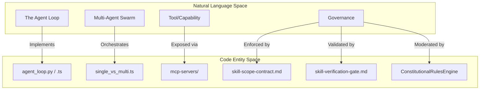
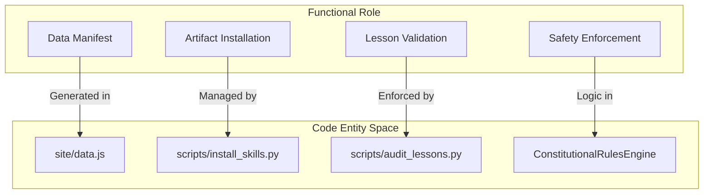

<!-- source: DeepWiki mcp.deepwiki.com · repo rohitg00/ai-engineering-from-scratch · page 18.2 Codebase-Specific Jargon & Abbreviations · fetched 2026-10-30 -->

# Codebase-Specific Jargon & Abbreviations

Relevant source files

The following files were used as context for generating this wiki page:

- [.github/workflows/curriculum.yml](.github/workflows/curriculum.yml)
- [.gitignore](.gitignore)
- [AGENTS.md](AGENTS.md)
- [README.md](README.md)
- [phases/14-agent-engineering/15-crewai-role-based-crews/code/main.py](phases/14-agent-engineering/15-crewai-role-based-crews/code/main.py)
- [phases/14-agent-engineering/15-crewai-role-based-crews/docs/en.md](phases/14-agent-engineering/15-crewai-role-based-crews/docs/en.md)
- [phases/14-agent-engineering/36-scope-contracts/code/main.py](phases/14-agent-engineering/36-scope-contracts/code/main.py)
- [phases/14-agent-engineering/36-scope-contracts/docs/en.md](phases/14-agent-engineering/36-scope-contracts/docs/en.md)
- [phases/14-agent-engineering/36-scope-contracts/outputs/skill-scope-contract.md](phases/14-agent-engineering/36-scope-contracts/outputs/skill-scope-contract.md)
- [phases/14-agent-engineering/38-verification-gates/code/main.py](phases/14-agent-engineering/38-verification-gates/code/main.py)
- [phases/14-agent-engineering/38-verification-gates/docs/en.md](phases/14-agent-engineering/38-verification-gates/docs/en.md)
- [phases/14-agent-engineering/38-verification-gates/outputs/skill-verification-gate.md](phases/14-agent-engineering/38-verification-gates/outputs/skill-verification-gate.md)
- [phases/19-capstone-projects/86-constitutional-rules-engine/code/main.py](phases/19-capstone-projects/86-constitutional-rules-engine/code/main.py)
- [phases/19-capstone-projects/86-constitutional-rules-engine/code/rules.yml](phases/19-capstone-projects/86-constitutional-rules-engine/code/rules.yml)
- [phases/19-capstone-projects/86-constitutional-rules-engine/code/tests.py](phases/19-capstone-projects/86-constitutional-rules-engine/code/tests.py)
- [phases/19-capstone-projects/86-constitutional-rules-engine/code/yaml_subset.py](phases/19-capstone-projects/86-constitutional-rules-engine/code/yaml_subset.py)
- [phases/19-capstone-projects/86-constitutional-rules-engine/docs/en.md](phases/19-capstone-projects/86-constitutional-rules-engine/docs/en.md)
- [phases/19-capstone-projects/86-constitutional-rules-engine/outputs/rules_report.json](phases/19-capstone-projects/86-constitutional-rules-engine/outputs/rules_report.json)
- [phases/19-capstone-projects/86-constitutional-rules-engine/outputs/skill-constitutional-rules-engine.md](phases/19-capstone-projects/86-constitutional-rules-engine/outputs/skill-constitutional-rules-engine.md)
- [phases/19-capstone-projects/86-constitutional-rules-engine/quiz.json](phases/19-capstone-projects/86-constitutional-rules-engine/quiz.json)
- [scripts/_lib.py](scripts/_lib.py)
- [scripts/build_catalog.py](scripts/build_catalog.py)
- [scripts/check_readme_counts.py](scripts/check_readme_counts.py)
- [scripts/install_skills.py](scripts/install_skills.py)
- [site/app.js](site/app.js)
- [site/build.js](site/build.js)
- [site/catalog.html](site/catalog.html)
- [site/cmdpalette.js](site/cmdpalette.js)
- [site/data.js](site/data.js)
- [site/glossary.html](site/glossary.html)
- [site/header.js](site/header.js)
- [site/index.html](site/index.html)
- [site/lesson.html](site/lesson.html)
- [site/prereqs.html](site/prereqs.html)
- [site/progress.js](site/progress.js)
- [site/robots.txt](site/robots.txt)
- [site/stats.json](site/stats.json)
- [site/style.css](site/style.css)
- [vercel.json](vercel.json)

This page defines the specialized terminology, architectural patterns, and mathematical shorthand used throughout the `ai-engineering-from-scratch` repository. Understanding these terms is essential for navigating the curriculum and utilizing the generated Toolkit artifacts.

## Structural Terminology

The repository is organized around a specific educational and engineering hierarchy designed for progressive mastery.

| Term | Definition |
| :--- | :--- |
| **Phase** | A high-level thematic block of the curriculum (e.g., Phase 1: Math Foundations). There are 20 phases in total [README.md:51-81](). |
| **Lesson** | A specific unit of study within a Phase, containing code, documentation, and notebooks [README.md:87-97](). |
| **Toolkit** | The collective output of the course, consisting of reusable prompts, skills, agents, and MCP servers stored in the `outputs/` directory [README.md:22-23](). |
| **Ship It** | The final stage of the 6-step lesson lifecycle where a functional artifact is exported to the global `outputs/` folder [README.md:110](). |
| **SkillKit** | The internal framework or methodology for installing and using `skill-*.md` artifacts in tools like Claude Code or Cursor [README.md:152-154](). |
| **Lesson Contract** | Invariants enforced by CI to ensure every lesson folder contains required subdirectories and valid metadata [site/build.js:168-175](). |
| **Catalog Drift** | A state where the `README.md` counts or `site/data.js` manifest falls out of sync with the actual file system [scripts/check_readme_counts.py:1-20](). |
| **Artifact Discovery** | The automated process of scanning lesson `outputs/` folders to populate the global registry [site/build.js:180-195](). |

**Sources:** [README.md:1-153](), [site/data.js:1-120](), [site/build.js:1-195]()

---

## Architectural Patterns

### The Agent Loop
The core execution pattern for autonomous entities. It follows a cyclic "Think → Act → Observe" process where an LLM reasons about a goal, selects a tool, executes it, and updates its state based on the result.
*   **Implementation:** `agent_loop.py` and `agent_loop.ts` in Phase 14 [README.md:40]().

### Swarms
A multi-agent coordination pattern where specialized agents communicate to solve complex tasks that exceed the capabilities of a single agent.
*   **Implementation:** Phase 16, Lesson 01 (e.g., `single_vs_multi.ts`) [README.md:75]().

### Model Context Protocol (MCP)
An open standard (JSON-RPC over stdio/HTTP) that allows AI agents to connect to external data sources and tools.
*   **Implementation:** Phase 13 (Tools & Protocols) and the `mcp-servers/` output directory [README.md:72]().

### Agent Workbench & Governance
Newer terms introduced in the expanded Phase 14 and Phase 19 curriculum:
*   **Scope Contract:** A JSON/YAML definition that constrains an agent's allowed actions and resource access [phases/14-agent-engineering/36-scope-contracts/docs/en.md:10-25]().
*   **Verification Gate:** A hard check (manual or automated) that must be passed before an agent can proceed to the next stage of a workflow [phases/14-agent-engineering/38-verification-gates/docs/en.md:5-15]().
*   **Constitutional Rules Engine:** A logic layer that evaluates agent outputs against a set of "Constitutional" principles before delivery [phases/19-capstone-projects/86-constitutional-rules-engine/docs/en.md:1-40]().
*   **Safety Gate:** The production implementation of a Constitutional engine, acting as a proxy between the LLM and the user [phases/19-capstone-projects/86-constitutional-rules-engine/code/main.py:10-30]().

### Mapping Concepts to Code
The following diagram illustrates how high-level agent concepts map to specific implementation entities in the codebase.

**Agent System Entity Mapping**

**Sources:** [README.md:144-153](), [phases/14-agent-engineering/36-scope-contracts/code/main.py:1-50](), [phases/19-capstone-projects/86-constitutional-rules-engine/code/main.py:1-60]()

---

## Mathematical & Algorithmic Jargon

### Autograd & Optimization
*   **Autograd Engine:** A system for automatic differentiation. It builds a computational graph during the forward pass to compute gradients in the backward pass.
*   **Value Class:** The fundamental unit of the autograd engine. It wraps a scalar `data` value and tracks `_prev` (children) and `_backward` (gradient function).
*   **Topological Sort:** An ordering of nodes in the computational graph such that for every directed edge $uv$, node $u$ comes before $v$. This is required to process gradients in the correct order during `backward()`.
*   **Dual Numbers:** Numbers of the form $a + b\epsilon$ where $\epsilon^2 = 0$. Used for forward-mode automatic differentiation.
*   **Gradient Accumulation:** The process of adding new gradients to existing ones (`self.grad += ...`) rather than replacing them, allowing for gradients to sum at branching nodes in the graph.

### Dimensionality Reduction & SVD
*   **PCA Pipeline:** The sequence of centering data, computing covariance, eigendecomposition, and projection.
*   **Deflation:** A technique in SVD/Eigendecomposition where once a principal component is found, its contribution is removed from the matrix to find the next component.
*   **Elbow Method:** A heuristic used to determine the optimal number of components ($k$) by looking for the "knee" in a plot of explained variance.
*   **Curse of Dimensionality:** The phenomenon where feature space volume increases so rapidly that data becomes sparse, and distance metrics lose discriminative power.

### Probability & Statistics
*   **Conjugate Prior:** A prior distribution that, when combined with a specific likelihood function, results in a posterior distribution of the same functional form.
*   **Laplace Smoothing:** Adding a small constant to counts to avoid zero probabilities for unseen features in Naive Bayes.
*   **Perplexity (PPL):** A measurement of how well a probability distribution or language model predicts a sample. It is defined as $e^{H(p,q)}$ where $H$ is cross-entropy.

### Modern Alignment & Training
*   **GRPO (Group Relative Policy Optimization):** A reinforcement learning algorithm used for reasoning models (DeepSeek-R1 style) that optimizes relative to a group of samples rather than a global baseline.
*   **Double Descent:** A phenomenon where model performance first improves, then worsens (overfitting), and then improves again as model complexity increases beyond the **Interpolation Threshold**.
*   **Surrogate Model:** A cheap-to-evaluate model (like a Gaussian Process) used in Bayesian Optimization to approximate an expensive objective function.
*   **Acquisition Function:** A mathematical function (e.g., Expected Improvement) that uses the surrogate model to decide where to sample next in the hyperparameter space.

**Sources:** [README.md:38-45](), [site/data.js:10-120](), [phases/19-capstone-projects/86-constitutional-rules-engine/docs/en.md:1-40]()

---

## Code-to-Concept Bridge

The following diagram maps specific implementation entities to their functional roles within the curriculum's automation and output system.

**Curriculum Infrastructure Map**

**Sources:** [site/build.js:1-30](), [scripts/install_skills.py:1-20](), [scripts/audit_lessons.py:1-25](), [phases/19-capstone-projects/86-constitutional-rules-engine/code/main.py:1-40]()