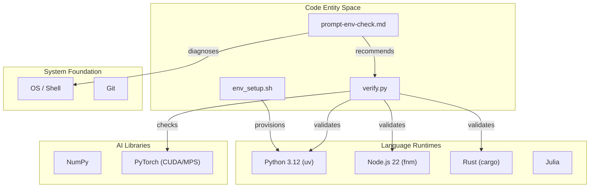
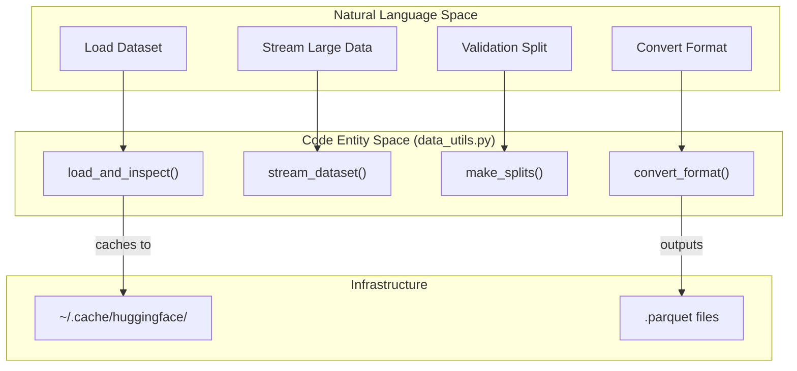

<!-- source: DeepWiki mcp.deepwiki.com · repo rohitg00/ai-engineering-from-scratch · page 2 Phase 0: Development Environment & Tooling · fetched 2026-10-30 -->

# Phase 0: Development Environment & Tooling

Relevant source files

The following files were used as context for generating this wiki page:

- [phases/00-setup-and-tooling/01-dev-environment/code/verify.py](phases/00-setup-and-tooling/01-dev-environment/code/verify.py)
- [phases/00-setup-and-tooling/01-dev-environment/docs/en.md](phases/00-setup-and-tooling/01-dev-environment/docs/en.md)
- [phases/00-setup-and-tooling/01-dev-environment/outputs/prompt-env-check.md](phases/00-setup-and-tooling/01-dev-environment/outputs/prompt-env-check.md)
- [phases/00-setup-and-tooling/01-dev-environment/quiz.json](phases/00-setup-and-tooling/01-dev-environment/quiz.json)
- [phases/00-setup-and-tooling/02-git-and-collaboration/docs/en.md](phases/00-setup-and-tooling/02-git-and-collaboration/docs/en.md)
- [phases/00-setup-and-tooling/04-apis-and-keys/code/first_api_call.py](phases/00-setup-and-tooling/04-apis-and-keys/code/first_api_call.py)
- [phases/00-setup-and-tooling/04-apis-and-keys/docs/en.md](phases/00-setup-and-tooling/04-apis-and-keys/docs/en.md)
- [phases/00-setup-and-tooling/04-apis-and-keys/outputs/prompt-api-troubleshooter.md](phases/00-setup-and-tooling/04-apis-and-keys/outputs/prompt-api-troubleshooter.md)
- [phases/00-setup-and-tooling/05-jupyter-notebooks/code/notebook_tips.py](phases/00-setup-and-tooling/05-jupyter-notebooks/code/notebook_tips.py)
- [phases/00-setup-and-tooling/05-jupyter-notebooks/docs/en.md](phases/00-setup-and-tooling/05-jupyter-notebooks/docs/en.md)
- [phases/00-setup-and-tooling/05-jupyter-notebooks/outputs/prompt-notebook-helper.md](phases/00-setup-and-tooling/05-jupyter-notebooks/outputs/prompt-notebook-helper.md)
- [phases/00-setup-and-tooling/06-python-environments/code/env_setup.sh](phases/00-setup-and-tooling/06-python-environments/code/env_setup.sh)
- [phases/00-setup-and-tooling/06-python-environments/docs/en.md](phases/00-setup-and-tooling/06-python-environments/docs/en.md)
- [phases/00-setup-and-tooling/07-docker-for-ai/code/Dockerfile](phases/00-setup-and-tooling/07-docker-for-ai/code/Dockerfile)
- [phases/00-setup-and-tooling/07-docker-for-ai/code/docker-compose.yml](phases/00-setup-and-tooling/07-docker-for-ai/code/docker-compose.yml)
- [phases/00-setup-and-tooling/07-docker-for-ai/docs/en.md](phases/00-setup-and-tooling/07-docker-for-ai/docs/en.md)
- [phases/00-setup-and-tooling/08-editor-setup/code/vscode/extensions.json](phases/00-setup-and-tooling/08-editor-setup/code/vscode/extensions.json)
- [phases/00-setup-and-tooling/08-editor-setup/code/vscode/settings.json](phases/00-setup-and-tooling/08-editor-setup/code/vscode/settings.json)
- [phases/00-setup-and-tooling/08-editor-setup/docs/en.md](phases/00-setup-and-tooling/08-editor-setup/docs/en.md)
- [phases/00-setup-and-tooling/09-data-management/code/data_utils.py](phases/00-setup-and-tooling/09-data-management/code/data_utils.py)
- [phases/00-setup-and-tooling/09-data-management/docs/en.md](phases/00-setup-and-tooling/09-data-management/docs/en.md)
- [phases/00-setup-and-tooling/09-data-management/outputs/prompt-data-helper.md](phases/00-setup-and-tooling/09-data-management/outputs/prompt-data-helper.md)
- [phases/00-setup-and-tooling/10-terminal-and-shell/code/shell_aliases.sh](phases/00-setup-and-tooling/10-terminal-and-shell/code/shell_aliases.sh)
- [phases/00-setup-and-tooling/10-terminal-and-shell/docs/en.md](phases/00-setup-and-tooling/10-terminal-and-shell/docs/en.md)
- [phases/00-setup-and-tooling/11-linux-for-ai/docs/en.md](phases/00-setup-and-tooling/11-linux-for-ai/docs/en.md)

Phase 0 establishes the foundational infrastructure required to build AI systems from scratch. Before implementing neural networks or agent loops, a robust multi-language environment must be configured to handle the diverse requirements of AI engineering, ranging from mathematical modeling in Julia to high-performance inference in Rust.

This phase is divided into 12 lessons that transition from basic system configuration to advanced developer workflows, data management, and containerization.

## Core Environment Setup

The initial lessons focus on creating a stable, reproducible environment across four distinct layers: System Foundation, Package Managers, Language Runtimes, and AI/ML Libraries [phases/00-setup-and-tooling/01-dev-environment/docs/en.md:25-32](). 

Key components include:
*   **Multi-Language Support**: Installation of Python 3.12 (via `uv`), Node.js 22 (via `fnm`), Rust (via `rustup`), and Julia [phases/00-setup-and-tooling/01-dev-environment/docs/en.md:54-115]().
*   **Virtual Environments**: Implementing a per-phase environment strategy using `uv`, `venv`, or `conda` to avoid dependency conflicts between conflicting library versions (e.g., PyTorch 2.4 vs 2.1) [phases/00-setup-and-tooling/06-python-environments/docs/en.md:113-131]().
*   **Verification**: A centralized script, `verify.py`, validates the presence of core dependencies like NumPy, Jupyter, and Git, as well as optional GPU support via PyTorch and CUDA [phases/00-setup-and-tooling/01-dev-environment/code/verify.py:5-22]().
*   **Jupyter Ecosystem**: Setting up notebooks as the "lab bench" for prototyping, while maintaining a "ship in scripts" workflow for production code [phases/00-setup-and-tooling/05-jupyter-notebooks/docs/en.md:17-21]().

### Environment Hierarchy & Validation

The following diagram illustrates how the system components interact and how the `verify.py` script maps to these entities.

**System Layer Mapping**

Sources: [phases/00-setup-and-tooling/01-dev-environment/docs/en.md:27-32](), [phases/00-setup-and-tooling/01-dev-environment/code/verify.py:5-22](), [phases/00-setup-and-tooling/06-python-environments/code/env_setup.sh:1-5]()

For details on specific installation commands and GPU configuration, see [Core Environment Setup](#2.1).

## Developer Workflow & Infrastructure Tools

Once the base languages are installed, the focus shifts to the professional AI developer's "inner loop." This involves optimizing the editor, terminal, and data management strategies.

*   **Docker for AI**: Utilizing a GPU-enabled `Dockerfile` based on `nvidia/cuda:12.4.1-devel-ubuntu22.04` to ensure environment parity between local development and cloud training environments [phases/00-setup-and-tooling/07-docker-for-ai/code/Dockerfile:1-154]().
*   **Data Management**: Using the `datasets` library for loading, streaming, and caching large datasets, and `data_utils.py` for converting between formats like Parquet, Arrow, and JSON [phases/00-setup-and-tooling/09-data-management/code/data_utils.py:22-77]().
*   **Editor & Terminal**: Configuring VS Code with Remote SSH for GPU boxes and setting up `tmux` for persistent training sessions that survive terminal disconnects [phases/00-setup-and-tooling/08-editor-setup/docs/en.md:131-159](), [phases/00-setup-and-tooling/10-terminal-and-shell/docs/en.md:140-174]().

### Tooling to Language Mapping

Different phases of the curriculum rely on specific toolchains within the environment.

| Language | Primary Use Case | Package Manager | Key Tools |
| :--- | :--- | :--- | :--- |
| **Python** | ML, Deep Learning, NLP, Vision | `uv` | `jupyter`, `datasets`, `torch` |
| **TypeScript** | Agents, MCP Servers, Infra | `pnpm` | `ts-node`, `@anthropic-ai/sdk` |
| **Rust** | Performance-critical Inference | `cargo` | `rustc`, `bpe.rs` |
| **Julia** | Math Foundations (Phase 1) | `Pkg` | `juliaup` |

Sources: [phases/00-setup-and-tooling/01-dev-environment/docs/en.md:147-153](), [phases/00-setup-and-tooling/04-apis-and-keys/docs/en.md:73-77]()

### Data Pipeline & Logic Flow

The following diagram bridges the high-level data concepts to the utility functions used to manage them.

**Data Utility Mapping**

Sources: [phases/00-setup-and-tooling/09-data-management/code/data_utils.py:22-100](), [phases/00-setup-and-tooling/09-data-management/docs/en.md:23-31]()

For details on containerization, data management, and terminal mastery, see [Developer Workflow & Infrastructure Tools](#2.2).

---

