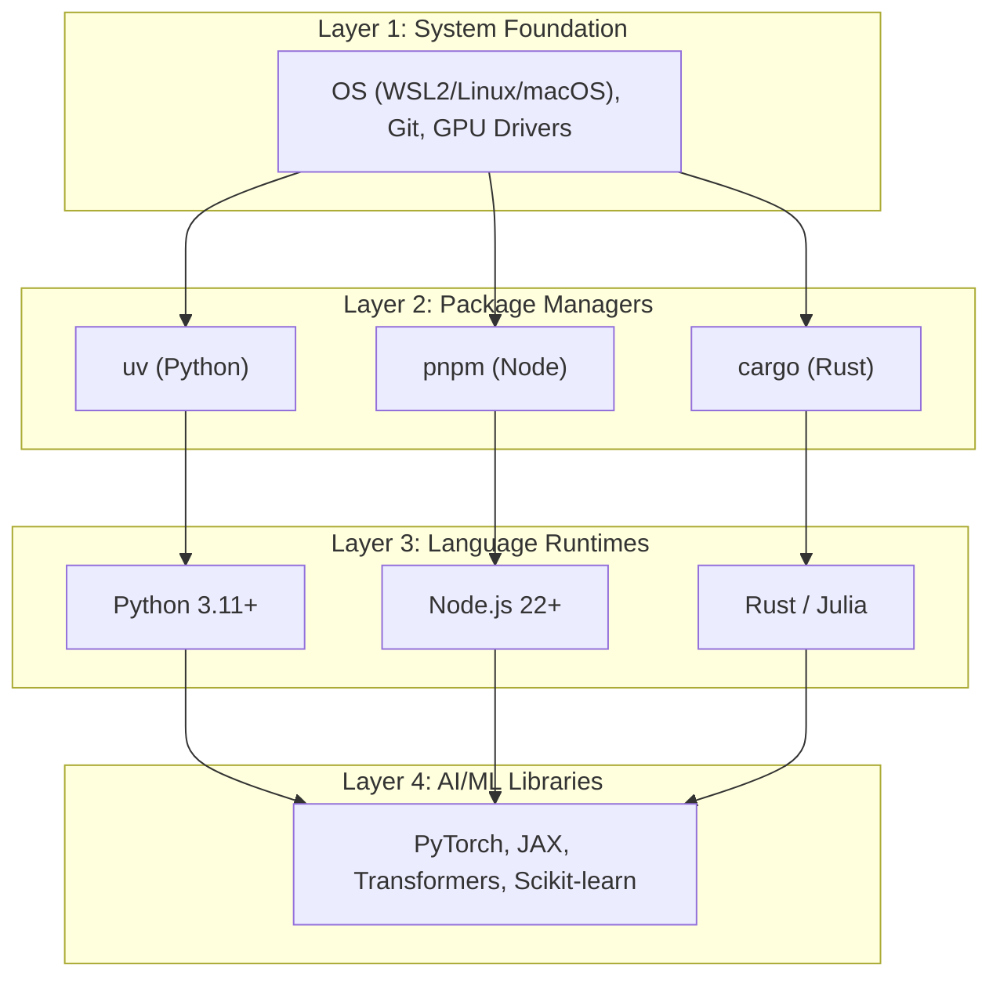
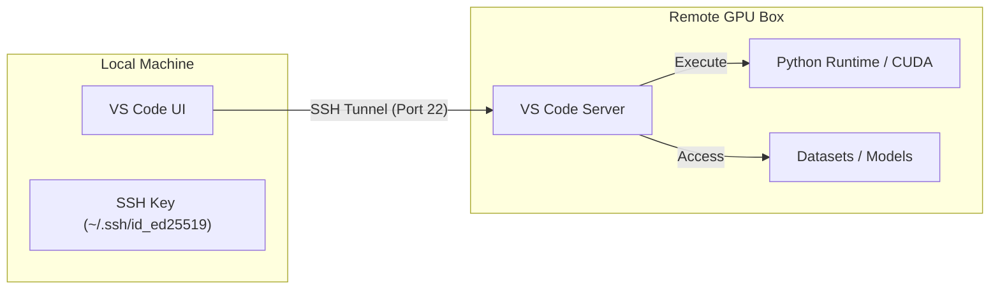
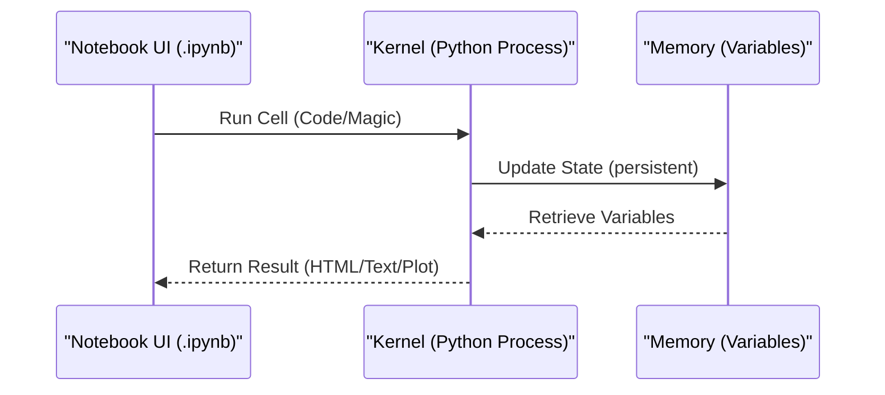

<!-- source: DeepWiki mcp.deepwiki.com · repo rohitg00/ai-engineering-from-scratch · page 2.1 Core Environment Setup · fetched 2026-10-30 -->

# Core Environment Setup

Relevant source files

The following files were used as context for generating this wiki page:

- [phases/00-setup-and-tooling/01-dev-environment/code/verify.py](phases/00-setup-and-tooling/01-dev-environment/code/verify.py)
- [phases/00-setup-and-tooling/01-dev-environment/docs/en.md](phases/00-setup-and-tooling/01-dev-environment/docs/en.md)
- [phases/00-setup-and-tooling/01-dev-environment/outputs/prompt-env-check.md](phases/00-setup-and-tooling/01-dev-environment/outputs/prompt-env-check.md)
- [phases/00-setup-and-tooling/01-dev-environment/quiz.json](phases/00-setup-and-tooling/01-dev-environment/quiz.json)
- [phases/00-setup-and-tooling/02-git-and-collaboration/docs/en.md](phases/00-setup-and-tooling/02-git-and-collaboration/docs/en.md)
- [phases/00-setup-and-tooling/04-apis-and-keys/code/first_api_call.py](phases/00-setup-and-tooling/04-apis-and-keys/code/first_api_call.py)
- [phases/00-setup-and-tooling/04-apis-and-keys/docs/en.md](phases/00-setup-and-tooling/04-apis-and-keys/docs/en.md)
- [phases/00-setup-and-tooling/04-apis-and-keys/outputs/prompt-api-troubleshooter.md](phases/00-setup-and-tooling/04-apis-and-keys/outputs/prompt-api-troubleshooter.md)
- [phases/00-setup-and-tooling/05-jupyter-notebooks/code/notebook_tips.py](phases/00-setup-and-tooling/05-jupyter-notebooks/code/notebook_tips.py)
- [phases/00-setup-and-tooling/05-jupyter-notebooks/docs/en.md](phases/00-setup-and-tooling/05-jupyter-notebooks/docs/en.md)
- [phases/00-setup-and-tooling/05-jupyter-notebooks/outputs/prompt-notebook-helper.md](phases/00-setup-and-tooling/05-jupyter-notebooks/outputs/prompt-notebook-helper.md)
- [phases/00-setup-and-tooling/06-python-environments/code/env_setup.sh](phases/00-setup-and-tooling/06-python-environments/code/env_setup.sh)
- [phases/00-setup-and-tooling/06-python-environments/docs/en.md](phases/00-setup-and-tooling/06-python-environments/docs/en.md)
- [phases/00-setup-and-tooling/07-docker-for-ai/code/Dockerfile](phases/00-setup-and-tooling/07-docker-for-ai/code/Dockerfile)
- [phases/00-setup-and-tooling/07-docker-for-ai/code/docker-compose.yml](phases/00-setup-and-tooling/07-docker-for-ai/code/docker-compose.yml)
- [phases/00-setup-and-tooling/07-docker-for-ai/docs/en.md](phases/00-setup-and-tooling/07-docker-for-ai/docs/en.md)
- [phases/00-setup-and-tooling/08-editor-setup/code/vscode/extensions.json](phases/00-setup-and-tooling/08-editor-setup/code/vscode/extensions.json)
- [phases/00-setup-and-tooling/08-editor-setup/code/vscode/settings.json](phases/00-setup-and-tooling/08-editor-setup/code/vscode/settings.json)
- [phases/00-setup-and-tooling/08-editor-setup/docs/en.md](phases/00-setup-and-tooling/08-editor-setup/docs/en.md)
- [phases/00-setup-and-tooling/09-data-management/code/data_utils.py](phases/00-setup-and-tooling/09-data-management/code/data_utils.py)
- [phases/00-setup-and-tooling/09-data-management/docs/en.md](phases/00-setup-and-tooling/09-data-management/docs/en.md)
- [phases/00-setup-and-tooling/09-data-management/outputs/prompt-data-helper.md](phases/00-setup-and-tooling/09-data-management/outputs/prompt-data-helper.md)
- [phases/00-setup-and-tooling/10-terminal-and-shell/code/shell_aliases.sh](phases/00-setup-and-tooling/10-terminal-and-shell/code/shell_aliases.sh)
- [phases/00-setup-and-tooling/10-terminal-and-shell/docs/en.md](phases/00-setup-and-tooling/10-terminal-and-shell/docs/en.md)
- [phases/00-setup-and-tooling/11-linux-for-ai/docs/en.md](phases/00-setup-and-tooling/11-linux-for-ai/docs/en.md)

This page covers the foundational environment setup required for AI engineering, spanning lessons 01–06 of Phase 0. It details the installation of multi-language runtimes, the configuration of high-performance Python environments, GPU verification, and the management of API credentials.

## 1. Multi-Layer Environment Architecture

The development environment is structured into four distinct layers, moving from hardware and OS foundations up to high-level AI libraries. Each layer serves as a dependency for the one above it.

### Environment Layer Diagram

**Sources:** [phases/00-setup-and-tooling/01-dev-environment/docs/en.md:25-32]()

## 2. Python Environment & Dependency Management

The curriculum uses `uv` as the primary package manager due to its performance (10-100x faster than `pip`) and integrated virtual environment management [phases/00-setup-and-tooling/01-dev-environment/docs/en.md:54-57]().

### Virtual Environment Strategy
To avoid "dependency hell"—where conflicting versions of libraries like PyTorch or CUDA bindings break projects—the repository recommends a per-phase isolation strategy [phases/00-setup-and-tooling/06-python-environments/docs/en.md:17-28]().

| Tool | Role | Command Example |
| :--- | :--- | :--- |
| `uv` | High-speed management | `uv venv` |
| `venv` | Built-in fallback | `python3 -m venv .venv` |
| `conda` | Non-Python deps (CUDA) | `conda install pytorch-cuda=12.4` |

### Environment Setup Logic
The script `phases/00-setup-and-tooling/06-python-environments/code/env_setup.sh` automates the creation of a shared base environment for the initial phases.
- It verifies a minimum Python version of 3.11 [phases/00-setup-and-tooling/01-dev-environment/docs/en.md:12]().
- It installs core libraries: `numpy`, `matplotlib`, `jupyter`, and `scikit-learn` [phases/00-setup-and-tooling/01-dev-environment/docs/en.md:66]().

**Sources:** [phases/00-setup-and-tooling/06-python-environments/docs/en.md:50-109](), [phases/00-setup-and-tooling/01-dev-environment/docs/en.md:54-67]()

## 3. Editor Setup & Remote Development

The recommended editor is VS Code (or AI-native forks like Cursor and Windsurf), configured with specific extensions for Python, Jupyter, and Remote SSH [phases/00-setup-and-tooling/08-editor-setup/docs/en.md:38-42]().

### Remote SSH Workflow
For AI work, training often happens on remote GPU boxes. The `Remote-SSH` extension allows editing and debugging on remote filesystems as if they were local [phases/00-setup-and-tooling/08-editor-setup/docs/en.md:131-134]().

**Sources:** [phases/00-setup-and-tooling/08-editor-setup/docs/en.md:131-159]()

### Essential Settings
Key configurations in `.vscode/settings.json` include:
- `python.analysis.typeCheckingMode`: Set to `basic` to catch tensor shape mismatches [phases/00-setup-and-tooling/08-editor-setup/docs/en.md:90-100]().
- `notebook.output.scrolling`: Prevents UI lag from large training logs [phases/00-setup-and-tooling/08-editor-setup/docs/en.md:93-103]().

**Sources:** [phases/00-setup-and-tooling/08-editor-setup/docs/en.md:88-105]()

## 4. API Key Management & Authentication

Safe handling of credentials is required for Phase 11+ (LLM APIs). The curriculum enforces the use of environment variables or `.env` files (excluded via `.gitignore`) rather than hardcoding keys [phases/00-setup-and-tooling/04-apis-and-keys/docs/en.md:41-53]().

### API Request Implementation
The `first_api_call.py` script demonstrates two patterns for interacting with AI providers:
1. **SDK Pattern:** Using `anthropic.Anthropic()` client which automatically looks for `ANTHROPIC_API_KEY` [phases/00-setup-and-tooling/04-apis-and-keys/docs/en.md:57-69]().
2. **Raw HTTP Pattern:** Using `urllib.request` to manually construct headers including `x-api-key` and `anthropic-version` [phases/00-setup-and-tooling/04-apis-and-keys/docs/en.md:89-110]().

**Sources:** [phases/00-setup-and-tooling/04-apis-and-keys/docs/en.md:1-112]()

## 5. Jupyter Notebooks for Prototyping

Notebooks serve as the "lab bench" for experimentation. The curriculum defines a strict "explore in notebooks, ship in scripts" workflow [phases/00-setup-and-tooling/05-jupyter-notebooks/docs/en.md:200-211]().

### Notebook Execution Model

**Sources:** [phases/00-setup-and-tooling/05-jupyter-notebooks/docs/en.md:33-41]()

### Key Utilities
- **Magic Commands:** Jupyter-specific commands like `%timeit` for micro-benchmarks and `%%time` for training run duration [phases/00-setup-and-tooling/05-jupyter-notebooks/docs/en.md:105-124]().
- **Rich Output:** Auto-displaying `pandas.DataFrame` objects as HTML tables and `matplotlib` plots inline [phases/00-setup-and-tooling/05-jupyter-notebooks/docs/en.md:148-174]().

**Sources:** [phases/00-setup-and-tooling/05-jupyter-notebooks/docs/en.md:1-220]()

## 6. Git & Collaboration Workflow

The repository uses a standard branching model for curriculum progress. Students are encouraged to use `git checkout -b my-progress` to track their individual implementations [phases/00-setup-and-tooling/02-git-and-collaboration/docs/en.md:78-81]().

| Action | Command |
| :--- | :--- |
| **Stage** | `git add <file>` |
| **Commit** | `git commit -m "Add perceptron"` |
| **Sync** | `git push origin main` |
| **Experiment** | `git checkout -b experiment/new-optimizer` |

### Large File Handling
Because model weights and datasets are large, they are excluded from Git via `.gitignore` [phases/00-setup-and-tooling/09-data-management/docs/en.md:139-151](). For teams, Git LFS or DVC is recommended [phases/00-setup-and-tooling/09-data-management/docs/en.md:153-172]().

**Sources:** [phases/00-setup-and-tooling/02-git-and-collaboration/docs/en.md:43-81](), [phases/00-setup-and-tooling/09-data-management/docs/en.md:137-182]()

---

