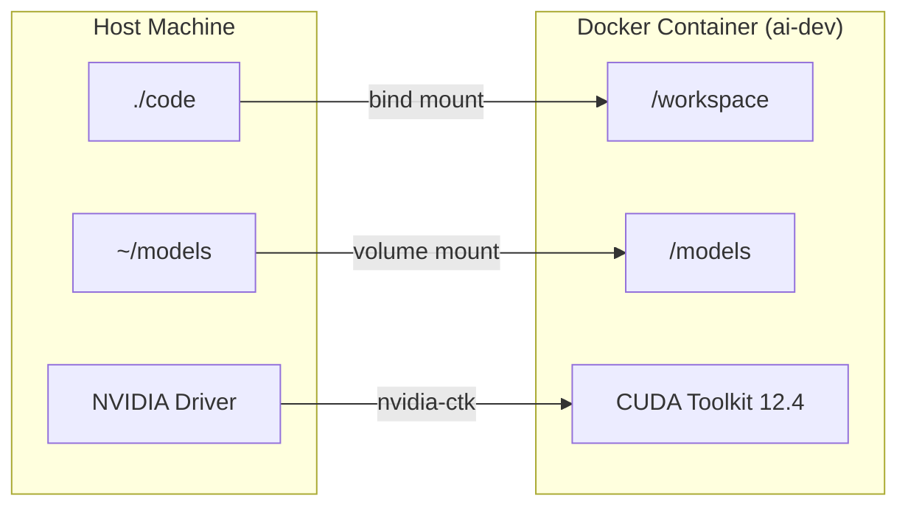
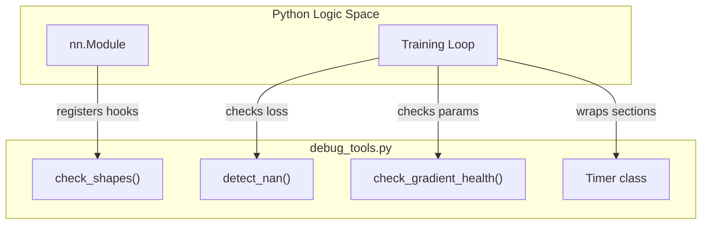

<!-- source: DeepWiki mcp.deepwiki.com · repo rohitg00/ai-engineering-from-scratch · page 2.2 Developer Workflow & Infrastructure Tools · fetched 2026-10-30 -->

# Developer Workflow & Infrastructure Tools

Relevant source files

The following files were used as context for generating this wiki page:

- [phases/00-setup-and-tooling/01-dev-environment/code/verify.py](phases/00-setup-and-tooling/01-dev-environment/code/verify.py)
- [phases/00-setup-and-tooling/01-dev-environment/docs/en.md](phases/00-setup-and-tooling/01-dev-environment/docs/en.md)
- [phases/00-setup-and-tooling/01-dev-environment/outputs/prompt-env-check.md](phases/00-setup-and-tooling/01-dev-environment/outputs/prompt-env-check.md)
- [phases/00-setup-and-tooling/01-dev-environment/quiz.json](phases/00-setup-and-tooling/01-dev-environment/quiz.json)
- [phases/00-setup-and-tooling/02-git-and-collaboration/docs/en.md](phases/00-setup-and-tooling/02-git-and-collaboration/docs/en.md)
- [phases/00-setup-and-tooling/04-apis-and-keys/code/first_api_call.py](phases/00-setup-and-tooling/04-apis-and-keys/code/first_api_call.py)
- [phases/00-setup-and-tooling/04-apis-and-keys/docs/en.md](phases/00-setup-and-tooling/04-apis-and-keys/docs/en.md)
- [phases/00-setup-and-tooling/04-apis-and-keys/outputs/prompt-api-troubleshooter.md](phases/00-setup-and-tooling/04-apis-and-keys/outputs/prompt-api-troubleshooter.md)
- [phases/00-setup-and-tooling/05-jupyter-notebooks/code/notebook_tips.py](phases/00-setup-and-tooling/05-jupyter-notebooks/code/notebook_tips.py)
- [phases/00-setup-and-tooling/05-jupyter-notebooks/docs/en.md](phases/00-setup-and-tooling/05-jupyter-notebooks/docs/en.md)
- [phases/00-setup-and-tooling/05-jupyter-notebooks/outputs/prompt-notebook-helper.md](phases/00-setup-and-tooling/05-jupyter-notebooks/outputs/prompt-notebook-helper.md)
- [phases/00-setup-and-tooling/06-python-environments/code/env_setup.sh](phases/00-setup-and-tooling/06-python-environments/code/env_setup.sh)
- [phases/00-setup-and-tooling/06-python-environments/docs/en.md](phases/00-setup-and-tooling/06-python-environments/docs/en.md)
- [phases/00-setup-and-tooling/07-docker-for-ai/code/Dockerfile](phases/00-setup-and-tooling/07-docker-for-ai/code/Dockerfile)
- [phases/00-setup-and-tooling/07-docker-for-ai/code/docker-compose.yml](phases/00-setup-and-tooling/07-docker-for-ai/code/docker-compose.yml)
- [phases/00-setup-and-tooling/07-docker-for-ai/docs/en.md](phases/00-setup-and-tooling/07-docker-for-ai/docs/en.md)
- [phases/00-setup-and-tooling/08-editor-setup/code/vscode/extensions.json](phases/00-setup-and-tooling/08-editor-setup/code/vscode/extensions.json)
- [phases/00-setup-and-tooling/08-editor-setup/code/vscode/settings.json](phases/00-setup-and-tooling/08-editor-setup/code/vscode/settings.json)
- [phases/00-setup-and-tooling/08-editor-setup/docs/en.md](phases/00-setup-and-tooling/08-editor-setup/docs/en.md)
- [phases/00-setup-and-tooling/09-data-management/code/data_utils.py](phases/00-setup-and-tooling/09-data-management/code/data_utils.py)
- [phases/00-setup-and-tooling/09-data-management/docs/en.md](phases/00-setup-and-tooling/09-data-management/docs/en.md)
- [phases/00-setup-and-tooling/09-data-management/outputs/prompt-data-helper.md](phases/00-setup-and-tooling/09-data-management/outputs/prompt-data-helper.md)
- [phases/00-setup-and-tooling/10-terminal-and-shell/code/shell_aliases.sh](phases/00-setup-and-tooling/10-terminal-and-shell/code/shell_aliases.sh)
- [phases/00-setup-and-tooling/10-terminal-and-shell/docs/en.md](phases/00-setup-and-tooling/10-terminal-and-shell/docs/en.md)
- [phases/00-setup-and-tooling/11-linux-for-ai/docs/en.md](phases/00-setup-and-tooling/11-linux-for-ai/docs/en.md)
- [phases/00-setup-and-tooling/12-debugging-and-profiling/code/debug_tools.py](phases/00-setup-and-tooling/12-debugging-and-profiling/code/debug_tools.py)
- [phases/00-setup-and-tooling/12-debugging-and-profiling/docs/en.md](phases/00-setup-and-tooling/12-debugging-and-profiling/docs/en.md)
- [phases/00-setup-and-tooling/12-debugging-and-profiling/outputs/prompt-debug-ai-code.md](phases/00-setup-and-tooling/12-debugging-and-profiling/outputs/prompt-debug-ai-code.md)

This page details the infrastructure and workflow tools required for modern AI engineering, covering Lessons 07–12 of Phase 0. It focuses on containerization, editor optimization, data management, and the diagnostic tools necessary to catch the "silent failures" unique to machine learning.

## Docker for AI

AI development environments are notoriously fragile due to tight coupling between Python versions, deep learning frameworks (PyTorch/TensorFlow), and hardware-specific drivers (CUDA/cuDNN). Docker provides environmental parity across local machines and cloud GPU instances [phases/00-setup-and-tooling/07-docker-for-ai/docs/en.md:10-14]().

### Container Architecture
The repository utilizes a multi-layered Docker approach to balance build speed with functionality. For NVIDIA GPU support, the `nvidia-container-toolkit` is used to pass through host GPU resources to the container [phases/00-setup-and-tooling/07-docker-for-ai/docs/en.md:91-106]().

**Base Image Selection Strategy:**
| Image Type | Use Case | Size |
|:---|:---|:---|
| `nvidia/cuda:12.4.1-devel-ubuntu22.04` | Building packages from source (e.g., `flash-attn`) | ~4 GB |
| `nvidia/cuda:12.4.1-runtime-ubuntu22.04` | Running pre-built code in production | ~1.5 GB |
| `pytorch/pytorch:2.3.1-cuda12.4-cudnn9-runtime` | Standard deep learning development | ~6 GB |
| `python:3.12-slim` | CPU-only inference or data processing | ~150 MB |

*Source: [phases/00-setup-and-tooling/07-docker-for-ai/docs/en.md:123-147]()*

### Implementation: The AI Dockerfile
The core Dockerfile [phases/00-setup-and-tooling/07-docker-for-ai/code/Dockerfile:1-190]() follows a specific sequence to optimize layer caching:
1.  **System Dependencies**: Installs `build-essential`, `git`, and `python3.12-dev` via `apt-get` [phases/00-setup-and-tooling/07-docker-for-ai/code/Dockerfile:159-167]().
2.  **Framework Installation**: Installs PyTorch with explicit CUDA 12.4 wheel indices to ensure hardware acceleration [phases/00-setup-and-tooling/07-docker-for-ai/code/Dockerfile:173-177]().
3.  **Persistence**: Defines `VOLUME` mounts for `/workspace` and `/models` to prevent large model weights from being stored inside the container's writable layer [phases/00-setup-and-tooling/07-docker-for-ai/code/Dockerfile:192]().

**Data Flow: Host to Container**

*Sources: [phases/00-setup-and-tooling/07-docker-for-ai/docs/en.md:183-190](), [phases/00-setup-and-tooling/07-docker-for-ai/docs/en.md:91-106]()*

---

## Editor Setup (VS Code)

The workflow is centered around VS Code (or its AI-first forks like Cursor and Windsurf) due to its first-class support for Jupyter Notebooks and Remote Development [phases/00-setup-and-tooling/08-editor-setup/docs/en.md:31-35]().

### Essential Extensions
The repository provides a recommended extensions manifest in `code/.vscode/extensions.json` [phases/00-setup-and-tooling/08-editor-setup/code/vscode/extensions.json:1-17]():
*   `ms-python.python`: Core language support and virtual environment detection.
*   `ms-python.vscode-pylance`: Critical for catching tensor shape mismatches via type checking [phases/00-setup-and-tooling/08-editor-setup/docs/en.md:100]().
*   `ms-toolsai.jupyter`: Inline execution of `.ipynb` files and variable exploration.
*   `ms-vscode-remote.remote-ssh`: Allows editing files directly on remote GPU boxes as if they were local [phases/00-setup-and-tooling/08-editor-setup/docs/en.md:131-135]().

### Key Settings
Standardized settings in `settings.json` ensure code quality and prevent common notebook issues:
*   `python.analysis.typeCheckingMode: "basic"`: Static analysis for API parameters.
*   `editor.formatOnSave: true`: Uses `Black` or `Ruff` for consistent formatting.
*   `notebook.output.scrolling: true`: Prevents the UI from exploding when training loops print thousands of lines [phases/00-setup-and-tooling/08-editor-setup/docs/en.md:88-96]().

---

## Data Management Utilities

Efficient AI engineering requires moving beyond manual CSV handling. The `data_utils.py` script provides a standardized interface for the Hugging Face `datasets` library [phases/00-setup-and-tooling/09-data-management/code/data_utils.py:1-20]().

### Key Functions
*   `load_and_inspect()`: Loads a dataset and prints metadata including columns, features, and row count [phases/00-setup-and-tooling/09-data-management/code/data_utils.py:22-36]().
*   `stream_dataset()`: Uses `streaming=True` for datasets too large for local disk (e.g., Wikipedia or Common Crawl) [phases/00-setup-and-tooling/09-data-management/code/data_utils.py:39-52]().
*   `convert_format()`: Benchmarks and converts data between CSV, JSON, and Parquet. Parquet is the preferred format for AI work due to its columnar compression and faster read speeds [phases/00-setup-and-tooling/09-data-management/code/data_utils.py:55-77]().
*   `make_splits()`: Implements reproducible `train`/`val`/`test` partitioning using fixed random seeds [phases/00-setup-and-tooling/09-data-management/code/data_utils.py:80-99]().

---

## Terminal & Shell Workflow

The terminal is the primary interface for monitoring training and managing remote instances. Most AI development happens on Linux-based cloud GPU boxes where the CLI is the only interface [phases/00-setup-and-tooling/11-linux-for-ai/docs/en.md:17-21]().

### Shell Aliases for AI
A dedicated `shell_aliases.sh` script provides shortcuts for common tasks [phases/00-setup-and-tooling/10-terminal-and-shell/code/shell_aliases.sh:1-144]():
*   `gpu`: Quick query of utilization, memory, and temperature via `nvidia-smi` [phases/00-setup-and-tooling/10-terminal-and-shell/docs/en.md:268]().
*   `watchloss`: Tails logs and filters for "loss" in real-time.
*   `ae`/`de`: Fast activation/deactivation of virtual environments.
*   `trainenv`: A function that initializes a 3-pane `tmux` session (Training, GPU Monitor, System Monitor) [phases/00-setup-and-tooling/10-terminal-and-shell/docs/en.md:25-34]().

### Remote Operations
For cloud GPU boxes, the workflow relies on `rsync` for efficient file synchronization and SSH port forwarding (`ssh -L`) to access remote Jupyter or TensorBoard instances locally [phases/00-setup-and-tooling/10-terminal-and-shell/docs/en.md:241-243]().

---

## Debugging & Profiling Tools

AI debugging differs from standard software debugging because code often runs without error while producing "garbage" results (e.g., silent NaN propagation) [phases/00-setup-and-tooling/12-debugging-and-profiling/docs/en.md:3-5]().

### The Debugging Stack
The `debug_tools.py` utility provides several diagnostic helpers [phases/00-setup-and-tooling/12-debugging-and-profiling/code/debug_tools.py:1-100]():

1.  **Tensor Inspection**: `debug_print()` displays shapes, dtypes, device location, and value ranges (min/max/mean) to catch `NaN` or vanishing gradients [phases/00-setup-and-tooling/12-debugging-and-profiling/docs/en.md:42-49]().
2.  **Shape Tracking**: `check_shapes()` uses PyTorch forward hooks to map every transformation through a model [phases/00-setup-and-tooling/12-debugging-and-profiling/docs/en.md:224-232]().
3.  **Gradient Health**: `check_gradient_health()` calculates the total norm and warns about zero or exploding gradients.
4.  **Device Verification**: `check_devices()` ensures model parameters and input tensors reside on the same hardware (CPU vs GPU).

**Code Entity Mapping: Diagnostic Tools**

*Sources: [phases/00-setup-and-tooling/12-debugging-and-profiling/docs/en.md:108-131](), [phases/00-setup-and-tooling/12-debugging-and-profiling/docs/en.md:224-232]()*

### Profiling
*   **CPU Profiling**: `cProfile` for function-level timing and `line_profiler` for line-by-line bottlenecks [phases/00-setup-and-tooling/12-debugging-and-profiling/docs/en.md:135-158]().
*   **Memory Tracking**: `tracemalloc` for CPU memory and `torch.cuda.memory_summary()` for GPU VRAM allocation to diagnose OOM (Out of Memory) errors [phases/00-setup-and-tooling/12-debugging-and-profiling/docs/en.md:162-207]().

*Sources: [phases/00-setup-and-tooling/07-docker-for-ai/docs/en.md](), [phases/00-setup-and-tooling/08-editor-setup/docs/en.md](), [phases/00-setup-and-tooling/09-data-management/docs/en.md](), [phases/00-setup-and-tooling/10-terminal-and-shell/docs/en.md](), [phases/00-setup-and-tooling/11-linux-for-ai/docs/en.md](), [phases/00-setup-and-tooling/12-debugging-and-profiling/docs/en.md]()*

---

