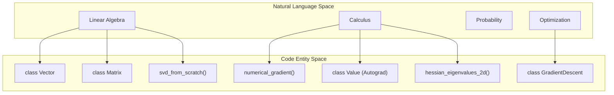
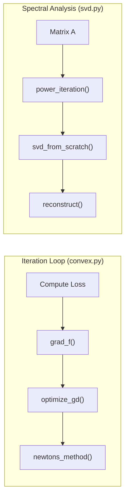

<!-- source: DeepWiki mcp.deepwiki.com · repo rohitg00/ai-engineering-from-scratch · page 3 Phase 1: Mathematical Foundations · fetched 2026-10-30 -->

# Phase 1: Mathematical Foundations

Relevant source files

The following files were used as context for generating this wiki page:

- [phases/01-math-foundations/01-linear-algebra-intuition/code/vectors.jl](phases/01-math-foundations/01-linear-algebra-intuition/code/vectors.jl)
- [phases/01-math-foundations/01-linear-algebra-intuition/code/vectors.py](phases/01-math-foundations/01-linear-algebra-intuition/code/vectors.py)
- [phases/01-math-foundations/01-linear-algebra-intuition/docs/en.md](phases/01-math-foundations/01-linear-algebra-intuition/docs/en.md)
- [phases/01-math-foundations/01-linear-algebra-intuition/outputs/prompt-linear-algebra-tutor.md](phases/01-math-foundations/01-linear-algebra-intuition/outputs/prompt-linear-algebra-tutor.md)
- [phases/01-math-foundations/03-matrix-transformations/code/transformations.jl](phases/01-math-foundations/03-matrix-transformations/code/transformations.jl)
- [phases/01-math-foundations/03-matrix-transformations/code/transformations.py](phases/01-math-foundations/03-matrix-transformations/code/transformations.py)
- [phases/01-math-foundations/03-matrix-transformations/docs/en.md](phases/01-math-foundations/03-matrix-transformations/docs/en.md)
- [phases/01-math-foundations/03-matrix-transformations/outputs/prompt-transformation-visualizer.md](phases/01-math-foundations/03-matrix-transformations/outputs/prompt-transformation-visualizer.md)
- [phases/01-math-foundations/06-probability-and-distributions/code/probability.py](phases/01-math-foundations/06-probability-and-distributions/code/probability.py)
- [phases/01-math-foundations/06-probability-and-distributions/docs/en.md](phases/01-math-foundations/06-probability-and-distributions/docs/en.md)
- [phases/01-math-foundations/06-probability-and-distributions/outputs/skill-probability-reasoning.md](phases/01-math-foundations/06-probability-and-distributions/outputs/skill-probability-reasoning.md)
- [phases/01-math-foundations/08-optimization/code/optimizers.py](phases/01-math-foundations/08-optimization/code/optimizers.py)
- [phases/01-math-foundations/08-optimization/docs/en.md](phases/01-math-foundations/08-optimization/docs/en.md)
- [phases/01-math-foundations/08-optimization/outputs/prompt-optimizer-guide.md](phases/01-math-foundations/08-optimization/outputs/prompt-optimizer-guide.md)
- [phases/01-math-foundations/11-singular-value-decomposition/code/svd.jl](phases/01-math-foundations/11-singular-value-decomposition/code/svd.jl)
- [phases/01-math-foundations/11-singular-value-decomposition/code/svd.py](phases/01-math-foundations/11-singular-value-decomposition/code/svd.py)
- [phases/01-math-foundations/11-singular-value-decomposition/docs/en.md](phases/01-math-foundations/11-singular-value-decomposition/docs/en.md)
- [phases/01-math-foundations/11-singular-value-decomposition/outputs/skill-svd.md](phases/01-math-foundations/11-singular-value-decomposition/outputs/skill-svd.md)
- [phases/01-math-foundations/17-linear-systems/code/linear_systems.py](phases/01-math-foundations/17-linear-systems/code/linear_systems.py)
- [phases/01-math-foundations/17-linear-systems/docs/en.md](phases/01-math-foundations/17-linear-systems/docs/en.md)
- [phases/01-math-foundations/18-convex-optimization/code/convex.py](phases/01-math-foundations/18-convex-optimization/code/convex.py)
- [phases/01-math-foundations/18-convex-optimization/docs/en.md](phases/01-math-foundations/18-convex-optimization/docs/en.md)

Phase 1 provides the 22-lesson bedrock required for AI engineering. While many practitioners rely on high-level libraries, this phase focuses on implementing the underlying mathematical operations from scratch. This ensures a deep intuition for how models "see" data, how they optimize their internal state, and how they reason about uncertainty.

The curriculum is divided into three core domains: the geometry of data (Linear Algebra), the mechanics of learning (Calculus & Optimization), and the logic of uncertainty (Probability & Statistics).

### Mathematical Landscape to Code Mapping

The following diagrams bridge the gap between abstract mathematical concepts and the specific code entities implemented in this phase, showing how "Natural Language Space" translates to "Code Entity Space".

**Math to Code Entity Mapping**

Sources: [phases/01-math-foundations/01-linear-algebra-intuition/code/vectors.py:1-81](), [phases/01-math-foundations/18-convex-optimization/code/convex.py:27-65](), [phases/01-math-foundations/11-singular-value-decomposition/code/svd.py:24-59]()

---

## 3.1 Linear Algebra & Calculus
This sub-phase covers the fundamental "physics" of AI. Linear algebra provides the language for representing data and transformations, while calculus provides the mechanism for optimization.

*   **Linear Algebra:** Focuses on vectors as points in space and matrices as transformations [phases/01-math-foundations/01-linear-algebra-intuition/docs/en.md:25-42](). Key implementations include `Vector` and `Matrix` classes in Python and Julia, covering dot products, projections, and the Gram-Schmidt process for orthonormalization [phases/01-math-foundations/01-linear-algebra-intuition/code/vectors.py:68-78](). It also covers solving linear systems `Ax = b` via `gaussian_elimination` and `lu_decompose` [phases/01-math-foundations/17-linear-systems/code/linear_systems.py:4-44]().
*   **Calculus:** Covers the computation of change. It moves from simple derivatives to partial derivatives and the gradient—the vector of all partial derivatives that points toward the steepest ascent.
*   **Automatic Differentiation:** Introduces the scalar-valued autograd system that implements the chain rule mechanically to enable backpropagation.

For details, see [Linear Algebra & Calculus](#3.1).

Sources: [phases/01-math-foundations/01-linear-algebra-intuition/docs/en.md:1-174](), [phases/01-math-foundations/17-linear-systems/docs/en.md:80-114]()

---

## 3.2 Probability, Statistics & Bayesian Reasoning
AI engineering is rarely about certainty; it is about managing likelihoods. This section transitions from frequentist statistics to Bayesian reasoning.

*   **Distributions & Statistics:** Understanding the shape of data through probability distributions like Bernoulli, Categorical, and Normal [phases/01-math-foundations/06-probability-and-distributions/docs/en.md:97-130]().
*   **Bayesian Reasoning:** Implementing Bayes' Theorem for sequential updating. This includes using Bayesian logic for reasoning under uncertainty, as seen in the `skill-probability-reasoning` artifact.
*   **Numerical Stability:** Implementation of `softmax` and `log-softmax` functions using the numerical stability trick (subtracting max logit) to prevent overflow [phases/01-math-foundations/06-probability-and-distributions/docs/en.md:221-224]().

For details, see [Probability, Statistics & Bayesian Reasoning](#3.2).

Sources: [phases/01-math-foundations/06-probability-and-distributions/docs/en.md:1-224]()

---

## 3.3 Optimization, Information Theory & Advanced Math
The final component of Phase 1 addresses how models converge and how we measure information.

*   **Optimization:** The implementation of the `optimizers.py` family, focusing on Gradient Descent, Momentum, and Adam [phases/01-math-foundations/08-optimization/docs/en.md:12-15](). It explores `check_convexity` to distinguish between easy (convex) and hard (non-convex) landscapes [phases/01-math-foundations/18-convex-optimization/code/convex.py:5-24]().
*   **Advanced Factorization:** Implementation of `svd_from_scratch` using power iteration to decompose any matrix into `U`, `Sigma`, and `V^T` for applications like PCA and image compression [phases/01-math-foundations/11-singular-value-decomposition/code/svd.py:24-59]().
*   **Convex Optimization:** Utilizing the Hessian matrix via `hessian_eigenvalues_2d` to understand the "curvature" of the loss landscape—identifying global minima versus saddle points [phases/01-math-foundations/18-convex-optimization/code/convex.py:27-38]().

**Optimization & Decomposition Workflow**

Sources: [phases/01-math-foundations/18-convex-optimization/code/convex.py:73-103](), [phases/01-math-foundations/11-singular-value-decomposition/code/svd.py:4-68]()

For details, see [Optimization, Information Theory & Advanced Math](#3.3).

---
**Next Phase:** [Phase 2: Machine Learning Fundamentals](#4)

---

