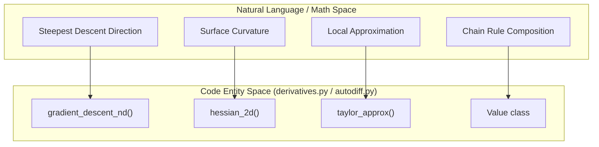
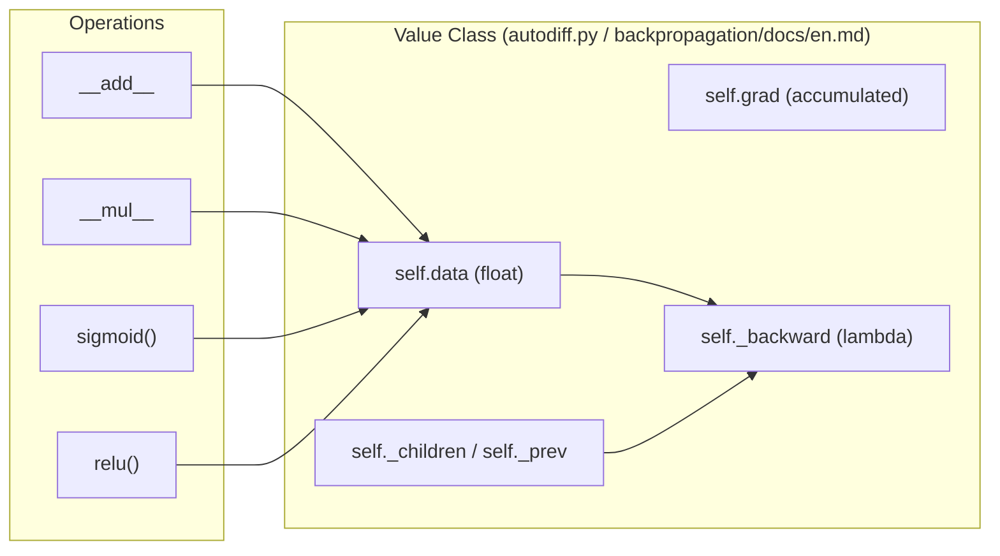

<!-- source: DeepWiki mcp.deepwiki.com · repo rohitg00/ai-engineering-from-scratch · page 3.1 Linear Algebra & Calculus · fetched 2026-10-30 -->

# Linear Algebra & Calculus

Relevant source files

The following files were used as context for generating this wiki page:

- [phases/01-math-foundations/01-linear-algebra-intuition/code/vectors.jl](phases/01-math-foundations/01-linear-algebra-intuition/code/vectors.jl)
- [phases/01-math-foundations/01-linear-algebra-intuition/code/vectors.py](phases/01-math-foundations/01-linear-algebra-intuition/code/vectors.py)
- [phases/01-math-foundations/01-linear-algebra-intuition/docs/en.md](phases/01-math-foundations/01-linear-algebra-intuition/docs/en.md)
- [phases/01-math-foundations/01-linear-algebra-intuition/outputs/prompt-linear-algebra-tutor.md](phases/01-math-foundations/01-linear-algebra-intuition/outputs/prompt-linear-algebra-tutor.md)
- [phases/01-math-foundations/03-matrix-transformations/code/transformations.jl](phases/01-math-foundations/03-matrix-transformations/code/transformations.jl)
- [phases/01-math-foundations/03-matrix-transformations/code/transformations.py](phases/01-math-foundations/03-matrix-transformations/code/transformations.py)
- [phases/01-math-foundations/03-matrix-transformations/docs/en.md](phases/01-math-foundations/03-matrix-transformations/docs/en.md)
- [phases/01-math-foundations/03-matrix-transformations/outputs/prompt-transformation-visualizer.md](phases/01-math-foundations/03-matrix-transformations/outputs/prompt-transformation-visualizer.md)
- [phases/01-math-foundations/04-calculus-for-ml/docs/en.md](phases/01-math-foundations/04-calculus-for-ml/docs/en.md)
- [phases/01-math-foundations/05-chain-rule-and-autodiff/docs/en.md](phases/01-math-foundations/05-chain-rule-and-autodiff/docs/en.md)
- [phases/01-math-foundations/06-probability-and-distributions/code/probability.py](phases/01-math-foundations/06-probability-and-distributions/code/probability.py)
- [phases/01-math-foundations/06-probability-and-distributions/docs/en.md](phases/01-math-foundations/06-probability-and-distributions/docs/en.md)
- [phases/01-math-foundations/06-probability-and-distributions/outputs/skill-probability-reasoning.md](phases/01-math-foundations/06-probability-and-distributions/outputs/skill-probability-reasoning.md)
- [phases/01-math-foundations/08-optimization/code/optimizers.py](phases/01-math-foundations/08-optimization/code/optimizers.py)
- [phases/01-math-foundations/08-optimization/docs/en.md](phases/01-math-foundations/08-optimization/docs/en.md)
- [phases/01-math-foundations/08-optimization/outputs/prompt-optimizer-guide.md](phases/01-math-foundations/08-optimization/outputs/prompt-optimizer-guide.md)
- [phases/01-math-foundations/11-singular-value-decomposition/code/svd.jl](phases/01-math-foundations/11-singular-value-decomposition/code/svd.jl)
- [phases/01-math-foundations/11-singular-value-decomposition/code/svd.py](phases/01-math-foundations/11-singular-value-decomposition/code/svd.py)
- [phases/01-math-foundations/11-singular-value-decomposition/docs/en.md](phases/01-math-foundations/11-singular-value-decomposition/docs/en.md)
- [phases/01-math-foundations/11-singular-value-decomposition/outputs/skill-svd.md](phases/01-math-foundations/11-singular-value-decomposition/outputs/skill-svd.md)
- [phases/01-math-foundations/17-linear-systems/code/linear_systems.py](phases/01-math-foundations/17-linear-systems/code/linear_systems.py)
- [phases/01-math-foundations/17-linear-systems/docs/en.md](phases/01-math-foundations/17-linear-systems/docs/en.md)
- [phases/01-math-foundations/18-convex-optimization/code/convex.py](phases/01-math-foundations/18-convex-optimization/code/convex.py)
- [phases/01-math-foundations/18-convex-optimization/docs/en.md](phases/01-math-foundations/18-convex-optimization/docs/en.md)
- [phases/03-deep-learning-core/03-backpropagation/docs/en.md](phases/03-deep-learning-core/03-backpropagation/docs/en.md)
- [phases/03-deep-learning-core/10-mini-framework/docs/en.md](phases/03-deep-learning-core/10-mini-framework/docs/en.md)
- [phases/03-deep-learning-core/11-intro-to-pytorch/docs/en.md](phases/03-deep-learning-core/11-intro-to-pytorch/docs/en.md)
- [phases/03-deep-learning-core/13-debugging-neural-networks/docs/en.md](phases/03-deep-learning-core/13-debugging-neural-networks/docs/en.md)
- [phases/05-nlp-foundations-to-advanced/08-cnns-rnns-for-text/docs/en.md](phases/05-nlp-foundations-to-advanced/08-cnns-rnns-for-text/docs/en.md)
- [phases/10-llms-from-scratch/01-tokenizers/docs/en.md](phases/10-llms-from-scratch/01-tokenizers/docs/en.md)
- [phases/10-llms-from-scratch/02-building-a-tokenizer/docs/en.md](phases/10-llms-from-scratch/02-building-a-tokenizer/docs/en.md)
- [phases/10-llms-from-scratch/04-pre-training-mini-gpt/docs/en.md](phases/10-llms-from-scratch/04-pre-training-mini-gpt/docs/en.md)
- [phases/11-llm-engineering/05-context-engineering/docs/en.md](phases/11-llm-engineering/05-context-engineering/docs/en.md)

This section covers the mathematical bedrock of machine learning: vectors, matrices, matrix transformations, and the calculus of gradients. These concepts are explored through from-scratch implementations in Python and Julia, moving from geometric intuition to the algorithmic implementation of automatic differentiation and linear system solvers.

## Linear Algebra Intuition & Operations

Linear algebra in this codebase is treated as a "spatial machine" for moving points in space [phases/01-math-foundations/01-linear-algebra-intuition/docs/en.md:12-14](). Vectors represent data points such as word embeddings (768-dimensional meanings), pixel values, or user preferences [phases/01-math-foundations/01-linear-algebra-intuition/docs/en.md:37-41](). Matrices represent transformations like neural network weights, attention scores, or projections [phases/01-math-foundations/01-linear-algebra-intuition/docs/en.md:65-69]().

### Core Entities: Vectors and Matrices
The `Vector` and `Matrix` classes provide the fundamental operations required for ML, including dot products for similarity and matrix-vector multiplication for neural layer simulation.

| Entity | Role | Key Functions |
| :--- | :--- | :--- |
| `Vector` | Represents points/directions | `dot()`, `magnitude()`, `normalize()`, `cosine_similarity()`, `project_onto()` |
| `Matrix` | Represents transformations | `__matmul__` (dot product/transformation), `transpose()`, `rank()` |

### Geometric Transformations & Orthogonality
Matrices are implemented as machines that reshape space [phases/01-math-foundations/03-matrix-transformations/docs/en.md:3-4]().
*   **Rotation:** Preserves distances and angles [phases/01-math-foundations/03-matrix-transformations/docs/en.md:41-42]().
*   **Scaling:** Stretches/compresses along axes [phases/01-math-foundations/03-matrix-transformations/docs/en.md:78-79]().
*   **Eigenvalues/vectors:** Directions where the transformation only scales the vector without rotating it [phases/01-math-foundations/03-matrix-transformations/docs/en.md:170-171]().
*   **Gram-Schmidt Process:** Converts independent vectors into an orthonormal basis, used in stable QR decomposition [phases/01-math-foundations/01-linear-algebra-intuition/docs/en.md:152-179]().

**Sources:**
* [phases/01-math-foundations/01-linear-algebra-intuition/docs/en.md:1-173]()
* [phases/01-math-foundations/01-linear-algebra-intuition/code/vectors.py:1-132]()
* [phases/01-math-foundations/03-matrix-transformations/docs/en.md:1-225]()
* [phases/01-math-foundations/03-matrix-transformations/code/transformations.py:1-252]()

---

## Calculus for Machine Learning

Calculus provides the mechanism for "turning the knobs" of a model to minimize error [phases/01-math-foundations/04-calculus-for-ml/docs/en.md:12-14](). The implementation focuses on gradients (vectors of partial derivatives) and the Hessian matrix (curvature).

### Gradient Descent & Curvature
The codebase implements numerical derivatives using the central difference method: `(f(x + h) - f(x - h)) / (2h)` [phases/01-math-foundations/04-calculus-for-ml/docs/en.md:124-128]().

*   **Gradient:** Points in the direction of steepest ascent. Negating it allows for Gradient Descent [phases/01-math-foundations/04-calculus-for-ml/docs/en.md:60-67](). The update rule `w_new = w_old - learning_rate * dL/dw` is implemented from scratch [phases/01-math-foundations/04-calculus-for-ml/docs/en.md:91-99]().
*   **Hessian Matrix:** A matrix of second-order partial derivatives used to determine the nature of critical points and surface curvature [phases/01-math-foundations/04-calculus-for-ml/docs/en.md:188-196]().

### Mathematical Space to Code Mapping
This diagram bridges the conceptual mathematical space to the specific implementation entities in the foundation phase.

**Sources:**
* [phases/01-math-foundations/04-calculus-for-ml/docs/en.md:1-205]()
* [phases/01-math-foundations/04-calculus-for-ml/code/derivatives.py:1-218]()
* [phases/01-math-foundations/05-chain-rule-and-autodiff/docs/en.md:1-166]()

---

## Automatic Differentiation (The Value Engine)

While numerical derivatives are useful for checking, ML frameworks use **Reverse Mode Automatic Differentiation** [phases/01-math-foundations/05-chain-rule-and-autodiff/docs/en.md:101-111](). This codebase implements a `Value` class that builds a dynamic computational graph.

### The Value Class Architecture
The `Value` class wraps raw scalars and tracks the operations that created them, allowing for a recursive backward pass via topological sort [phases/01-math-foundations/05-chain-rule-and-autodiff/docs/en.md:168-184]().

### Execution Flow
1.  **Forward Pass:** Operations (like `+`, `*`, `relu`) create new `Value` objects and store references to their parents in `_prev` or `_children` [phases/03-deep-learning-core/03-backpropagation/docs/en.md:158-164]().
2.  **Topological Sort:** The `backward()` function performs a topological sort to ensure gradients are processed from output to input [phases/03-deep-learning-core/03-backpropagation/docs/en.md:188-197]().
3.  **Backward Pass:** Iterates through the sorted nodes in reverse, calling each node's `_backward()` function to apply the chain rule and accumulate gradients [phases/03-deep-learning-core/03-backpropagation/docs/en.md:199-201]().
4.  **Gradient Checking:** Verification of analytical gradients against numerical finite differences [phases/03-deep-learning-core/13-debugging-neural-networks/docs/en.md:87-104]().

**Sources:**
* [phases/01-math-foundations/05-chain-rule-and-autodiff/docs/en.md:1-205]()
* [phases/03-deep-learning-core/03-backpropagation/docs/en.md:135-205]()
* [phases/03-deep-learning-core/13-debugging-neural-networks/docs/en.md:87-116]()

---

## Linear Systems ($Ax = b$)

Solving $Ax = b$ is the foundation of linear regression and many optimization algorithms [phases/01-math-foundations/17-linear-systems/docs/en.md:3-14]().

| Method | Characteristics | Application |
| :--- | :--- | :--- |
| **Gaussian Elimination** | Direct solver with partial pivoting. | General small systems. |
| **LU Decomposition** | Factors $A$ into $L$ and $U$. | Efficient for multiple $b$ vectors. |
| **Cholesky Decomposition** | For symmetric positive-definite matrices. | Covariance matrices / GPs. |
| **Conjugate Gradient** | Iterative solver. | Large, sparse systems. |
| **Normal Equations** | $(A^T A)x = A^T b$. | Least-squares regression. |

### Numerical Stability
The implementation emphasizes **Partial Pivoting** in Gaussian elimination to avoid division by zero or small numbers that amplify rounding errors [phases/01-math-foundations/17-linear-systems/docs/en.md:111-128](). It also provides a `condition_number()` function to measure how sensitive the system is to input noise [phases/01-math-foundations/17-linear-systems/code/linear_systems.py:107-111]().

**Sources:**
* [phases/01-math-foundations/17-linear-systems/docs/en.md:1-188]()
* [phases/01-math-foundations/17-linear-systems/code/linear_systems.py:1-264]()
* [phases/01-math-foundations/01-linear-algebra-intuition/docs/en.md:108-119]()

---

