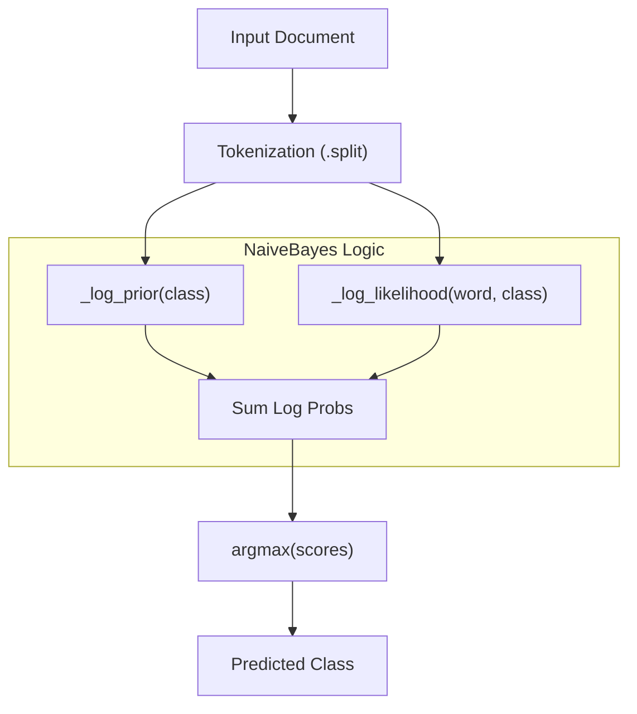
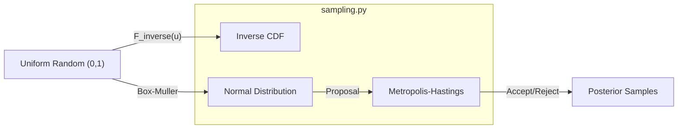

<!-- source: DeepWiki mcp.deepwiki.com · repo rohitg00/ai-engineering-from-scratch · page 3.2 Probability, Statistics & Bayesian Reasoning · fetched 2026-10-30 -->

# Probability, Statistics & Bayesian Reasoning

Relevant source files

The following files were used as context for generating this wiki page:

- [phases/01-math-foundations/01-linear-algebra-intuition/code/vectors.jl](phases/01-math-foundations/01-linear-algebra-intuition/code/vectors.jl)
- [phases/01-math-foundations/01-linear-algebra-intuition/code/vectors.py](phases/01-math-foundations/01-linear-algebra-intuition/code/vectors.py)
- [phases/01-math-foundations/01-linear-algebra-intuition/docs/en.md](phases/01-math-foundations/01-linear-algebra-intuition/docs/en.md)
- [phases/01-math-foundations/01-linear-algebra-intuition/outputs/prompt-linear-algebra-tutor.md](phases/01-math-foundations/01-linear-algebra-intuition/outputs/prompt-linear-algebra-tutor.md)
- [phases/01-math-foundations/03-matrix-transformations/code/transformations.jl](phases/01-math-foundations/03-matrix-transformations/code/transformations.jl)
- [phases/01-math-foundations/03-matrix-transformations/code/transformations.py](phases/01-math-foundations/03-matrix-transformations/code/transformations.py)
- [phases/01-math-foundations/03-matrix-transformations/docs/en.md](phases/01-math-foundations/03-matrix-transformations/docs/en.md)
- [phases/01-math-foundations/03-matrix-transformations/outputs/prompt-transformation-visualizer.md](phases/01-math-foundations/03-matrix-transformations/outputs/prompt-transformation-visualizer.md)
- [phases/01-math-foundations/06-probability-and-distributions/code/probability.py](phases/01-math-foundations/06-probability-and-distributions/code/probability.py)
- [phases/01-math-foundations/06-probability-and-distributions/docs/en.md](phases/01-math-foundations/06-probability-and-distributions/docs/en.md)
- [phases/01-math-foundations/06-probability-and-distributions/outputs/skill-probability-reasoning.md](phases/01-math-foundations/06-probability-and-distributions/outputs/skill-probability-reasoning.md)
- [phases/01-math-foundations/08-optimization/code/optimizers.py](phases/01-math-foundations/08-optimization/code/optimizers.py)
- [phases/01-math-foundations/08-optimization/docs/en.md](phases/01-math-foundations/08-optimization/docs/en.md)
- [phases/01-math-foundations/08-optimization/outputs/prompt-optimizer-guide.md](phases/01-math-foundations/08-optimization/outputs/prompt-optimizer-guide.md)
- [phases/01-math-foundations/11-singular-value-decomposition/code/svd.jl](phases/01-math-foundations/11-singular-value-decomposition/code/svd.jl)
- [phases/01-math-foundations/11-singular-value-decomposition/code/svd.py](phases/01-math-foundations/11-singular-value-decomposition/code/svd.py)
- [phases/01-math-foundations/11-singular-value-decomposition/docs/en.md](phases/01-math-foundations/11-singular-value-decomposition/docs/en.md)
- [phases/01-math-foundations/11-singular-value-decomposition/outputs/skill-svd.md](phases/01-math-foundations/11-singular-value-decomposition/outputs/skill-svd.md)
- [phases/01-math-foundations/17-linear-systems/code/linear_systems.py](phases/01-math-foundations/17-linear-systems/code/linear_systems.py)
- [phases/01-math-foundations/17-linear-systems/docs/en.md](phases/01-math-foundations/17-linear-systems/docs/en.md)
- [phases/01-math-foundations/18-convex-optimization/code/convex.py](phases/01-math-foundations/18-convex-optimization/code/convex.py)
- [phases/01-math-foundations/18-convex-optimization/docs/en.md](phases/01-math-foundations/18-convex-optimization/docs/en.md)

This page covers the mathematical foundations of uncertainty, inference, and data analysis essential for AI engineering. It spans Phase 1 Lessons 06–07 and 15–16, detailing the implementation of probability distributions, Bayesian classifiers, hypothesis testing, and advanced sampling techniques used in generative models.

## 1. Probability Fundamentals & Distributions

Probability provides the language for expressing model uncertainty. In the codebase, this is implemented by defining Probability Mass Functions (PMF) for discrete variables and Probability Density Functions (PDF) for continuous variables.

### Key Concepts
*   **Axioms of Probability**: Non-negativity, normalization ($P(S)=1$), and additivity for disjoint events `[phases/01-math-foundations/06-probability-and-distributions/docs/en.md:39-42]()`.
*   **Expectation & Variance**: The weighted average outcome and the measure of spread around that average `[phases/01-math-foundations/06-probability-and-distributions/docs/en.md:139-153]()`.
*   **Log Probabilities**: Used to prevent numerical underflow when multiplying many small probabilities, converting products into sums `[phases/01-math-foundations/06-probability-and-distributions/docs/en.md:195-211]()`.
*   **Central Limit Theorem**: Explains why the normal distribution dominates as the sum of independent random variables `[phases/01-math-foundations/06-probability-and-distributions/docs/en.md:177-187]()`.

### Implemented Distributions
| Distribution | Type | Use Case | Code Reference |
| :--- | :--- | :--- | :--- |
| **Bernoulli** | Discrete | Binary classification [0, 1] | `[phases/01-math-foundations/06-probability-and-distributions/docs/en.md:99-105]()` |
| **Categorical** | Discrete | Multi-class (Softmax output) | `[phases/01-math-foundations/06-probability-and-distributions/docs/en.md:107-112]()` |
| **Normal** | Continuous | Weight init, Gaussian noise | `[phases/01-math-foundations/06-probability-and-distributions/docs/en.md:121-130]()` |
| **Poisson** | Discrete | Event rates in intervals | `[phases/01-math-foundations/06-probability-and-distributions/docs/en.md:132-137]()` |

**Sources:** `[phases/01-math-foundations/06-probability-and-distributions/docs/en.md]()`, `[phases/01-math-foundations/06-probability-and-distributions/code/probability.py]()`

---

## 2. Bayesian Reasoning & Naive Bayes

Bayesian reasoning allows a model to update its beliefs ($P(H)$) after observing new evidence ($E$). This is the foundation of sequential learning and the Naive Bayes classifier.

### The Bayesian Update Cycle
The implementation follows the core theorem:
$$P(H|E) = \frac{P(E|H) \cdot P(H)}{P(E)}$$
where $P(E)$ is the evidence calculated via the law of total probability. This allows for sequential updating where the posterior of one step becomes the prior for the next `[phases/01-math-foundations/07-bayes-theorem/docs/en.md:46-57]()`.

### Naive Bayes Classifier
The `NaiveBayes` implementation typically handles text classification by assuming feature independence. It uses log-likelihoods to avoid underflow and Laplace smoothing to handle unseen words `[phases/01-math-foundations/07-bayes-theorem/code/bayes.py:19-61]()`.

**Data Flow: Bayesian Text Classification**

**Sources:** `[phases/01-math-foundations/07-bayes-theorem/code/bayes.py]()`, `[phases/01-math-foundations/07-bayes-theorem/docs/en.md]()`

---

## 3. Statistics for ML

Statistics provides the framework for model evaluation, ensuring that observed improvements are not merely the result of random noise.

### Descriptive Statistics & Correlation
The toolkit includes functions for calculating central tendency and dispersion.
*   **Pearson Correlation**: Measures linear relationships `[phases/01-math-foundations/15-statistics-for-ml/code/statistics.py:68-77]()`.
*   **Spearman Correlation**: Measures monotonic relationships via rank-ordering `[phases/01-math-foundations/15-statistics-for-ml/code/statistics.py:95-98]()`.

### Hypothesis Testing & Bootstrapping
The system implements several tests to validate model performance:
*   **T-Tests**: For comparing means between groups (e.g., A/B testing) `[phases/01-math-foundations/15-statistics-for-ml/code/statistics.py:182-199]()`.
*   **Chi-Squared**: For categorical data distributions `[phases/01-math-foundations/15-statistics-for-ml/code/statistics.py:202-208]()`.
*   **Bootstrapping**: A non-parametric method to estimate confidence intervals for metrics like F1-score by resampling with replacement `[phases/01-math-foundations/15-statistics-for-ml/code/statistics.py:233-251]()`.

**Sources:** `[phases/01-math-foundations/15-statistics-for-ml/code/statistics.py]()`, `[phases/01-math-foundations/15-statistics-for-ml/docs/en.md]()`

---

## 4. Sampling Methods

Sampling is the mechanism by which generative models (LLMs, Diffusion) produce output. The codebase implements both direct and Markov Chain Monte Carlo (MCMC) methods.

### Generative Sampling (LLMs)
The toolkit provides logic for controlling token generation:
*   **Temperature Sampling**: Scales logits to control "creativity" `[phases/01-math-foundations/16-sampling-methods/code/sampling.py:226-231]()`.
*   **Top-K Sampling**: Restricts sampling to the $K$ most likely tokens `[phases/01-math-foundations/16-sampling-methods/code/sampling.py:243-249]()`.

### Advanced Sampling Algorithms
| Method | Description | Implementation |
| :--- | :--- | :--- |
| **Inverse CDF** | Transforms uniform samples into target distribution samples | `[phases/01-math-foundations/16-sampling-methods/code/sampling.py:11-13]()` |
| **Rejection Sampling** | Samples from a proposal distribution and rejects based on target density | `[phases/01-math-foundations/16-sampling-methods/code/sampling.py:38-45]()` |
| **Metropolis-Hastings** | An MCMC algorithm for high-dimensional distributions | `[phases/01-math-foundations/16-sampling-methods/code/sampling.py:145-164]()` |
| **Gibbs Sampling** | Samples from conditional distributions sequentially | `[phases/01-math-foundations/16-sampling-methods/code/sampling.py:196-206]()` |

**Sampling Logic Diagram**

**Sources:** `[phases/01-math-foundations/16-sampling-methods/code/sampling.py]()`, `[phases/01-math-foundations/16-sampling-methods/docs/en.md]()`

---

## 5. Toolkit Artifacts

This section produces several reusable artifacts for the `outputs/` directory:

*   **skill-probability-reasoning**: A skill for calculating distributions, expectations, and handling numerical stability `[phases/01-math-foundations/06-probability-and-distributions/outputs/skill-probability-reasoning.md]()`.
*   **prompt-bayesian-reasoning**: A guide for stepping through Bayes' theorem for complex scenarios `[phases/01-math-foundations/07-bayes-theorem/outputs/prompt-bayesian-reasoning.md]()`.
*   **skill-statistical-testing**: A decision tree for selecting the correct test (T-test, Chi-square, etc.) based on data types `[phases/01-math-foundations/15-statistics-for-ml/outputs/skill-statistical-testing.md]()`.
*   **skill-sampling-strategy**: Guidelines for choosing between Temperature, Top-P, and MCMC methods `[phases/01-math-foundations/16-sampling-methods/outputs/skill-sampling-strategy.md]()`.

**Sources:** `[phases/01-math-foundations/07-bayes-theorem/outputs/prompt-bayesian-reasoning.md]()`, `[phases/01-math-foundations/15-statistics-for-ml/outputs/skill-statistical-testing.md]()`, `[phases/01-math-foundations/16-sampling-methods/outputs/skill-sampling-strategy.md]()`

---

