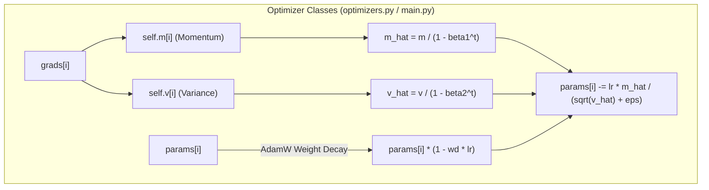
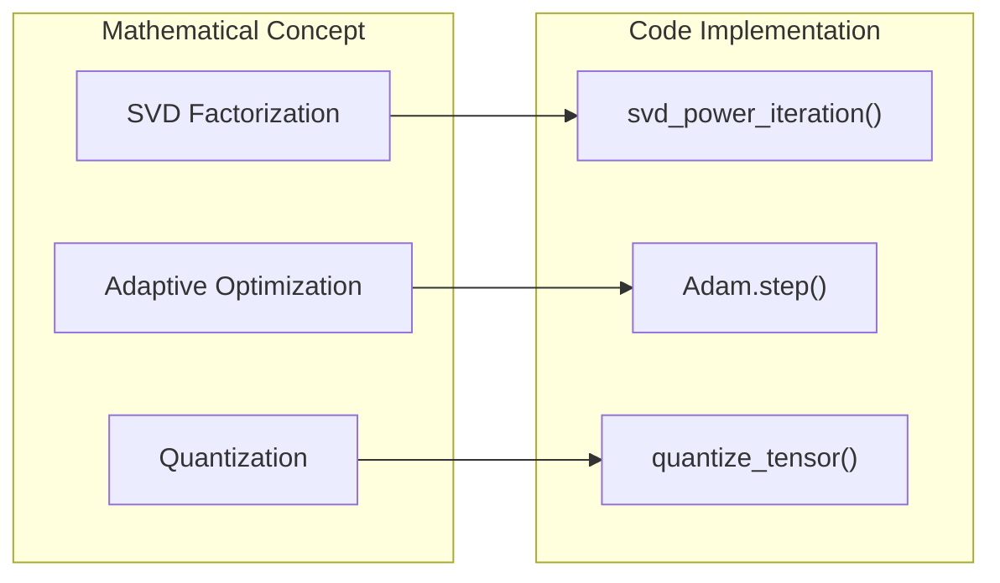

<!-- source: DeepWiki mcp.deepwiki.com · repo rohitg00/ai-engineering-from-scratch · page 3.3 Optimization, Information Theory & Advanced Math · fetched 2026-10-30 -->

# Optimization, Information Theory & Advanced Math

Relevant source files

The following files were used as context for generating this wiki page:

- [phases/01-math-foundations/01-linear-algebra-intuition/code/vectors.jl](phases/01-math-foundations/01-linear-algebra-intuition/code/vectors.jl)
- [phases/01-math-foundations/01-linear-algebra-intuition/code/vectors.py](phases/01-math-foundations/01-linear-algebra-intuition/code/vectors.py)
- [phases/01-math-foundations/01-linear-algebra-intuition/docs/en.md](phases/01-math-foundations/01-linear-algebra-intuition/docs/en.md)
- [phases/01-math-foundations/01-linear-algebra-intuition/outputs/prompt-linear-algebra-tutor.md](phases/01-math-foundations/01-linear-algebra-intuition/outputs/prompt-linear-algebra-tutor.md)
- [phases/01-math-foundations/03-matrix-transformations/code/transformations.jl](phases/01-math-foundations/03-matrix-transformations/code/transformations.jl)
- [phases/01-math-foundations/03-matrix-transformations/code/transformations.py](phases/01-math-foundations/03-matrix-transformations/code/transformations.py)
- [phases/01-math-foundations/03-matrix-transformations/docs/en.md](phases/01-math-foundations/03-matrix-transformations/docs/en.md)
- [phases/01-math-foundations/03-matrix-transformations/outputs/prompt-transformation-visualizer.md](phases/01-math-foundations/03-matrix-transformations/outputs/prompt-transformation-visualizer.md)
- [phases/01-math-foundations/06-probability-and-distributions/code/probability.py](phases/01-math-foundations/06-probability-and-distributions/code/probability.py)
- [phases/01-math-foundations/06-probability-and-distributions/docs/en.md](phases/01-math-foundations/06-probability-and-distributions/docs/en.md)
- [phases/01-math-foundations/06-probability-and-distributions/outputs/skill-probability-reasoning.md](phases/01-math-foundations/06-probability-and-distributions/outputs/skill-probability-reasoning.md)
- [phases/01-math-foundations/08-optimization/code/optimizers.py](phases/01-math-foundations/08-optimization/code/optimizers.py)
- [phases/01-math-foundations/08-optimization/docs/en.md](phases/01-math-foundations/08-optimization/docs/en.md)
- [phases/01-math-foundations/08-optimization/outputs/prompt-optimizer-guide.md](phases/01-math-foundations/08-optimization/outputs/prompt-optimizer-guide.md)
- [phases/01-math-foundations/11-singular-value-decomposition/code/svd.jl](phases/01-math-foundations/11-singular-value-decomposition/code/svd.jl)
- [phases/01-math-foundations/11-singular-value-decomposition/code/svd.py](phases/01-math-foundations/11-singular-value-decomposition/code/svd.py)
- [phases/01-math-foundations/11-singular-value-decomposition/docs/en.md](phases/01-math-foundations/11-singular-value-decomposition/docs/en.md)
- [phases/01-math-foundations/11-singular-value-decomposition/outputs/skill-svd.md](phases/01-math-foundations/11-singular-value-decomposition/outputs/skill-svd.md)
- [phases/01-math-foundations/17-linear-systems/code/linear_systems.py](phases/01-math-foundations/17-linear-systems/code/linear_systems.py)
- [phases/01-math-foundations/17-linear-systems/docs/en.md](phases/01-math-foundations/17-linear-systems/docs/en.md)
- [phases/01-math-foundations/18-convex-optimization/code/convex.py](phases/01-math-foundations/18-convex-optimization/code/convex.py)
- [phases/01-math-foundations/18-convex-optimization/docs/en.md](phases/01-math-foundations/18-convex-optimization/docs/en.md)
- [phases/02-ml-fundamentals/04-decision-trees/code/trees.py](phases/02-ml-fundamentals/04-decision-trees/code/trees.py)
- [phases/02-ml-fundamentals/04-decision-trees/docs/en.md](phases/02-ml-fundamentals/04-decision-trees/docs/en.md)
- [phases/02-ml-fundamentals/07-unsupervised-learning/code/clustering.py](phases/02-ml-fundamentals/07-unsupervised-learning/code/clustering.py)
- [phases/02-ml-fundamentals/07-unsupervised-learning/docs/en.md](phases/02-ml-fundamentals/07-unsupervised-learning/docs/en.md)
- [phases/02-ml-fundamentals/14-naive-bayes/docs/en.md](phases/02-ml-fundamentals/14-naive-bayes/docs/en.md)
- [phases/03-deep-learning-core/02-multi-layer-networks/code/main.py](phases/03-deep-learning-core/02-multi-layer-networks/code/main.py)
- [phases/03-deep-learning-core/02-multi-layer-networks/docs/en.md](phases/03-deep-learning-core/02-multi-layer-networks/docs/en.md)
- [phases/03-deep-learning-core/02-multi-layer-networks/outputs/prompt-network-architect.md](phases/03-deep-learning-core/02-multi-layer-networks/outputs/prompt-network-architect.md)
- [phases/03-deep-learning-core/04-activation-functions/code/main.py](phases/03-deep-learning-core/04-activation-functions/code/main.py)
- [phases/03-deep-learning-core/04-activation-functions/docs/en.md](phases/03-deep-learning-core/04-activation-functions/docs/en.md)
- [phases/03-deep-learning-core/04-activation-functions/outputs/prompt-activation-selector.md](phases/03-deep-learning-core/04-activation-functions/outputs/prompt-activation-selector.md)
- [phases/03-deep-learning-core/06-optimizers/code/main.py](phases/03-deep-learning-core/06-optimizers/code/main.py)
- [phases/03-deep-learning-core/06-optimizers/docs/en.md](phases/03-deep-learning-core/06-optimizers/docs/en.md)
- [phases/03-deep-learning-core/06-optimizers/outputs/prompt-optimizer-selector.md](phases/03-deep-learning-core/06-optimizers/outputs/prompt-optimizer-selector.md)
- [phases/10-llms-from-scratch/11-quantization/code/main.py](phases/10-llms-from-scratch/11-quantization/code/main.py)
- [phases/10-llms-from-scratch/11-quantization/docs/en.md](phases/10-llms-from-scratch/11-quantization/docs/en.md)
- [phases/10-llms-from-scratch/11-quantization/outputs/skill-quantization.md](phases/10-llms-from-scratch/11-quantization/outputs/skill-quantization.md)

This section covers the mathematical machinery that enables neural networks to learn, represent data efficiently, and maintain numerical integrity. It spans from the iterative algorithms used to minimize loss functions to the information-theoretic measures that define those losses, alongside advanced topics in dimensionality reduction, convex optimization, and spectral analysis.

## 1. Optimization & Gradient Descent

Optimization in AI is the process of finding the weight values $w$ that minimize a loss function $L(w)$ [phases/01-math-foundations/08-optimization/docs/en.md:21-28](). While vanilla Gradient Descent moves weights opposite the gradient ($\Delta w = -\eta \nabla L$), modern optimizers use history and adaptive scaling to navigate complex loss landscapes [phases/03-deep-learning-core/06-optimizers/docs/en.md:17-29]().

### Optimizer Mechanics
*   **Momentum**: Accumulates past gradients into a velocity term to dampen oscillations and accelerate through flat regions [phases/03-deep-learning-core/06-optimizers/docs/en.md:45-58]().
*   **Adam (Adaptive Moment Estimation)**: Combines momentum with RMSProp. It tracks both the first moment (mean of gradients) and second moment (uncentered variance) [phases/03-deep-learning-core/06-optimizers/docs/en.md:75-82](). It uses **Bias Correction** to compensate for zero-initialization in early steps [phases/03-deep-learning-core/06-optimizers/code/main.py:49-50]().
*   **AdamW**: Decouples weight decay from the adaptive learning rate, applying it directly to the weights to improve generalization [phases/03-deep-learning-core/06-optimizers/docs/en.md:101-115]().

### Optimization Data Flow
The diagram below illustrates how gradients are transformed by the `Adam` and `AdamW` logic before updating model parameters.

**Optimizer Pipeline**

Sources: [phases/03-deep-learning-core/06-optimizers/code/main.py:28-82](), [phases/03-deep-learning-core/06-optimizers/docs/en.md:75-115]()

## 2. Information Theory & Loss Functions

Information theory provides the formal definition for "surprise" and "uncertainty," which form the basis of most ML loss functions.

### Key Metrics
*   **Entropy**: Measures the disorder or information content in a node. In decision trees, it is used to calculate **Information Gain** [phases/02-ml-fundamentals/04-decision-trees/docs/en.md:65-82]().
*   **Gini Impurity**: An alternative to entropy for tree splitting that measures the probability of misclassification [phases/02-ml-fundamentals/04-decision-trees/docs/en.md:49-57]().
*   **Cross-Entropy Loss**: Standard for classification, implemented as `-(y * log(p) + (1 - y) * log(1 - p))` in training loops [phases/03-deep-learning-core/06-optimizers/code/main.py:189]().
*   **Log-Loss**: The convex loss function used in logistic regression [phases/01-math-foundations/18-convex-optimization/docs/en.md:120]().

Sources: [phases/02-ml-fundamentals/04-decision-trees/docs/en.md:45-91](), [phases/03-deep-learning-core/06-optimizers/code/main.py:187-194]()

## 3. Dimensionality Reduction & SVD

High-dimensional data is often redundant. Reduction techniques find the "latent" manifold where the actual information resides.

### Singular Value Decomposition (SVD)
SVD generalizes eigendecomposition to any $m \times n$ matrix $A$, factoring it into $U \Sigma V^T$ [phases/01-math-foundations/11-singular-value-decomposition/docs/en.md:22-34]().
*   **$V^T$**: Rotation in input space [phases/01-math-foundations/11-singular-value-decomposition/docs/en.md:71]().
*   **$\Sigma$**: Scaling along axes (Singular Values) [phases/01-math-foundations/11-singular-value-decomposition/docs/en.md:73]().
*   **$U$**: Rotation into output space [phases/01-math-foundations/11-singular-value-decomposition/docs/en.md:75]().
*   **Truncated SVD**: The best rank-$k$ approximation of a matrix is found by keeping only the top $k$ singular values, used for compression and denoising [phases/01-math-foundations/11-singular-value-decomposition/docs/en.md:141-157]().

### Linear Systems & Factorization
*   **LU Decomposition**: Factors $A = LU$ to solve $Ax=b$ efficiently via forward and back substitution [phases/01-math-foundations/17-linear-systems/docs/en.md:137-159]().
*   **QR Decomposition**: Factors $A = QR$ using orthonormal matrices, providing a stable path for least-squares regression [phases/01-math-foundations/17-linear-systems/docs/en.md:163-179]().
*   **Cholesky**: Fast factorization for symmetric positive-definite matrices like covariance matrices [phases/01-math-foundations/17-linear-systems/docs/en.md:13]().

Sources: [phases/01-math-foundations/11-singular-value-decomposition/docs/en.md:1-157](), [phases/01-math-foundations/17-linear-systems/docs/en.md:137-179]()

## 4. Numerical Stability, Norms & Quantization

AI engineering requires managing floating-point precision to balance memory and accuracy.

### Quantization
Quantization reduces memory by mapping high-precision floats (FP16/BF16) to lower-bit formats like INT8 or INT4 [phases/10-llms-from-scratch/11-quantization/docs/en.md:1-27]().
*   **Symmetric Quantization**: `scale = max(abs(tensor)) / 127` [phases/10-llms-from-scratch/11-quantization/docs/en.md:89-102]().
*   **Per-Channel Quantization**: Uses a unique scale factor per output channel to preserve precision in heterogeneous weight matrices [phases/10-llms-from-scratch/11-quantization/docs/en.md:106]().

### Norms & Distances
*   **Euclidean Distance**: Standard $L2$ distance used in `kmeans` and `dbscan` [phases/02-ml-fundamentals/07-unsupervised-learning/code/clustering.py:5-6]().
*   **Norms in Training**: $L2$ regularization (weight decay) is used to prevent overfitting by penalizing large parameter magnitudes [phases/03-deep-learning-core/06-optimizers/docs/en.md:103-115]().

Sources: [phases/10-llms-from-scratch/11-quantization/docs/en.md:31-108](), [phases/02-ml-fundamentals/07-unsupervised-learning/code/clustering.py:5-23]()

## 5. Convex Optimization & Nonlinearity

### Convexity
A problem is convex if any local minimum is the global minimum [phases/01-math-foundations/18-convex-optimization/docs/en.md:90-94]().
*   **Hessian Matrix**: The matrix of second partial derivatives used to test for convexity (Positive Semidefinite) and curvature [phases/01-math-foundations/18-convex-optimization/docs/en.md:130-154]().
*   **Newton's Method**: A second-order optimization algorithm that jumps to the minimum of a quadratic approximation [phases/01-math-foundations/18-convex-optimization/docs/en.md:157-162]().

### Breaking Linearity
Neural networks use **Activation Functions** to break the composability of linear layers, allowing them to approximate non-convex functions [phases/03-deep-learning-core/04-activation-functions/docs/en.md:27-53]().
*   **ReLU**: `max(0, x)`, solves vanishing gradients but can cause "dead neurons" [phases/03-deep-learning-core/04-activation-functions/docs/en.md:99-116]().
*   **GELU/Swish**: Smooth, non-monotonic activations used in modern Transformers to improve gradient flow [phases/03-deep-learning-core/04-activation-functions/docs/en.md:129-155]().

**Math to Code Entity Map**

Sources: [phases/01-math-foundations/11-singular-value-decomposition/code/svd.py:1-50](), [phases/03-deep-learning-core/06-optimizers/code/main.py:28-53](), [phases/10-llms-from-scratch/11-quantization/docs/en.md:87-91]()

---

