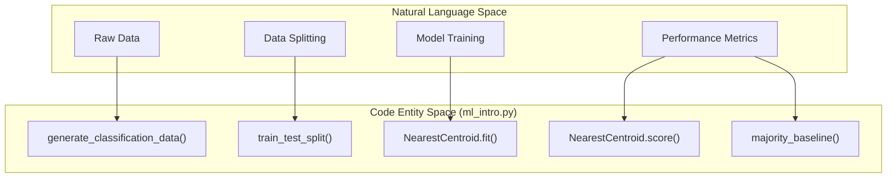
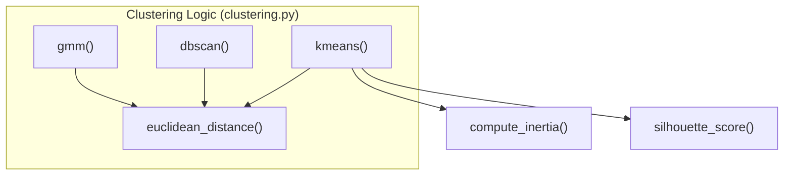
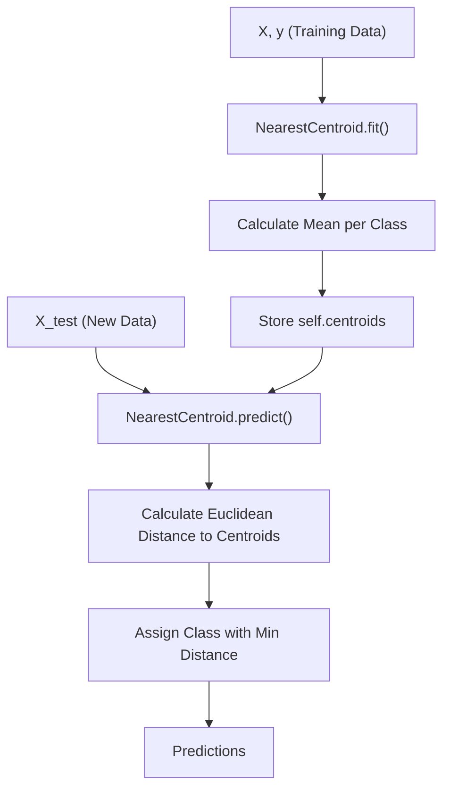

<!-- source: DeepWiki mcp.deepwiki.com · repo rohitg00/ai-engineering-from-scratch · page 4 Phase 2: Machine Learning Fundamentals · fetched 2026-10-30 -->

# Phase 2: Machine Learning Fundamentals

Relevant source files

The following files were used as context for generating this wiki page:

- [phases/02-ml-fundamentals/04-decision-trees/code/trees.py](phases/02-ml-fundamentals/04-decision-trees/code/trees.py)
- [phases/02-ml-fundamentals/04-decision-trees/docs/en.md](phases/02-ml-fundamentals/04-decision-trees/docs/en.md)
- [phases/02-ml-fundamentals/07-unsupervised-learning/code/clustering.py](phases/02-ml-fundamentals/07-unsupervised-learning/code/clustering.py)
- [phases/02-ml-fundamentals/07-unsupervised-learning/docs/en.md](phases/02-ml-fundamentals/07-unsupervised-learning/docs/en.md)
- [phases/02-ml-fundamentals/14-naive-bayes/docs/en.md](phases/02-ml-fundamentals/14-naive-bayes/docs/en.md)
- [phases/03-deep-learning-core/02-multi-layer-networks/code/main.py](phases/03-deep-learning-core/02-multi-layer-networks/code/main.py)
- [phases/03-deep-learning-core/02-multi-layer-networks/docs/en.md](phases/03-deep-learning-core/02-multi-layer-networks/docs/en.md)
- [phases/03-deep-learning-core/02-multi-layer-networks/outputs/prompt-network-architect.md](phases/03-deep-learning-core/02-multi-layer-networks/outputs/prompt-network-architect.md)
- [phases/03-deep-learning-core/04-activation-functions/code/main.py](phases/03-deep-learning-core/04-activation-functions/code/main.py)
- [phases/03-deep-learning-core/04-activation-functions/docs/en.md](phases/03-deep-learning-core/04-activation-functions/docs/en.md)
- [phases/03-deep-learning-core/04-activation-functions/outputs/prompt-activation-selector.md](phases/03-deep-learning-core/04-activation-functions/outputs/prompt-activation-selector.md)
- [phases/03-deep-learning-core/06-optimizers/code/main.py](phases/03-deep-learning-core/06-optimizers/code/main.py)
- [phases/03-deep-learning-core/06-optimizers/docs/en.md](phases/03-deep-learning-core/06-optimizers/docs/en.md)
- [phases/03-deep-learning-core/06-optimizers/outputs/prompt-optimizer-selector.md](phases/03-deep-learning-core/06-optimizers/outputs/prompt-optimizer-selector.md)
- [phases/10-llms-from-scratch/11-quantization/code/main.py](phases/10-llms-from-scratch/11-quantization/code/main.py)
- [phases/10-llms-from-scratch/11-quantization/docs/en.md](phases/10-llms-from-scratch/11-quantization/docs/en.md)
- [phases/10-llms-from-scratch/11-quantization/outputs/skill-quantization.md](phases/10-llms-from-scratch/11-quantization/outputs/skill-quantization.md)

Phase 2 transitions from pure mathematical theory into the practical application of algorithms that learn from data. This phase covers 18 lessons focused on implementing classical machine learning algorithms from scratch using Python and NumPy. The goal is to move beyond "programming rules" to building systems that "discover rules" from data [phases/02-ml-fundamentals/01-what-is-machine-learning/docs/en.md:3-16]().

## The Machine Learning Paradigm

Machine learning shifts the development focus from manual rule-writing to algorithmic pattern discovery. In traditional programming, developers provide rules and data to get output; in machine learning, developers provide data and expected outputs to a learning algorithm, which then produces a model (the rules) [phases/02-ml-fundamentals/01-what-is-machine-learning/docs/en.md:24-45]().

### Learning Taxonomy
The curriculum categorizes machine learning into three primary domains, while also exploring modern hybrid strategies like self-supervised learning used in Large Language Models [phases/02-ml-fundamentals/01-what-is-machine-learning/docs/en.md:49-95]().

| Category | Goal | Key Examples |
| :--- | :--- | :--- |
| **Supervised** | Map inputs to labeled outputs | Regression, Classification |
| **Unsupervised** | Find hidden structure in unlabeled data | Clustering, Dimensionality Reduction |
| **Reinforcement** | Maximize rewards through environmental interaction | Policy Optimization, Robotics |

### From Data to Code
The following diagram illustrates how the conceptual ML workflow maps to the implementation entities found in this phase, specifically highlighting the `NearestCentroid` implementation as a foundational example.

**ML Workflow to Code Entity Mapping**

Sources: [phases/02-ml-fundamentals/01-what-is-machine-learning/code/ml_intro.py:4-58]()

---

## Core Curriculum Components

### Supervised Learning Algorithms
This section covers the implementation of models that predict discrete categories (Classification) or continuous numbers (Regression) [phases/02-ml-fundamentals/01-what-is-machine-learning/docs/en.md:101-112](). You will build foundational models including Linear Regression (OLS, Ridge, Lasso), Logistic Regression, Decision Trees, and Support Vector Machines. 

Key implementations include:
- **Decision Trees**: Recursive partitioning using Gini impurity and Information Gain [phases/02-ml-fundamentals/04-decision-trees/docs/en.md:45-91]().
- **Naive Bayes**: Probabilistic classification using Bayes' Theorem [phases/02-ml-fundamentals/14-naive-bayes/docs/en.md:1-20]().

For details, see [Supervised Learning Algorithms](#4.1).

### Unsupervised Learning & Ensemble Methods
Focuses on finding patterns without explicit labels. This includes clustering techniques like K-Means, DBSCAN, and Gaussian Mixture Models (GMM) [phases/02-ml-fundamentals/07-unsupervised-learning/docs/en.md:31-42](). Ensemble methods combine multiple weak learners (like Decision Trees) into strong learners (like Random Forests) using techniques like Bagging and Feature Randomization [phases/02-ml-fundamentals/04-decision-trees/docs/en.md:134-157]().

**Clustering Implementation Logic**

Sources: [phases/02-ml-fundamentals/07-unsupervised-learning/code/clustering.py:5-159]()

For details, see [Unsupervised Learning & Ensemble Methods](#4.2).

### Model Evaluation, Feature Engineering & Pipelines
Machine learning is an iterative process [phases/02-ml-fundamentals/01-what-is-machine-learning/docs/en.md:117-128](). This section covers the critical "plumbing" of AI engineering: transforming raw data into usable features, selecting the best model via cross-validation, and tuning hyperparameters. It also addresses real-world challenges like quantization for model compression [phases/10-llms-from-scratch/11-quantization/docs/en.md:83-106]().

For details, see [Model Evaluation, Feature Engineering & Pipelines](#4.3).

---

## Technical Implementation Example: Nearest Centroid
The `NearestCentroid` class serves as the introductory implementation for this phase. It demonstrates the `fit`/`predict` pattern used throughout the curriculum.

**Algorithm Logic Flow**

Sources: [phases/02-ml-fundamentals/01-what-is-machine-learning/code/ml_intro.py:9-20]()

### Key Implementation Details
- **`fit(X, y)`**: Identifies unique classes and calculates the mean feature vector (centroid) for each [phases/02-ml-fundamentals/01-what-is-machine-learning/code/ml_intro.py:9-13]().
- **`predict(X)`**: Uses vectorized NumPy operations to calculate distances between new points and stored centroids [phases/02-ml-fundamentals/01-what-is-machine-learning/code/ml_intro.py:15-20]().
- **`score(X, y)`**: Evaluates accuracy by comparing predictions against ground truth labels [phases/02-ml-fundamentals/01-what-is-machine-learning/code/ml_intro.py:22-23]().

**Sources:**
- [phases/02-ml-fundamentals/01-what-is-machine-learning/docs/en.md:1-143]()
- [phases/02-ml-fundamentals/01-what-is-machine-learning/code/ml_intro.py:1-197]()
- [phases/02-ml-fundamentals/04-decision-trees/docs/en.md:1-157]()
- [phases/02-ml-fundamentals/07-unsupervised-learning/docs/en.md:1-125]()
- [phases/02-ml-fundamentals/07-unsupervised-learning/code/clustering.py:1-221]()

---

