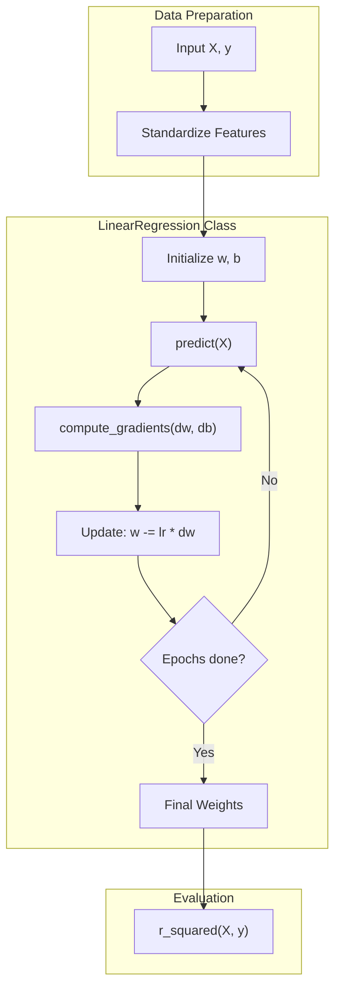
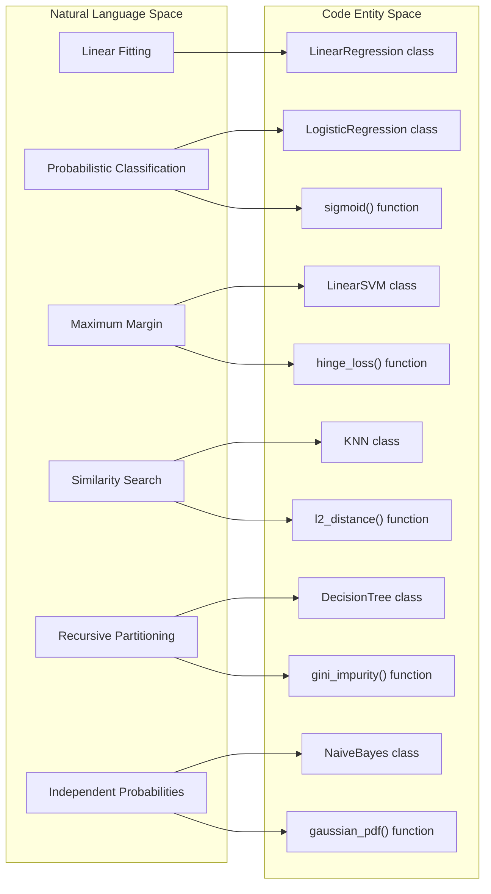

<!-- source: DeepWiki mcp.deepwiki.com · repo rohitg00/ai-engineering-from-scratch · page 4.1 Supervised Learning Algorithms · fetched 2026-10-30 -->

# Supervised Learning Algorithms

Relevant source files

The following files were used as context for generating this wiki page:

- [phases/02-ml-fundamentals/04-decision-trees/code/trees.py](phases/02-ml-fundamentals/04-decision-trees/code/trees.py)
- [phases/02-ml-fundamentals/04-decision-trees/docs/en.md](phases/02-ml-fundamentals/04-decision-trees/docs/en.md)
- [phases/02-ml-fundamentals/07-unsupervised-learning/code/clustering.py](phases/02-ml-fundamentals/07-unsupervised-learning/code/clustering.py)
- [phases/02-ml-fundamentals/07-unsupervised-learning/docs/en.md](phases/02-ml-fundamentals/07-unsupervised-learning/docs/en.md)
- [phases/02-ml-fundamentals/14-naive-bayes/docs/en.md](phases/02-ml-fundamentals/14-naive-bayes/docs/en.md)
- [phases/03-deep-learning-core/02-multi-layer-networks/code/main.py](phases/03-deep-learning-core/02-multi-layer-networks/code/main.py)
- [phases/03-deep-learning-core/02-multi-layer-networks/docs/en.md](phases/03-deep-learning-core/02-multi-layer-networks/docs/en.md)
- [phases/03-deep-learning-core/02-multi-layer-networks/outputs/prompt-network-architect.md](phases/03-deep-learning-core/02-multi-layer-networks/outputs/prompt-network-architect.md)
- [phases/03-deep-learning-core/04-activation-functions/code/main.py](phases/03-deep-learning-core/04-activation-functions/code/main.py)
- [phases/03-deep-learning-core/04-activation-functions/docs/en.md](phases/03-deep-learning-core/04-activation-functions/docs/en.md)
- [phases/03-deep-learning-core/04-activation-functions/outputs/prompt-activation-selector.md](phases/03-deep-learning-core/04-activation-functions/outputs/prompt-activation-selector.md)
- [phases/03-deep-learning-core/06-optimizers/code/main.py](phases/03-deep-learning-core/06-optimizers/code/main.py)
- [phases/03-deep-learning-core/06-optimizers/docs/en.md](phases/03-deep-learning-core/06-optimizers/docs/en.md)
- [phases/03-deep-learning-core/06-optimizers/outputs/prompt-optimizer-selector.md](phases/03-deep-learning-core/06-optimizers/outputs/prompt-optimizer-selector.md)
- [phases/10-llms-from-scratch/11-quantization/code/main.py](phases/10-llms-from-scratch/11-quantization/code/main.py)
- [phases/10-llms-from-scratch/11-quantization/docs/en.md](phases/10-llms-from-scratch/11-quantization/docs/en.md)
- [phases/10-llms-from-scratch/11-quantization/outputs/skill-quantization.md](phases/10-llms-from-scratch/11-quantization/outputs/skill-quantization.md)

This page covers the implementation and theory of fundamental supervised learning algorithms as explored in Phase 2, Lessons 02–06 and 14. These algorithms represent the "classical" machine learning toolkit, providing essential baselines for regression and classification tasks. All implementations are written from scratch in Python to demonstrate the underlying mathematical optimization and logic.

## 1. Linear Regression (OLS, Ridge, Lasso)

Linear regression models the relationship between a scalar response and one or more explanatory variables by fitting a linear equation to observed data [phases/02-ml-fundamentals/02-linear-regression/docs/en.md:20-22]().

### Core Implementations
*   **Gradient Descent (`LinearRegression`)**: Iteratively updates weights `w` and bias `b` to minimize Mean Squared Error (MSE) [phases/02-ml-fundamentals/02-linear-regression/code/linear_regression.py:18-50]().
*   **Normal Equation (`LinearRegressionNormal`)**: A closed-form solution using matrix inversion, ideal for smaller datasets where $n < 10,000$ [phases/02-ml-fundamentals/02-linear-regression/code/linear_regression.py:68-81]().
*   **Multiple Linear Regression**: Extends the model to $n$ features using vector operations [phases/02-ml-fundamentals/02-linear-regression/code/linear_regression.py:101-134]().
*   **Regularization**: Ridge (L2) adds a penalty $\lambda \sum w_i^2$ to discourage large weights and prevent overfitting [phases/02-ml-fundamentals/02-linear-regression/docs/en.md:133-141]().

### Regression Data Flow
The following diagram illustrates the lifecycle of a regression model from initialization to evaluation.

**Model Training & Prediction Loop**

Sources: [phases/02-ml-fundamentals/02-linear-regression/code/linear_regression.py:18-58](), [phases/02-ml-fundamentals/02-linear-regression/docs/en.md:57-66]()

## 2. Logistic Regression & Classification

Despite its name, Logistic Regression is a classification algorithm that predicts the probability of a binary outcome using the Sigmoid function [phases/02-ml-fundamentals/03-logistic-regression/docs/en.md:11-16]().

### Key Components
*   **Sigmoid Function**: Squashes the linear output $z = wx + b$ into the range $(0, 1)$ [phases/02-ml-fundamentals/03-logistic-regression/code/logistic_regression.py:5-7]().
*   **Binary Cross-Entropy (Log Loss)**: The convex cost function used for optimization [phases/02-ml-fundamentals/03-logistic-regression/code/logistic_regression.py:50-57]().
*   **Softmax Regression**: A generalization for multi-class classification where probabilities for all classes sum to 1 [phases/02-ml-fundamentals/03-logistic-regression/code/logistic_regression.py:165-188]().
*   **Metrics**: Evaluation via `ClassificationMetrics` class, calculating Accuracy, Precision, Recall, and F1 Score [phases/02-ml-fundamentals/03-logistic-regression/code/logistic_regression.py:99-135]().

Sources: [phases/02-ml-fundamentals/03-logistic-regression/code/logistic_regression.py:36-82](), [phases/02-ml-fundamentals/03-logistic-regression/docs/en.md:53-64]()

## 3. Decision Trees & Random Forests

Decision Trees partition the feature space into regions based on feature thresholds. Random Forests improve this by averaging multiple decorrelated trees [phases/02-ml-fundamentals/04-decision-trees/docs/en.md:12-16]().

### Split Criteria
*   **Gini Impurity**: Measures the probability of misclassification [phases/02-ml-fundamentals/04-decision-trees/code/trees.py:5-12]().
*   **Entropy**: Measures information disorder [phases/02-ml-fundamentals/04-decision-trees/code/trees.py:15-24]().
*   **Variance Reduction**: Used for regression trees [phases/02-ml-fundamentals/04-decision-trees/code/trees.py:42-51]().

### Random Forest Mechanics
The `RandomForest` implementation utilizes **Bagging** (bootstrap samples) and **Feature Randomization** (selecting a subset of features at each split) to reduce variance [phases/02-ml-fundamentals/04-decision-trees/docs/en.md:146-153](). Diversity is achieved through `bootstrap_sample` and selecting a random subset of features at each node [phases/02-ml-fundamentals/04-decision-trees/docs/en.md:154-158]().

Sources: [phases/02-ml-fundamentals/04-decision-trees/code/trees.py:75-143](), [phases/02-ml-fundamentals/04-decision-trees/docs/en.md:131-145]()

## 4. Support Vector Machines (SVM)

SVMs aim to find the hyperplane that maximizes the margin between two classes [phases/02-ml-fundamentals/05-support-vector-machines/docs/en.md:11-16]().

### Implementation Details
*   **Hinge Loss**: The loss function that penalizes points inside the margin or on the wrong side of the boundary [phases/02-ml-fundamentals/05-support-vector-machines/code/svm.py:38-44]().
*   **Kernel Trick**: Allows the SVM to operate in high-dimensional feature spaces without explicit transformation. Supported kernels include Linear, Polynomial, and RBF (Gaussian) [phases/02-ml-fundamentals/05-support-vector-machines/code/svm.py:25-35]().
*   **C Parameter**: Controls the trade-off between maximizing the margin and minimizing classification errors (Soft Margin) [phases/02-ml-fundamentals/05-support-vector-machines/docs/en.md:87-94]().

Sources: [phases/02-ml-fundamentals/05-support-vector-machines/code/svm.py:53-111](), [phases/02-ml-fundamentals/05-support-vector-machines/docs/en.md:161-170]()

## 5. K-Nearest Neighbors (KNN)

KNN is a "lazy" learning algorithm that stores all training data and makes predictions based on the $K$ most similar instances [phases/02-ml-fundamentals/06-knn-and-distances/docs/en.md:11-14]().

### Distance Metrics & Optimization
*   **Metrics**: Implementation of L1 (Manhattan), L2 (Euclidean), Cosine, and Minkowski distances [phases/02-ml-fundamentals/06-knn-and-distances/code/knn.py:5-25]().
*   **KD-Tree**: A spatial data structure implemented in `KDTree` and `KDNode` classes to speed up neighbor searches from $O(N)$ to $O(\log N)$ [phases/02-ml-fundamentals/06-knn-and-distances/code/knn.py:112-172]().

Sources: [phases/02-ml-fundamentals/06-knn-and-distances/code/knn.py:49-109](), [phases/02-ml-fundamentals/06-knn-and-distances/docs/en.md:156-170]()

## 6. Naive Bayes

Naive Bayes classifiers apply Bayes' Theorem with the "naive" assumption of conditional independence between features [phases/02-ml-fundamentals/14-naive-bayes/docs/en.md:10-15]().

*   **Multinomial**: Typically used for discrete counts like word frequencies in text classification [phases/02-ml-fundamentals/14-naive-bayes/docs/en.md:18-20]().
*   **Gaussian**: Used for continuous data, modeling each feature as a normal distribution defined by its mean and variance [phases/02-ml-fundamentals/14-naive-bayes/docs/en.md:18-20]().
*   **Bernoulli**: Suitable for binary or boolean features [phases/02-ml-fundamentals/14-naive-bayes/docs/en.md:18-20]().

Sources: [phases/02-ml-fundamentals/14-naive-bayes/docs/en.md:1-20](), [phases/02-ml-fundamentals/14-naive-bayes/code/naive_bayes.py:1-50]()

## 7. Algorithm Mapping: Logic to Code

This diagram bridges the conceptual "Natural Language Space" of supervised learning to the specific "Code Entity Space" found in the repository.

**System Logic to Code Entity Mapping**

Sources: [phases/02-ml-fundamentals/02-linear-regression/code/linear_regression.py:18](), [phases/02-ml-fundamentals/03-logistic-regression/code/logistic_regression.py:5,36](), [phases/02-ml-fundamentals/04-decision-trees/code/trees.py:5,75](), [phases/02-ml-fundamentals/05-support-vector-machines/code/svm.py:38,53](), [phases/02-ml-fundamentals/06-knn-and-distances/code/knn.py:5,49](), [phases/02-ml-fundamentals/14-naive-bayes/code/naive_bayes.py:10,25]()

## 8. Summary Table of Toolkit Skills

| Skill Artifact | Purpose | Relevant File |
| :--- | :--- | :--- |
| `skill-regression` | Strategy guide for choosing regression models | [outputs/skill-regression.md]() |
| `skill-classification-baseline` | Establishing baselines with Logistic Regression | [outputs/skill-classification-baseline.md]() |
| `skill-svm-kernel-chooser` | Selecting kernels for SVM tasks | [outputs/skill-svm-kernel-chooser.md]() |
| `prompt-tree-interpreter` | Prompt for explaining decision tree logic | [outputs/prompt-tree-interpreter.md]() |
| `prompt-optimizer-selector` | Decision prompt for choosing the right optimizer (Adam, SGD, etc) | [phases/03-deep-learning-core/06-optimizers/outputs/prompt-optimizer-selector.md:1-6]() |

Sources: [phases/02-ml-fundamentals/02-linear-regression/outputs/skill-regression.md:1-8](), [phases/02-ml-fundamentals/03-logistic-regression/outputs/skill-classification-baseline.md:1-8](), [phases/03-deep-learning-core/06-optimizers/outputs/prompt-optimizer-selector.md:1-6]()

---

