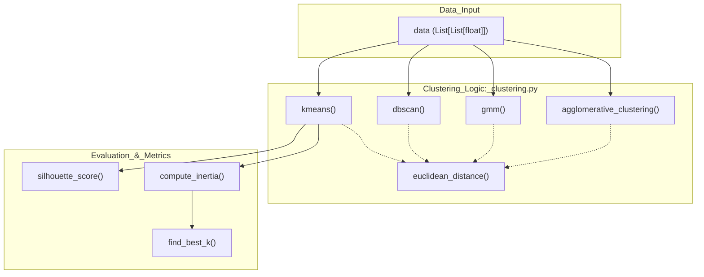
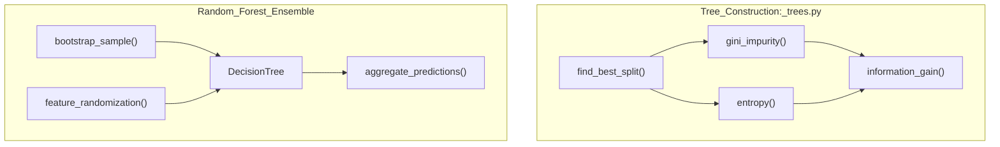
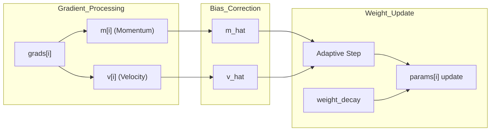

<!-- source: DeepWiki mcp.deepwiki.com · repo rohitg00/ai-engineering-from-scratch · page 4.2 Unsupervised Learning & Ensemble Methods · fetched 2026-10-30 -->

# Unsupervised Learning & Ensemble Methods

Relevant source files

The following files were used as context for generating this wiki page:

- [phases/02-ml-fundamentals/04-decision-trees/code/trees.py](phases/02-ml-fundamentals/04-decision-trees/code/trees.py)
- [phases/02-ml-fundamentals/04-decision-trees/docs/en.md](phases/02-ml-fundamentals/04-decision-trees/docs/en.md)
- [phases/02-ml-fundamentals/07-unsupervised-learning/code/clustering.py](phases/02-ml-fundamentals/07-unsupervised-learning/code/clustering.py)
- [phases/02-ml-fundamentals/07-unsupervised-learning/docs/en.md](phases/02-ml-fundamentals/07-unsupervised-learning/docs/en.md)
- [phases/02-ml-fundamentals/14-naive-bayes/docs/en.md](phases/02-ml-fundamentals/14-naive-bayes/docs/en.md)
- [phases/03-deep-learning-core/02-multi-layer-networks/code/main.py](phases/03-deep-learning-core/02-multi-layer-networks/code/main.py)
- [phases/03-deep-learning-core/02-multi-layer-networks/docs/en.md](phases/03-deep-learning-core/02-multi-layer-networks/docs/en.md)
- [phases/03-deep-learning-core/02-multi-layer-networks/outputs/prompt-network-architect.md](phases/03-deep-learning-core/02-multi-layer-networks/outputs/prompt-network-architect.md)
- [phases/03-deep-learning-core/04-activation-functions/code/main.py](phases/03-deep-learning-core/04-activation-functions/code/main.py)
- [phases/03-deep-learning-core/04-activation-functions/docs/en.md](phases/03-deep-learning-core/04-activation-functions/docs/en.md)
- [phases/03-deep-learning-core/04-activation-functions/outputs/prompt-activation-selector.md](phases/03-deep-learning-core/04-activation-functions/outputs/prompt-activation-selector.md)
- [phases/03-deep-learning-core/06-optimizers/code/main.py](phases/03-deep-learning-core/06-optimizers/code/main.py)
- [phases/03-deep-learning-core/06-optimizers/docs/en.md](phases/03-deep-learning-core/06-optimizers/docs/en.md)
- [phases/03-deep-learning-core/06-optimizers/outputs/prompt-optimizer-selector.md](phases/03-deep-learning-core/06-optimizers/outputs/prompt-optimizer-selector.md)
- [phases/10-llms-from-scratch/11-quantization/code/main.py](phases/10-llms-from-scratch/11-quantization/code/main.py)
- [phases/10-llms-from-scratch/11-quantization/docs/en.md](phases/10-llms-from-scratch/11-quantization/docs/en.md)
- [phases/10-llms-from-scratch/11-quantization/outputs/skill-quantization.md](phases/10-llms-from-scratch/11-quantization/outputs/skill-quantization.md)

This page covers the implementation and theoretical foundations of unsupervised learning (clustering and anomaly detection) and ensemble methods (bagging, boosting, and stacking). These techniques represent the transition from simple models to robust, production-grade systems capable of handling complex data structures and high-variance scenarios.

## Unsupervised Learning: Finding Hidden Structure

Unsupervised learning algorithms identify patterns in data without explicit labels [phases/02-ml-fundamentals/07-unsupervised-learning/docs/en.md:3-14](). The primary focus is on **Clustering**, which groups similar data points based on distance metrics or density [phases/02-ml-fundamentals/07-unsupervised-learning/docs/en.md:20-22]().

### Core Clustering Algorithms

The implementation in `clustering.py` provides four distinct approaches to grouping data:

1.  **K-Means**: Partitions data into $K$ spherical clusters by minimizing "inertia" (total squared distance to centroids) [phases/02-ml-fundamentals/07-unsupervised-learning/docs/en.md:44-55]().
2.  **DBSCAN**: A density-based approach that identifies clusters of arbitrary shapes and labels sparse points as noise (outliers) [phases/02-ml-fundamentals/07-unsupervised-learning/docs/en.md:65-78]().
3.  **Hierarchical (Agglomerative)**: A bottom-up approach that builds a tree of nested clusters (dendrogram) [phases/02-ml-fundamentals/07-unsupervised-learning/docs/en.md:82-90]().
4.  **Gaussian Mixture Models (GMM)**: A probabilistic approach using the Expectation-Maximization (EM) algorithm to allow for soft assignments and elliptical clusters [phases/02-ml-fundamentals/07-unsupervised-learning/docs/en.md:98-107]().

### Clustering System Architecture

The following diagram maps the logical clustering concepts to the implementation in `clustering.py`.

**Clustering Implementation Flow**

Sources: [phases/02-ml-fundamentals/07-unsupervised-learning/code/clustering.py:5-223](), [phases/02-ml-fundamentals/07-unsupervised-learning/docs/en.md:31-42]()

### Key Functions
*   `kmeans(data, k, ...)`: Implements Lloyd's algorithm: assign to nearest centroid, then recompute means [phases/02-ml-fundamentals/07-unsupervised-learning/code/clustering.py:9-45]().
*   `dbscan(data, eps, min_samples)`: Uses a `region_query` to expand clusters from "core points" [phases/02-ml-fundamentals/07-unsupervised-learning/code/clustering.py:111-159]().
*   `gmm(data, k, ...)`: Implements EM steps, updating `means`, `variances`, and `weights` for $K$ Gaussians [phases/02-ml-fundamentals/07-unsupervised-learning/code/clustering.py:162-221]().
*   `find_best_k(data)`: Automates the "Elbow Method" by iterating through $K$ values and calculating inertia [phases/02-ml-fundamentals/07-unsupervised-learning/code/clustering.py:93-108]().

---

## Ensemble Methods: Combining Weak Learners

Ensemble methods combine multiple "weak learners" to create a "strong learner". They are categorized by how they address the bias-variance tradeoff.

### Bagging, Boosting, and Stacking

| Method | Primary Goal | Mechanism | Implementation Detail |
| :--- | :--- | :--- | :--- |
| **Bagging** | Reduce Variance | Parallel training on bootstrap samples (sampling with replacement) [phases/02-ml-fundamentals/04-decision-trees/docs/en.md:154-156](). | `RandomForestClassifier` logic [phases/02-ml-fundamentals/04-decision-trees/docs/en.md:134-158]() |
| **Boosting** | Reduce Bias | Sequential training where each model corrects the errors of the previous one. | Iterative residual fitting or reweighting. |
| **Stacking** | Improve Generalization | Uses a meta-learner to combine predictions from diverse base models. | Multi-level model architecture. |

### Decision Trees & Random Forests

The `DecisionTree` implementation uses recursive partitioning based on impurity metrics like Gini and Entropy [phases/02-ml-fundamentals/04-decision-trees/docs/en.md:45-80]().

**Decision Tree Logic**

Sources: [phases/02-ml-fundamentals/04-decision-trees/docs/en.md:134-158](), [phases/02-ml-fundamentals/04-decision-trees/code/trees.py:1-100]()

### Advanced Optimization: Adam and AdamW

While classical ensembles combine models, modern deep learning uses sophisticated optimizers to navigate the loss landscape [phases/03-deep-learning-core/06-optimizers/docs/en.md:3-4]().

*   **Adam**: Combines Momentum (first moment) and RMSProp (second moment) with bias correction [phases/03-deep-learning-core/06-optimizers/code/main.py:28-53]().
*   **AdamW**: Decouples weight decay from the gradient update to improve generalization [phases/03-deep-learning-core/06-optimizers/code/main.py:55-81]().

**Optimizer Data Flow**

Sources: [phases/03-deep-learning-core/06-optimizers/code/main.py:38-81](), [phases/03-deep-learning-core/06-optimizers/docs/en.md:75-113]()

### Practical Deployment: Quantization

To deploy these large ensembles or deep models, quantization is used to reduce memory footprint [phases/10-llms-from-scratch/11-quantization/docs/en.md:1-3]().

*   **Symmetric Quantization**: Uses a single scale factor: `scale = max(abs(tensor)) / qmax` [phases/10-llms-from-scratch/11-quantization/code/main.py:82-90]().
*   **Asymmetric Quantization**: Adds a `zero_point` to handle non-centered distributions [phases/10-llms-from-scratch/11-quantization/code/main.py:119-130]().

Sources: [phases/10-llms-from-scratch/11-quantization/code/main.py:1-175](), [phases/10-llms-from-scratch/11-quantization/outputs/skill-quantization.md:10-140]()

---

