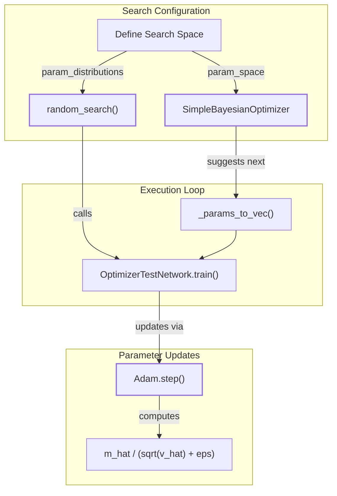
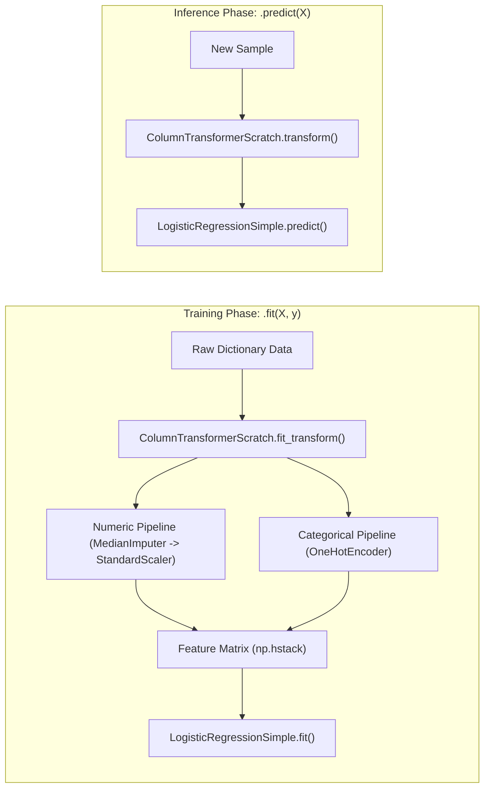

<!-- source: DeepWiki mcp.deepwiki.com · repo rohitg00/ai-engineering-from-scratch · page 4.3 Model Evaluation, Feature Engineering & Pipelines · fetched 2026-10-30 -->

# Model Evaluation, Feature Engineering & Pipelines

Relevant source files

The following files were used as context for generating this wiki page:

- [phases/02-ml-fundamentals/04-decision-trees/code/trees.py](phases/02-ml-fundamentals/04-decision-trees/code/trees.py)
- [phases/02-ml-fundamentals/04-decision-trees/docs/en.md](phases/02-ml-fundamentals/04-decision-trees/docs/en.md)
- [phases/02-ml-fundamentals/07-unsupervised-learning/code/clustering.py](phases/02-ml-fundamentals/07-unsupervised-learning/code/clustering.py)
- [phases/02-ml-fundamentals/07-unsupervised-learning/docs/en.md](phases/02-ml-fundamentals/07-unsupervised-learning/docs/en.md)
- [phases/02-ml-fundamentals/14-naive-bayes/docs/en.md](phases/02-ml-fundamentals/14-naive-bayes/docs/en.md)
- [phases/03-deep-learning-core/02-multi-layer-networks/code/main.py](phases/03-deep-learning-core/02-multi-layer-networks/code/main.py)
- [phases/03-deep-learning-core/02-multi-layer-networks/docs/en.md](phases/03-deep-learning-core/02-multi-layer-networks/docs/en.md)
- [phases/03-deep-learning-core/02-multi-layer-networks/outputs/prompt-network-architect.md](phases/03-deep-learning-core/02-multi-layer-networks/outputs/prompt-network-architect.md)
- [phases/03-deep-learning-core/04-activation-functions/code/main.py](phases/03-deep-learning-core/04-activation-functions/code/main.py)
- [phases/03-deep-learning-core/04-activation-functions/docs/en.md](phases/03-deep-learning-core/04-activation-functions/docs/en.md)
- [phases/03-deep-learning-core/04-activation-functions/outputs/prompt-activation-selector.md](phases/03-deep-learning-core/04-activation-functions/outputs/prompt-activation-selector.md)
- [phases/03-deep-learning-core/06-optimizers/code/main.py](phases/03-deep-learning-core/06-optimizers/code/main.py)
- [phases/03-deep-learning-core/06-optimizers/docs/en.md](phases/03-deep-learning-core/06-optimizers/docs/en.md)
- [phases/03-deep-learning-core/06-optimizers/outputs/prompt-optimizer-selector.md](phases/03-deep-learning-core/06-optimizers/outputs/prompt-optimizer-selector.md)
- [phases/10-llms-from-scratch/11-quantization/code/main.py](phases/10-llms-from-scratch/11-quantization/code/main.py)
- [phases/10-llms-from-scratch/11-quantization/docs/en.md](phases/10-llms-from-scratch/11-quantization/docs/en.md)
- [phases/10-llms-from-scratch/11-quantization/outputs/skill-quantization.md](phases/10-llms-from-scratch/11-quantization/outputs/skill-quantization.md)

This section covers the critical engineering practices required to move from raw data to production-ready machine learning models. It focuses on transforming data into predictive signals (Feature Engineering), measuring model performance reliably (Evaluation), and automating the end-to-end lifecycle (Pipelines & Hyperparameter Tuning).

## 1. Feature Engineering & Selection

Feature engineering is the process of transforming raw data into representations that make patterns easier for models to find [phases/02-ml-fundamentals/08-feature-engineering/docs/en.md:18-19](). In classical ML, the representation of data often matters more than the choice of algorithm [phases/02-ml-fundamentals/08-feature-engineering/docs/en.md:14-16]().

### Core Transformations
*   **Numerical Scaling**: Essential for distance-based algorithms like K-Means or SVM. Implementation includes `min_max_scale` (mapping to [0, 1]) and `standardize` (mean=0, std=1) [phases/02-ml-fundamentals/08-feature-engineering/code/features.py:5-18]().
*   **Categorical Encoding**: Converting strings to numbers. `one_hot_encode` creates binary columns for each category, while `label_encode` maps categories to integers [phases/02-ml-fundamentals/08-feature-engineering/code/features.py:51-69]().
*   **Text Features**: `count_vectorize` converts documents to word frequency vectors, and `tfidf` weighs words by their uniqueness across the corpus [phases/02-ml-fundamentals/08-feature-engineering/code/features.py:90-143]().
*   **Imputation**: Handling missing values via `impute_mean`, `impute_median`, or `impute_mode` [phases/02-ml-fundamentals/08-feature-engineering/code/features.py:146-174]().

### Feature Selection
To reduce noise and prevent overfitting, the toolkit provides:
*   **Filter Methods**: `variance_threshold` to remove constant features and `remove_correlated` to eliminate redundant variables [phases/02-ml-fundamentals/08-feature-engineering/code/features.py:226-250]().
*   **Information Theory**: `mutual_information` measures how much a feature reduces uncertainty about the target [phases/02-ml-fundamentals/08-feature-engineering/code/features.py:193-223]().

**Sources:** [phases/02-ml-fundamentals/08-feature-engineering/docs/en.md:1-100](), [phases/02-ml-fundamentals/08-feature-engineering/code/features.py:1-250]()

---

## 2. Model Evaluation Metrics

Evaluation is the safeguard against models that "cheat" or fail to generalize.

### The Evaluation Lifecycle
The standard workflow involves splitting data into **Train** (learning), **Validation** (tuning), and **Test** (final reporting) sets [phases/02-ml-fundamentals/09-model-evaluation/docs/en.md:22-40]().

### Key Implementation Entities
| Metric | Code Function | Purpose |
| :--- | :--- | :--- |
| **F1 Score** | `f1_score` | Harmonic mean of precision and recall; used for imbalanced data [phases/02-ml-fundamentals/09-model-evaluation/code/evaluation.py:123-126](). |
| **AUC-ROC** | `auc_roc` | Threshold-independent measure of ranking quality [phases/02-ml-fundamentals/09-model-evaluation/code/evaluation.py:151-164](). |
| **R-Squared** | `r_squared` | Fraction of variance explained by a regression model [phases/02-ml-fundamentals/09-model-evaluation/code/evaluation.py:181-187](). |
| **Stratified K-Fold** | `stratified_kfold_split` | Ensures class ratios are preserved across CV folds [phases/02-ml-fundamentals/09-model-evaluation/code/evaluation.py:46-68](). |
| **Silhouette Score** | `silhouette_score` | Measures cluster quality by comparing intra-cluster vs inter-cluster distance [phases/02-ml-fundamentals/07-unsupervised-learning/code/clustering.py:55-90](). |

### Model Diagnostics: Bias vs. Variance
The `bias_variance_decomposition` function uses bootstrapping to estimate the three components of error: **Bias^2** (underfitting), **Variance** (overfitting), and **Irreducible Noise** [phases/02-ml-fundamentals/10-bias-variance/code/bias_variance.py:34-70]().

**Sources:** [phases/02-ml-fundamentals/09-model-evaluation/docs/en.md:85-108](), [phases/02-ml-fundamentals/09-model-evaluation/code/evaluation.py:99-187](), [phases/02-ml-fundamentals/10-bias-variance/code/bias_variance.py:1-70](), [phases/02-ml-fundamentals/07-unsupervised-learning/code/clustering.py:55-90]()

---

## 3. Hyperparameter Tuning & Optimization

Hyperparameters are the configurations set before training (e.g., learning rate, max depth) [phases/02-ml-fundamentals/12-hyperparameter-tuning/docs/en.md:18-30]().

### Tuning Strategies
1.  **Grid Search**: Exhaustive search over a fixed set of values. Scalability is poor (exponential growth) [phases/02-ml-fundamentals/12-hyperparameter-tuning/docs/en.md:31-46]().
2.  **Random Search**: Samples from distributions. Usually beats Grid Search because it covers important dimensions more densely [phases/02-ml-fundamentals/12-hyperparameter-tuning/docs/en.md:50-74]().
3.  **Bayesian Optimization**: Uses a **Surrogate Model** (e.g., Gaussian Process) and an **Acquisition Function** to learn from past evaluations and pick the next best point [phases/02-ml-fundamentals/12-hyperparameter-tuning/docs/en.md:76-101]().

### Deep Learning Optimizers
Modern neural networks require advanced optimizers to handle loss landscape oscillations [phases/03-deep-learning-core/06-optimizers/docs/en.md:21-29]().
*   **SGD**: Basic gradient descent with learning rate `lr` [phases/03-deep-learning-core/06-optimizers/code/main.py:6-11]().
*   **Adam**: Combines momentum (first moment `m`) and RMSProp (second moment `v`) with bias correction `m_hat` and `v_hat` [phases/03-deep-learning-core/06-optimizers/code/main.py:28-53]().
*   **AdamW**: Decouples weight decay from the adaptive gradient updates to improve generalization [phases/03-deep-learning-core/06-optimizers/code/main.py:56-82]().

### Diagram: Hyperparameter & Optimizer Search Logic
"Natural Language Space" to "Code Entity Space" mapping for tuning and optimization.

**Sources:** [phases/02-ml-fundamentals/12-hyperparameter-tuning/docs/en.md:54-89](), [phases/03-deep-learning-core/06-optimizers/code/main.py:28-82](), [phases/03-deep-learning-core/06-optimizers/docs/en.md:77-100]()

---

## 4. ML Pipelines & Experiment Tracking

A pipeline is an ordered sequence of data transformations followed by a model, ensuring reproducibility and preventing **Data Leakage** [phases/02-ml-fundamentals/13-ml-pipelines/docs/en.md:20-38]().

### Pipeline Components
*   **PipelineFromScratch**: Chains multiple `fit_transform` steps and a final `predict` call [phases/02-ml-fundamentals/13-ml-pipelines/code/pipeline.py:119-136]().
*   **ColumnTransformerScratch**: Allows different preprocessing pipelines for different column subsets [phases/02-ml-fundamentals/13-ml-pipelines/code/pipeline.py:143-162]().

### Diagram: Pipeline Data Flow
Tracing the flow from raw data to prediction through the `PipelineFromScratch` class.

### Experiment Tracking
The curriculum emphasizes tracking every run using tools like **MLflow** or **Weights & Biases (wandb)** to log parameters, metrics, and serialized pipeline artifacts [phases/02-ml-fundamentals/13-ml-pipelines/docs/en.md:128-149]().

**Sources:** [phases/02-ml-fundamentals/13-ml-pipelines/docs/en.md:24-124](), [phases/02-ml-fundamentals/13-ml-pipelines/code/pipeline.py:119-215]()

---

## 5. Specialized Handling & Efficiency

### Imbalanced Data & Anomaly Detection
*   **Resampling**: `RandomOverSampler` or `RandomUnderSampler` [phases/02-ml-fundamentals/17-imbalanced-data/code/imbalanced.py]().
*   **DBSCAN**: Identifies outliers as "noise points" that do not belong to any dense cluster [phases/02-ml-fundamentals/07-unsupervised-learning/code/clustering.py:111-159]().
*   **Isolation Forest**: Standard tool for anomaly detection [phases/02-ml-fundamentals/16-anomaly-detection/code/anomaly_detection.py]().

### Quantization: Model Efficiency
Quantization reduces model memory footprint by mapping high-precision floating points to lower-precision integers [phases/10-llms-from-scratch/11-quantization/docs/en.md:23-25]().
*   **Symmetric Quantization**: Uses a single `scale` factor based on the maximum absolute value [phases/10-llms-from-scratch/11-quantization/code/main.py:82-90]().
*   **Asymmetric Quantization**: Includes a `zero_point` to handle non-centered distributions [phases/10-llms-from-scratch/11-quantization/code/main.py:119-130]().
*   **Per-Channel Quantization**: Calculates unique scales for each output channel to preserve precision across different feature magnitudes [phases/10-llms-from-scratch/11-quantization/code/main.py:97-109]().

**Sources:** [phases/02-ml-fundamentals/17-imbalanced-data/docs/en.md](), [phases/07-unsupervised-learning/code/clustering.py:111-159](), [phases/10-llms-from-scratch/11-quantization/docs/en.md:29-56](), [phases/10-llms-from-scratch/11-quantization/code/main.py:82-130]()

---

