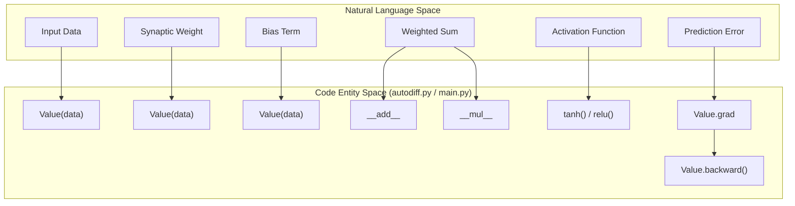
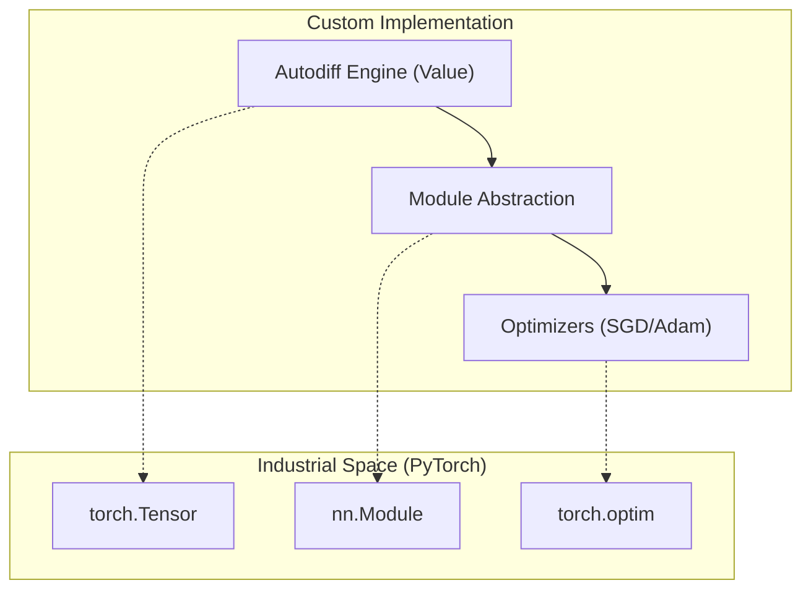

<!-- source: DeepWiki mcp.deepwiki.com · repo rohitg00/ai-engineering-from-scratch · page 5 Phase 3: Deep Learning Core · fetched 2026-10-30 -->

# Phase 3: Deep Learning Core

Relevant source files

The following files were used as context for generating this wiki page:

- [phases/01-math-foundations/04-calculus-for-ml/docs/en.md](phases/01-math-foundations/04-calculus-for-ml/docs/en.md)
- [phases/01-math-foundations/05-chain-rule-and-autodiff/docs/en.md](phases/01-math-foundations/05-chain-rule-and-autodiff/docs/en.md)
- [phases/03-deep-learning-core/03-backpropagation/docs/en.md](phases/03-deep-learning-core/03-backpropagation/docs/en.md)
- [phases/03-deep-learning-core/05-loss-functions/code/main.py](phases/03-deep-learning-core/05-loss-functions/code/main.py)
- [phases/03-deep-learning-core/05-loss-functions/docs/en.md](phases/03-deep-learning-core/05-loss-functions/docs/en.md)
- [phases/03-deep-learning-core/05-loss-functions/outputs/prompt-loss-debugger.md](phases/03-deep-learning-core/05-loss-functions/outputs/prompt-loss-debugger.md)
- [phases/03-deep-learning-core/05-loss-functions/outputs/prompt-loss-function-selector.md](phases/03-deep-learning-core/05-loss-functions/outputs/prompt-loss-function-selector.md)
- [phases/03-deep-learning-core/07-regularization/code/main.py](phases/03-deep-learning-core/07-regularization/code/main.py)
- [phases/03-deep-learning-core/07-regularization/docs/en.md](phases/03-deep-learning-core/07-regularization/docs/en.md)
- [phases/03-deep-learning-core/07-regularization/outputs/prompt-regularization-advisor.md](phases/03-deep-learning-core/07-regularization/outputs/prompt-regularization-advisor.md)
- [phases/03-deep-learning-core/08-weight-initialization/code/main.py](phases/03-deep-learning-core/08-weight-initialization/code/main.py)
- [phases/03-deep-learning-core/08-weight-initialization/docs/en.md](phases/03-deep-learning-core/08-weight-initialization/docs/en.md)
- [phases/03-deep-learning-core/08-weight-initialization/outputs/prompt-init-strategy.md](phases/03-deep-learning-core/08-weight-initialization/outputs/prompt-init-strategy.md)
- [phases/03-deep-learning-core/09-learning-rate-schedules/code/main.py](phases/03-deep-learning-core/09-learning-rate-schedules/code/main.py)
- [phases/03-deep-learning-core/09-learning-rate-schedules/docs/en.md](phases/03-deep-learning-core/09-learning-rate-schedules/docs/en.md)
- [phases/03-deep-learning-core/09-learning-rate-schedules/outputs/prompt-lr-schedule-advisor.md](phases/03-deep-learning-core/09-learning-rate-schedules/outputs/prompt-lr-schedule-advisor.md)
- [phases/03-deep-learning-core/10-mini-framework/code/main.py](phases/03-deep-learning-core/10-mini-framework/code/main.py)
- [phases/03-deep-learning-core/10-mini-framework/docs/en.md](phases/03-deep-learning-core/10-mini-framework/docs/en.md)
- [phases/03-deep-learning-core/10-mini-framework/outputs/prompt-framework-architect.md](phases/03-deep-learning-core/10-mini-framework/outputs/prompt-framework-architect.md)
- [phases/03-deep-learning-core/11-intro-to-pytorch/docs/en.md](phases/03-deep-learning-core/11-intro-to-pytorch/docs/en.md)
- [phases/03-deep-learning-core/13-debugging-neural-networks/docs/en.md](phases/03-deep-learning-core/13-debugging-neural-networks/docs/en.md)
- [phases/05-nlp-foundations-to-advanced/08-cnns-rnns-for-text/docs/en.md](phases/05-nlp-foundations-to-advanced/08-cnns-rnns-for-text/docs/en.md)
- [phases/10-llms-from-scratch/01-tokenizers/docs/en.md](phases/10-llms-from-scratch/01-tokenizers/docs/en.md)
- [phases/10-llms-from-scratch/02-building-a-tokenizer/docs/en.md](phases/10-llms-from-scratch/02-building-a-tokenizer/docs/en.md)
- [phases/10-llms-from-scratch/04-pre-training-mini-gpt/code/main.py](phases/10-llms-from-scratch/04-pre-training-mini-gpt/code/main.py)
- [phases/10-llms-from-scratch/04-pre-training-mini-gpt/docs/en.md](phases/10-llms-from-scratch/04-pre-training-mini-gpt/docs/en.md)
- [phases/10-llms-from-scratch/04-pre-training-mini-gpt/outputs/prompt-gpt-architecture-analyzer.md](phases/10-llms-from-scratch/04-pre-training-mini-gpt/outputs/prompt-gpt-architecture-analyzer.md)
- [phases/11-llm-engineering/05-context-engineering/docs/en.md](phases/11-llm-engineering/05-context-engineering/docs/en.md)

Phase 3 transitions from classical machine learning to deep learning by building the fundamental unit of neural networks—the perceptron—and developing a modular automatic differentiation (autograd) engine. This phase bridges the gap between mathematical theory (calculus and linear algebra) and the implementation of modern deep learning frameworks.

While the foundational lessons (01-03) and the transition to PyTorch (11) are prioritized, the phase provides a comprehensive roadmap for constructing a complete from-scratch deep learning framework, including activation functions, loss functions, and optimizers.

### Deep Learning Architecture Mapping

The following diagram maps the conceptual components of a neural network to their specific implementations in the `autodiff.py` engine and the `perceptron.py` logic.

**Neural Network to Code Entity Map**

Sources: [phases/01-math-foundations/05-chain-rule-and-autodiff/code/autodiff.py:4-105](), [phases/03-deep-learning-core/01-the-perceptron/code/perceptron.py:1-27](), [phases/03-deep-learning-core/03-backpropagation/docs/en.md:141-165]()

---

### Core Components

#### 1. The Perceptron
The perceptron is the "atom" of neural networks, performing a linear transformation followed by a step function [phases/03-deep-learning-core/01-the-perceptron/docs/en.md:3-36](). In this phase, we implement the `Perceptron` class to solve basic logic gates (AND, OR, NOT) [phases/03-deep-learning-core/01-the-perceptron/code/perceptron.py:1-70](). 

A key learning milestone is the **XOR Problem**: demonstrating that a single perceptron cannot solve non-linearly separable problems, necessitating the move to Multi-Layer Perceptrons (MLP) [phases/03-deep-learning-core/01-the-perceptron/docs/en.md:80-108]().

#### 2. Automatic Differentiation (Autograd)
The engine of modern deep learning is reverse-mode automatic differentiation. We implement a `Value` class that wraps scalars and tracks the computational graph [phases/01-math-foundations/05-chain-rule-and-autodiff/code/autodiff.py:4-14](). 

- **Forward Pass**: Operations like `__add__` and `__mul__` create new `Value` objects while maintaining pointers to `_prev` nodes [phases/01-math-foundations/05-chain-rule-and-autodiff/code/autodiff.py:15-34]().
- **Backward Pass**: The `backward()` method performs a topological sort of the graph and applies the chain rule recursively to populate `.grad` attributes [phases/03-deep-learning-core/03-backpropagation/docs/en.md:178-205]().

#### 3. The Mini-Framework Abstraction
The curriculum culminates in building a `Module` abstraction [phases/03-deep-learning-core/10-mini-framework/docs/en.md:157-175](). This allows for high-level model definitions similar to modern libraries:
- **`Sequential`**: A container that chains modules and propagates both `forward` and `backward` passes [phases/03-deep-learning-core/10-mini-framework/docs/en.md:137-148]().
- **`Linear`**: Implements the standard `Wx + b` layer with He initialization [phases/03-deep-learning-core/10-mini-framework/docs/en.md:186-198]().

For details, see [The Perceptron & Neural Network Foundations](#5.1).

---

### Implementation Status & Roadmap

The curriculum progresses from a single neuron to a full Multi-Layer Perceptron (MLP) capable of training on complex datasets like XOR via backpropagation, eventually moving to industrial-grade tools like PyTorch.

**Deep Learning Framework Evolution**

Sources: [phases/03-deep-learning-core/10-mini-framework/docs/en.md:57-90](), [phases/03-deep-learning-core/11-intro-to-pytorch/docs/en.md:119-153]()

| Lesson | Topic | Status | Key Artifacts |
| :--- | :--- | :--- | :--- |
| 01 | The Perceptron | ✅ Complete | `perceptron.py`, `skill-perceptron.md` |
| 03 | Backpropagation | ✅ Complete | `Value` class, `topological_sort` |
| 10 | Mini-Framework | ✅ Complete | `Module`, `Linear`, `Sequential` |
| 11 | Intro to PyTorch | ✅ Complete | `nn.Module`, `torch.Tensor` |
| 13 | Debugging | ✅ Complete | `gradient_checking`, `overfit_one_batch` |

For details on future lessons and the broader AI roadmap, see [Planned Deep Learning Curriculum (Phases 3–9)](#5.2).

---

### Toolkit Artifacts
This phase produces reusable skills for identifying network architecture requirements and debugging model performance.
- **skill-perceptron**: A guide for determining when a single-layer vs. multi-layer architecture is required based on linear separability [phases/03-deep-learning-core/01-the-perceptron/outputs/skill-perceptron.md:1-58]().
- **prompt-framework-architect**: Guidance on designing modular deep learning systems [phases/03-deep-learning-core/10-mini-framework/outputs/prompt-framework-architect.md]().
- **Debugging Checklist**: Systematic strategies for diagnosing "silent" failures like vanishing gradients or dead ReLUs [phases/03-deep-learning-core/13-debugging-neural-networks/docs/en.md:37-51]().

Sources: [phases/03-deep-learning-core/01-the-perceptron/outputs/skill-perceptron.md:1-8](), [phases/03-deep-learning-core/13-debugging-neural-networks/docs/en.md:12-15]()

---

