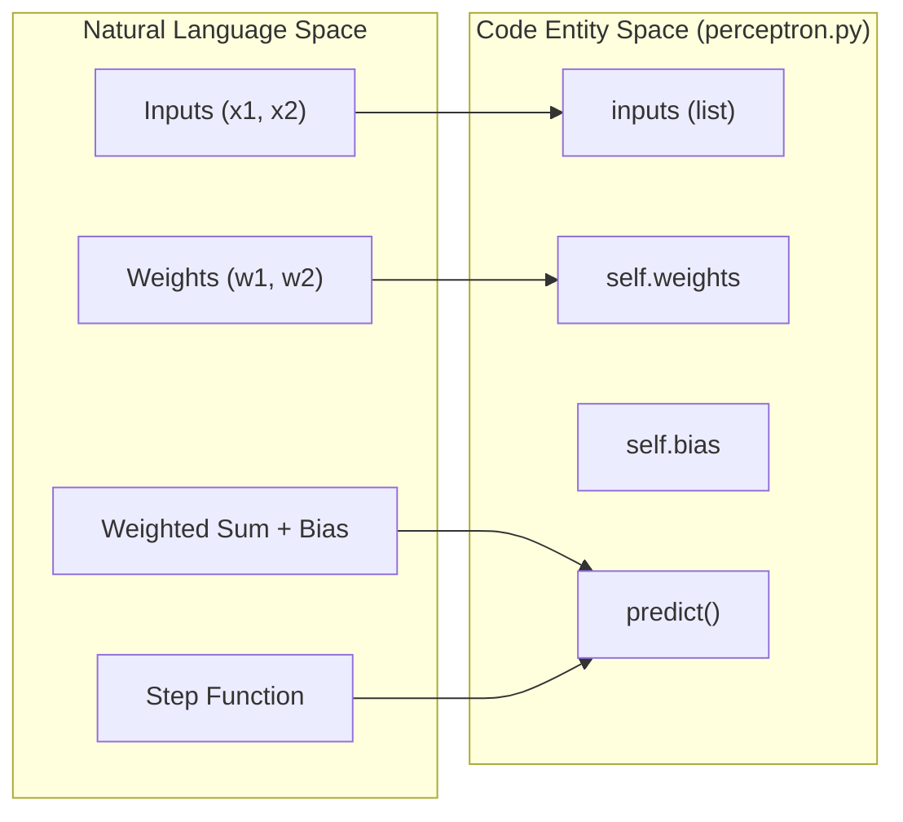
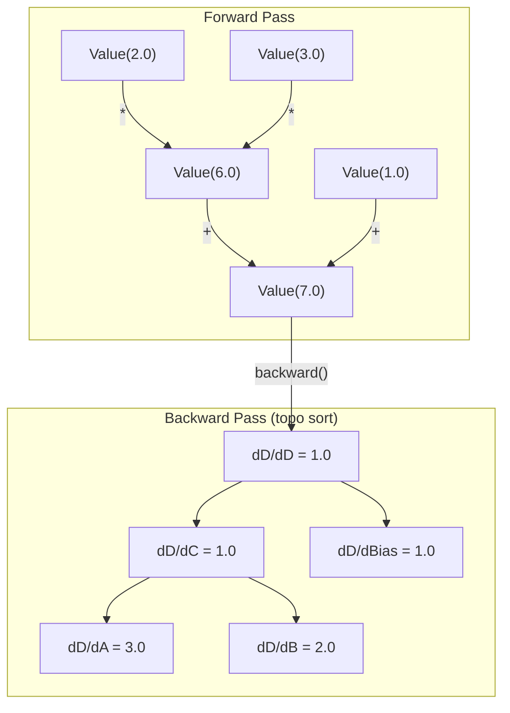
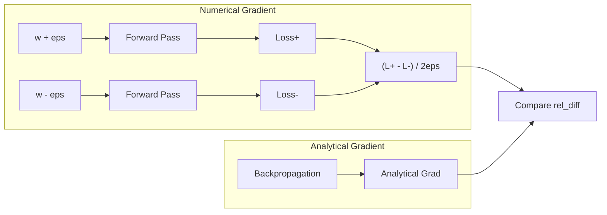

<!-- source: DeepWiki mcp.deepwiki.com · repo rohitg00/ai-engineering-from-scratch · page 5.1 The Perceptron & Neural Network Foundations · fetched 2026-10-30 -->

# The Perceptron & Neural Network Foundations

Relevant source files

The following files were used as context for generating this wiki page:

- [phases/01-math-foundations/04-calculus-for-ml/docs/en.md](phases/01-math-foundations/04-calculus-for-ml/docs/en.md)
- [phases/01-math-foundations/05-chain-rule-and-autodiff/docs/en.md](phases/01-math-foundations/05-chain-rule-and-autodiff/docs/en.md)
- [phases/03-deep-learning-core/03-backpropagation/docs/en.md](phases/03-deep-learning-core/03-backpropagation/docs/en.md)
- [phases/03-deep-learning-core/05-loss-functions/code/main.py](phases/03-deep-learning-core/05-loss-functions/code/main.py)
- [phases/03-deep-learning-core/05-loss-functions/docs/en.md](phases/03-deep-learning-core/05-loss-functions/docs/en.md)
- [phases/03-deep-learning-core/05-loss-functions/outputs/prompt-loss-debugger.md](phases/03-deep-learning-core/05-loss-functions/outputs/prompt-loss-debugger.md)
- [phases/03-deep-learning-core/05-loss-functions/outputs/prompt-loss-function-selector.md](phases/03-deep-learning-core/05-loss-functions/outputs/prompt-loss-function-selector.md)
- [phases/03-deep-learning-core/07-regularization/code/main.py](phases/03-deep-learning-core/07-regularization/code/main.py)
- [phases/03-deep-learning-core/07-regularization/docs/en.md](phases/03-deep-learning-core/07-regularization/docs/en.md)
- [phases/03-deep-learning-core/07-regularization/outputs/prompt-regularization-advisor.md](phases/03-deep-learning-core/07-regularization/outputs/prompt-regularization-advisor.md)
- [phases/03-deep-learning-core/08-weight-initialization/code/main.py](phases/03-deep-learning-core/08-weight-initialization/code/main.py)
- [phases/03-deep-learning-core/08-weight-initialization/docs/en.md](phases/03-deep-learning-core/08-weight-initialization/docs/en.md)
- [phases/03-deep-learning-core/08-weight-initialization/outputs/prompt-init-strategy.md](phases/03-deep-learning-core/08-weight-initialization/outputs/prompt-init-strategy.md)
- [phases/03-deep-learning-core/09-learning-rate-schedules/code/main.py](phases/03-deep-learning-core/09-learning-rate-schedules/code/main.py)
- [phases/03-deep-learning-core/09-learning-rate-schedules/docs/en.md](phases/03-deep-learning-core/09-learning-rate-schedules/docs/en.md)
- [phases/03-deep-learning-core/09-learning-rate-schedules/outputs/prompt-lr-schedule-advisor.md](phases/03-deep-learning-core/09-learning-rate-schedules/outputs/prompt-lr-schedule-advisor.md)
- [phases/03-deep-learning-core/10-mini-framework/code/main.py](phases/03-deep-learning-core/10-mini-framework/code/main.py)
- [phases/03-deep-learning-core/10-mini-framework/docs/en.md](phases/03-deep-learning-core/10-mini-framework/docs/en.md)
- [phases/03-deep-learning-core/10-mini-framework/outputs/prompt-framework-architect.md](phases/03-deep-learning-core/10-mini-framework/outputs/prompt-framework-architect.md)
- [phases/03-deep-learning-core/11-intro-to-pytorch/docs/en.md](phases/03-deep-learning-core/11-intro-to-pytorch/docs/en.md)
- [phases/03-deep-learning-core/13-debugging-neural-networks/docs/en.md](phases/03-deep-learning-core/13-debugging-neural-networks/docs/en.md)
- [phases/05-nlp-foundations-to-advanced/08-cnns-rnns-for-text/docs/en.md](phases/05-nlp-foundations-to-advanced/08-cnns-rnns-for-text/docs/en.md)
- [phases/10-llms-from-scratch/01-tokenizers/docs/en.md](phases/10-llms-from-scratch/01-tokenizers/docs/en.md)
- [phases/10-llms-from-scratch/02-building-a-tokenizer/docs/en.md](phases/10-llms-from-scratch/02-building-a-tokenizer/docs/en.md)
- [phases/10-llms-from-scratch/04-pre-training-mini-gpt/code/main.py](phases/10-llms-from-scratch/04-pre-training-mini-gpt/code/main.py)
- [phases/10-llms-from-scratch/04-pre-training-mini-gpt/docs/en.md](phases/10-llms-from-scratch/04-pre-training-mini-gpt/docs/en.md)
- [phases/10-llms-from-scratch/04-pre-training-mini-gpt/outputs/prompt-gpt-architecture-analyzer.md](phases/10-llms-from-scratch/04-pre-training-mini-gpt/outputs/prompt-gpt-architecture-analyzer.md)
- [phases/11-llm-engineering/05-context-engineering/docs/en.md](phases/11-llm-engineering/05-context-engineering/docs/en.md)

This page details the architectural and mathematical foundations of neural networks as implemented in Phase 1 and Phase 3. It covers the transition from the biological inspiration of the single perceptron to the computational reality of automatic differentiation (autograd) and Multi-Layer Perceptrons (MLP).

## The Perceptron: The Atomic Unit

The perceptron is a linear classifier that computes a weighted sum of inputs plus a bias, then applies a step function to produce a binary output [phases/03-deep-learning-core/01-the-perceptron/docs/en.md:22-36]().

### Perceptron Implementation
The `Perceptron` class manages a vector of `weights` and a scalar `bias`. Learning occurs via a simple update rule: if a prediction is incorrect, the weights are shifted by the product of the `learning_rate`, the `error`, and the `input` value [phases/03-deep-learning-core/01-the-perceptron/code/perceptron.py:1-25]().

**The XOR Limitation:**
A single perceptron can solve linearly separable problems like AND, OR, and NOT gates [phases/03-deep-learning-core/01-the-perceptron/code/perceptron.py:67-69](). However, it fails to converge on the XOR problem because no single linear hyperplane can separate the classes [phases/03-deep-learning-core/01-the-perceptron/docs/en.md:93-106](). Solving XOR requires stacking perceptrons into layers to create non-linear decision boundaries [phases/03-deep-learning-core/01-the-perceptron/docs/en.md:205-215]().

### Perceptron Data Flow
The following diagram bridges the conceptual "Neuron" with the `Perceptron` class implementation.

**Perceptron Entity Mapping**

Sources: [phases/03-deep-learning-core/01-the-perceptron/code/perceptron.py:1-10](), [phases/03-deep-learning-core/01-the-perceptron/docs/en.md:24-34]()

---

## Automatic Differentiation: The Engine

While the perceptron uses a simple error-correction rule, modern deep learning relies on **Reverse-Mode Automatic Differentiation** (Backpropagation) to calculate gradients for millions of parameters [phases/01-math-foundations/05-chain-rule-and-autodiff/docs/en.md:12-18]().

### The Value Class
The `Value` class is the core of the autograd engine. It wraps a scalar `data` value and maintains a `grad` (gradient) [phases/01-math-foundations/05-chain-rule-and-autodiff/code/autodiff.py:4-13]().

| Attribute | Description |
| :--- | :--- |
| `self.data` | The numeric value of the node (forward pass). |
| `self.grad` | The derivative of the final output with respect to this node. |
| `self._prev` | A set of parent `Value` objects that created this node. |
| `self._backward` | A lambda function that implements the local chain rule for the operation. |

Sources: [phases/01-math-foundations/05-chain-rule-and-autodiff/code/autodiff.py:4-10](), [phases/01-math-foundations/05-chain-rule-and-autodiff/docs/en.md:163-174]()

### Computational Graph & Backpropagation
When operations are performed on `Value` objects (e.g., `__add__`, `__mul__`, `relu`), a directed acyclic graph (DAG) is constructed [phases/01-math-foundations/05-chain-rule-and-autodiff/docs/en.md:149-158]().

The `backward()` method:
1. Performs a **topological sort** of the graph to ensure every node is processed only after its dependents [phases/01-math-foundations/05-chain-rule-and-autodiff/code/autodiff.py:92-100]().
2. Sets the seed gradient of the output to `1.0` [phases/01-math-foundations/05-chain-rule-and-autodiff/code/autodiff.py:102]().
3. Iterates through the sorted nodes in reverse, calling each node's `_backward()` function to propagate gradients [phases/01-math-foundations/05-chain-rule-and-autodiff/code/autodiff.py:103-104]().

**Autograd Logic Flow**

Sources: [phases/01-math-foundations/05-chain-rule-and-autodiff/docs/en.md:55-78](), [phases/01-math-foundations/05-chain-rule-and-autodiff/code/autodiff.py:91-105]()

---

## Multi-Layer Perceptron (MLP)

The foundation built in the `Value` engine allows for the construction of fully differentiable neural networks. The implementation follows a hierarchical structure: `Neuron` → `Layer` → `MLP`.

### Implementation Hierarchy
*   **Neuron**: Contains a list of `Value` weights and one `Value` bias. It performs a dot product and applies `tanh` [phases/01-math-foundations/05-chain-rule-and-autodiff/code/autodiff.py:191-201]().
*   **Layer**: A collection of `Neuron` instances that all receive the same input [phases/01-math-foundations/05-chain-rule-and-autodiff/code/autodiff.py:204-213]().
*   **MLP**: A sequence of `Layer` instances where the output of one layer is the input to the next [phases/01-math-foundations/05-chain-rule-and-autodiff/code/autodiff.py:216-226]().

### Gradient Checking
To ensure the `_backward` implementations are correct, the system includes a `gradient_check` function. This compares the analytical gradient (from autograd) against a numerical gradient calculated via finite differences: `grad_numerical = (loss(w + eps) - loss(w - eps)) / (2 * eps)` [phases/03-deep-learning-core/13-debugging-neural-networks/docs/en.md:91-95]().

**Gradient Check Workflow**

Sources: [phases/03-deep-learning-core/13-debugging-neural-networks/docs/en.md:105-116](), [phases/01-math-foundations/05-chain-rule-and-autodiff/code/autodiff.py:229-240]()

---

## Planned Lessons & Roadmap

The current foundations support basic training, but the curriculum is structured to expand into more complex deep learning topics:

1.  **Activation Functions**: Moving beyond `tanh` and `ReLU` to explore `Sigmoid`, `Leaky ReLU`, and `Softmax` [phases/01-math-foundations/05-chain-rule-and-autodiff/outputs/skill-autodiff.md:32-36]().
2.  **Loss Functions**: Implementing Cross-Entropy and Mean Squared Error (MSE) [phases/03-deep-learning-core/05-loss-functions/docs/en.md:1-15]().
3.  **Optimizers**: Transitioning from basic SGD to Adam and RMSProp [phases/03-deep-learning-core/10-mini-framework/docs/en.md:76-79]().
4.  **Regularization**: Adding Dropout and Weight Decay (L2) to prevent overfitting [phases/03-deep-learning-core/07-regularization/docs/en.md:1-10]().
5.  **Debugging**: Systematic diagnosis of NaN loss, vanishing gradients, and dead ReLUs [phases/03-deep-learning-core/13-debugging-neural-networks/docs/en.md:37-51]().

Sources: [phases/03-deep-learning-core/10-mini-framework/docs/en.md:57-90](), [phases/01-math-foundations/05-chain-rule-and-autodiff/outputs/skill-autodiff.md:14-19](), [phases/03-deep-learning-core/13-debugging-neural-networks/docs/en.md:12-16]()

---

