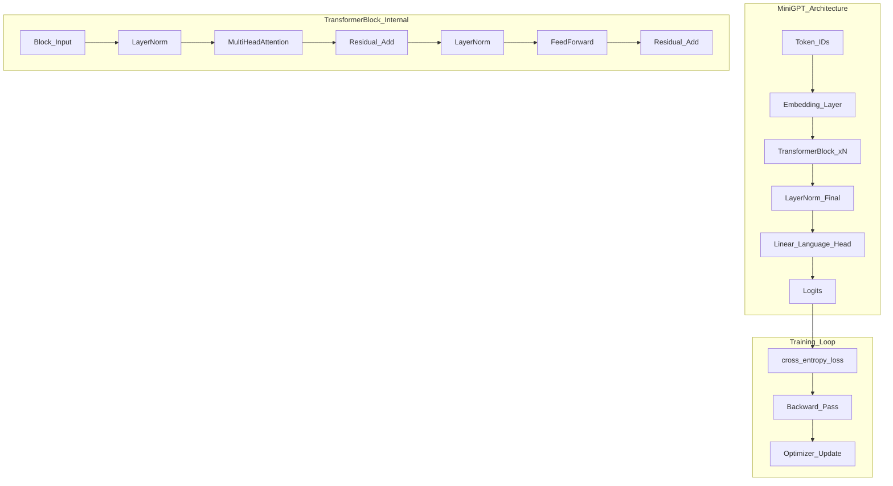
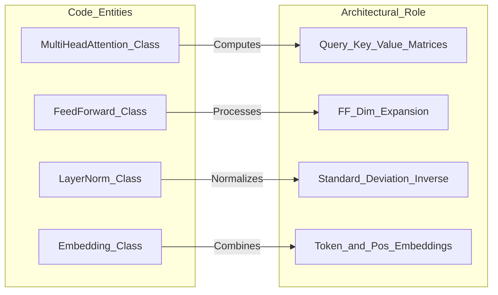

<!-- source: DeepWiki mcp.deepwiki.com · repo rohitg00/ai-engineering-from-scratch · page 5.2 Planned Deep Learning Curriculum (Phases 3–9) · fetched 2026-10-30 -->

# Planned Deep Learning Curriculum (Phases 3–9)

Relevant source files

The following files were used as context for generating this wiki page:

- [phases/03-deep-learning-core/05-loss-functions/code/main.py](phases/03-deep-learning-core/05-loss-functions/code/main.py)
- [phases/03-deep-learning-core/05-loss-functions/docs/en.md](phases/03-deep-learning-core/05-loss-functions/docs/en.md)
- [phases/03-deep-learning-core/05-loss-functions/outputs/prompt-loss-debugger.md](phases/03-deep-learning-core/05-loss-functions/outputs/prompt-loss-debugger.md)
- [phases/03-deep-learning-core/05-loss-functions/outputs/prompt-loss-function-selector.md](phases/03-deep-learning-core/05-loss-functions/outputs/prompt-loss-function-selector.md)
- [phases/03-deep-learning-core/07-regularization/code/main.py](phases/03-deep-learning-core/07-regularization/code/main.py)
- [phases/03-deep-learning-core/07-regularization/docs/en.md](phases/03-deep-learning-core/07-regularization/docs/en.md)
- [phases/03-deep-learning-core/07-regularization/outputs/prompt-regularization-advisor.md](phases/03-deep-learning-core/07-regularization/outputs/prompt-regularization-advisor.md)
- [phases/03-deep-learning-core/08-weight-initialization/code/main.py](phases/03-deep-learning-core/08-weight-initialization/code/main.py)
- [phases/03-deep-learning-core/08-weight-initialization/docs/en.md](phases/03-deep-learning-core/08-weight-initialization/docs/en.md)
- [phases/03-deep-learning-core/08-weight-initialization/outputs/prompt-init-strategy.md](phases/03-deep-learning-core/08-weight-initialization/outputs/prompt-init-strategy.md)
- [phases/03-deep-learning-core/09-learning-rate-schedules/code/main.py](phases/03-deep-learning-core/09-learning-rate-schedules/code/main.py)
- [phases/03-deep-learning-core/09-learning-rate-schedules/docs/en.md](phases/03-deep-learning-core/09-learning-rate-schedules/docs/en.md)
- [phases/03-deep-learning-core/09-learning-rate-schedules/outputs/prompt-lr-schedule-advisor.md](phases/03-deep-learning-core/09-learning-rate-schedules/outputs/prompt-lr-schedule-advisor.md)
- [phases/03-deep-learning-core/10-mini-framework/code/main.py](phases/03-deep-learning-core/10-mini-framework/code/main.py)
- [phases/03-deep-learning-core/10-mini-framework/outputs/prompt-framework-architect.md](phases/03-deep-learning-core/10-mini-framework/outputs/prompt-framework-architect.md)
- [phases/09-reinforcement-learning/06-policy-gradients-reinforce/assets/policy-gradient.svg](phases/09-reinforcement-learning/06-policy-gradients-reinforce/assets/policy-gradient.svg)
- [phases/09-reinforcement-learning/06-policy-gradients-reinforce/code/main.py](phases/09-reinforcement-learning/06-policy-gradients-reinforce/code/main.py)
- [phases/09-reinforcement-learning/06-policy-gradients-reinforce/docs/en.md](phases/09-reinforcement-learning/06-policy-gradients-reinforce/docs/en.md)
- [phases/09-reinforcement-learning/06-policy-gradients-reinforce/notebook/.gitkeep](phases/09-reinforcement-learning/06-policy-gradients-reinforce/notebook/.gitkeep)
- [phases/09-reinforcement-learning/06-policy-gradients-reinforce/outputs/skill-policy-gradient-trainer.md](phases/09-reinforcement-learning/06-policy-gradients-reinforce/outputs/skill-policy-gradient-trainer.md)
- [phases/09-reinforcement-learning/07-actor-critic-a2c-a3c/docs/en.md](phases/09-reinforcement-learning/07-actor-critic-a2c-a3c/docs/en.md)
- [phases/09-reinforcement-learning/08-ppo/docs/en.md](phases/09-reinforcement-learning/08-ppo/docs/en.md)
- [phases/09-reinforcement-learning/09-reward-modeling-rlhf/docs/en.md](phases/09-reinforcement-learning/09-reward-modeling-rlhf/docs/en.md)
- [phases/09-reinforcement-learning/12-rl-for-games/docs/en.md](phases/09-reinforcement-learning/12-rl-for-games/docs/en.md)
- [phases/10-llms-from-scratch/04-pre-training-mini-gpt/code/main.py](phases/10-llms-from-scratch/04-pre-training-mini-gpt/code/main.py)
- [phases/10-llms-from-scratch/04-pre-training-mini-gpt/outputs/prompt-gpt-architecture-analyzer.md](phases/10-llms-from-scratch/04-pre-training-mini-gpt/outputs/prompt-gpt-architecture-analyzer.md)

This page documents the roadmap for Phases 3 through 9 of the **AI Engineering from Scratch** curriculum. While the mathematical foundations and initial deep learning concepts are established, these phases represent the planned expansion into specialized domains including Computer Vision, NLP, Speech, and Reinforcement Learning.

## Phase 3: Deep Learning Core

Phase 3 transitions from classical machine learning to neural networks. It focuses on building a custom deep learning framework from scratch before moving to industry-standard libraries like PyTorch or JAX.

### Core Architecture and Mechanics
The curriculum follows a "build-to-understand" approach, starting with the `Module` base class [phases/03-deep-learning-core/10-mini-framework/code/main.py:5-23]() and expanding into multi-layer architectures.

| Lesson | Topic | Key Implementation Goal |
|:---:|---|---|
| 05 | Loss Functions | Implementing `MSE`, `BinaryCrossEntropy`, and `CategoricalCrossEntropy` [phases/03-deep-learning-core/05-loss-functions/code/main.py:5-60](). |
| 07 | Regularization | Implementing `Dropout`, `BatchNorm`, and `LayerNorm` [phases/03-deep-learning-core/07-regularization/code/main.py:5-110](). |
| 08 | Weight Initialization | `Xavier` and `Kaiming` (He) initialization to stabilize deep networks [phases/03-deep-learning-core/08-weight-initialization/code/main.py:13-20](). |
| 09 | LR Schedules | `Warmup`, `CosineAnnealing`, and `1cycle` policies [phases/03-deep-learning-core/09-learning-rate-schedules/code/main.py:9-35](). |
| 10 | Mini Framework | A `Sequential` container [phases/03-deep-learning-core/10-mini-framework/code/main.py:210-220]() for modular network building. |

### Neural Network Data Flow
The following diagram illustrates the data flow within the `MiniGPT` architecture and the modular framework components.

**MiniGPT and Framework Data Flow**

Sources: [phases/10-llms-from-scratch/04-pre-training-mini-gpt/code/main.py:81-103](), [phases/03-deep-learning-core/10-mini-framework/code/main.py:210-220](), [phases/03-deep-learning-core/05-loss-functions/code/main.py:120-131]()

---

## Phase 4 & 5: Computer Vision & NLP (Planned)

### Computer Vision (Phase 4)
Covers the evolution of computer vision from raw pixel manipulation to generative diffusion models.
*   **Architectures:** Implementing CNNs, ResNet, and Vision Transformers (ViT).
*   **Detection & Segmentation:** YOLO for object detection and U-Net for segmentation.
*   **Generative Vision:** GANs and the architecture of Diffusion models.

### NLP Foundations (Phase 5)
*   **Representation:** Building `Word2Vec` and exploring subword tokenization.
*   **Sequence Models:** RNNs, LSTMs, and the transition to the **Attention Mechanism**, which serves as the bridge to Phase 7.

---

## Phase 6 & 7: Speech & Transformers

### Speech & Audio (Phase 6)
*   **Signal Processing:** Utilizing the **Fourier Transform** [phases/01-math-foundations/20-fourier-transform/]() to generate Mel-Spectrograms.
*   **Advanced Models:** Fine-tuning Whisper for ASR and implementing neural audio codecs.

### Transformers Deep Dive (Phase 7)
This phase is the technical core of modern LLM engineering, focusing on `MultiHeadAttention` [phases/10-llms-from-scratch/04-pre-training-mini-gpt/code/main.py:28-52]() and positional encodings.

**Transformer Component Mapping**

Sources: [phases/10-llms-from-scratch/04-pre-training-mini-gpt/code/main.py:4-78]()

---

## Phase 9: Reinforcement Learning

Covers the transition from Markov Decision Processes (MDPs) to the alignment techniques used for LLMs.

### RL Foundations & Policy Gradients
*   **REINFORCE:** The foundational policy gradient theorem [phases/09-reinforcement-learning/06-policy-gradients-reinforce/docs/en.md:24-30]().
*   **Actor-Critic (A2C):** Using a critic `V_φ(s)` to reduce variance via the **Advantage** `A(s, a) = G - V̂(s)` [phases/09-reinforcement-learning/07-actor-critic-a2c-a3c/docs/en.md:14-18]().
*   **PPO:** Proximal Policy Optimization using a **Clipped Surrogate Objective** to allow multiple epochs per rollout [phases/09-reinforcement-learning/08-ppo/docs/en.md:30-41]().

### Alignment Stack (RLHF & GRPO)
*   **RLHF:** The three-stage pipeline: SFT → Reward Model (RM) → PPO [phases/09-reinforcement-learning/09-reward-modeling-rlhf/docs/en.md:16-18]().
*   **GRPO:** Group Relative Policy Optimization, used in DeepSeek-R1, which eliminates the critic by using group-relative advantages [phases/09-reinforcement-learning/12-rl-for-games/docs/en.md:53-63]().

| Method | Reward Source | Advantage Calculation |
|---|---|---|
| **PPO** | Reward Model / Env | $A_t = G_t - V(s_t)$ [phases/09-reinforcement-learning/07-actor-critic-a2c-a3c/docs/en.md:16]() |
| **RLHF** | Human Preference RM | $r_{total} = R(x,y) - \beta KL$ [phases/09-reinforcement-learning/09-reward-modeling-rlhf/docs/en.md:43]() |
| **GRPO** | Verifier (Rules/Math) | $A_i = (r_i - mean(r)) / std(r)$ [phases/09-reinforcement-learning/12-rl-for-games/docs/en.md:57]() |

Sources: [phases/09-reinforcement-learning/06-policy-gradients-reinforce/docs/en.md:1-50](), [phases/09-reinforcement-learning/08-ppo/docs/en.md:1-60](), [phases/09-reinforcement-learning/09-reward-modeling-rlhf/docs/en.md:1-55](), [phases/09-reinforcement-learning/12-rl-for-games/docs/en.md:53-77]()

---

