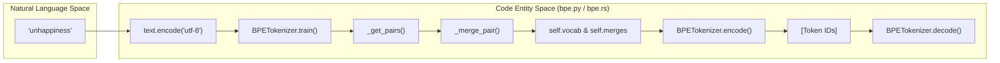

<!-- source: DeepWiki mcp.deepwiki.com · repo rohitg00/ai-engineering-from-scratch · page 6 Phase 7 & 10: Transformers & LLMs from Scratch · fetched 2026-10-30 -->

# Phase 7 & 10: Transformers & LLMs from Scratch

<details>
<summary>Relevant source files</summary>

The following files were used as context for generating this wiki page:

- [phases/01-math-foundations/04-calculus-for-ml/docs/en.md](phases/01-math-foundations/04-calculus-for-ml/docs/en.md)
- [phases/01-math-foundations/05-chain-rule-and-autodiff/docs/en.md](phases/01-math-foundations/05-chain-rule-and-autodiff/docs/en.md)
- [phases/03-deep-learning-core/03-backpropagation/docs/en.md](phases/03-deep-learning-core/03-backpropagation/docs/en.md)
- [phases/03-deep-learning-core/10-mini-framework/docs/en.md](phases/03-deep-learning-core/10-mini-framework/docs/en.md)
- [phases/03-deep-learning-core/11-intro-to-pytorch/docs/en.md](phases/03-deep-learning-core/11-intro-to-pytorch/docs/en.md)
- [phases/03-deep-learning-core/13-debugging-neural-networks/docs/en.md](phases/03-deep-learning-core/13-debugging-neural-networks/docs/en.md)
- [phases/05-nlp-foundations-to-advanced/08-cnns-rnns-for-text/docs/en.md](phases/05-nlp-foundations-to-advanced/08-cnns-rnns-for-text/docs/en.md)
- [phases/07-transformers-deep-dive/02-self-attention-from-scratch/code/self_attention.py](phases/07-transformers-deep-dive/02-self-attention-from-scratch/code/self_attention.py)
- [phases/07-transformers-deep-dive/02-self-attention-from-scratch/docs/en.md](phases/07-transformers-deep-dive/02-self-attention-from-scratch/docs/en.md)
- [phases/07-transformers-deep-dive/02-self-attention-from-scratch/outputs/prompt-attention-explainer.md](phases/07-transformers-deep-dive/02-self-attention-from-scratch/outputs/prompt-attention-explainer.md)
- [phases/07-transformers-deep-dive/05-full-transformer/assets/full-transformer.svg](phases/07-transformers-deep-dive/05-full-transformer/assets/full-transformer.svg)
- [phases/07-transformers-deep-dive/05-full-transformer/code/main.py](phases/07-transformers-deep-dive/05-full-transformer/code/main.py)
- [phases/07-transformers-deep-dive/05-full-transformer/docs/en.md](phases/07-transformers-deep-dive/05-full-transformer/docs/en.md)
- [phases/07-transformers-deep-dive/05-full-transformer/notebook/.gitkeep](phases/07-transformers-deep-dive/05-full-transformer/notebook/.gitkeep)
- [phases/07-transformers-deep-dive/05-full-transformer/outputs/skill-transformer-block-reviewer.md](phases/07-transformers-deep-dive/05-full-transformer/outputs/skill-transformer-block-reviewer.md)
- [phases/07-transformers-deep-dive/12-kv-cache-flash-attention/assets/kv-cache-flash-attn.svg](phases/07-transformers-deep-dive/12-kv-cache-flash-attention/assets/kv-cache-flash-attn.svg)
- [phases/07-transformers-deep-dive/12-kv-cache-flash-attention/code/main.py](phases/07-transformers-deep-dive/12-kv-cache-flash-attention/code/main.py)
- [phases/07-transformers-deep-dive/12-kv-cache-flash-attention/docs/en.md](phases/07-transformers-deep-dive/12-kv-cache-flash-attention/docs/en.md)
- [phases/07-transformers-deep-dive/12-kv-cache-flash-attention/notebook/.gitkeep](phases/07-transformers-deep-dive/12-kv-cache-flash-attention/notebook/.gitkeep)
- [phases/07-transformers-deep-dive/12-kv-cache-flash-attention/outputs/skill-inference-optimizer.md](phases/07-transformers-deep-dive/12-kv-cache-flash-attention/outputs/skill-inference-optimizer.md)
- [phases/10-llms-from-scratch/01-tokenizers/docs/en.md](phases/10-llms-from-scratch/01-tokenizers/docs/en.md)
- [phases/10-llms-from-scratch/02-building-a-tokenizer/docs/en.md](phases/10-llms-from-scratch/02-building-a-tokenizer/docs/en.md)
- [phases/10-llms-from-scratch/04-pre-training-mini-gpt/docs/en.md](phases/10-llms-from-scratch/04-pre-training-mini-gpt/docs/en.md)
- [phases/11-llm-engineering/05-context-engineering/docs/en.md](phases/11-llm-engineering/05-context-engineering/docs/en.md)
- [site/figures.js](site/figures.js)
- [site/lesson-figures.js](site/lesson-figures.js)

</details>


This section covers the transition from traditional deep learning to the modern Transformer-based architectures that power Large Language Models (LLMs). The curriculum is split into two primary tracks: the mathematical mechanics of the Transformer architecture (Phase 7) and the engineering pipeline required to build and train LLMs (Phase 10).

## Core Architecture: Self-Attention & Transformers

The fundamental shift in this phase is moving away from sequential processing (RNNs) toward parallelizable attention mechanisms. Instead of compressing a sequence into a single hidden state, the model allows every token to "attend" to every other token in a single step [phases/07-transformers-deep-dive/02-self-attention-from-scratch/docs/en.md:12-16](). While RNNs and CNNs were used for text to capture n-grams and memory, they suffered from vanishing gradients and sequential bottlenecks [phases/05-nlp-foundations-to-advanced/08-cnns-rnns-for-text/docs/en.md:110-114]().

The implementation focuses on the "Soft Database Lookup" analogy, where tokens generate Queries, Keys, and Values to determine relationship strengths [phases/07-transformers-deep-dive/02-self-attention-from-scratch/docs/en.md:22-37]().

### From Natural Language to Attention Tensors
The following diagram bridges the conceptual "Natural Language Space" to the "Code Entity Space" of the from-scratch implementations.

**Attention Mechanism Mapping**
```mermaid
graph TD
    subgraph "Natural Language Space"
        [Input_Sentence] --> |"Tokens"| [cat]
        [Input_Sentence] --> |"Tokens"| [sat]
        [cat] -.-> |"Subject of"| [sat]
    end

    subgraph "Code Entity Space (self_attention.py / main.py)"
        X["X (Input Embeddings)"] --> SA["SelfAttention.forward()"]
        SA --> Wq["self.Wq (Weight Matrix)"]
        SA --> Wk["self.Wk (Weight Matrix)"]
        SA --> Wv["self.Wv (Weight Matrix)"]
        
        Wq --> Q["Q (Query)"]
        Wk --> K["K (Key)"]
        Wv --> V["V (Value)"]

        Q & K --> SDP["scaled_dot_product_attention()"]
        SDP --> SM["softmax()"]
        SM --> Weights["Attention Weights Matrix"]
        Weights & V --> Out["Weighted Sum Output"]
    end

    [cat] -.-> |"Maps to row in"| X
    Weights -.-> |"Visualized by"| AH["ascii_heatmap()"]
```
**Sources:** [phases/07-transformers-deep-dive/02-self-attention-from-scratch/code/self_attention.py:18-32](), [phases/07-transformers-deep-dive/02-self-attention-from-scratch/docs/en.md:54-59](), [phases/07-transformers-deep-dive/05-full-transformer/docs/en.md:89-95]()

For a detailed breakdown of multi-head attention and the mathematical derivation of scaling factors, see **[Self-Attention & Transformer Architecture](#6.1)**.

---

## The LLM Pipeline: Tokenization & Pre-training

Before a Transformer can process text, the text must be converted into numerical identifiers. Phase 10 introduces the engineering of tokenizers, specifically Byte Pair Encoding (BPE), which is the standard for GPT-family models [phases/10-llms-from-scratch/01-tokenizers/docs/en.md:42-44](). A production tokenizer is a pipeline involving normalization, pre-tokenization (regex), BPE merging, and special token injection [phases/10-llms-from-scratch/02-building-a-tokenizer/docs/en.md:33-49]().

### Tokenization Flow
This diagram maps the raw text processing to the specific methods in the `BPETokenizer` class.

**BPE Tokenization Lifecycle**

**Sources:** [phases/10-llms-from-scratch/01-tokenizers/code/bpe.py:9-53](), [phases/10-llms-from-scratch/01-tokenizers/code/bpe.rs:20-89](), [phases/10-llms-from-scratch/02-building-a-tokenizer/docs/en.md:35-41]()

### Architecture of a Mini-GPT
Training an LLM involves stacking these blocks (embeddings, attention, FFN, and layer norms) into a cohesive architecture like GPT-2 (124M parameters) [phases/10-llms-from-scratch/04-pre-training-mini-gpt/docs/en.md:31-46](). Modern variants optimize this via KV Caching and Flash Attention to move from $O(N^2)$ to $O(N)$ inference cost [phases/07-transformers-deep-dive/12-kv-cache-flash-attention/docs/en.md:12-19]().

| Component | Modern Standard (2026) | Purpose |
| :--- | :--- | :--- |
| **Normalization** | RMSNorm | Faster, more stable training [phases/07-transformers-deep-dive/05-full-transformer/docs/en.md:66-73]() |
| **Activation** | SwiGLU | Superior FFN performance [phases/07-transformers-deep-dive/05-full-transformer/docs/en.md:67-73]() |
| **Inference** | KV Cache | Avoids redundant attention compute [phases/07-transformers-deep-dive/12-kv-cache-flash-attention/docs/en.md:131-145]() |

For details on vocabulary construction and the pre-training data pipeline, see **[Tokenizers & LLM Pre-Training Pipeline](#6.2)**.

---

## Roadmap & Artifacts

These phases produce several reusable artifacts found in the `outputs/` directory:
*   **`prompt-attention-explainer`**: A system prompt designed to teach the Q/K/V database analogy [phases/07-transformers-deep-dive/02-self-attention-from-scratch/outputs/prompt-attention-explainer.md:1-45]().
*   **`skill-tokenizer`**: A technical guide for selecting and building custom tokenizers based on domain-specific data [phases/10-llms-from-scratch/01-tokenizers/outputs/skill-tokenizer.md:1-55]().
*   **`skill-transformer-block-reviewer`**: A tool to audit transformer implementations against modern (2026) defaults like RoPE and SwiGLU [phases/07-transformers-deep-dive/05-full-transformer/outputs/skill-transformer-block-reviewer.md:1-20]().

### Planned Lessons
*   **Phase 7**: Positional Encoding (RoPE), BERT (Encoder-only), GPT (Decoder-only), Mixture of Experts (MoE), and Flash Attention.
*   **Phase 10**: Mini-GPT Pre-training, Context Engineering [phases/11-llm-engineering/05-context-engineering/docs/en.md:3-9](), Supervised Fine-Tuning (SFT), RLHF, and Direct Preference Optimization (DPO).

**Sources:** [phases/07-transformers-deep-dive/02-self-attention-from-scratch/docs/en.md](), [phases/10-llms-from-scratch/01-tokenizers/docs/en.md](), [phases/07-transformers-deep-dive/12-kv-cache-flash-attention/docs/en.md]()

---

