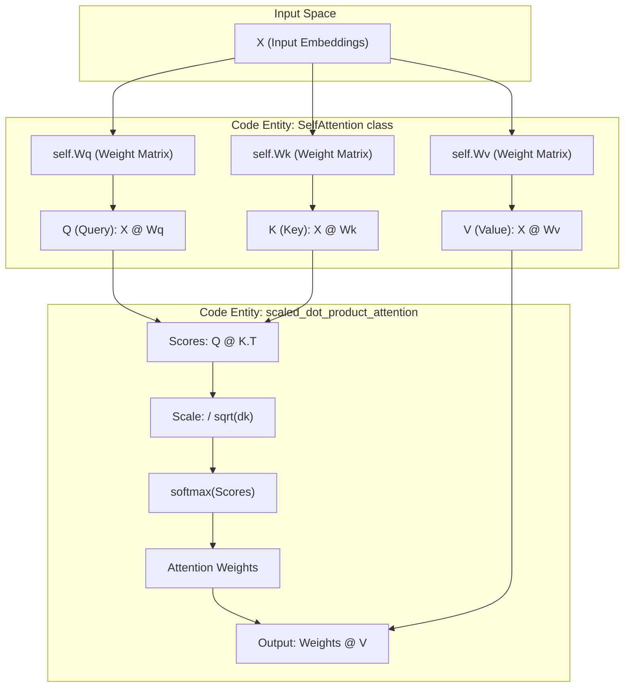
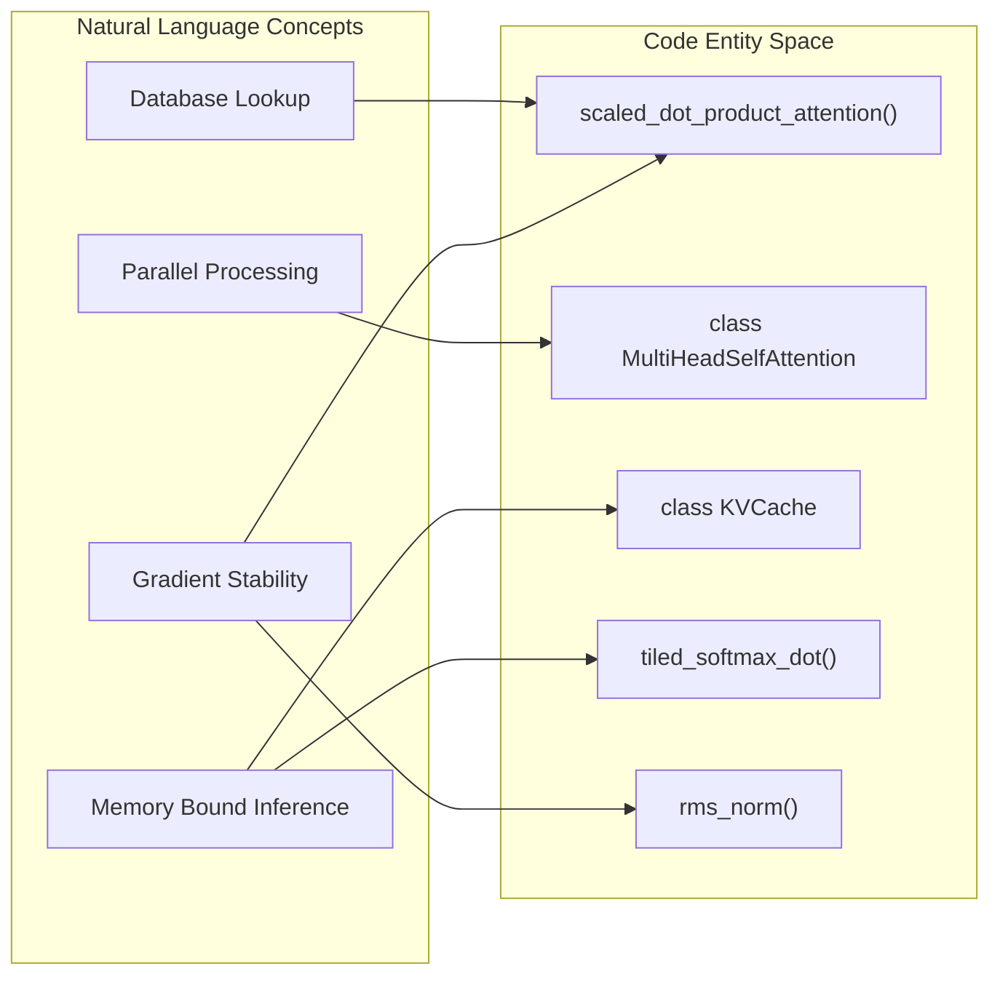

<!-- source: DeepWiki mcp.deepwiki.com · repo rohitg00/ai-engineering-from-scratch · page 6.1 Self-Attention & Transformer Architecture · fetched 2026-10-30 -->

# Self-Attention & Transformer Architecture

Relevant source files

The following files were used as context for generating this wiki page:

- [phases/05-nlp-foundations-to-advanced/10-attention-mechanism/assets/attention.svg](phases/05-nlp-foundations-to-advanced/10-attention-mechanism/assets/attention.svg)
- [phases/05-nlp-foundations-to-advanced/10-attention-mechanism/code/main.py](phases/05-nlp-foundations-to-advanced/10-attention-mechanism/code/main.py)
- [phases/05-nlp-foundations-to-advanced/10-attention-mechanism/docs/en.md](phases/05-nlp-foundations-to-advanced/10-attention-mechanism/docs/en.md)
- [phases/05-nlp-foundations-to-advanced/10-attention-mechanism/notebook/.gitkeep](phases/05-nlp-foundations-to-advanced/10-attention-mechanism/notebook/.gitkeep)
- [phases/05-nlp-foundations-to-advanced/10-attention-mechanism/outputs/.gitkeep](phases/05-nlp-foundations-to-advanced/10-attention-mechanism/outputs/.gitkeep)
- [phases/05-nlp-foundations-to-advanced/10-attention-mechanism/outputs/prompt-attention-shapes.md](phases/05-nlp-foundations-to-advanced/10-attention-mechanism/outputs/prompt-attention-shapes.md)
- [phases/07-transformers-deep-dive/02-self-attention-from-scratch/code/self_attention.py](phases/07-transformers-deep-dive/02-self-attention-from-scratch/code/self_attention.py)
- [phases/07-transformers-deep-dive/02-self-attention-from-scratch/docs/en.md](phases/07-transformers-deep-dive/02-self-attention-from-scratch/docs/en.md)
- [phases/07-transformers-deep-dive/02-self-attention-from-scratch/outputs/prompt-attention-explainer.md](phases/07-transformers-deep-dive/02-self-attention-from-scratch/outputs/prompt-attention-explainer.md)
- [phases/07-transformers-deep-dive/05-full-transformer/assets/full-transformer.svg](phases/07-transformers-deep-dive/05-full-transformer/assets/full-transformer.svg)
- [phases/07-transformers-deep-dive/05-full-transformer/code/main.py](phases/07-transformers-deep-dive/05-full-transformer/code/main.py)
- [phases/07-transformers-deep-dive/05-full-transformer/docs/en.md](phases/07-transformers-deep-dive/05-full-transformer/docs/en.md)
- [phases/07-transformers-deep-dive/05-full-transformer/notebook/.gitkeep](phases/07-transformers-deep-dive/05-full-transformer/notebook/.gitkeep)
- [phases/07-transformers-deep-dive/05-full-transformer/outputs/skill-transformer-block-reviewer.md](phases/07-transformers-deep-dive/05-full-transformer/outputs/skill-transformer-block-reviewer.md)
- [phases/07-transformers-deep-dive/12-kv-cache-flash-attention/assets/kv-cache-flash-attn.svg](phases/07-transformers-deep-dive/12-kv-cache-flash-attention/assets/kv-cache-flash-attn.svg)
- [phases/07-transformers-deep-dive/12-kv-cache-flash-attention/code/main.py](phases/07-transformers-deep-dive/12-kv-cache-flash-attention/code/main.py)
- [phases/07-transformers-deep-dive/12-kv-cache-flash-attention/docs/en.md](phases/07-transformers-deep-dive/12-kv-cache-flash-attention/docs/en.md)
- [phases/07-transformers-deep-dive/12-kv-cache-flash-attention/notebook/.gitkeep](phases/07-transformers-deep-dive/12-kv-cache-flash-attention/notebook/.gitkeep)
- [phases/07-transformers-deep-dive/12-kv-cache-flash-attention/outputs/skill-inference-optimizer.md](phases/07-transformers-deep-dive/12-kv-cache-flash-attention/outputs/skill-inference-optimizer.md)
- [site/figures.js](site/figures.js)
- [site/lesson-figures.js](site/lesson-figures.js)

This page details the implementation of the self-attention mechanism and the broader Transformer architecture from scratch, as found in Phase 7. It covers the mathematical foundations of Query, Key, and Value matrices, the mechanics of scaled dot-product attention, multi-head attention, and modern inference optimizations like KV Caching and Flash Attention.

## Overview of Self-Attention

Self-attention is a mechanism that allows every position in a sequence to attend to every other position in a single parallel step [phases/07-transformers-deep-dive/02-self-attention-from-scratch/docs/en.md:16-16](). Unlike RNNs, which process tokens sequentially and suffer from information compression in long-range dependencies, self-attention computes relationships across the entire context window simultaneously [phases/07-transformers-deep-dive/02-self-attention-from-scratch/docs/en.md:12-16]().

### The Database Lookup Analogy
The implementation uses a "soft database lookup" analogy to explain the interaction between tokens [phases/07-transformers-deep-dive/02-self-attention-from-scratch/outputs/prompt-attention-explainer.md:14-19]():
*   **Query (Q):** What the current token is searching for [phases/07-transformers-deep-dive/02-self-attention-from-scratch/outputs/prompt-attention-explainer.md:15-15]().
*   **Key (K):** What each token "advertises" about itself [phases/07-transformers-deep-dive/02-self-attention-from-scratch/outputs/prompt-attention-explainer.md:16-16]().
*   **Value (V):** The actual content/information the token carries [phases/07-transformers-deep-dive/02-self-attention-from-scratch/outputs/prompt-attention-explainer.md:17-17]().

**Sources:**
* [phases/07-transformers-deep-dive/02-self-attention-from-scratch/docs/en.md:12-37]()
* [phases/07-transformers-deep-dive/02-self-attention-from-scratch/outputs/prompt-attention-explainer.md:8-20]()

## Technical Implementation

### Data Flow: From Embeddings to Attention
The transformation from input embeddings $X$ to the final attention output involves linear projections and matrix operations.

**Attention Data Flow Diagram**

**Sources:**
* [phases/07-transformers-deep-dive/02-self-attention-from-scratch/code/self_attention.py:10-15]()
* [phases/07-transformers-deep-dive/02-self-attention-from-scratch/code/self_attention.py:18-32]()
* [phases/07-transformers-deep-dive/02-self-attention-from-scratch/docs/en.md:132-158]()

### Key Functions and Classes

#### 1. Softmax and Numerical Stability
The `softmax` function is implemented with a shift (subtracting the maximum value) to ensure numerical stability and prevent overflow when dealing with large logits [phases/07-transformers-deep-dive/02-self-attention-from-scratch/code/self_attention.py:4-7]().

#### 2. Scaled Dot-Product Attention
The function `scaled_dot_product_attention` implements the core formula:
$$\text{Attention}(Q, K, V) = \text{softmax}\left(\frac{QK^T}{\sqrt{d_k}}\right)V$$
The scaling factor $1/\sqrt{d_k}$ is critical to prevent the dot products from growing too large, which would push the softmax into regions with vanishing gradients [phases/07-transformers-deep-dive/02-self-attention-from-scratch/docs/en.md:97-105]().

#### 3. SelfAttention Class
The `SelfAttention` class manages the learned weight matrices `Wq`, `Wk`, and `Wv` [phases/07-transformers-deep-dive/02-self-attention-from-scratch/code/self_attention.py:18-26](). It uses Xavier-like initialization to scale weights based on input/output dimensions [phases/07-transformers-deep-dive/02-self-attention-from-scratch/code/self_attention.py:21-25]().

#### 4. MultiHeadSelfAttention Class
Multi-head attention runs multiple `SelfAttention` heads in parallel [phases/07-transformers-deep-dive/02-self-attention-from-scratch/code/self_attention.py:35-44](). Each head learns different types of relationships (e.g., syntax vs. coreference) [phases/07-transformers-deep-dive/02-self-attention-from-scratch/outputs/prompt-attention-explainer.md:44-44](). The results are concatenated and projected through a final output matrix `Wo` [phases/07-transformers-deep-dive/02-self-attention-from-scratch/code/self_attention.py:56-58]().

**Sources:**
* [phases/07-transformers-deep-dive/02-self-attention-from-scratch/code/self_attention.py:4-59]()
* [phases/07-transformers-deep-dive/02-self-attention-from-scratch/docs/en.md:180-214]()

## The Full Transformer Architecture

A single attention layer is a feature extractor; a Transformer model stacks these layers with residual connections, normalization, and feed-forward networks [phases/07-transformers-deep-dive/05-full-transformer/docs/en.md:10-14]().

### Transformer Block Components
Modern 2026-era Transformer blocks (like those in Llama 3 or Qwen) utilize specific refinements over the original 2017 design [phases/07-transformers-deep-dive/05-full-transformer/docs/en.md:60-73]():

| Component | 2017 Standard | 2026 Modernized |
| :--- | :--- | :--- |
| **Normalization** | LayerNorm | RMSNorm |
| **FFN Activation** | ReLU | SwiGLU |
| **Position** | Sinusoidal | RoPE |
| **Attention** | Full MHA | GQA (Grouped Query Attention) |
| **Norm Order** | Post-Norm | Pre-Norm |

### Block Wiring
The `encoder_block` and `decoder_block` functions wire these components together, ensuring that gradients can flow through residual connections `x + sublayer(x)` [phases/07-transformers-deep-dive/05-full-transformer/docs/en.md:27-28]().

**Sources:**
* [phases/07-transformers-deep-dive/05-full-transformer/docs/en.md:22-73]()
* [phases/07-transformers-deep-dive/05-full-transformer/docs/en.md:103-115]()

## Inference Optimization: KV Cache & Flash Attention

While training is parallel, inference is serial and memory-bound [phases/07-transformers-deep-dive/12-kv-cache-flash-attention/docs/en.md:3-3](). Two primary optimizations are implemented to handle this.

### 1. KV Cache
To avoid $O(N^2)$ work in autoregressive generation, the `KVCache` class stores the Key and Value vectors for all previous tokens [phases/07-transformers-deep-dive/12-kv-cache-flash-attention/docs/en.md:12-18](). Each new generation step only computes one new Query against the cached Keys/Values, reducing complexity to $O(N)$ [phases/07-transformers-deep-dive/12-kv-cache-flash-attention/code/main.py:87-97]().

### 2. Flash Attention (Tiled Softmax)
Standard attention is memory-bound due to large $N \times N$ score matrices hitting High Bandwidth Memory (HBM) [phases/07-transformers-deep-dive/12-kv-cache-flash-attention/docs/en.md:14-14](). `tiled_softmax_dot` simulates the Flash Attention algorithm by computing the softmax and weighted sum in tiles, maintaining a running maximum and sum to ensure numerical exactness without materializing the full matrix [phases/07-transformers-deep-dive/12-kv-cache-flash-attention/code/main.py:35-56]().

**Sources:**
* [phases/07-transformers-deep-dive/12-kv-cache-flash-attention/docs/en.md:12-89]()
* [phases/07-transformers-deep-dive/12-kv-cache-flash-attention/code/main.py:35-97]()

## Architectural Mapping

This diagram bridges the conceptual "Attention" mechanism with the specific Python entities implemented across the Transformer phases.

**Code-to-Concept Mapping**

**Sources:**
* [phases/07-transformers-deep-dive/02-self-attention-from-scratch/code/self_attention.py:10-44]()
* [phases/07-transformers-deep-dive/12-kv-cache-flash-attention/code/main.py:35-62]()
* [phases/07-transformers-deep-dive/05-full-transformer/docs/en.md:60-73]()

## Summary of Planned Lessons
The Transformer curriculum progresses from foundational math to production-grade optimizations:
*   **Positional Encoding:** RoPE vs. Sinusoidal [phases/07-transformers-deep-dive/05-full-transformer/docs/en.md:69-69]().
*   **Architectures:** BERT (Encoder), GPT (Decoder), and T5 (Encoder-Decoder) [phases/07-transformers-deep-dive/05-full-transformer/docs/en.md:135-144]().
*   **Modern Blocks:** SwiGLU, RMSNorm, and GQA/MLA [phases/07-transformers-deep-dive/05-full-transformer/docs/en.md:60-73]().
*   **Inference:** PagedAttention, Speculative Decoding, and Continuous Batching [phases/07-transformers-deep-dive/12-kv-cache-flash-attention/docs/en.md:102-120]().

**Sources:**
* [phases/07-transformers-deep-dive/05-full-transformer/docs/en.md:1-144]()
* [phases/07-transformers-deep-dive/12-kv-cache-flash-attention/docs/en.md:1-121]()

---

