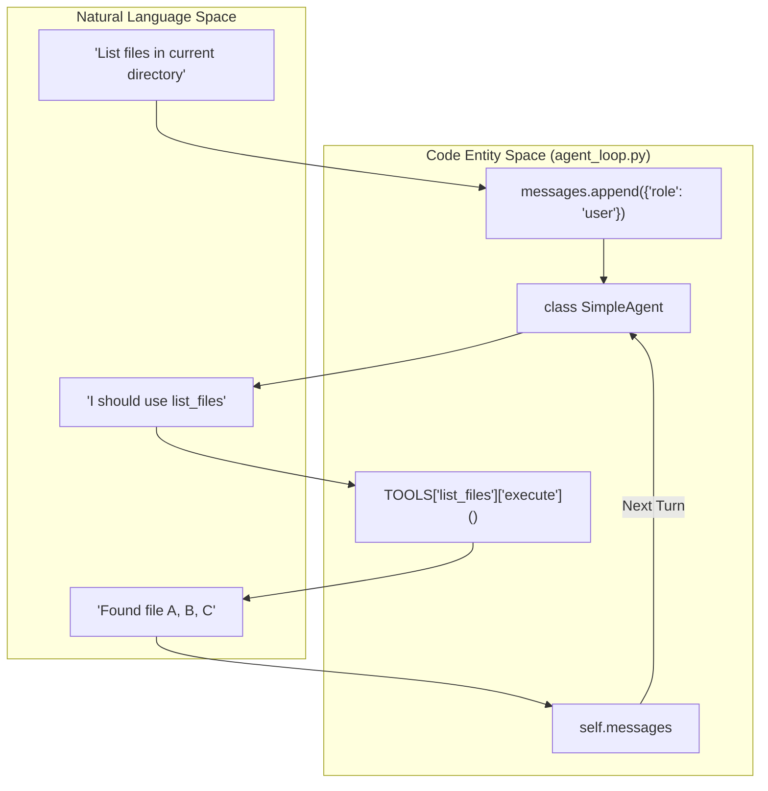
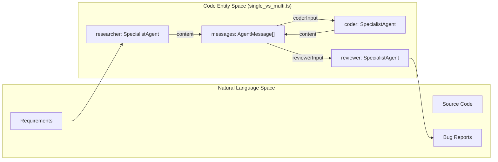

<!-- source: DeepWiki mcp.deepwiki.com · repo rohitg00/ai-engineering-from-scratch · page 7 Phase 14 & 16: Agent Engineering & Multi-Agent Systems · fetched 2026-10-30 -->

# Phase 14 & 16: Agent Engineering & Multi-Agent Systems

Relevant source files

The following files were used as context for generating this wiki page:

- [ROADMAP.md](ROADMAP.md)
- [phases/13-tools-and-protocols/18-mcp-auth-production/assets/auth-flow.svg](phases/13-tools-and-protocols/18-mcp-auth-production/assets/auth-flow.svg)
- [phases/13-tools-and-protocols/18-mcp-auth-production/code/main.py](phases/13-tools-and-protocols/18-mcp-auth-production/code/main.py)
- [phases/13-tools-and-protocols/18-mcp-auth-production/docs/en.md](phases/13-tools-and-protocols/18-mcp-auth-production/docs/en.md)
- [phases/13-tools-and-protocols/18-mcp-auth-production/notebook/.gitkeep](phases/13-tools-and-protocols/18-mcp-auth-production/notebook/.gitkeep)
- [phases/13-tools-and-protocols/18-mcp-auth-production/outputs/skill-mcp-auth.md](phases/13-tools-and-protocols/18-mcp-auth-production/outputs/skill-mcp-auth.md)
- [phases/14-agent-engineering/42-agent-workbench-capstone/code/main.py](phases/14-agent-engineering/42-agent-workbench-capstone/code/main.py)
- [phases/14-agent-engineering/42-agent-workbench-capstone/docs/en.md](phases/14-agent-engineering/42-agent-workbench-capstone/docs/en.md)
- [phases/14-agent-engineering/42-agent-workbench-capstone/outputs/agent-workbench-pack/AGENTS.md](phases/14-agent-engineering/42-agent-workbench-capstone/outputs/agent-workbench-pack/AGENTS.md)
- [phases/14-agent-engineering/42-agent-workbench-capstone/outputs/agent-workbench-pack/README.md](phases/14-agent-engineering/42-agent-workbench-capstone/outputs/agent-workbench-pack/README.md)
- [phases/14-agent-engineering/42-agent-workbench-capstone/outputs/agent-workbench-pack/VERSION](phases/14-agent-engineering/42-agent-workbench-capstone/outputs/agent-workbench-pack/VERSION)
- [phases/14-agent-engineering/42-agent-workbench-capstone/outputs/agent-workbench-pack/bin/install.sh](phases/14-agent-engineering/42-agent-workbench-capstone/outputs/agent-workbench-pack/bin/install.sh)
- [phases/14-agent-engineering/42-agent-workbench-capstone/outputs/agent-workbench-pack/docs/agent-rules.md](phases/14-agent-engineering/42-agent-workbench-capstone/outputs/agent-workbench-pack/docs/agent-rules.md)
- [phases/14-agent-engineering/42-agent-workbench-capstone/outputs/agent-workbench-pack/docs/handoff-protocol.md](phases/14-agent-engineering/42-agent-workbench-capstone/outputs/agent-workbench-pack/docs/handoff-protocol.md)
- [phases/14-agent-engineering/42-agent-workbench-capstone/outputs/agent-workbench-pack/docs/reliability-policy.md](phases/14-agent-engineering/42-agent-workbench-capstone/outputs/agent-workbench-pack/docs/reliability-policy.md)
- [phases/14-agent-engineering/42-agent-workbench-capstone/outputs/agent-workbench-pack/docs/reviewer-rubric.md](phases/14-agent-engineering/42-agent-workbench-capstone/outputs/agent-workbench-pack/docs/reviewer-rubric.md)
- [phases/14-agent-engineering/42-agent-workbench-capstone/outputs/agent-workbench-pack/schemas/agent_state.schema.json](phases/14-agent-engineering/42-agent-workbench-capstone/outputs/agent-workbench-pack/schemas/agent_state.schema.json)
- [phases/14-agent-engineering/42-agent-workbench-capstone/outputs/agent-workbench-pack/schemas/task_board.schema.json](phases/14-agent-engineering/42-agent-workbench-capstone/outputs/agent-workbench-pack/schemas/task_board.schema.json)
- [phases/14-agent-engineering/42-agent-workbench-capstone/outputs/agent-workbench-pack/scripts/generate_handoff.py](phases/14-agent-engineering/42-agent-workbench-capstone/outputs/agent-workbench-pack/scripts/generate_handoff.py)
- [phases/14-agent-engineering/42-agent-workbench-capstone/outputs/agent-workbench-pack/scripts/init_agent.py](phases/14-agent-engineering/42-agent-workbench-capstone/outputs/agent-workbench-pack/scripts/init_agent.py)
- [phases/14-agent-engineering/42-agent-workbench-capstone/outputs/agent-workbench-pack/scripts/run_with_feedback.py](phases/14-agent-engineering/42-agent-workbench-capstone/outputs/agent-workbench-pack/scripts/run_with_feedback.py)
- [phases/14-agent-engineering/42-agent-workbench-capstone/outputs/agent-workbench-pack/scripts/verify_agent.py](phases/14-agent-engineering/42-agent-workbench-capstone/outputs/agent-workbench-pack/scripts/verify_agent.py)
- [phases/16-multi-agent-and-swarms/03-communication-protocols/code/main.ts](phases/16-multi-agent-and-swarms/03-communication-protocols/code/main.ts)
- [phases/16-multi-agent-and-swarms/03-communication-protocols/docs/en.md](phases/16-multi-agent-and-swarms/03-communication-protocols/docs/en.md)
- [phases/16-multi-agent-and-swarms/03-communication-protocols/outputs/prompt-protocol-selector.md](phases/16-multi-agent-and-swarms/03-communication-protocols/outputs/prompt-protocol-selector.md)

This phase represents the culmination of the AI Engineering curriculum, moving from static model interactions to dynamic, autonomous systems. It covers the transition from single-purpose LLM calls to complex loops that can reason, use tools, and coordinate across multiple specialized agents.

## Overview

While previous phases focused on the mechanics of models (Transformers, LLMs), Phases 14 and 16 focus on **Agentic Workflows**. An agent is defined here as a system where the LLM is placed inside a control loop, allowing it to observe the world through tools and take actions to reach a goal [phases/14-agent-engineering/01-the-agent-loop/docs/en.md:3-14]().

### The Evolution of Agency

| Stage | Control Logic | Context Management | Complexity |
| :--- | :--- | :--- | :--- |
| **LLM Call** | Linear / Scripted | Single Window | Low |
| **Agent Loop** | Recursive (While Loop) | Growing Message History | Medium |
| **Agent Workbench** | Scope Contracts & Gates | Multi-session Persistence | High |
| **Multi-Agent** | Orchestrated / Swarm | Distributed Windows | Very High |

---

## The Agent Loop & Workbench (Phase 14)

The core building block of any agentic system is the **Agent Loop**. This pattern enables an LLM to perform multi-step reasoning where each step depends on the result of a previous action [phases/14-agent-engineering/01-the-agent-loop/outputs/skill-agent-loop.md:26-30]().

### Core Architecture: Think-Act-Observe
The loop consists of four primary stages:
1.  **Think**: The LLM receives the message history and decides whether to respond to the user or call a tool.
2.  **Act**: If a tool call is generated, the system executes the corresponding function (e.g., `read_file`, `run_command`).
3.  **Observe**: The output of the tool is captured.
4.  **Feed Back**: The observation is appended to the message history as a `tool` role message, and the loop repeats [phases/14-agent-engineering/01-the-agent-loop/code/agent_loop.py:92-99]().

### The Agent Workbench
Beyond the basic loop, the **Agent Workbench** (Lessons 31–42) introduces professional-grade reliability. It uses "surfaces" like `scope_contract.schema.json` to prevent scope creep and `verify_agent.py` to enforce deterministic verification gates [phases/14-agent-engineering/42-agent-workbench-capstone/docs/en.md:45-53]().

For a deep dive into implementation details, tool definitions, and the workbench capstone, see **[The Agent Loop Pattern](#7.1)**.

### Bridging Logic to Code: The SimpleAgent
The following diagram maps the conceptual loop to the specific entities implemented in the `SimpleAgent` class.

**Diagram: Agent Loop Code Mapping**

Sources: [phases/14-agent-engineering/01-the-agent-loop/code/agent_loop.py:43-81](), [phases/14-agent-engineering/01-the-agent-loop/docs/en.md:20-60]()

---

## Multi-Agent Systems & Swarms (Phase 16)

As tasks grow in complexity, a single agent loop eventually hits a "ceiling" characterized by context saturation and role confusion [phases/16-multi-agent-and-swarms/01-why-multi-agent/docs/en.md:12-21]().

### Coordination & Communication
Multi-agent systems solve this by distributing work across specialized loops. To prevent "strangers shouting into the void," Phase 16 focuses on **Communication Protocols** [phases/16-multi-agent-and-swarms/03-communication-protocols/docs/en.md:1-4]():
*   **MCP**: For tool access (Agent-to-Tool).
*   **A2A**: For peer-to-peer collaboration and task delegation via **Agent Cards** [phases/16-multi-agent-and-swarms/03-communication-protocols/docs/en.md:72-78]().
*   **ACP**: For enterprise auditability and session continuity.

For details on coordination patterns and decision matrices for choosing between single and multi-agent architectures, see **[Multi-Agent Systems & Swarms](#7.2)**.

### Bridging Coordination to Code: Specialist Agents
The implementation uses `SpecialistAgent` types to isolate system prompts and context windows.

**Diagram: Multi-Agent Pipeline Entity Mapping**

Sources: [phases/16-multi-agent-and-swarms/01-why-multi-agent/code/single_vs_multi.ts:20-24](), [phases/16-multi-agent-and-swarms/01-why-multi-agent/code/single_vs_multi.ts:100-113]()

---

## Toolkit Artifacts

These phases produce critical reusable artifacts in the `outputs/` directory:
*   **`skill-agent-loop.md`**: A foundational skill for building tool-using loops [phases/14-agent-engineering/01-the-agent-loop/outputs/skill-agent-loop.md:1-8]().
*   **`agent-workbench-pack/`**: A drop-in directory containing `AGENTS.md`, verification scripts, and schemas for production agent management [phases/14-agent-engineering/42-agent-workbench-capstone/code/main.py:15-36]().
*   **`skill-mcp-auth.md`**: A plan for production-grade MCP authorization, including JWKS refresh and audience pinning [phases/13-tools-and-protocols/18-mcp-auth-production/outputs/skill-mcp-auth.md:1-10]().
*   **`prompt-multi-agent-decision.md`**: An architect's guide for choosing the right multi-agent pattern based on context load and role diversity [phases/16-multi-agent-and-swarms/01-why-multi-agent/outputs/prompt-multi-agent-decision.md:1-40]().

---
**Sources:**
* [phases/14-agent-engineering/01-the-agent-loop/docs/en.md]()
* [phases/14-agent-engineering/01-the-agent-loop/code/agent_loop.py]()
* [phases/14-agent-engineering/42-agent-workbench-capstone/docs/en.md]()
* [phases/14-agent-engineering/42-agent-workbench-capstone/code/main.py]()
* [phases/16-multi-agent-and-swarms/01-why-multi-agent/docs/en.md]()
* [phases/16-multi-agent-and-swarms/01-why-multi-agent/code/single_vs_multi.ts]()
* [phases/16-multi-agent-and-swarms/03-communication-protocols/docs/en.md]()
* [phases/13-tools-and-protocols/18-mcp-auth-production/outputs/skill-mcp-auth.md]()

---

