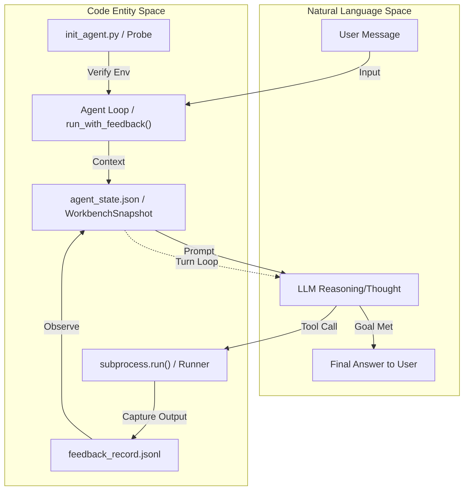
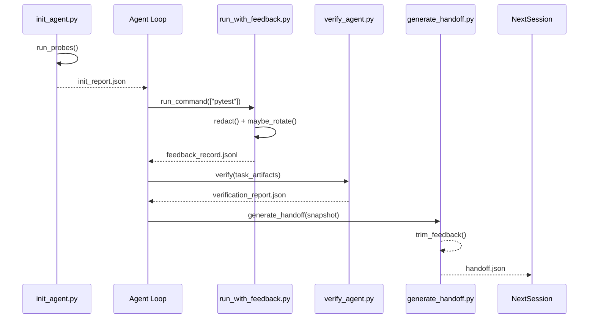

<!-- source: DeepWiki mcp.deepwiki.com · repo rohitg00/ai-engineering-from-scratch · page 7.1 The Agent Loop Pattern · fetched 2026-10-30 -->

# The Agent Loop Pattern

Relevant source files

The following files were used as context for generating this wiki page:

- [phases/14-agent-engineering/31-agent-workbench-why-models-fail/code/main.py](phases/14-agent-engineering/31-agent-workbench-why-models-fail/code/main.py)
- [phases/14-agent-engineering/31-agent-workbench-why-models-fail/docs/en.md](phases/14-agent-engineering/31-agent-workbench-why-models-fail/docs/en.md)
- [phases/14-agent-engineering/31-agent-workbench-why-models-fail/outputs/skill-workbench-audit.md](phases/14-agent-engineering/31-agent-workbench-why-models-fail/outputs/skill-workbench-audit.md)
- [phases/14-agent-engineering/35-initialization-scripts/code/main.py](phases/14-agent-engineering/35-initialization-scripts/code/main.py)
- [phases/14-agent-engineering/35-initialization-scripts/docs/en.md](phases/14-agent-engineering/35-initialization-scripts/docs/en.md)
- [phases/14-agent-engineering/35-initialization-scripts/outputs/skill-init-script.md](phases/14-agent-engineering/35-initialization-scripts/outputs/skill-init-script.md)
- [phases/14-agent-engineering/36-scope-contracts/code/main.py](phases/14-agent-engineering/36-scope-contracts/code/main.py)
- [phases/14-agent-engineering/36-scope-contracts/docs/en.md](phases/14-agent-engineering/36-scope-contracts/docs/en.md)
- [phases/14-agent-engineering/36-scope-contracts/outputs/skill-scope-contract.md](phases/14-agent-engineering/36-scope-contracts/outputs/skill-scope-contract.md)
- [phases/14-agent-engineering/37-runtime-feedback-loops/code/main.py](phases/14-agent-engineering/37-runtime-feedback-loops/code/main.py)
- [phases/14-agent-engineering/37-runtime-feedback-loops/docs/en.md](phases/14-agent-engineering/37-runtime-feedback-loops/docs/en.md)
- [phases/14-agent-engineering/37-runtime-feedback-loops/outputs/skill-feedback-runner.md](phases/14-agent-engineering/37-runtime-feedback-loops/outputs/skill-feedback-runner.md)
- [phases/14-agent-engineering/38-verification-gates/code/main.py](phases/14-agent-engineering/38-verification-gates/code/main.py)
- [phases/14-agent-engineering/38-verification-gates/docs/en.md](phases/14-agent-engineering/38-verification-gates/docs/en.md)
- [phases/14-agent-engineering/38-verification-gates/outputs/skill-verification-gate.md](phases/14-agent-engineering/38-verification-gates/outputs/skill-verification-gate.md)
- [phases/14-agent-engineering/40-multi-session-handoff/code/main.py](phases/14-agent-engineering/40-multi-session-handoff/code/main.py)
- [phases/14-agent-engineering/40-multi-session-handoff/docs/en.md](phases/14-agent-engineering/40-multi-session-handoff/docs/en.md)
- [phases/14-agent-engineering/40-multi-session-handoff/outputs/skill-handoff-generator.md](phases/14-agent-engineering/40-multi-session-handoff/outputs/skill-handoff-generator.md)
- [phases/14-agent-engineering/42-agent-workbench-capstone/code/main.py](phases/14-agent-engineering/42-agent-workbench-capstone/code/main.py)
- [phases/14-agent-engineering/42-agent-workbench-capstone/docs/en.md](phases/14-agent-engineering/42-agent-workbench-capstone/docs/en.md)
- [phases/14-agent-engineering/42-agent-workbench-capstone/outputs/agent-workbench-pack/AGENTS.md](phases/14-agent-engineering/42-agent-workbench-capstone/outputs/agent-workbench-pack/AGENTS.md)
- [phases/14-agent-engineering/42-agent-workbench-capstone/outputs/agent-workbench-pack/README.md](phases/14-agent-engineering/42-agent-workbench-capstone/outputs/agent-workbench-pack/README.md)
- [phases/14-agent-engineering/42-agent-workbench-capstone/outputs/agent-workbench-pack/VERSION](phases/14-agent-engineering/42-agent-workbench-capstone/outputs/agent-workbench-pack/VERSION)
- [phases/14-agent-engineering/42-agent-workbench-capstone/outputs/agent-workbench-pack/bin/install.sh](phases/14-agent-engineering/42-agent-workbench-capstone/outputs/agent-workbench-pack/bin/install.sh)
- [phases/14-agent-engineering/42-agent-workbench-capstone/outputs/agent-workbench-pack/docs/agent-rules.md](phases/14-agent-engineering/42-agent-workbench-capstone/outputs/agent-workbench-pack/docs/agent-rules.md)
- [phases/14-agent-engineering/42-agent-workbench-capstone/outputs/agent-workbench-pack/docs/handoff-protocol.md](phases/14-agent-engineering/42-agent-workbench-capstone/outputs/agent-workbench-pack/docs/handoff-protocol.md)
- [phases/14-agent-engineering/42-agent-workbench-capstone/outputs/agent-workbench-pack/docs/reliability-policy.md](phases/14-agent-engineering/42-agent-workbench-capstone/outputs/agent-workbench-pack/docs/reliability-policy.md)
- [phases/14-agent-engineering/42-agent-workbench-capstone/outputs/agent-workbench-pack/docs/reviewer-rubric.md](phases/14-agent-engineering/42-agent-workbench-capstone/outputs/agent-workbench-pack/docs/reviewer-rubric.md)
- [phases/14-agent-engineering/42-agent-workbench-capstone/outputs/agent-workbench-pack/schemas/agent_state.schema.json](phases/14-agent-engineering/42-agent-workbench-capstone/outputs/agent-workbench-pack/schemas/agent_state.schema.json)
- [phases/14-agent-engineering/42-agent-workbench-capstone/outputs/agent-workbench-pack/schemas/task_board.schema.json](phases/14-agent-engineering/42-agent-workbench-capstone/outputs/agent-workbench-pack/schemas/task_board.schema.json)
- [phases/14-agent-engineering/42-agent-workbench-capstone/outputs/agent-workbench-pack/scripts/generate_handoff.py](phases/14-agent-engineering/42-agent-workbench-capstone/outputs/agent-workbench-pack/scripts/generate_handoff.py)
- [phases/14-agent-engineering/42-agent-workbench-capstone/outputs/agent-workbench-pack/scripts/init_agent.py](phases/14-agent-engineering/42-agent-workbench-capstone/outputs/agent-workbench-pack/scripts/init_agent.py)
- [phases/14-agent-engineering/42-agent-workbench-capstone/outputs/agent-workbench-pack/scripts/run_with_feedback.py](phases/14-agent-engineering/42-agent-workbench-capstone/outputs/agent-workbench-pack/scripts/run_with_feedback.py)
- [phases/14-agent-engineering/42-agent-workbench-capstone/outputs/agent-workbench-pack/scripts/verify_agent.py](phases/14-agent-engineering/42-agent-workbench-capstone/outputs/agent-workbench-pack/scripts/verify_agent.py)

The Agent Loop is the foundational architectural pattern for autonomous AI systems. While a standard LLM is a passive "input-output" engine, an agent is a dynamic system that uses a loop to reason, act via tools, observe results, and iterate until a goal is reached [phases/14-agent-engineering/31-agent-workbench-why-models-fail/docs/en.md:41-51]().

## Overview of the Loop
The core of every AI agent is a `while` loop containing an LLM. The cycle follows a strict sequence:
1. **Think**: The LLM processes the current conversation history and decides whether to provide a final answer or call a tool.
2. **Act**: If the LLM requests a tool, the system executes the corresponding code (e.g., reading a file or running a shell command).
3. **Observe**: The result of the tool execution is captured as feedback [phases/14-agent-engineering/37-runtime-feedback-loops/docs/en.md:25-33]().
4. **Repeat**: The updated history is sent back to the LLM for the next turn.

### The LLM-Think-Act-Observe Cycle
The following diagram maps the conceptual loop to the specific implementation entities in the workbench architecture.

**Agent Loop Logic Flow**

Sources: [phases/14-agent-engineering/31-agent-workbench-why-models-fail/docs/en.md:41-51](), [phases/14-agent-engineering/37-runtime-feedback-loops/docs/en.md:25-33](), [phases/14-agent-engineering/35-initialization-scripts/docs/en.md:25-33]()

---

## Agent Workbench Components (Lessons 31–42)

Reliable engineering requires a "workbench" environment that wraps the model. This workbench consists of seven critical surfaces [phases/14-agent-engineering/31-agent-workbench-why-models-fail/docs/en.md:27-38]().

### 1. Initialization and Probes
Before the loop starts, an initialization script pays the "setup tax" by verifying the environment [phases/14-agent-engineering/35-initialization-scripts/docs/en.md:1-4]().
- **Probes**: Deterministic functions that return `(name, status, detail)` [phases/14-agent-engineering/35-initialization-scripts/code/main.py:46-50]().
- **Checks**: Includes `probe_runtime`, `probe_dependencies`, and `probe_lkg_diff` to ensure the agent doesn't start in a broken state [phases/14-agent-engineering/35-initialization-scripts/code/main.py:177-185]().
- **Locking**: A `prereqs.lock` with a TTL prevents redundant expensive checks [phases/14-agent-engineering/35-initialization-scripts/code/main.py:148-169]().

### 2. Scope Contracts
A scope contract defines the boundaries of the task to prevent "agent creep" [phases/14-agent-engineering/36-scope-contracts/docs/en.md:1-4]().
- **Fields**: `allowed_files` (globs), `forbidden_files`, and `acceptance_criteria` [phases/14-agent-engineering/36-scope-contracts/code/main.py:23-35]().
- **Merge Semantics**: Multiple contracts (project-wide vs. task-specific) are merged using least-privilege logic: intersecting allowed paths and unioning forbidden ones [phases/14-agent-engineering/36-scope-contracts/code/main.py:71-93]().

### 3. Runtime Feedback Loops
Every shell command executed by the agent must be captured into a structured `FeedbackRecord` [phases/14-agent-engineering/37-runtime-feedback-loops/code/main.py:42-56]().
- **Redaction**: Secrets (API keys, Bearer tokens) are stripped at write-time using `REDACTION_PATTERNS` [phases/14-agent-engineering/37-runtime-feedback-loops/code/main.py:31-39]().
- **Truncation**: Large outputs are deterministically tailed to preserve token budgets [phases/14-agent-engineering/37-runtime-feedback-loops/code/main.py:70-76]().
- **Lineage**: Every record carries a `command_id` and `parent_command_id` to reconstruct retry chains [phases/14-agent-engineering/37-runtime-feedback-loops/code/main.py:192-200]().

### 4. Verification Gates
A deterministic function that evaluates if a task is complete by reading the workbench artifacts [phases/14-agent-engineering/38-verification-gates/docs/en.md:1-3]().
- **Verdict**: Combines `_acceptance_findings`, `_scope_findings`, and `_coverage_findings` into a final pass/fail report [phases/14-agent-engineering/38-verification-gates/code/main.py:140-163]().
- **Overrides**: Human operators can bypass blockages by providing a signed entry in `overrides.jsonl` [phases/14-agent-engineering/38-verification-gates/code/main.py:171-188]().

### 5. Multi-Session Handoff
When a session ends, the system generates a `HandoffPayload` (JSON/Markdown) so the next session can resume instantly [phases/14-agent-engineering/40-multi-session-handoff/docs/en.md:35-46]().
- **Contents**: Summary, changed files, failed attempts, and the critical `next_action` field [phases/14-agent-engineering/40-multi-session-handoff/code/main.py:30-39]().

---

## Data Flow and Entity Mapping

The workbench transforms probabilistic model outputs into deterministic system states.

**Workbench Data Flow**

Sources: [phases/14-agent-engineering/35-initialization-scripts/code/main.py:177-185](), [phases/14-agent-engineering/37-runtime-feedback-loops/code/main.py:103-156](), [phases/14-agent-engineering/38-verification-gates/code/main.py:140-163](), [phases/14-agent-engineering/40-multi-session-handoff/code/main.py:73-121]()

---

## Workbench Artifact Summary

| Artifact | File Pattern | Key Responsibility |
| :--- | :--- | :--- |
| **State** | `agent_state.json` | Persistent task progress and blockers [phases/14-agent-engineering/40-multi-session-handoff/code/main.py:127-131]() |
| **Scope** | `scope_contract.json` | ACL for file writes and network egress [phases/14-agent-engineering/36-scope-contracts/code/main.py:23-35]() |
| **Feedback** | `feedback_record.jsonl` | Redacted history of tool execution [phases/14-agent-engineering/37-runtime-feedback-loops/code/main.py:23]() |
| **Verdict** | `verification_report.json` | Final deterministic completion check [phases/14-agent-engineering/38-verification-gates/code/main.py:71-78]() |
| **Handoff** | `handoff.md` | Human-readable summary for next session [phases/14-agent-engineering/40-multi-session-handoff/code/main.py:97-121]() |

Sources: [phases/14-agent-engineering/36-scope-contracts/code/main.py](), [phases/14-agent-engineering/37-runtime-feedback-loops/code/main.py](), [phases/14-agent-engineering/38-verification-gates/code/main.py](), [phases/14-agent-engineering/40-multi-session-handoff/code/main.py]()

---

## Planned Agent Engineering Lessons
The curriculum continues with:
- **Memory**: Advanced session persistence and context management.
- **Planning**: Hierarchical task decomposition.
- **MCP Integration**: Model Context Protocol for tool interoperability.
- **Evaluation**: Benchmarking agent reliability against SWE-bench and other metrics.
- **Multi-Agent Systems**: Swarm coordination and communication protocols (Phase 16).

Sources: [phases/14-agent-engineering/31-agent-workbench-why-models-fail/docs/en.md:63-91](), [phases/14-agent-engineering/42-agent-workbench-capstone/docs/en.md:1-15]()

---

