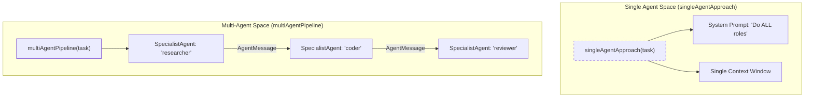
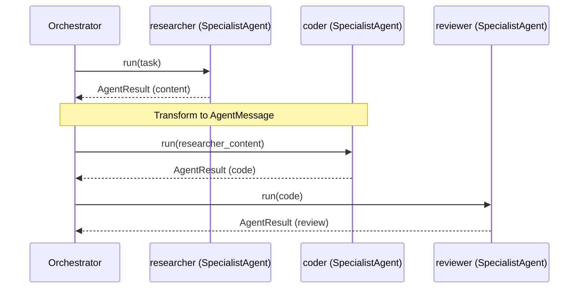
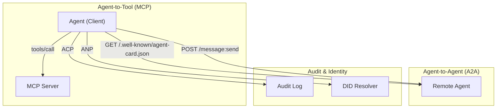

<!-- source: DeepWiki mcp.deepwiki.com · repo rohitg00/ai-engineering-from-scratch · page 7.2 Multi-Agent Systems & Swarms · fetched 2026-10-30 -->

# Multi-Agent Systems & Swarms

Relevant source files

The following files were used as context for generating this wiki page:

- [ROADMAP.md](ROADMAP.md)
- [phases/13-tools-and-protocols/01-the-tool-interface/docs/en.md](phases/13-tools-and-protocols/01-the-tool-interface/docs/en.md)
- [phases/13-tools-and-protocols/06-mcp-fundamentals/outputs/skill-mcp-handshake-tracer.md](phases/13-tools-and-protocols/06-mcp-fundamentals/outputs/skill-mcp-handshake-tracer.md)
- [phases/13-tools-and-protocols/09-mcp-transports/assets/transports.svg](phases/13-tools-and-protocols/09-mcp-transports/assets/transports.svg)
- [phases/13-tools-and-protocols/09-mcp-transports/code/main.py](phases/13-tools-and-protocols/09-mcp-transports/code/main.py)
- [phases/13-tools-and-protocols/09-mcp-transports/docs/en.md](phases/13-tools-and-protocols/09-mcp-transports/docs/en.md)
- [phases/13-tools-and-protocols/09-mcp-transports/notebook/.gitkeep](phases/13-tools-and-protocols/09-mcp-transports/notebook/.gitkeep)
- [phases/13-tools-and-protocols/09-mcp-transports/outputs/skill-mcp-transport-migrator.md](phases/13-tools-and-protocols/09-mcp-transports/outputs/skill-mcp-transport-migrator.md)
- [phases/13-tools-and-protocols/10-mcp-resources-and-prompts/assets/primitive-split.svg](phases/13-tools-and-protocols/10-mcp-resources-and-prompts/assets/primitive-split.svg)
- [phases/13-tools-and-protocols/10-mcp-resources-and-prompts/code/main.py](phases/13-tools-and-protocols/10-mcp-resources-and-prompts/code/main.py)
- [phases/13-tools-and-protocols/10-mcp-resources-and-prompts/docs/en.md](phases/13-tools-and-protocols/10-mcp-resources-and-prompts/docs/en.md)
- [phases/13-tools-and-protocols/10-mcp-resources-and-prompts/notebook/.gitkeep](phases/13-tools-and-protocols/10-mcp-resources-and-prompts/notebook/.gitkeep)
- [phases/13-tools-and-protocols/10-mcp-resources-and-prompts/outputs/skill-primitive-splitter.md](phases/13-tools-and-protocols/10-mcp-resources-and-prompts/outputs/skill-primitive-splitter.md)
- [phases/13-tools-and-protocols/17-mcp-gateways-and-registries/docs/en.md](phases/13-tools-and-protocols/17-mcp-gateways-and-registries/docs/en.md)
- [phases/13-tools-and-protocols/18-mcp-auth-production/assets/auth-flow.svg](phases/13-tools-and-protocols/18-mcp-auth-production/assets/auth-flow.svg)
- [phases/13-tools-and-protocols/18-mcp-auth-production/code/main.py](phases/13-tools-and-protocols/18-mcp-auth-production/code/main.py)
- [phases/13-tools-and-protocols/18-mcp-auth-production/docs/en.md](phases/13-tools-and-protocols/18-mcp-auth-production/docs/en.md)
- [phases/13-tools-and-protocols/18-mcp-auth-production/notebook/.gitkeep](phases/13-tools-and-protocols/18-mcp-auth-production/notebook/.gitkeep)
- [phases/13-tools-and-protocols/18-mcp-auth-production/outputs/skill-mcp-auth.md](phases/13-tools-and-protocols/18-mcp-auth-production/outputs/skill-mcp-auth.md)
- [phases/13-tools-and-protocols/19-a2a-protocol/code/main.py](phases/13-tools-and-protocols/19-a2a-protocol/code/main.py)
- [phases/13-tools-and-protocols/20-opentelemetry-genai/code/main.py](phases/13-tools-and-protocols/20-opentelemetry-genai/code/main.py)
- [phases/13-tools-and-protocols/21-llm-routing-layer/code/main.py](phases/13-tools-and-protocols/21-llm-routing-layer/code/main.py)
- [phases/13-tools-and-protocols/22-skills-and-agent-sdks/code/main.py](phases/13-tools-and-protocols/22-skills-and-agent-sdks/code/main.py)
- [phases/13-tools-and-protocols/23-capstone-tool-ecosystem/code/main.py](phases/13-tools-and-protocols/23-capstone-tool-ecosystem/code/main.py)
- [phases/13-tools-and-protocols/23-capstone-tool-ecosystem/docs/en.md](phases/13-tools-and-protocols/23-capstone-tool-ecosystem/docs/en.md)
- [phases/15-autonomous-systems/07-recursive-self-improvement/assets/rsi-race.svg](phases/15-autonomous-systems/07-recursive-self-improvement/assets/rsi-race.svg)
- [phases/15-autonomous-systems/07-recursive-self-improvement/code/main.py](phases/15-autonomous-systems/07-recursive-self-improvement/code/main.py)
- [phases/15-autonomous-systems/07-recursive-self-improvement/docs/en.md](phases/15-autonomous-systems/07-recursive-self-improvement/docs/en.md)
- [phases/15-autonomous-systems/07-recursive-self-improvement/notebook/.gitkeep](phases/15-autonomous-systems/07-recursive-self-improvement/notebook/.gitkeep)
- [phases/15-autonomous-systems/07-recursive-self-improvement/outputs/skill-rsi-cycle-pause-spec.md](phases/15-autonomous-systems/07-recursive-self-improvement/outputs/skill-rsi-cycle-pause-spec.md)
- [phases/15-autonomous-systems/21-metr-external-evaluation/assets/horizon-fit.svg](phases/15-autonomous-systems/21-metr-external-evaluation/assets/horizon-fit.svg)
- [phases/15-autonomous-systems/21-metr-external-evaluation/code/main.py](phases/15-autonomous-systems/21-metr-external-evaluation/code/main.py)
- [phases/15-autonomous-systems/21-metr-external-evaluation/docs/en.md](phases/15-autonomous-systems/21-metr-external-evaluation/docs/en.md)
- [phases/15-autonomous-systems/21-metr-external-evaluation/notebook/.gitkeep](phases/15-autonomous-systems/21-metr-external-evaluation/notebook/.gitkeep)
- [phases/15-autonomous-systems/21-metr-external-evaluation/outputs/skill-horizon-interpretation.md](phases/15-autonomous-systems/21-metr-external-evaluation/outputs/skill-horizon-interpretation.md)
- [phases/16-multi-agent-and-swarms/03-communication-protocols/code/main.ts](phases/16-multi-agent-and-swarms/03-communication-protocols/code/main.ts)
- [phases/16-multi-agent-and-swarms/03-communication-protocols/docs/en.md](phases/16-multi-agent-and-swarms/03-communication-protocols/docs/en.md)
- [phases/16-multi-agent-and-swarms/03-communication-protocols/outputs/prompt-protocol-selector.md](phases/16-multi-agent-and-swarms/03-communication-protocols/outputs/prompt-protocol-selector.md)

The Multi-Agent Systems & Swarms phase (Phase 16) represents the culmination of the curriculum's agent engineering track. While Phase 14 focuses on the "Agent Loop" (the mechanics of a single entity reasoning and acting), Phase 16 explores the transition from a single monolithic agent to a coordinated system of specialized entities. This architectural shift addresses the "Single-Agent Ceiling" by distributing context, expertise, and execution across multiple isolated or collaborative loops.

## The Single-Agent Ceiling

A single-agent system, as implemented in the basic `agent_loop.ts`, eventually encounters scaling limits when applied to complex, real-world tasks like codebase-wide refactoring or multi-stage research [phases/16-multi-agent-and-swarms/01-why-multi-agent/docs/en.md:12-16]().

### Constraints of Single-Agent Systems
*   **Context Saturation**: As tool outputs, file contents, and reasoning steps accumulate, the context window fills up. By the time an agent reaches deep into a task, critical early details may be lost or diluted [phases/16-multi-agent-and-swarms/01-why-multi-agent/docs/en.md:54-54]().
*   **Role Confusion**: A system prompt that attempts to define an agent as a "researcher, coder, and reviewer" often results in degraded performance across all roles compared to specialized prompts [phases/16-multi-agent-and-swarms/01-why-multi-agent/docs/en.md:56-56]().
*   **Sequential Bottlenecks**: Single agents execute tools and reasoning steps serially. They cannot naturally parallelize tasks like reading five documentation files simultaneously [phases/16-multi-agent-and-swarms/01-why-multi-agent/docs/en.md:58-58]().

### Single-Agent vs. Multi-Agent Logic
The following diagram maps the transition from a monolithic `singleAgentApproach` to a decoupled `multiAgentPipeline` using the types and functions defined in the codebase.

**Transitioning from Monolith to Pipeline**

**Sources:** [phases/16-multi-agent-and-swarms/01-why-multi-agent/code/single_vs_multi.ts:42-80](), [phases/16-multi-agent-and-swarms/01-why-multi-agent/code/single_vs_multi.ts:115-167]()

## Multi-Agent Architectures

Phase 16 Lesson 01 categorizes multi-agent systems into five primary patterns based on coordination complexity and communication flow [phases/16-multi-agent-and-swarms/01-why-multi-agent/docs/en.md:108-126]().

| Pattern | Coordination | Data Flow | Typical Use Case |
| :--- | :--- | :--- | :--- |
| **Subagents** | Parent-Child | Parent spawns and cleans context | Scoped tasks (e.g., `Task` in Claude Code) |
| **Pipeline** | Linear | Sequential handoffs (A -> B -> C) | Research -> Code -> Review workflows |
| **Team/Fan-out** | Orchestrator | Parallel execution + Message Bus | Multi-file refactors, simultaneous research |
| **Swarm** | Peer-to-Peer | Shared State / Queue | Large-scale data processing |

### Implementation Entities
The implementation in `single_vs_multi.ts` defines the core primitives for these architectures:
*   `SpecialistAgent`: A container for a `name`, a focused `systemPrompt`, and a `run` method [phases/16-multi-agent-and-swarms/01-why-multi-agent/code/single_vs_multi.ts:20-24]().
*   `AgentMessage`: The data structure for inter-agent communication, tracking `from`, `to`, `content`, and `timestamp` [phases/16-multi-agent-and-swarms/01-why-multi-agent/code/single_vs_multi.ts:13-18]().
*   `multiAgentFanOut`: Demonstrates parallelism by running a `researcher` and a `requirements` analyst simultaneously using `Promise.all` [phases/16-multi-agent-and-swarms/01-why-multi-agent/code/single_vs_multi.ts:169-223]().

**Multi-Agent Communication Flow**

**Sources:** [phases/16-multi-agent-and-swarms/01-why-multi-agent/code/single_vs_multi.ts:115-167](), [phases/16-multi-agent-and-swarms/01-why-multi-agent/docs/en.md:143-145]()

## Communication Protocols

Agents require shared contracts to exchange information effectively beyond simple string passing [phases/16-multi-agent-and-swarms/03-communication-protocols/docs/en.md:19-23](). Phase 16 Lesson 03 explores four primary protocols:

| Protocol | Purpose | Key Artifacts |
| :--- | :--- | :--- |
| **MCP** | Agent-to-Tool communication | `tools/list`, `tools/call` [phases/16-multi-agent-and-swarms/03-communication-protocols/docs/en.md:57-60]() |
| **A2A** | Peer-to-Peer agent collaboration | `Agent Card`, `Task Lifecycle` [phases/16-multi-agent-and-swarms/03-communication-protocols/docs/en.md:72-78]() |
| **ACP** | Enterprise auditability | Trajectory metadata, session continuity [phases/16-multi-agent-and-swarms/03-communication-protocols/docs/en.md:29-29]() |
| **ANP** | Decentralized identity and trust | DID, E2EE, trust scores [phases/16-multi-agent-and-swarms/03-communication-protocols/docs/en.md:30-30]() |

### The A2A Agent Card
The **Agent Card** (served at `/.well-known/agent-card.json`) is the core discovery mechanism for A2A collaboration. It defines an agent's `skills`, `supportedInterfaces` (JSON-RPC, REST), and `securitySchemes` [phases/16-multi-agent-and-swarms/03-communication-protocols/docs/en.md:104-162]().

**Protocol Interoperability**

**Sources:** [phases/16-multi-agent-and-swarms/03-communication-protocols/docs/en.md:40-51](), [phases/16-multi-agent-and-swarms/03-communication-protocols/docs/en.md:59-68](), [phases/16-multi-agent-and-swarms/03-communication-protocols/docs/en.md:82-102]()

## Decision Logic: Single vs. Multi-Agent

To assist developers in choosing an architecture, the Toolkit includes `prompt-multi-agent-decision.md`. This prompt acts as an "AI systems architect" to analyze tasks against specific scaling criteria [phases/16-multi-agent-and-swarms/01-why-multi-agent/outputs/prompt-multi-agent-decision.md:8-8]().

### Decision Matrix Criteria
1.  **Context Load**: Single-agent is recommended for < 100k tokens. Multi-agent (Swarms/Pipelines) is required for 500k+ tokens to isolate context [phases/16-multi-agent-and-swarms/01-why-multi-agent/outputs/prompt-multi-agent-decision.md:12-12]().
2.  **Role Diversity**: If the task requires 3+ distinct skills (e.g., research, coding, testing), specialist agents are preferred [phases/16-multi-agent-and-swarms/01-why-multi-agent/outputs/prompt-multi-agent-decision.md:14-14]().
3.  **Parallelism Potential**: If subtasks are independent, a "Team/Fan-out" pattern is recommended [phases/16-multi-agent-and-swarms/01-why-multi-agent/outputs/prompt-multi-agent-decision.md:16-16]().
4.  **Coordination Complexity**: If agents require high-frequency interaction, a "Shared State" (Swarm) or "Message Bus" (Team) is necessary [phases/16-multi-agent-and-swarms/01-why-multi-agent/outputs/prompt-multi-agent-decision.md:18-18]().

**Sources:** [phases/16-multi-agent-and-swarms/01-why-multi-agent/outputs/prompt-multi-agent-decision.md:24-30]()

## Integration with Other Phases

Multi-agent systems do not exist in a vacuum; they rely on infrastructure and protocols established in previous phases:
*   **Phase 13 (MCP Tools & Protocols)**: Multi-agent systems utilize the Model Context Protocol (MCP) to provide agents with standardized access to tools. Production deployments require `RFC 8414` metadata discovery and `JWKS` key rotation [phases/13-tools-and-protocols/18-mcp-auth-production/docs/en.md:3-6]().
*   **Phase 14 (Agent Engineering)**: Each `SpecialistAgent` in Phase 16 is essentially a specialized version of the `agent_loop` pattern developed in Phase 14 [phases/16-multi-agent-and-swarms/03-communication-protocols/docs/en.md:7-7]().
*   **Phase 15 (Autonomous Systems)**: Long-horizon swarms are evaluated using metrics like **METR Time Horizons**, which fit a logistic curve to task-success probability vs. log(expert completion time) [phases/15-autonomous-systems/21-metr-external-evaluation/docs/en.md:3-3]().

## Planned Swarm Lessons

Future lessons in Phase 16 will expand on collective intelligence and decentralized coordination:
*   **Consensus Algorithms**: How multiple agents agree on a single "truth" when outputs conflict (e.g., multiple reviewers finding different bugs).
*   **Collective Intelligence**: Emerging behaviors where the system solves problems that no individual agent's system prompt could describe.
*   **Recursive Self-Improvement (RSI)**: Monitoring the "misalignment gap" where capability improvement outpaces alignment quality [phases/15-autonomous-systems/07-recursive-self-improvement/docs/en.md:40-43]().

**Sources:** [phases/16-multi-agent-and-swarms/01-why-multi-agent/docs/en.md:136-137](), [phases/15-autonomous-systems/07-recursive-self-improvement/docs/en.md:3-4]()

---

