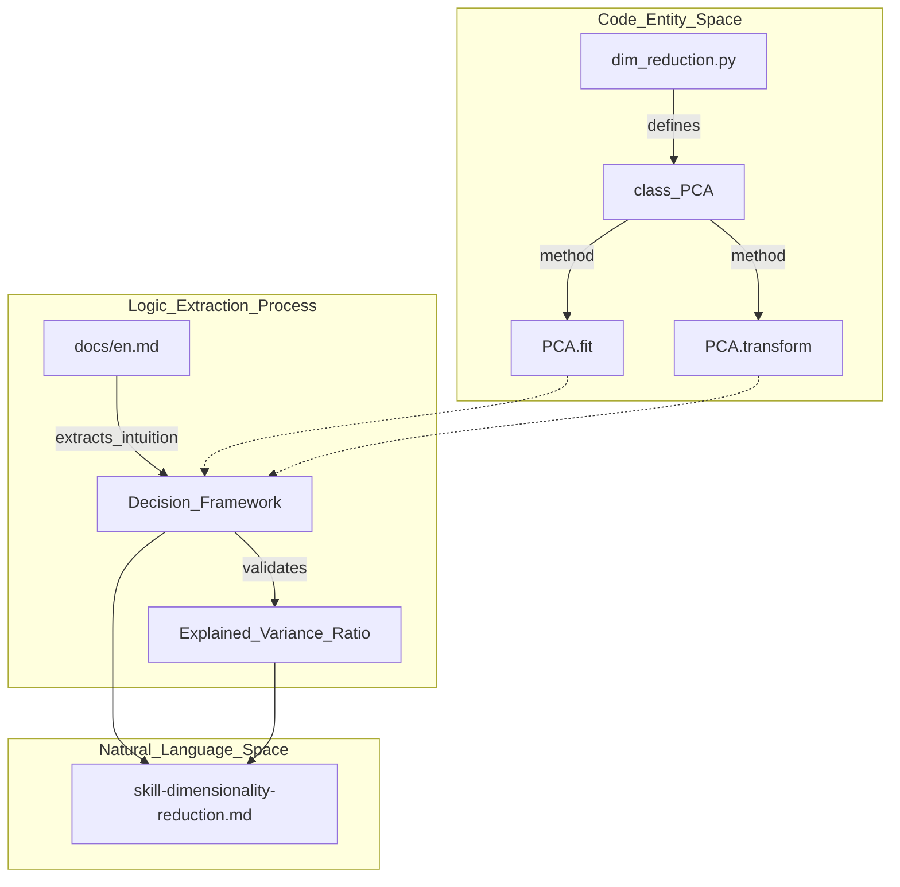
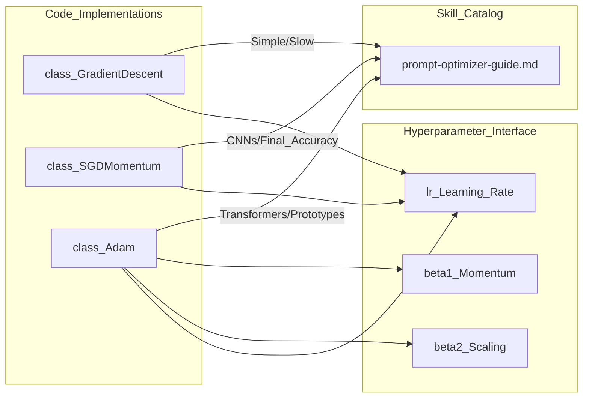

<!-- source: DeepWiki mcp.deepwiki.com · repo rohitg00/ai-engineering-from-scratch · page 8.1 Prompts & Skills Catalog · fetched 2026-10-30 -->

# Prompts & Skills Catalog

<details>
<summary>Relevant source files</summary>

The following files were used as context for generating this wiki page:

- [.github/workflows/curriculum.yml](.github/workflows/curriculum.yml)
- [.gitignore](.gitignore)
- [AGENTS.md](AGENTS.md)
- [README.md](README.md)
- [phases/14-agent-engineering/15-crewai-role-based-crews/code/main.py](phases/14-agent-engineering/15-crewai-role-based-crews/code/main.py)
- [phases/14-agent-engineering/15-crewai-role-based-crews/docs/en.md](phases/14-agent-engineering/15-crewai-role-based-crews/docs/en.md)
- [scripts/_lib.py](scripts/_lib.py)
- [scripts/build_catalog.py](scripts/build_catalog.py)
- [scripts/check_readme_counts.py](scripts/check_readme_counts.py)
- [scripts/install_skills.py](scripts/install_skills.py)
- [site/app.js](site/app.js)
- [site/build.js](site/build.js)
- [site/catalog.html](site/catalog.html)
- [site/cmdpalette.js](site/cmdpalette.js)
- [site/data.js](site/data.js)
- [site/glossary.html](site/glossary.html)
- [site/header.js](site/header.js)
- [site/index.html](site/index.html)
- [site/lesson.html](site/lesson.html)
- [site/prereqs.html](site/prereqs.html)
- [site/progress.js](site/progress.js)
- [site/robots.txt](site/robots.txt)
- [site/stats.json](site/stats.json)
- [site/style.css](site/style.css)
- [vercel.json](vercel.json)

</details>


The **Prompts & Skills Catalog** documents the reusable intelligence artifacts produced throughout the "AI Engineering from Scratch" curriculum. Unlike static code, these artifacts—stored as `.md` files with YAML frontmatter—represent encoded expertise in mathematical reasoning, algorithm selection, and agentic behavior produced during the **Ship It** phase of the lesson lifecycle [README.md:110]().

## Artifact Format & Metadata

Every prompt and skill follows a standardized format to ensure compatibility with automated loaders like `install_skills.py` and AI-integrated editors like Claude Code or Cursor [README.md:129-150]().

### YAML Frontmatter
Files begin with a metadata block parsed by `_lib.py` during the catalog build process [scripts/_lib.py:1-15]():
```yaml
---
name: skill-name-here
description: Clear summary of the capability
phase: 1 # The curriculum phase where it was built
lesson: 10 # The specific lesson number
tags: [math, optimization, visualization] # Optional categorization
---
```

## Installation & Usage

### 1. SkillKit / install_skills.py
The `scripts/install_skills.py` utility automates the discovery and deployment of artifacts from lesson folders into the global `outputs/` directory [scripts/install_skills.py:5-25]().
- **Discovery**: `discover_artifacts()` scans `phases/NN-name/NN-name/outputs/` for `.md` files.
- **Manifest**: It produces a `manifest.json` used by agents to understand available capabilities.

### 2. Claude Code / Cursor / AI Editors
To use these within AI-native editors:
- **Reference**: Add the file to your `.cursorrules` or mention the file directly using `@skill-dimensionality-reduction.md`.
- **System Prompt**: Copy the content (excluding frontmatter) into the "System Instructions" of your LLM interface.
- **Agent Integration**: Artifacts are automatically indexed by the site's search palette (`cmdpalette.js`) for quick retrieval [site/cmdpalette.js:10-30]().

---

## The Catalog: Key Examples

### Mathematical & Algorithmic Skills
These skills focus on the "From Scratch" philosophy, providing the LLM with the intuition needed to debug low-level implementations.

| Artifact | Purpose | Phase/Lesson |
|:---|:---|:---|
| `skill-autodiff` | Operational manual for the `Value` class; debugs backprop. | P1 L05 |
| `skill-probability-reasoning` | Guides Bayesian updating and distribution selection. | P1 L06 |
| `skill-dimensionality-reduction` | Decision framework for PCA, t-SNE, and UMAP. | P1 L10 |
| `skill-svd` | Logic for Singular Value Decomposition and matrix deflation. | P1 L11 |
| `skill-tokenizer` | BPE/WordPiece comparison and vocabulary construction logic. | P10 L01 |

### Engineering & Agentic Prompts
These prompts act as "Advisors" or "Runtime Engines," helping the engineer manage complex agentic workflows.

| Artifact | Purpose | Phase/Lesson |
|:---|:---|:---|
| `prompt-transformation-visualizer` | Explains matrix operations as spatial transformations. | P1 L03 |
| `prompt-optimizer-guide` | Recommends Adam vs SGD based on loss curve behavior. | P1 L08 |
| `prompt-attention-explainer` | Breaks down Q, K, V matrix interactions and scaling. | P7 L02 |
| `skill-agent-loop` | Implements the `LLM-think-act-observe` state machine logic. | P14 L01 |
| `prompt-multi-agent-decision` | Logic for routing tasks between specialized sub-agents. | P16 L01 |

---

## Data Flow: From Code to Skill

The following diagram illustrates how a "Build It" lesson transforms from a raw Python implementation into a reusable Skill artifact.

**Transformation Pipeline: Code Entity to Skill Space**


**Sources**: [site/build.js:64-120](), [README.md:92-97](), [scripts/_lib.py:10-25]()

---

## Implementation Detail: Optimization Advisor

The `prompt-optimizer-guide.md` is informed by the `optimizers.py` implementation. It maps the mathematical behavior of different classes to practical training advice.

**Optimizer Logic Mapping**


**Sources**: [site/data.js:111-117](), [README.md:103-111](), [scripts/install_skills.py:30-50]()

### Key Logic in `skill-dimensionality-reduction`
This skill encodes the constraints of the `PCA` class vs. external libraries:
- **Deterministic Check**: Recommended when results must be reproducible via the `random_state` parameter.
- **Preprocessing Flow**: Recommends reducing to 50 dimensions via `PCA.fit_transform()` before applying stochastic methods like t-SNE.
- **Validation**: Uses the `explained_variance_ratio_` attribute to confirm if the intrinsic dimensionality was captured.

### Key Logic in `skill-autodiff`
This skill is the operational manual for the `Value` class (autograd engine):
- **Computational Graph**: Instructs the LLM to perform a topological sort using `Value._prev` to verify the backward pass.
- **Finite Difference Verification**: Encodes the formula `(f(x+h) - f(x-h)) / (2h)` for numerical gradient checking against the `Value.grad` attribute.

**Sources**:
- [README.md:87-111]()
- [scripts/install_skills.py:1-60]()
- [site/build.js:134-180]()
- [scripts/_lib.py:1-40]()

---

