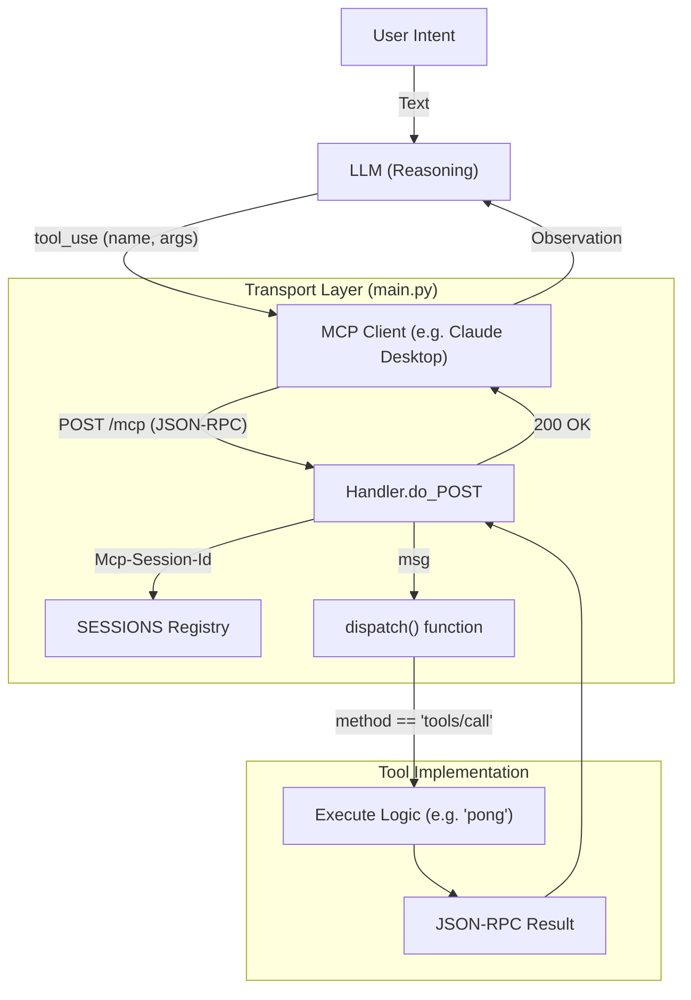
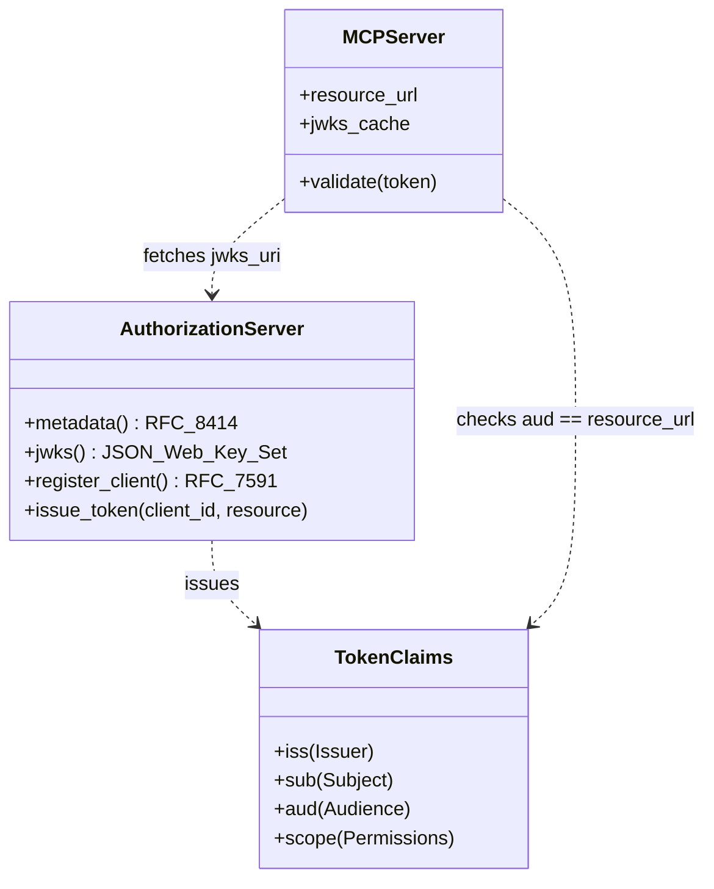

<!-- source: DeepWiki mcp.deepwiki.com · repo rohitg00/ai-engineering-from-scratch · page 8.2 Agents & MCP Servers · fetched 2026-10-30 -->

# Agents & MCP Servers

Relevant source files

The following files were used as context for generating this wiki page:

- [ROADMAP.md](ROADMAP.md)
- [phases/13-tools-and-protocols/01-the-tool-interface/docs/en.md](phases/13-tools-and-protocols/01-the-tool-interface/docs/en.md)
- [phases/13-tools-and-protocols/06-mcp-fundamentals/outputs/skill-mcp-handshake-tracer.md](phases/13-tools-and-protocols/06-mcp-fundamentals/outputs/skill-mcp-handshake-tracer.md)
- [phases/13-tools-and-protocols/09-mcp-transports/assets/transports.svg](phases/13-tools-and-protocols/09-mcp-transports/assets/transports.svg)
- [phases/13-tools-and-protocols/09-mcp-transports/code/main.py](phases/13-tools-and-protocols/09-mcp-transports/code/main.py)
- [phases/13-tools-and-protocols/09-mcp-transports/docs/en.md](phases/13-tools-and-protocols/09-mcp-transports/docs/en.md)
- [phases/13-tools-and-protocols/09-mcp-transports/notebook/.gitkeep](phases/13-tools-and-protocols/09-mcp-transports/notebook/.gitkeep)
- [phases/13-tools-and-protocols/09-mcp-transports/outputs/skill-mcp-transport-migrator.md](phases/13-tools-and-protocols/09-mcp-transports/outputs/skill-mcp-transport-migrator.md)
- [phases/13-tools-and-protocols/10-mcp-resources-and-prompts/assets/primitive-split.svg](phases/13-tools-and-protocols/10-mcp-resources-and-prompts/assets/primitive-split.svg)
- [phases/13-tools-and-protocols/10-mcp-resources-and-prompts/code/main.py](phases/13-tools-and-protocols/10-mcp-resources-and-prompts/code/main.py)
- [phases/13-tools-and-protocols/10-mcp-resources-and-prompts/docs/en.md](phases/13-tools-and-protocols/10-mcp-resources-and-prompts/docs/en.md)
- [phases/13-tools-and-protocols/10-mcp-resources-and-prompts/notebook/.gitkeep](phases/13-tools-and-protocols/10-mcp-resources-and-prompts/notebook/.gitkeep)
- [phases/13-tools-and-protocols/10-mcp-resources-and-prompts/outputs/skill-primitive-splitter.md](phases/13-tools-and-protocols/10-mcp-resources-and-prompts/outputs/skill-primitive-splitter.md)
- [phases/13-tools-and-protocols/17-mcp-gateways-and-registries/docs/en.md](phases/13-tools-and-protocols/17-mcp-gateways-and-registries/docs/en.md)
- [phases/13-tools-and-protocols/18-mcp-auth-production/assets/auth-flow.svg](phases/13-tools-and-protocols/18-mcp-auth-production/assets/auth-flow.svg)
- [phases/13-tools-and-protocols/18-mcp-auth-production/code/main.py](phases/13-tools-and-protocols/18-mcp-auth-production/code/main.py)
- [phases/13-tools-and-protocols/18-mcp-auth-production/docs/en.md](phases/13-tools-and-protocols/18-mcp-auth-production/docs/en.md)
- [phases/13-tools-and-protocols/18-mcp-auth-production/notebook/.gitkeep](phases/13-tools-and-protocols/18-mcp-auth-production/notebook/.gitkeep)
- [phases/13-tools-and-protocols/18-mcp-auth-production/outputs/skill-mcp-auth.md](phases/13-tools-and-protocols/18-mcp-auth-production/outputs/skill-mcp-auth.md)
- [phases/13-tools-and-protocols/19-a2a-protocol/code/main.py](phases/13-tools-and-protocols/19-a2a-protocol/code/main.py)
- [phases/13-tools-and-protocols/20-opentelemetry-genai/code/main.py](phases/13-tools-and-protocols/20-opentelemetry-genai/code/main.py)
- [phases/13-tools-and-protocols/21-llm-routing-layer/code/main.py](phases/13-tools-and-protocols/21-llm-routing-layer/code/main.py)
- [phases/13-tools-and-protocols/22-skills-and-agent-sdks/code/main.py](phases/13-tools-and-protocols/22-skills-and-agent-sdks/code/main.py)
- [phases/13-tools-and-protocols/23-capstone-tool-ecosystem/code/main.py](phases/13-tools-and-protocols/23-capstone-tool-ecosystem/code/main.py)
- [phases/13-tools-and-protocols/23-capstone-tool-ecosystem/docs/en.md](phases/13-tools-and-protocols/23-capstone-tool-ecosystem/docs/en.md)
- [phases/16-multi-agent-and-swarms/03-communication-protocols/code/main.ts](phases/16-multi-agent-and-swarms/03-communication-protocols/code/main.ts)
- [phases/16-multi-agent-and-swarms/03-communication-protocols/docs/en.md](phases/16-multi-agent-and-swarms/03-communication-protocols/docs/en.md)
- [phases/16-multi-agent-and-swarms/03-communication-protocols/outputs/prompt-protocol-selector.md](phases/16-multi-agent-and-swarms/03-communication-protocols/outputs/prompt-protocol-selector.md)

## Overview
In the **AI Engineering from Scratch** ecosystem, agents are not treated as magical autonomous entities, but as deterministic software patterns—specifically, a `while` loop where an LLM acts as the reasoning engine to select tools, observe outcomes, and iterate toward a goal [phases/13-tools-and-protocols/01-the-tool-interface/docs/en.md:19-25]().

This page documents the **Toolkit** artifacts located in the `outputs/agents/` and `outputs/mcp-servers/` directories, the centralized `outputs/index.json` manifest, and the implementation of the **Model Context Protocol (MCP)**. MCP provides a standardized JSON-RPC interface for agents to securely connect to external data sources and tools [phases/13-tools-and-protocols/09-mcp-transports/docs/en.md:3-6]().

---

## The Agent Loop Pattern
The core of every agent in this repository is the **Agent Loop**, following a strict **Think → Act → Observe** cycle.

### Implementation Logic
The loop follows a four-step invariant regardless of the underlying protocol (OpenAI functions, MCP, or A2A) [phases/13-tools-and-protocols/01-the-tool-interface/docs/en.md:25-27]():
1.  **Describe**: The host (client) declares tools using JSON Schema [phases/13-tools-and-protocols/01-the-tool-interface/docs/en.md:31-35]().
2.  **Decide**: The LLM chooses to answer directly or emit a structured tool call [phases/13-tools-and-protocols/01-the-tool-interface/docs/en.md:41-45]().
3.  **Execute**: The host runs the deterministic code (the tool) and produces a result [phases/13-tools-and-protocols/01-the-tool-interface/docs/en.md:49-53]().
4.  **Observe**: The result is fed back into the conversation for the LLM to process [phases/13-tools-and-protocols/01-the-tool-interface/docs/en.md:55-58]().

### Circuit Breakers
To prevent infinite loops and runaway API costs, implementations must enforce a maximum turn count (typically between 5 and 25) [phases/13-tools-and-protocols/01-the-tool-interface/docs/en.md:87-91]().

**Sources:** [phases/13-tools-and-protocols/01-the-tool-interface/docs/en.md:3-91](), [ROADMAP.md:255-259]()

---

## Model Context Protocol (MCP)
MCP is a **client-server** protocol that standardizes how LLMs connect to external tools and data [phases/16-multi-agent-and-swarms/03-communication-protocols/docs/en.md:55-58]().

### MCP Primitives
| Primitive | Purpose | Decision Rule |
| :--- | :--- | :--- |
| **Tools** | Mutate state or perform computation | If the model should call it to search/filter/transform [phases/13-tools-and-protocols/10-mcp-resources-and-prompts/docs/en.md:33-33](). |
| **Resources** | Expose data for reading/context | If the user should benefit from attaching it to a conversation [phases/13-tools-and-protocols/10-mcp-resources-and-prompts/docs/en.md:34-34](). |
| **Prompts** | Reusable templates / Slash commands | If a multi-step workflow is the unit of re-use [phases/13-tools-and-protocols/10-mcp-resources-and-prompts/docs/en.md:35-35](). |

### Transport Layers
*   **stdio**: Used for local child-process communication (IDE extensions like Cursor/Claude Desktop) [phases/13-tools-and-protocols/09-mcp-transports/docs/en.md:27-33]().
*   **Streamable HTTP**: The 2025 standard for remote servers. It uses a single `/mcp` endpoint with `POST` for requests and `GET` (SSE) for server-to-client streams, linked by a cryptographically random `Mcp-Session-Id` [phases/13-tools-and-protocols/09-mcp-transports/docs/en.md:35-43]().

### Data Flow: Natural Language to Tool Execution
This diagram maps the transition from user intent to the code execution in `phases/13-tools-and-protocols/09-mcp-transports/code/main.py`.

**Title: MCP Tool Invocation Lifecycle**

**Sources:** [phases/13-tools-and-protocols/09-mcp-transports/code/main.py:42-60](), [phases/13-tools-and-protocols/09-mcp-transports/code/main.py:107-132](), [phases/13-tools-and-protocols/01-the-tool-interface/docs/en.md:29-58]()

---

## Production Auth & Security
Production MCP servers require robust authentication to prevent "confused deputy" attacks and unauthorized access.

### The Auth Surface
1.  **Discovery**: Clients find the Authorization Server (AS) via RFC 8414 metadata at `/.well-known/oauth-authorization-server` [phases/13-tools-and-protocols/18-mcp-auth-production/docs/en.md:35-37]().
2.  **Enrollment**: Clients enroll via **Client ID Metadata Documents (CIMD)** (preferred) or **Dynamic Client Registration (DCR)** [phases/13-tools-and-protocols/18-mcp-auth-production/docs/en.md:25-26]().
3.  **Validation**: The MCP server (Resource Server) verifies JWTs using a cached **JWKS** (JSON Web Key Set) that must be refreshed on a schedule [phases/13-tools-and-protocols/18-mcp-auth-production/docs/en.md:27-28]().
4.  **Audience Pinning**: Tokens are pinned to a specific `aud` (audience) to prevent replay across different servers [phases/13-tools-and-protocols/18-mcp-auth-production/docs/en.md:29-30]().

**Title: Production MCP Auth Logic**

**Sources:** [phases/13-tools-and-protocols/18-mcp-auth-production/code/main.py:99-126](), [phases/13-tools-and-protocols/18-mcp-auth-production/docs/en.md:35-51](), [phases/13-tools-and-protocols/18-mcp-auth-production/outputs/skill-mcp-auth.md:44-49]()

---

## Multi-Agent Communication (A2A)
While MCP connects agents to tools, the **Agent2Agent (A2A)** protocol connects agents to other agents [phases/16-multi-agent-and-swarms/03-communication-protocols/docs/en.md:72-76]().

*   **Agent Card**: A JSON document (served at `/.well-known/agent-card.json`) describing an agent's skills, supported interfaces, and security schemes [phases/16-multi-agent-and-swarms/03-communication-protocols/docs/en.md:104-108]().
*   **Task Lifecycle**: Work moves through states: `submitted` → `working` → `completed/failed` [phases/16-multi-agent-and-swarms/03-communication-protocols/docs/en.md:171-182]().

**Sources:** [phases/16-multi-agent-and-swarms/03-communication-protocols/docs/en.md:72-182](), [phases/16-multi-agent-and-swarms/03-communication-protocols/code/main.ts:54-66]()

---

## Toolkit Manifest: `outputs/index.json`
The `outputs/` directory serves as the centralized repository for all "shipped" artifacts.

### Artifact Categories
*   **`prompts`**: System instructions and reusable templates (e.g., `prompt-protocol-selector.md`).
*   **`skills`**: Logical decision frameworks (e.g., `skill-mcp-auth.md`, `skill-primitive-splitter.md`).
*   **`agents`**: Complete agent configurations and loop implementations.
*   **`mcp_servers`**: Reference server implementations (e.g., the notes server with resource subscriptions).

**Sources:** [phases/13-tools-and-protocols/10-mcp-resources-and-prompts/docs/en.md:112-114](), [phases/13-tools-and-protocols/18-mcp-auth-production/outputs/skill-mcp-auth.md:1-8]()

---

