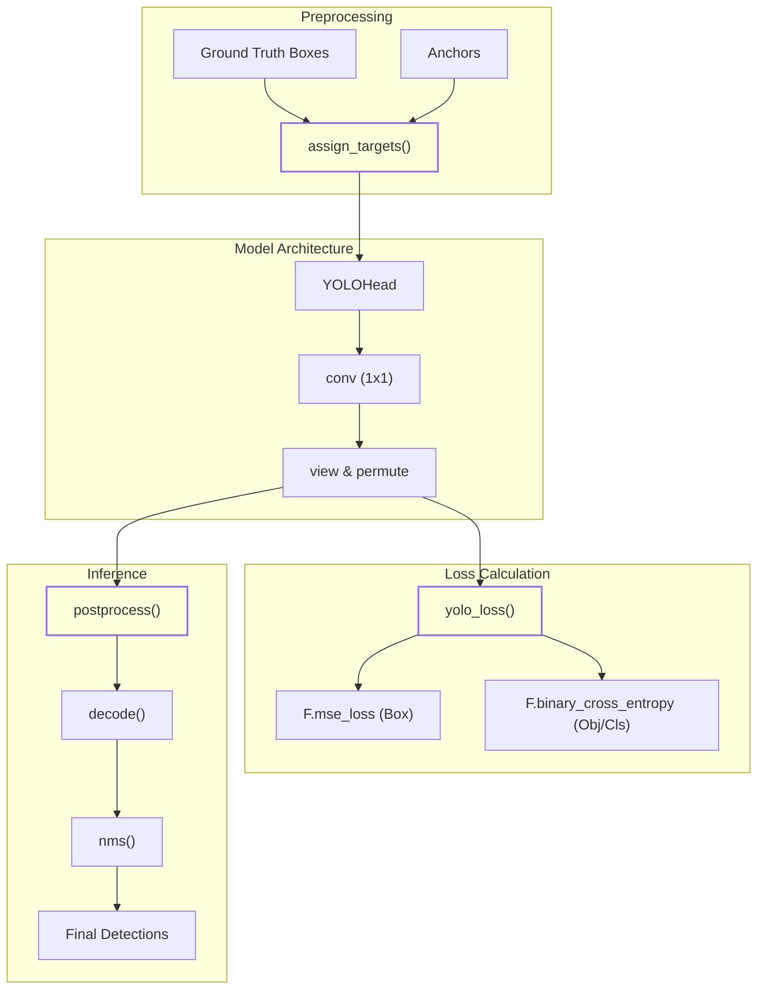
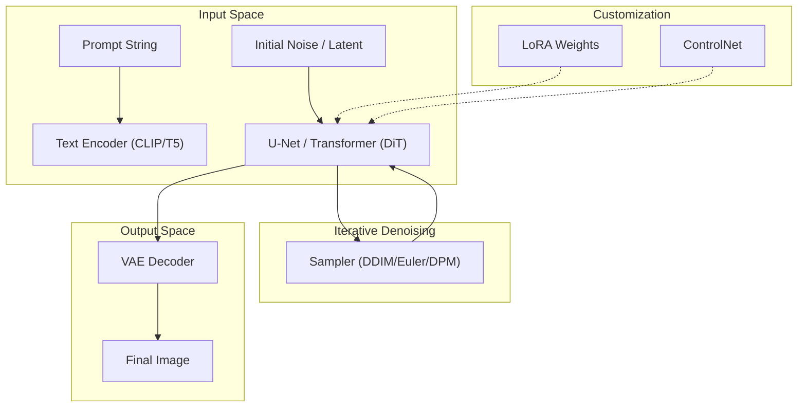

<!-- source: DeepWiki mcp.deepwiki.com · repo rohitg00/ai-engineering-from-scratch · page 9.1 Computer Vision: CNNs, Detection & Generation · fetched 2026-10-30 -->

# Computer Vision: CNNs, Detection & Generation

Relevant source files

The following files were used as context for generating this wiki page:

- [phases/04-computer-vision/06-object-detection-yolo/code/main.py](phases/04-computer-vision/06-object-detection-yolo/code/main.py)
- [phases/04-computer-vision/06-object-detection-yolo/docs/en.md](phases/04-computer-vision/06-object-detection-yolo/docs/en.md)
- [phases/04-computer-vision/06-object-detection-yolo/outputs/prompt-detection-metric-reader.md](phases/04-computer-vision/06-object-detection-yolo/outputs/prompt-detection-metric-reader.md)
- [phases/04-computer-vision/06-object-detection-yolo/outputs/skill-anchor-designer.md](phases/04-computer-vision/06-object-detection-yolo/outputs/skill-anchor-designer.md)
- [phases/04-computer-vision/06-object-detection-yolo/quiz.json](phases/04-computer-vision/06-object-detection-yolo/quiz.json)
- [phases/04-computer-vision/10-image-generation-diffusion/code/main.py](phases/04-computer-vision/10-image-generation-diffusion/code/main.py)
- [phases/04-computer-vision/10-image-generation-diffusion/docs/en.md](phases/04-computer-vision/10-image-generation-diffusion/docs/en.md)
- [phases/04-computer-vision/10-image-generation-diffusion/outputs/prompt-diffusion-sampler-picker.md](phases/04-computer-vision/10-image-generation-diffusion/outputs/prompt-diffusion-sampler-picker.md)
- [phases/04-computer-vision/10-image-generation-diffusion/outputs/skill-noise-schedule-designer.md](phases/04-computer-vision/10-image-generation-diffusion/outputs/skill-noise-schedule-designer.md)
- [phases/04-computer-vision/10-image-generation-diffusion/quiz.json](phases/04-computer-vision/10-image-generation-diffusion/quiz.json)
- [phases/04-computer-vision/11-stable-diffusion/code/main.py](phases/04-computer-vision/11-stable-diffusion/code/main.py)
- [phases/04-computer-vision/11-stable-diffusion/docs/en.md](phases/04-computer-vision/11-stable-diffusion/docs/en.md)
- [phases/04-computer-vision/11-stable-diffusion/outputs/prompt-sd-pipeline-planner.md](phases/04-computer-vision/11-stable-diffusion/outputs/prompt-sd-pipeline-planner.md)
- [phases/04-computer-vision/11-stable-diffusion/outputs/skill-lora-training-setup.md](phases/04-computer-vision/11-stable-diffusion/outputs/skill-lora-training-setup.md)
- [phases/04-computer-vision/11-stable-diffusion/quiz.json](phases/04-computer-vision/11-stable-diffusion/quiz.json)
- [phases/04-computer-vision/12-video-understanding/code/main.py](phases/04-computer-vision/12-video-understanding/code/main.py)
- [phases/04-computer-vision/12-video-understanding/docs/en.md](phases/04-computer-vision/12-video-understanding/docs/en.md)
- [phases/04-computer-vision/12-video-understanding/outputs/prompt-video-architecture-picker.md](phases/04-computer-vision/12-video-understanding/outputs/prompt-video-architecture-picker.md)
- [phases/04-computer-vision/12-video-understanding/outputs/skill-frame-sampler-auditor.md](phases/04-computer-vision/12-video-understanding/outputs/skill-frame-sampler-auditor.md)
- [phases/04-computer-vision/12-video-understanding/quiz.json](phases/04-computer-vision/12-video-understanding/quiz.json)
- [phases/04-computer-vision/14-vision-transformers/code/main.py](phases/04-computer-vision/14-vision-transformers/code/main.py)
- [phases/04-computer-vision/14-vision-transformers/docs/en.md](phases/04-computer-vision/14-vision-transformers/docs/en.md)
- [phases/04-computer-vision/14-vision-transformers/outputs/prompt-vit-vs-cnn-picker.md](phases/04-computer-vision/14-vision-transformers/outputs/prompt-vit-vs-cnn-picker.md)
- [phases/04-computer-vision/14-vision-transformers/outputs/skill-vit-patch-and-pos-embed-inspector.md](phases/04-computer-vision/14-vision-transformers/outputs/skill-vit-patch-and-pos-embed-inspector.md)
- [phases/04-computer-vision/14-vision-transformers/quiz.json](phases/04-computer-vision/14-vision-transformers/quiz.json)
- [phases/04-computer-vision/20-image-retrieval-metric/code/main.py](phases/04-computer-vision/20-image-retrieval-metric/code/main.py)
- [phases/04-computer-vision/20-image-retrieval-metric/docs/en.md](phases/04-computer-vision/20-image-retrieval-metric/docs/en.md)
- [phases/04-computer-vision/20-image-retrieval-metric/outputs/prompt-retrieval-loss-picker.md](phases/04-computer-vision/20-image-retrieval-metric/outputs/prompt-retrieval-loss-picker.md)
- [phases/04-computer-vision/20-image-retrieval-metric/outputs/skill-recall-at-k-runner.md](phases/04-computer-vision/20-image-retrieval-metric/outputs/skill-recall-at-k-runner.md)
- [phases/04-computer-vision/20-image-retrieval-metric/quiz.json](phases/04-computer-vision/20-image-retrieval-metric/quiz.json)
- [phases/04-computer-vision/24-sam3-open-vocab-segmentation/code/main.py](phases/04-computer-vision/24-sam3-open-vocab-segmentation/code/main.py)
- [phases/04-computer-vision/24-sam3-open-vocab-segmentation/docs/en.md](phases/04-computer-vision/24-sam3-open-vocab-segmentation/docs/en.md)
- [phases/04-computer-vision/24-sam3-open-vocab-segmentation/outputs/prompt-open-vocab-stack-picker.md](phases/04-computer-vision/24-sam3-open-vocab-segmentation/outputs/prompt-open-vocab-stack-picker.md)
- [phases/04-computer-vision/24-sam3-open-vocab-segmentation/outputs/skill-concept-prompt-designer.md](phases/04-computer-vision/24-sam3-open-vocab-segmentation/outputs/skill-concept-prompt-designer.md)
- [phases/04-computer-vision/24-sam3-open-vocab-segmentation/quiz.json](phases/04-computer-vision/24-sam3-open-vocab-segmentation/quiz.json)
- [phases/04-computer-vision/26-monocular-depth/code/main.py](phases/04-computer-vision/26-monocular-depth/code/main.py)
- [phases/04-computer-vision/26-monocular-depth/docs/en.md](phases/04-computer-vision/26-monocular-depth/docs/en.md)
- [phases/04-computer-vision/26-monocular-depth/outputs/prompt-depth-model-picker.md](phases/04-computer-vision/26-monocular-depth/outputs/prompt-depth-model-picker.md)
- [phases/04-computer-vision/26-monocular-depth/outputs/skill-depth-to-pointcloud.md](phases/04-computer-vision/26-monocular-depth/outputs/skill-depth-to-pointcloud.md)
- [phases/04-computer-vision/26-monocular-depth/quiz.json](phases/04-computer-vision/26-monocular-depth/quiz.json)
- [phases/04-computer-vision/28-world-models-video-diffusion/code/main.py](phases/04-computer-vision/28-world-models-video-diffusion/code/main.py)
- [phases/04-computer-vision/28-world-models-video-diffusion/docs/en.md](phases/04-computer-vision/28-world-models-video-diffusion/docs/en.md)
- [phases/04-computer-vision/28-world-models-video-diffusion/outputs/prompt-video-model-picker.md](phases/04-computer-vision/28-world-models-video-diffusion/outputs/prompt-video-model-picker.md)
- [phases/04-computer-vision/28-world-models-video-diffusion/outputs/skill-physical-plausibility-checks.md](phases/04-computer-vision/28-world-models-video-diffusion/outputs/skill-physical-plausibility-checks.md)
- [phases/04-computer-vision/28-world-models-video-diffusion/quiz.json](phases/04-computer-vision/28-world-models-video-diffusion/quiz.json)

This page covers Phase 4 of the curriculum, detailing the evolution from foundational Convolutional Neural Networks (CNNs) to modern Vision Transformers (ViTs), object detection frameworks like YOLO, and the state-of-the-art in generative modeling (Diffusion, World Models) and 3D vision.

## Object Detection & Segmentation

The curriculum implements object detection from first principles using the YOLO (You Only Look Once) paradigm. Key logic involves grid-based prediction where a `YOLOHead` [phases/04-computer-vision/06-object-detection-yolo/code/main.py:69-81]() maps feature maps to anchor-relative coordinates.

### Detection Data Flow

The following diagram bridges the mathematical concept of anchor-based detection to the implementation in `main.py`.

**Detection Pipeline: Logic to Code**

**Key Entities:**
- `assign_targets`: Encodes boxes into grid cells based on IOU with `anchors` [phases/04-computer-vision/06-object-detection-yolo/code/main.py:84-118]().
- `decode`: Converts raw network outputs ($t_x, t_y, t_w, t_h$) back into image-space coordinates ($c_x, c_y, w, h$) [phases/04-computer-vision/06-object-detection-yolo/code/main.py:60-66]().
- `nms`: Non-Maximum Suppression to filter overlapping boxes [phases/04-computer-vision/06-object-detection-yolo/code/main.py:30-41]().

Sources: [phases/04-computer-vision/06-object-detection-yolo/code/main.py:1-183]()

### Open-Vocabulary Segmentation (SAM 3)
Moving beyond fixed classes, the curriculum covers SAM 3 (Segment Anything Model). Implementation focuses on the `ConceptDetection` [phases/04-computer-vision/24-sam3-open-vocab-segmentation/code/main.py:8-14]() data structure and RLE (Run-Length Encoding) for efficient mask storage [phases/04-computer-vision/24-sam3-open-vocab-segmentation/code/main.py:27-42]().

**Artifacts:**
- `skill-concept-prompt-designer`: Normalizes natural language into SAM-friendly noun phrases [phases/04-computer-vision/24-sam3-open-vocab-segmentation/outputs/skill-concept-prompt-designer.md:10-12]().

Sources: [phases/04-computer-vision/24-sam3-open-vocab-segmentation/code/main.py:1-135](), [phases/04-computer-vision/24-sam3-open-vocab-segmentation/outputs/skill-concept-prompt-designer.md:1-85]()

---

## Vision Transformers (ViT) & Backbones

The transition from CNNs to Transformers in vision is managed via decision logic that considers dataset size and inference constraints.

### Backbone Selection Logic
The `prompt-vit-vs-cnn-picker` [phases/04-computer-vision/14-vision-transformers/outputs/prompt-vit-vs-cnn-picker.md:1-6]() provides a heuristic for choosing architectures:
- **Edge/Mobile:** Prefers `ConvNeXt-Tiny` or `EfficientNet-V2` [phases/04-computer-vision/14-vision-transformers/outputs/prompt-vit-vs-cnn-picker.md:22]().
- **Large Datasets (>100k):** Prefers `ViT-B/16` with MAE pretraining [phases/04-computer-vision/14-vision-transformers/outputs/prompt-vit-vs-cnn-picker.md:25]().
- **Dense Prediction:** Prefers `Swin-V2` for hierarchical feature pyramids [phases/04-computer-vision/14-vision-transformers/outputs/prompt-vit-vs-cnn-picker.md:23]().

### ViT Debugging
The `skill-vit-patch-and-pos-embed-inspector` [phases/04-computer-vision/14-vision-transformers/outputs/skill-vit-patch-and-pos-embed-inspector.md:1-8]() is used to verify positional embedding shapes, preventing common resolution-mismatch bugs during fine-tuning [phases/04-computer-vision/14-vision-transformers/outputs/skill-vit-patch-and-pos-embed-inspector.md:10-12]().

Sources: [phases/04-computer-vision/14-vision-transformers/outputs/prompt-vit-vs-cnn-picker.md:1-53](), [phases/04-computer-vision/14-vision-transformers/outputs/skill-vit-patch-and-pos-embed-inspector.md:1-58]()

---

## Image Generation & Stable Diffusion

The curriculum covers the Diffusion pipeline from noise schedules to LoRA (Low-Rank Adaptation) fine-tuning.

### Diffusion Pipeline Architecture

### Sampler & Pipeline Selection
- **Samplers:** The `prompt-diffusion-sampler-picker` [phases/04-computer-vision/10-image-generation-diffusion/outputs/prompt-diffusion-sampler-picker.md:1-6]() maps quality targets to samplers like `DPM-Solver++ 2M` for production and `DDPM` for research [phases/04-computer-vision/10-image-generation-diffusion/outputs/prompt-diffusion-sampler-picker.md:22-28]().
- **Models:** The `prompt-sd-pipeline-planner` [phases/04-computer-vision/11-stable-diffusion/outputs/prompt-sd-pipeline-planner.md:1-6]() assists in choosing between `SD 1.5`, `SDXL`, `SD3`, or `FLUX` based on licensing and fidelity [phases/04-computer-vision/11-stable-diffusion/outputs/prompt-sd-pipeline-planner.md:22-29]().

### Fine-Tuning with LoRA
The `skill-lora-training-setup` [phases/04-computer-vision/11-stable-diffusion/outputs/skill-lora-training-setup.md:1-8]() defines optimal rank/alpha settings:
| Purpose | Rank | Alpha |
| :--- | :--- | :--- |
| Subject | 8-16 | Rank |
| Style | 16-32 | Rank * 2 |
| Concept | 32-64 | Rank |

Source: [phases/04-computer-vision/11-stable-diffusion/outputs/skill-lora-training-setup.md:30-35]()

Sources: [phases/04-computer-vision/10-image-generation-diffusion/outputs/prompt-diffusion-sampler-picker.md:1-60](), [phases/04-computer-vision/11-stable-diffusion/outputs/prompt-sd-pipeline-planner.md:1-80](), [phases/04-computer-vision/11-stable-diffusion/outputs/skill-lora-training-setup.md:1-123]()

---

## Video Understanding & World Models

This section explores the transition from video classification to action-conditioned world modeling.

### Video Architectures
The `prompt-video-architecture-picker` [phases/04-computer-vision/12-video-understanding/outputs/prompt-video-architecture-picker.md:1-6]() categorizes models by signal type:
- **Appearance:** `2D+pool` with `ResNet` or `MViT` [phases/04-computer-vision/12-video-understanding/outputs/prompt-video-architecture-picker.md:21-22]().
- **Motion:** `I3D`, `R(2+1)D`, or `VideoMAE` [phases/04-computer-vision/12-video-understanding/outputs/prompt-video-architecture-picker.md:23-25]().
- **Joint Spatio-temporal:** `TimeSformer` with divided attention [phases/04-computer-vision/12-video-understanding/outputs/prompt-video-architecture-picker.md:26]().

### World Models & Video DiT
World models (e.g., Genie 3, Sora 2) are described as simulators [phases/04-computer-vision/28-world-models-video-diffusion/docs/en.md:1-3]().
- **Action-Conditioned:** `Genie 3` and `GWM-1` allow steering mid-rollout [phases/04-computer-vision/28-world-models-video-diffusion/docs/en.md:49]().
- **Video DiT Architecture:** Utilizes spatio-temporal patches where tokens are grouped by $(T/P_t) \times (H/P_h) \times (W/P_w)$ [phases/04-computer-vision/28-world-models-video-diffusion/docs/en.md:54-58]().

Sources: [phases/04-computer-vision/12-video-understanding/outputs/prompt-video-architecture-picker.md:1-59](), [phases/04-computer-vision/28-world-models-video-diffusion/docs/en.md:1-118]()

---

## 3D Vision & Depth Estimation

Focuses on monocular depth estimation and lifting 2D images to 3D representations.

### Depth Model Selection
The `prompt-depth-model-picker` [phases/04-computer-vision/26-monocular-depth/outputs/prompt-depth-model-picker.md:1-6]() differentiates between:
- **Relative Depth:** `Depth Anything V2/V3` for general scene understanding [phases/04-computer-vision/26-monocular-depth/outputs/prompt-depth-model-picker.md:21-22]().
- **Metric Depth:** `UniDepth` or `ZoeDepth` for indoor/outdoor measurements [phases/04-computer-vision/26-monocular-depth/outputs/prompt-depth-model-picker.md:23-25]().
- **High Quality:** `Marigold` (diffusion-based) for sharp edges [phases/04-computer-vision/26-monocular-depth/outputs/prompt-depth-model-picker.md:26]().

Sources: [phases/04-computer-vision/26-monocular-depth/outputs/prompt-depth-model-picker.md:1-59]()

---

