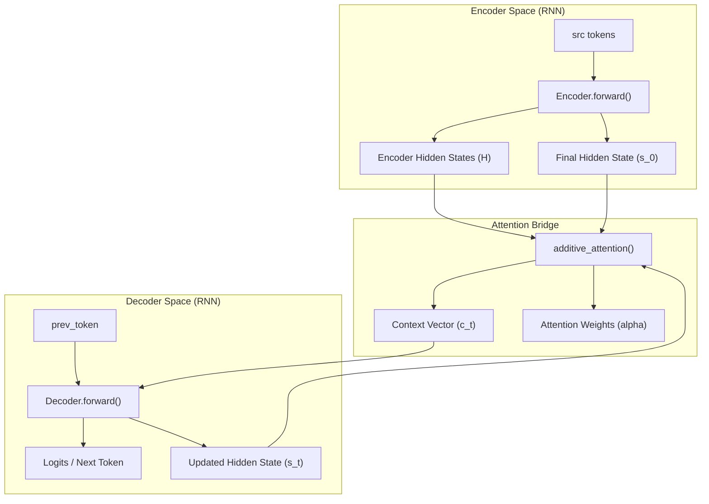

<!-- source: DeepWiki mcp.deepwiki.com · repo rohitg00/ai-engineering-from-scratch · page 9.2 NLP Foundations: Text Processing to Seq2Seq · fetched 2026-10-30 -->

# NLP Foundations: Text Processing to Seq2Seq

Relevant source files

The following files were used as context for generating this wiki page:

- [phases/05-nlp-foundations-to-advanced/01-text-processing/assets/pipeline.svg](phases/05-nlp-foundations-to-advanced/01-text-processing/assets/pipeline.svg)
- [phases/05-nlp-foundations-to-advanced/01-text-processing/docs/en.md](phases/05-nlp-foundations-to-advanced/01-text-processing/docs/en.md)
- [phases/05-nlp-foundations-to-advanced/02-bag-of-words-tfidf/docs/en.md](phases/05-nlp-foundations-to-advanced/02-bag-of-words-tfidf/docs/en.md)
- [phases/05-nlp-foundations-to-advanced/03-word-embeddings-word2vec/docs/en.md](phases/05-nlp-foundations-to-advanced/03-word-embeddings-word2vec/docs/en.md)
- [phases/05-nlp-foundations-to-advanced/05-sentiment-analysis/docs/en.md](phases/05-nlp-foundations-to-advanced/05-sentiment-analysis/docs/en.md)
- [phases/05-nlp-foundations-to-advanced/06-named-entity-recognition/docs/en.md](phases/05-nlp-foundations-to-advanced/06-named-entity-recognition/docs/en.md)
- [phases/05-nlp-foundations-to-advanced/07-pos-tagging-parsing/docs/en.md](phases/05-nlp-foundations-to-advanced/07-pos-tagging-parsing/docs/en.md)
- [phases/05-nlp-foundations-to-advanced/09-sequence-to-sequence/docs/en.md](phases/05-nlp-foundations-to-advanced/09-sequence-to-sequence/docs/en.md)
- [phases/05-nlp-foundations-to-advanced/10-attention-mechanism/assets/attention.svg](phases/05-nlp-foundations-to-advanced/10-attention-mechanism/assets/attention.svg)
- [phases/05-nlp-foundations-to-advanced/10-attention-mechanism/code/main.py](phases/05-nlp-foundations-to-advanced/10-attention-mechanism/code/main.py)
- [phases/05-nlp-foundations-to-advanced/10-attention-mechanism/docs/en.md](phases/05-nlp-foundations-to-advanced/10-attention-mechanism/docs/en.md)
- [phases/05-nlp-foundations-to-advanced/10-attention-mechanism/notebook/.gitkeep](phases/05-nlp-foundations-to-advanced/10-attention-mechanism/notebook/.gitkeep)
- [phases/05-nlp-foundations-to-advanced/10-attention-mechanism/outputs/.gitkeep](phases/05-nlp-foundations-to-advanced/10-attention-mechanism/outputs/.gitkeep)
- [phases/05-nlp-foundations-to-advanced/10-attention-mechanism/outputs/prompt-attention-shapes.md](phases/05-nlp-foundations-to-advanced/10-attention-mechanism/outputs/prompt-attention-shapes.md)
- [phases/05-nlp-foundations-to-advanced/17-chatbots-rule-to-neural/docs/en.md](phases/05-nlp-foundations-to-advanced/17-chatbots-rule-to-neural/docs/en.md)

This section covers the foundational journey of Natural Language Processing (NLP) from raw text manipulation to the sophisticated sequence-to-sequence architectures that underpin modern translation and generative systems. It documents the implementation of the classical NLP pipeline, statistical classification, and the evolution of attention mechanisms.

## The Text Preprocessing Pipeline

Language is continuous, but models are discrete. The preprocessing pipeline serves as the bridge between human strings and machine-readable integers.

### Core Operations
1.  **Tokenization**: Splitting strings into discrete units (tokens). A regex-based approach is used to handle alphanumeric runs and punctuation separately [phases/05-nlp-foundations-to-advanced/01-text-processing/docs/en.md:41-43]().
2.  **Stemming**: A rule-based reduction of words to their roots (e.g., "running" to "run"). The implementation focuses on Porter Stemmer Step 1a rules [phases/05-nlp-foundations-to-advanced/01-text-processing/docs/en.md:59-69]().
3.  **Lemmatization**: A dictionary-based approach that uses morphological analysis and Part-of-Speech (POS) context to find the canonical form (e.g., "better" to "good") [phases/05-nlp-foundations-to-advanced/01-text-processing/docs/en.md:83-104]().

### Natural Language Space to Code Entity Space: Preprocessing
The following diagram maps the linguistic transformation stages to the specific functions implemented in the `preprocess` pipeline.

| Operation | Code Entity | Implementation Detail |
| :--- | :--- | :--- |
| **Tokenize** | `tokenize(text)` | Uses `re.findall` with specific patterns for words/apostrophes [phases/05-nlp-foundations-to-advanced/01-text-processing/docs/en.md:41-43](). |
| **Stem** | `stem_step_1a(word)` | Chops suffixes like `sses` and `ies` [phases/05-nlp-foundations-to-advanced/01-text-processing/docs/en.md:59-69](). |
| **Lemmatize** | `lemmatize(word, pos)` | Lookups in `LEMMA_TABLE` with fallback rules [phases/05-nlp-foundations-to-advanced/01-text-processing/docs/en.md:83-104](). |
| **Orchestrate** | `preprocess(text)` | Pipes tokens through stems and lemmas [phases/05-nlp-foundations-to-advanced/01-text-processing/docs/en.md:123-129](). |

**Sources:** [phases/05-nlp-foundations-to-advanced/01-text-processing/docs/en.md:1-130](), [phases/05-nlp-foundations-to-advanced/01-text-processing/assets/pipeline.svg:1-60]()

---

## Text Representation: BoW and TF-IDF

To process text with linear models, tokens must be converted into fixed-size vectors.

*   **Bag of Words (BoW)**: Represents a document by the counts of its vocabulary words, discarding order [phases/05-nlp-foundations-to-advanced/02-bag-of-words-tfidf/docs/en.md:22-22]().
*   **TF-IDF (Term Frequency-Inverse Document Frequency)**: Reweights BoW counts. It rewards words that are frequent in a specific document but rare across the corpus [phases/05-nlp-foundations-to-advanced/02-bag-of-words-tfidf/docs/en.md:24-25]().

### Key Implementation Functions
*   `build_vocab(docs)`: Creates a mapping of `{word: index}` [phases/05-nlp-foundations-to-advanced/02-bag-of-words-tfidf/docs/en.md:40-47]().
*   `inverse_document_frequency(df, n_docs)`: Implements smoothed IDF using `log((n_docs + 1) / (d + 1)) + 1` [phases/05-nlp-foundations-to-advanced/02-bag-of-words-tfidf/docs/en.md:91-93]().
*   `l2_normalize(matrix)`: Ensures document length does not dominate similarity scores by projecting vectors onto a unit hypersphere [phases/05-nlp-foundations-to-advanced/02-bag-of-words-tfidf/docs/en.md:128-134]().

**Sources:** [phases/05-nlp-foundations-to-advanced/02-bag-of-words-tfidf/docs/en.md:1-134]()

---

## Sentiment Analysis and NER

These tasks demonstrate classification and sequence labeling.

### Sentiment Analysis
Implemented using **Multinomial Naive Bayes** and **Logistic Regression** from scratch. A critical interface is `apply_negation(tokens)`, which handles the "not good" problem by prefixing tokens with `NOT_` until the next punctuation [phases/05-nlp-foundations-to-advanced/05-sentiment-analysis/docs/en.md:133-147]().

### Named Entity Recognition (NER)
NER is treated as a sequence labeling problem using **BIO tagging** (Beginning, Inside, Outside).
*   `spans_to_bio(tokens, spans)`: Converts character offsets to BIO labels [phases/05-nlp-foundations-to-advanced/06-named-entity-recognition/docs/en.md:52-58]().
*   `bio_to_spans(tokens, labels)`: Reconstructs entities from tag sequences [phases/05-nlp-foundations-to-advanced/06-named-entity-recognition/docs/en.md:61-77]().

**Sources:** [phases/05-nlp-foundations-to-advanced/05-sentiment-analysis/docs/en.md:1-150](), [phases/05-nlp-foundations-to-advanced/06-named-entity-recognition/docs/en.md:1-85]()

---

## Word Embeddings (Word2Vec)

Word2Vec (Skip-gram) learns dense vector representations where semantically similar words are geometrically close [phases/05-nlp-foundations-to-advanced/03-word-embeddings-word2vec/docs/en.md:12-16]().

### Training Logic
The `train_pair` function implements negative sampling, avoiding the expensive full-vocabulary softmax [phases/05-nlp-foundations-to-advanced/03-word-embeddings-word2vec/docs/en.md:37-37](). It updates two tables: `W` (center word) and `W_prime` (context word) [phases/05-nlp-foundations-to-advanced/03-word-embeddings-word2vec/docs/en.md:91-108]().

**Sources:** [phases/05-nlp-foundations-to-advanced/03-word-embeddings-word2vec/docs/en.md:1-130]()

---

## Sequence-to-Sequence and Attention

Seq2Seq architectures map variable-length inputs to variable-length outputs using an **Encoder-Decoder** framework.

### The Context Bottleneck
In a basic Seq2Seq model, the Encoder (an RNN) compresses the entire input into a single fixed-size hidden state (the context vector) [phases/05-nlp-foundations-to-advanced/09-sequence-to-sequence/docs/en.md:20-21](). This leads to performance degradation on long sequences [phases/05-nlp-foundations-to-advanced/09-sequence-to-sequence/docs/en.md:127-132]().

### The Attention Mechanism
Attention allows the decoder to "look back" at all encoder hidden states at every step, calculating a weighted average based on relevance [phases/05-nlp-foundations-to-advanced/10-attention-mechanism/docs/en.md:14-16]().

### Seq2Seq Data Flow and Code Entities
The following diagram traces the data flow from the `Encoder` through the `additive_attention` mechanism to the `Decoder`.

### Implementation Details: Attention Variants
*   **Additive (Bahdanau)**: `e = v_a * tanh(W_a * s + U_a * h)`. Implemented in `additive_attention` [phases/05-nlp-foundations-to-advanced/10-attention-mechanism/code/main.py:47-60]().
*   **Dot-Product (Luong)**: `e = s^T * h`. Implemented in `dot_attention` [phases/05-nlp-foundations-to-advanced/10-attention-mechanism/code/main.py:17-33]().

### The Agent Loop Interface
The `agent_loop` represents the modern evolution of chatbots, moving from pure neural generation to a tool-calling cycle [phases/05-nlp-foundations-to-advanced/17-chatbots-rule-to-neural/docs/en.md:28-28]().
*   **Interface**: `agent_loop(user_message, tools, llm, max_steps)` [phases/05-nlp-foundations-to-advanced/17-chatbots-rule-to-neural/docs/en.md:114]().
*   **Logic**: The loop continues as long as the LLM requests a `tool_call`. It executes the tool, appends the result to history, and re-queries the LLM [phases/05-nlp-foundations-to-advanced/17-chatbots-rule-to-neural/docs/en.md:116-135]().

**Sources:** [phases/05-nlp-foundations-to-advanced/09-sequence-to-sequence/docs/en.md:1-132](), [phases/05-nlp-foundations-to-advanced/10-attention-mechanism/docs/en.md:1-136](), [phases/05-nlp-foundations-to-advanced/10-attention-mechanism/code/main.py:1-90](), [phases/05-nlp-foundations-to-advanced/17-chatbots-rule-to-neural/docs/en.md:114-140]()

---

