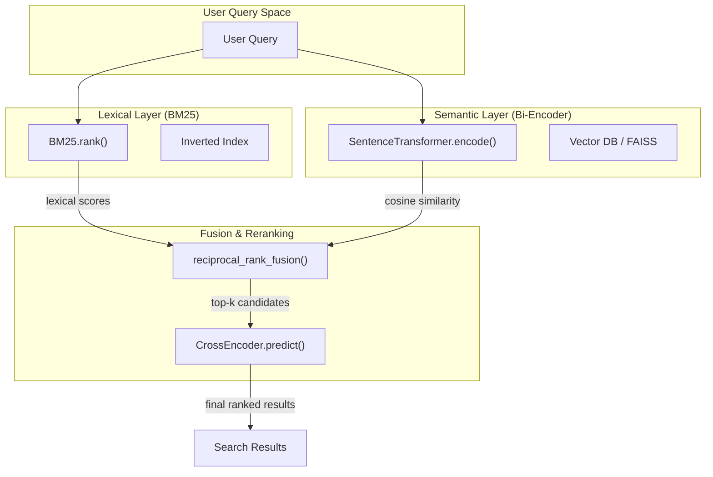
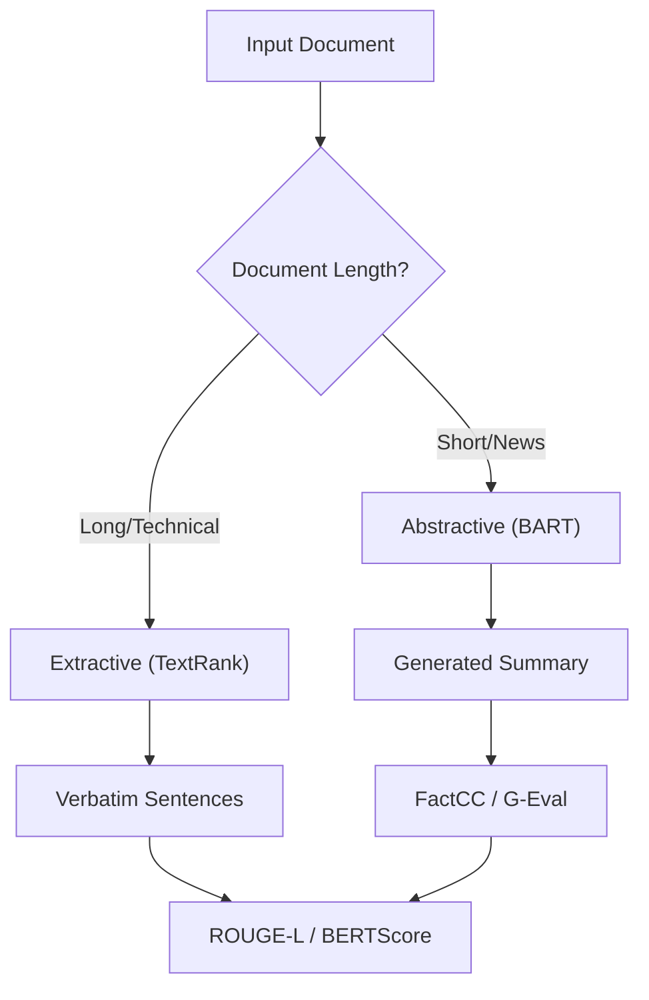
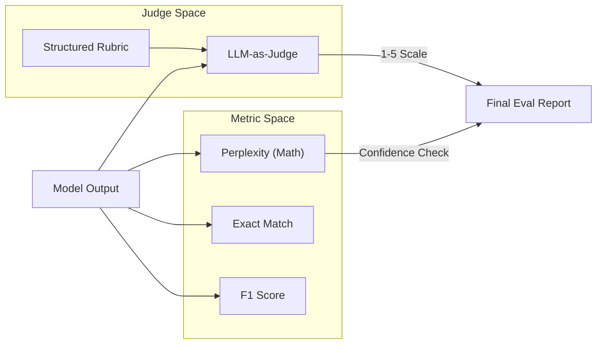

<!-- source: DeepWiki mcp.deepwiki.com · repo rohitg00/ai-engineering-from-scratch · page 9.3 Advanced NLP: IR, QA, Summarization & Multilingual · fetched 2026-10-30 -->

# Advanced NLP: IR, QA, Summarization & Multilingual

Relevant source files

The following files were used as context for generating this wiki page:

- [phases/05-nlp-foundations-to-advanced/04-glove-fasttext-subword/docs/en.md](phases/05-nlp-foundations-to-advanced/04-glove-fasttext-subword/docs/en.md)
- [phases/05-nlp-foundations-to-advanced/04-glove-fasttext-subword/outputs/skill-embeddings-picker.md](phases/05-nlp-foundations-to-advanced/04-glove-fasttext-subword/outputs/skill-embeddings-picker.md)
- [phases/05-nlp-foundations-to-advanced/11-machine-translation/assets/mt-pipeline.svg](phases/05-nlp-foundations-to-advanced/11-machine-translation/assets/mt-pipeline.svg)
- [phases/05-nlp-foundations-to-advanced/11-machine-translation/code/main.py](phases/05-nlp-foundations-to-advanced/11-machine-translation/code/main.py)
- [phases/05-nlp-foundations-to-advanced/11-machine-translation/docs/en.md](phases/05-nlp-foundations-to-advanced/11-machine-translation/docs/en.md)
- [phases/05-nlp-foundations-to-advanced/11-machine-translation/notebook/.gitkeep](phases/05-nlp-foundations-to-advanced/11-machine-translation/notebook/.gitkeep)
- [phases/05-nlp-foundations-to-advanced/11-machine-translation/outputs/.gitkeep](phases/05-nlp-foundations-to-advanced/11-machine-translation/outputs/.gitkeep)
- [phases/05-nlp-foundations-to-advanced/11-machine-translation/outputs/skill-mt-evaluator.md](phases/05-nlp-foundations-to-advanced/11-machine-translation/outputs/skill-mt-evaluator.md)
- [phases/05-nlp-foundations-to-advanced/12-text-summarization/docs/en.md](phases/05-nlp-foundations-to-advanced/12-text-summarization/docs/en.md)
- [phases/05-nlp-foundations-to-advanced/13-question-answering/docs/en.md](phases/05-nlp-foundations-to-advanced/13-question-answering/docs/en.md)
- [phases/05-nlp-foundations-to-advanced/14-information-retrieval-search/assets/retrieval.svg](phases/05-nlp-foundations-to-advanced/14-information-retrieval-search/assets/retrieval.svg)
- [phases/05-nlp-foundations-to-advanced/14-information-retrieval-search/code/main.py](phases/05-nlp-foundations-to-advanced/14-information-retrieval-search/code/main.py)
- [phases/05-nlp-foundations-to-advanced/14-information-retrieval-search/docs/en.md](phases/05-nlp-foundations-to-advanced/14-information-retrieval-search/docs/en.md)
- [phases/05-nlp-foundations-to-advanced/14-information-retrieval-search/notebook/.gitkeep](phases/05-nlp-foundations-to-advanced/14-information-retrieval-search/notebook/.gitkeep)
- [phases/05-nlp-foundations-to-advanced/14-information-retrieval-search/outputs/.gitkeep](phases/05-nlp-foundations-to-advanced/14-information-retrieval-search/outputs/.gitkeep)
- [phases/05-nlp-foundations-to-advanced/14-information-retrieval-search/outputs/skill-retrieval-picker.md](phases/05-nlp-foundations-to-advanced/14-information-retrieval-search/outputs/skill-retrieval-picker.md)
- [phases/05-nlp-foundations-to-advanced/15-topic-modeling/assets/topic-modeling.svg](phases/05-nlp-foundations-to-advanced/15-topic-modeling/assets/topic-modeling.svg)
- [phases/05-nlp-foundations-to-advanced/15-topic-modeling/code/main.py](phases/05-nlp-foundations-to-advanced/15-topic-modeling/code/main.py)
- [phases/05-nlp-foundations-to-advanced/15-topic-modeling/docs/en.md](phases/05-nlp-foundations-to-advanced/15-topic-modeling/docs/en.md)
- [phases/05-nlp-foundations-to-advanced/15-topic-modeling/notebook/.gitkeep](phases/05-nlp-foundations-to-advanced/15-topic-modeling/notebook/.gitkeep)
- [phases/05-nlp-foundations-to-advanced/15-topic-modeling/outputs/.gitkeep](phases/05-nlp-foundations-to-advanced/15-topic-modeling/outputs/.gitkeep)
- [phases/05-nlp-foundations-to-advanced/15-topic-modeling/outputs/skill-topic-picker.md](phases/05-nlp-foundations-to-advanced/15-topic-modeling/outputs/skill-topic-picker.md)
- [phases/05-nlp-foundations-to-advanced/16-text-generation-pre-transformer/assets/ngram.svg](phases/05-nlp-foundations-to-advanced/16-text-generation-pre-transformer/assets/ngram.svg)
- [phases/05-nlp-foundations-to-advanced/16-text-generation-pre-transformer/code/main.py](phases/05-nlp-foundations-to-advanced/16-text-generation-pre-transformer/code/main.py)
- [phases/05-nlp-foundations-to-advanced/16-text-generation-pre-transformer/docs/en.md](phases/05-nlp-foundations-to-advanced/16-text-generation-pre-transformer/docs/en.md)
- [phases/05-nlp-foundations-to-advanced/16-text-generation-pre-transformer/notebook/.gitkeep](phases/05-nlp-foundations-to-advanced/16-text-generation-pre-transformer/notebook/.gitkeep)
- [phases/05-nlp-foundations-to-advanced/16-text-generation-pre-transformer/outputs/.gitkeep](phases/05-nlp-foundations-to-advanced/16-text-generation-pre-transformer/outputs/.gitkeep)
- [phases/05-nlp-foundations-to-advanced/16-text-generation-pre-transformer/outputs/prompt-lm-baseline.md](phases/05-nlp-foundations-to-advanced/16-text-generation-pre-transformer/outputs/prompt-lm-baseline.md)
- [phases/05-nlp-foundations-to-advanced/18-multilingual-nlp/assets/multilingual.svg](phases/05-nlp-foundations-to-advanced/18-multilingual-nlp/assets/multilingual.svg)
- [phases/05-nlp-foundations-to-advanced/18-multilingual-nlp/code/main.py](phases/05-nlp-foundations-to-advanced/18-multilingual-nlp/code/main.py)
- [phases/05-nlp-foundations-to-advanced/18-multilingual-nlp/docs/en.md](phases/05-nlp-foundations-to-advanced/18-multilingual-nlp/docs/en.md)
- [phases/05-nlp-foundations-to-advanced/18-multilingual-nlp/notebook/.gitkeep](phases/05-nlp-foundations-to-advanced/18-multilingual-nlp/notebook/.gitkeep)
- [phases/05-nlp-foundations-to-advanced/18-multilingual-nlp/outputs/.gitkeep](phases/05-nlp-foundations-to-advanced/18-multilingual-nlp/outputs/.gitkeep)
- [phases/05-nlp-foundations-to-advanced/18-multilingual-nlp/outputs/skill-multilingual-picker.md](phases/05-nlp-foundations-to-advanced/18-multilingual-nlp/outputs/skill-multilingual-picker.md)
- [phases/05-nlp-foundations-to-advanced/19-subword-tokenization/assets/subword-tokenization.svg](phases/05-nlp-foundations-to-advanced/19-subword-tokenization/assets/subword-tokenization.svg)
- [phases/05-nlp-foundations-to-advanced/19-subword-tokenization/code/main.py](phases/05-nlp-foundations-to-advanced/19-subword-tokenization/code/main.py)
- [phases/05-nlp-foundations-to-advanced/19-subword-tokenization/docs/en.md](phases/05-nlp-foundations-to-advanced/19-subword-tokenization/docs/en.md)
- [phases/05-nlp-foundations-to-advanced/19-subword-tokenization/notebook/.gitkeep](phases/05-nlp-foundations-to-advanced/19-subword-tokenization/notebook/.gitkeep)
- [phases/05-nlp-foundations-to-advanced/19-subword-tokenization/outputs/skill-bpe-vs-wordpiece.md](phases/05-nlp-foundations-to-advanced/19-subword-tokenization/outputs/skill-bpe-vs-wordpiece.md)
- [phases/10-llms-from-scratch/10-evaluation/code/main.py](phases/10-llms-from-scratch/10-evaluation/code/main.py)
- [phases/10-llms-from-scratch/10-evaluation/docs/en.md](phases/10-llms-from-scratch/10-evaluation/docs/en.md)
- [phases/10-llms-from-scratch/10-evaluation/outputs/prompt-eval-designer.md](phases/10-llms-from-scratch/10-evaluation/outputs/prompt-eval-designer.md)
- [phases/10-llms-from-scratch/10-evaluation/outputs/skill-llm-evaluation.md](phases/10-llms-from-scratch/10-evaluation/outputs/skill-llm-evaluation.md)

This section covers the transition from basic text processing to advanced NLP tasks including Information Retrieval (IR), Question Answering (QA), Text Summarization, and Multilingual systems. It details the implementation of production-grade pipelines that combine classical statistical methods with modern transformer-based architectures.

## Information Retrieval (IR) & Hybrid Search

Modern IR systems in the repository utilize a multi-layered approach to overcome the limitations of keyword-only or semantic-only search. The architecture follows a four-layer pipeline: Sparse Retrieval, Dense Retrieval, Fusion, and Reranking [phases/05-nlp-foundations-to-advanced/14-information-retrieval-search/docs/en.md:20-29]().

### The Hybrid Retrieval Pipeline
The system implements **BM25** for lexical precision and **Dense Bi-Encoders** for semantic recall. These disparate scores are merged using **Reciprocal Rank Fusion (RRF)**, which relies on rank positions rather than raw score scales [phases/05-nlp-foundations-to-advanced/14-information-retrieval-search/docs/en.md:113-122]().

#### Retrieval Logic Flow
Title: Information Retrieval Data Flow

Sources: [phases/05-nlp-foundations-to-advanced/14-information-retrieval-search/docs/en.md:20-29](), [phases/05-nlp-foundations-to-advanced/14-information-retrieval-search/code/main.py:10-84]()

### Key Implementation Details
*   **BM25 Parameters**: The `k1` parameter (default 1.5) controls term-frequency saturation, while `b` (default 0.75) manages document length normalization [phases/05-nlp-foundations-to-advanced/14-information-retrieval-search/docs/en.md:86-87]().
*   **RRF Constant**: A constant `k=60` is used to flatten the contribution of rank differences, preventing top ranks from completely drowning out lower-ranked but relevant documents [phases/05-nlp-foundations-to-advanced/14-information-retrieval-search/code/main.py:49-55]().

## Question Answering (QA) & RAG

The QA implementation distinguishes between **Extractive QA** (finding spans in text) and **Generative QA** (producing answers via LLMs grounded in retrieved context) [phases/05-nlp-foundations-to-advanced/13-question-answering/docs/en.md:14-20]().

### RAG Evaluation with RAGAS
For production systems, the `RAGAS` framework is implemented to evaluate four dimensions without requiring gold references [phases/05-nlp-foundations-to-advanced/13-question-answering/docs/en.md:120-128]():
1.  **Faithfulness**: NLI-based entailment check between answer and context.
2.  **Answer Relevance**: Comparison of hypothetical questions generated from the answer against the actual query.
3.  **Context Precision**: Fraction of retrieved chunks that are relevant.
4.  **Context Recall**: Ability of the retriever to find all necessary information.

Sources: [phases/05-nlp-foundations-to-advanced/13-question-answering/docs/en.md:120-128]()

## Text Summarization

The codebase supports two distinct summarization paradigms: **Extractive** (ranking existing sentences) and **Abstractive** (generating new text) [phases/05-nlp-foundations-to-advanced/12-text-summarization/docs/en.md:10-18]().

### Extractive Summarization (TextRank)
The `textrank` function treats a document as a graph where nodes are sentences and edges represent similarity. It uses a damping factor (default 0.85) and iterative updates similar to PageRank to identify the most "connected" sentences [phases/05-nlp-foundations-to-advanced/12-text-summarization/docs/en.md:54-82]().

### Abstractive Summarization (BART/Pegasus)
For abstractive tasks, the system utilizes pretrained encoder-decoder transformers like `facebook/bart-large-cnn`. While more fluent, these models are monitored for "Factuality Problems" such as entity swaps or polarity flips [phases/05-nlp-foundations-to-advanced/12-text-summarization/docs/en.md:86-99](), [phases/05-nlp-foundations-to-advanced/12-text-summarization/docs/en.md:129-134]().

Title: Summarization Strategy Selector

Sources: [phases/05-nlp-foundations-to-advanced/12-text-summarization/docs/en.md:20-28](), [phases/05-nlp-foundations-to-advanced/12-text-summarization/docs/en.md:125-142]()

## Multilingual NLP & Translation

The repository handles multilingual tasks through shared embedding spaces and zero-shot cross-lingual transfer [phases/05-nlp-foundations-to-advanced/18-multilingual-nlp/docs/en.md:3-15]().

### Cross-Lingual Transfer
By using models like **XLM-R** or **NLLB-200**, a model fine-tuned on English sentiment analysis can perform sentiment prediction on Urdu or Swahili without additional training data [phases/05-nlp-foundations-to-advanced/18-multilingual-nlp/docs/en.md:14-28]().

### Subword Tokenization
The system implements **Byte-Pair Encoding (BPE)** to handle the "tokenization tax" in multilingual settings. BPE learns a vocabulary of frequent subword units, ensuring that rare or unseen words are broken into known morphemes rather than being treated as "Unknown" [phases/05-nlp-foundations-to-advanced/04-glove-fasttext-subword/docs/en.md:112-145]().

#### BPE Algorithm Logic
1.  Initialize vocabulary with individual characters/bytes [phases/05-nlp-foundations-to-advanced/04-glove-fasttext-subword/docs/en.md:115-119]().
2.  Iteratively find the most frequent adjacent pair of tokens [phases/05-nlp-foundations-to-advanced/04-glove-fasttext-subword/docs/en.md:123-129]().
3.  Merge the pair into a single new token [phases/05-nlp-foundations-to-advanced/04-glove-fasttext-subword/docs/en.md:132-144]().

Sources: [phases/05-nlp-foundations-to-advanced/18-multilingual-nlp/docs/en.md:22-26](), [phases/05-nlp-foundations-to-advanced/04-glove-fasttext-subword/docs/en.md:112-145]()

## Topic Modeling

The repository implements two primary topic modeling approaches in `phases/05-nlp-foundations-to-advanced/15-topic-modeling/code/main.py` [phases/05-nlp-foundations-to-advanced/15-topic-modeling/code/main.py:1-112]().

| Feature | LDA (Latent Dirichlet Allocation) | BERTopic |
| :--- | :--- | :--- |
| **Mechanism** | Bayesian mixture of word distributions | Clustering in embedding space |
| **Membership** | Mixed (one doc can have multiple topics) | Single (one doc, one topic) |
| **Best For** | Long documents, explainable word probs | Short text (social media), semantic clusters |
| **Library** | `scikit-learn` / `gensim` | `bertopic` |

Sources: [phases/05-nlp-foundations-to-advanced/15-topic-modeling/docs/en.md:3-20](), [phases/05-nlp-foundations-to-advanced/15-topic-modeling/code/main.py:13-83]()

## LLM Evaluation Frameworks

The evaluation of these advanced systems moves beyond simple metrics (like BLEU/ROUGE) to more robust frameworks.

### Perplexity (PPL)
Used as a "health check" for language models, perplexity measures how surprised a model is by a sequence of tokens. Formally, it is the exponentiated average negative log-likelihood [phases/10-llms-from-scratch/10-evaluation/docs/en.md:66-74]():
`PPL = exp(-1/N * sum(log P(token_i | context)))`

### LLM-as-Judge
For open-ended tasks where automated scoring fails, the system implements a "Judge" pattern using a stronger model (e.g., GPT-4) to score a weaker model's output based on a structured rubric [phases/10-llms-from-scratch/10-evaluation/docs/en.md:78-84]().

Title: LLM Evaluation Logic

Sources: [phases/10-llms-from-scratch/10-evaluation/docs/en.md:39-54](), [phases/10-llms-from-scratch/10-evaluation/docs/en.md:78-86]()

---

