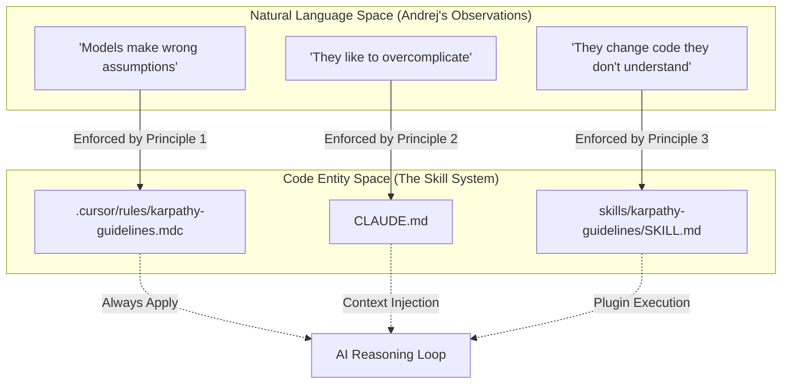
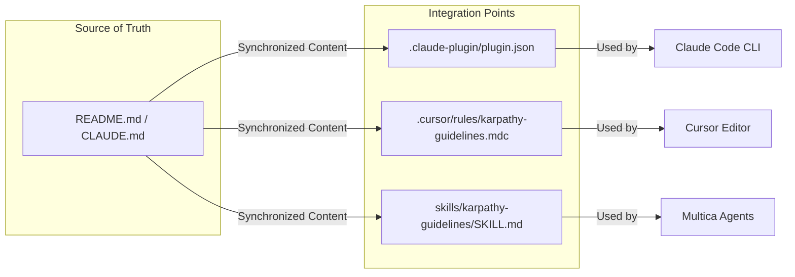

<!-- source: DeepWiki mcp.deepwiki.com · repo multica-ai/andrej-karpathy-skills · page 1 Overview · fetched 2026-10-30 -->

# Overview

Relevant source files

The following files were used as context for generating this wiki page:

- [CLAUDE.md](CLAUDE.md)
- [README.md](README.md)

The `andrej-karpathy-skills` project provides a set of behavioral guidelines for AI coding assistants (like Claude Code and Cursor) to mitigate common Large Language Model (LLM) coding pitfalls. These guidelines are derived from observations by Andrej Karpathy regarding how LLMs often fail in software engineering tasks—such as making silent assumptions, over-engineering solutions, and performing unnecessary "drive-by" refactoring [README.md:7-20]().

The repository centralizes these behavioral corrections into a single set of instructions that can be integrated as a global plugin, a per-project `CLAUDE.md` file, or a Cursor rule [README.md:101-130]().

## The Core Problems

The project addresses three primary failure modes observed in LLM-assisted development:
1.  **Hidden Confusion:** Models often pick an interpretation of an ambiguous prompt silently and proceed without seeking clarification [README.md:13-15]().
2.  **Architectural Bloat:** LLMs tend to overcomplicate APIs and implement 1000-line solutions where 100 lines would suffice [README.md:17-18]().
3.  **Unrelated Edits:** Models frequently change comments or code orthogonal to the task, leading to "noisy" diffs [README.md:19-20]().

For a deeper look at the origins of these principles, see **[Background & Motivation](#1.2)**.

## The Solution: Four Principles

The repository organizes its instructions into four core principles designed to transform the AI from an impulsive coder into a disciplined engineer [README.md:23-30]().

| Principle | Behavioral Shift |
| :--- | :--- |
| **Think Before Coding** | Forces explicit reasoning, assumption checking, and push-back on complexity [README.md:34-44](). |
| **Simplicity First** | Enforces a "senior engineer" heuristic: no speculative features or over-abstraction [README.md:45-58](). |
| **Surgical Changes** | Limits edits strictly to the requested task to ensure clean, minimal PRs [README.md:59-76](). |
| **Goal-Driven Execution** | Shifts from imperative instructions to declarative, verifiable success criteria [README.md:77-98](). |

For detailed implementation details and examples of each, see **[The Four Principles](#2)**.

## Key Insight: Declarative vs. Imperative

The fundamental insight of this project is that LLMs perform significantly better when given **success criteria** rather than just a list of steps. By transforming a task like "Fix the bug" into "Write a test that reproduces the bug, then make it pass," the AI can enter a self-correcting loop [README.md:132-138]().

### Mapping Natural Language Goals to Code Execution

The following diagram illustrates how the project translates high-level Karpathy observations into specific code-enforced behaviors within the AI's context window.

**Logic Flow: From Observations to Skill Enforcement**

Sources: [README.md:13-30](), [README.md:101-130](), [CLAUDE.md:1-66]()

## Repository Organization

The project is structured to support multiple AI development environments simultaneously, ensuring that the same "Karpathy-inspired" logic is applied regardless of the tool used.

**System Architecture: Distribution Formats**

Sources: [README.md:101-130](), [README.md:1-7](), [CLAUDE.md:1-3]()

### Installation & Integration
The project supports three main installation paths:
*   **Claude Code Plugin:** Installed via `/plugin marketplace add` and `/plugin install` for global availability across projects [README.md:101-113]().
*   **CLAUDE.md:** A portable file placed in a project root to guide Claude's behavior locally [README.md:115-126]().
*   **Cursor Rules:** A `.mdc` file located in `.cursor/rules/` for native integration with the Cursor editor [README.md:128-130]().

For step-by-step setup instructions, see **[Getting Started & Installation](#1.1)**.

---

