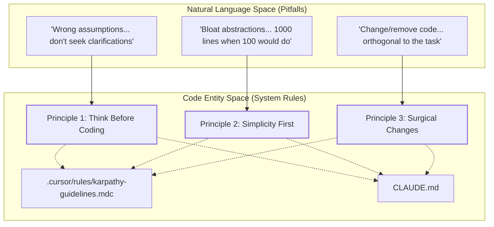
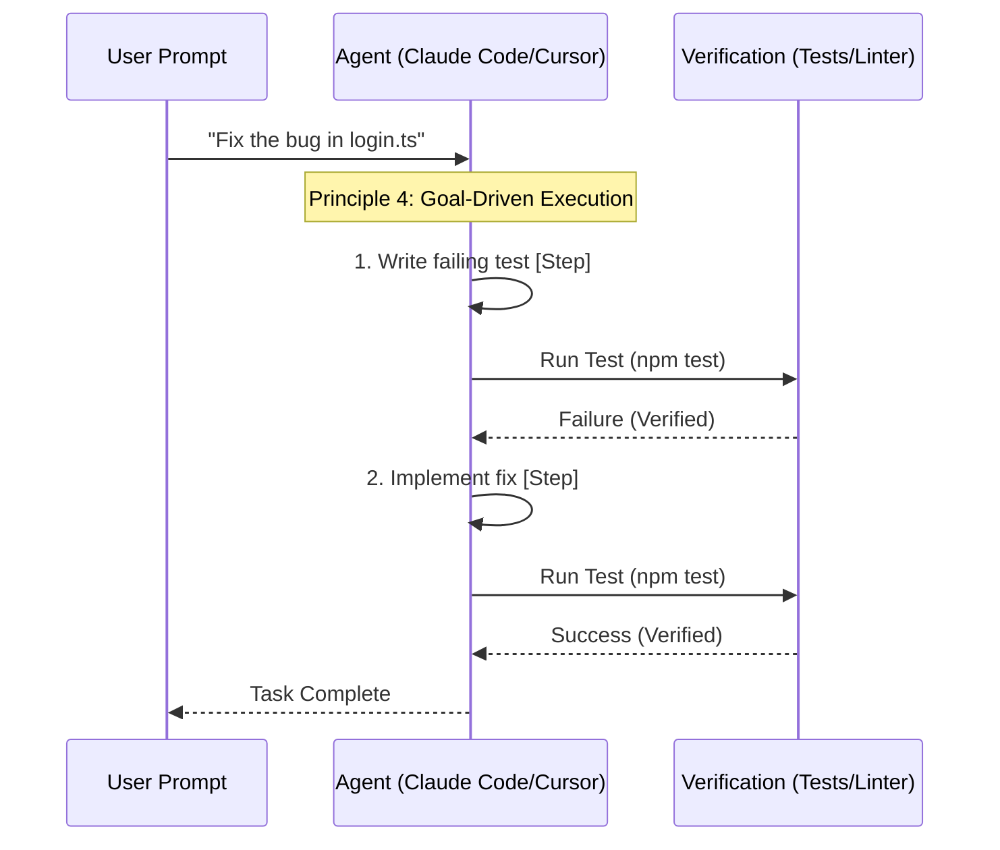

<!-- source: DeepWiki mcp.deepwiki.com · repo multica-ai/andrej-karpathy-skills · page 1.2 Background & Motivation · fetched 2026-10-30 -->

# Background & Motivation

Relevant source files

The following files were used as context for generating this wiki page:

- [README.md](README.md)
- [README.zh.md](README.zh.md)

This section details the theoretical and practical foundations of the `andrej-karpathy-skills` project. It explores the specific Large Language Model (LLM) behaviors identified by Andrej Karpathy that lead to degraded code quality and explains how this repository's guidelines codify solutions to those failure modes.

## Origin: The Karpathy Observations

The guidelines in this repository are derived from public observations made by Andrej Karpathy regarding the pitfalls of using LLMs for software engineering [README.md:7-13](). Karpathy identified that while LLMs are powerful, they often default to "path of least resistance" behaviors that introduce technical debt, architectural complexity, and instability into codebases [README.md:15-20]().

### The Three Core Failure Modes

The project specifically targets three recurring failure modes observed in LLM-assisted coding:

1.  **Hidden Confusion**: Models often make incorrect assumptions on the user's behalf without seeking clarification [README.md:15-16](). They may pick one interpretation of an ambiguous prompt and proceed silently, leading to logic that deviates from the user's actual intent.
2.  **Architectural Bloat**: There is a strong tendency for LLMs to overcomplicate APIs and implementations [README.md:17-18](). This manifests as bloated abstractions (e.g., implementing 1000 lines of code where 100 would suffice) and speculative features that were never requested.
3.  **Unrelated Edits (Side Effects)**: Models frequently perform "drive-by" refactoring—changing comments, formatting, or orthogonal code they do not fully understand—while attempting to solve a specific task [README.md:19-20]().

### LLM Behavior Mapping

The following diagram bridges the "Natural Language Space" (Karpathy's observations) to the "Code Entity Space" (the principles enforced in `CLAUDE.md` and the Cursor rule `.cursor/rules/karpathy-guidelines.mdc`).

**Mapping Observations to Enforcement Principles**

Sources: [README.md:15-30](), [README.md:34-75](), [README.md:130-130]()

## Key Insight: Declarative vs. Imperative

The foundational technical insight of this project is the shift from **imperative instructions** (telling the LLM *how* to do something) to **declarative goals** (telling the LLM *what* success looks like) [README.md:132-138]().

Karpathy noted that LLMs are exceptionally effective at "looping" until they meet specific, verifiable criteria [README.md:134-136](). By providing the LLM with a definition of success—such as a failing test case—the developer leverages the model's ability to iterate independently toward a correct solution.

### The Verification Loop
This insight is implemented as **Principle 4: Goal-Driven Execution** [README.md:77-79](). It transforms vague requests into a structured step-plan format used by the agent during task execution.

**Implementation of the Verification Loop**

Sources: [README.md:77-98](), [README.md:134-138]()

## Problem-Solution Framework

The project organizes these insights into a table that maps specific problems to the principles defined in the core skill files like `CLAUDE.md` and the `karpathy-skills` plugin [README.md:110-115]().

| Problem Category | Specific LLM Pitfall | Enforcement Principle |
| :--- | :--- | :--- |
| **Ambiguity** | Hidden assumptions, missing tradeoffs | **Think Before Coding** |
| **Complexity** | Overengineering, speculative features | **Simplicity First** |
| **Stability** | Side effects, style drift, orphan code | **Surgical Changes** |
| **Reliability** | Weak success criteria, lack of verification | **Goal-Driven Execution** |

Sources: [README.md:25-30](), [README.md:140-148]()

## Technical Tradeoffs

The implementation of these guidelines biases the AI assistant toward **caution over speed** [README.md:163-165](). 

*   **Latency**: Users may experience slightly higher latency as the model is forced to output explicit reasoning and step-plans before writing code [README.md:38-44](), [README.md:89-95]().
*   **Rigor**: For trivial one-line fixes, the guidelines suggest using developer judgment to bypass full rigor, but for non-trivial work, the guidelines mandate a "stop and ask" approach when confusion arises [README.md:43-44](), [README.md:165-167]().

Sources: [README.md:163-168]()

---

