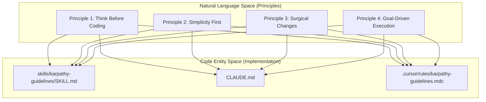
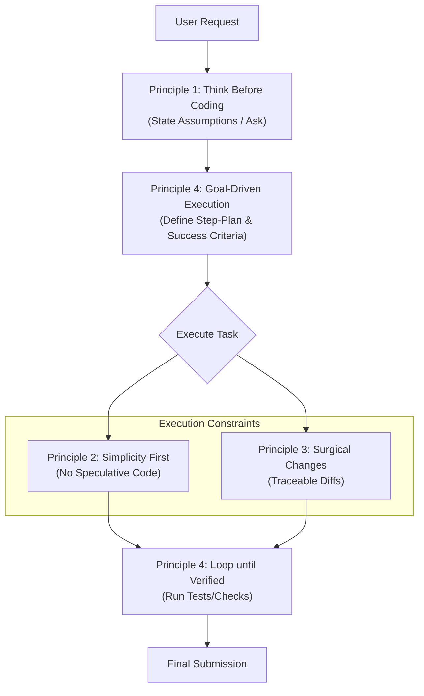

<!-- source: DeepWiki mcp.deepwiki.com · repo multica-ai/andrej-karpathy-skills · page 2 The Four Principles · fetched 2026-10-30 -->

# The Four Principles

Relevant source files

The following files were used as context for generating this wiki page:

- [.cursor/rules/karpathy-guidelines.mdc](.cursor/rules/karpathy-guidelines.mdc)
- [CLAUDE.md](CLAUDE.md)
- [skills/karpathy-guidelines/SKILL.md](skills/karpathy-guidelines/SKILL.md)

The core of this repository is a system of four behavioral principles designed to mitigate common pitfalls in AI-assisted coding. These principles prioritize caution, simplicity, and precision over raw speed, ensuring that the AI agent acts as a disciplined engineer rather than an over-eager assistant.

These guidelines are implemented across multiple formats, including the [skills/karpathy-guidelines/SKILL.md](), [.cursor/rules/karpathy-guidelines.mdc](), and [CLAUDE.md]() files, to provide consistent enforcement in various development environments.

### System Overview Diagram
This diagram illustrates how the behavioral principles in the "Natural Language Space" (the guidelines) map to the "Code Entity Space" (the configuration files and enforcement mechanisms).

**Guideline-to-Code Mapping**

Sources: [skills/karpathy-guidelines/SKILL.md:1-68](), [CLAUDE.md:1-62](), [.cursor/rules/karpathy-guidelines.mdc:1-67]()

---

## Principle 1: Think Before Coding
The first principle focuses on eliminating ambiguity before any code is written. It mandates that the AI agent surfaces assumptions, presents multiple interpretations of a prompt, and pushes back on over-complicated requests. The goal is to ensure that "clarifying questions come before implementation rather than after mistakes" [.cursor/rules/karpathy-guidelines.mdc:70-70]().

For details, see [Principle 1: Think Before Coding](#2.1).

Sources: [skills/karpathy-guidelines/SKILL.md:13-21](), [CLAUDE.md:7-15](), [.cursor/rules/karpathy-guidelines.mdc:12-20]()

## Principle 2: Simplicity First
This principle enforces the "Minimum Viable Code" philosophy. It explicitly forbids speculative features, unnecessary abstractions for single-use code, and unrequested "flexibility" [skills/karpathy-guidelines/SKILL.md:25-30](). It introduces a "senior engineer" heuristic to evaluate if a solution is over-engineered, specifically targeting the reduction of bloated implementations (e.g., rewriting 200 lines into 50) [CLAUDE.md:25-27]().

For details, see [Principle 2: Simplicity First](#2.2).

Sources: [skills/karpathy-guidelines/SKILL.md:23-33](), [CLAUDE.md:17-27](), [.cursor/rules/karpathy-guidelines.mdc:22-32]()

## Principle 3: Surgical Changes
Surgical Changes is a constraint on the scope of edits. It requires that every changed line must trace directly to the user's request [.cursor/rules/karpathy-guidelines.mdc:48-48](). It prevents "drive-by refactoring"—the habit of fixing adjacent code, comments, or formatting that is unrelated to the task at hand [CLAUDE.md:33-35]().

For details, see [Principle 3: Surgical Changes](#2.3).

Sources: [skills/karpathy-guidelines/SKILL.md:35-50](), [CLAUDE.md:29-44](), [.cursor/rules/karpathy-guidelines.mdc:34-49]()

## Principle 4: Goal-Driven Execution
The final principle transforms imperative instructions into declarative, verifiable success criteria. Instead of simply "fixing a bug," the agent is instructed to write a reproduction test first [CLAUDE.md:51-52](). It also mandates a step-by-step verification plan for multi-step tasks using a specific `[Step] → verify: [check]` format [.cursor/rules/karpathy-guidelines.mdc:60-64]().

For details, see [Principle 4: Goal-Driven Execution](#2.4).

Sources: [skills/karpathy-guidelines/SKILL.md:51-67](), [CLAUDE.md:45-61](), [.cursor/rules/karpathy-guidelines.mdc:50-67]()

---

### Workflow Integration Diagram
This diagram shows how these principles interact during a standard development cycle within the `karpathy-guidelines` framework.

**Behavioral Lifecycle**

Sources: [skills/karpathy-guidelines/SKILL.md:7-68](), [CLAUDE.md:1-66](), [.cursor/rules/karpathy-guidelines.mdc:6-70]()

---

