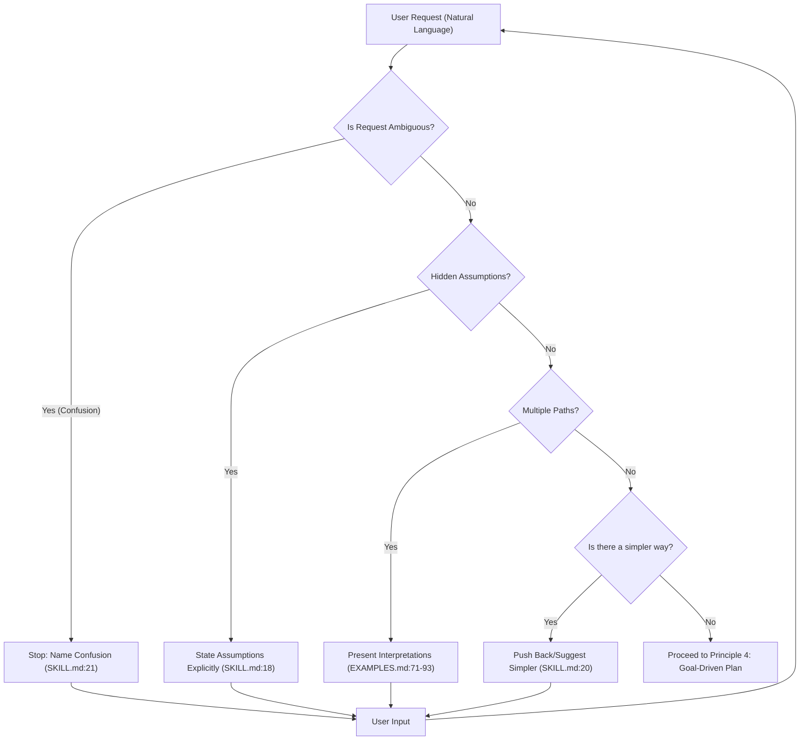
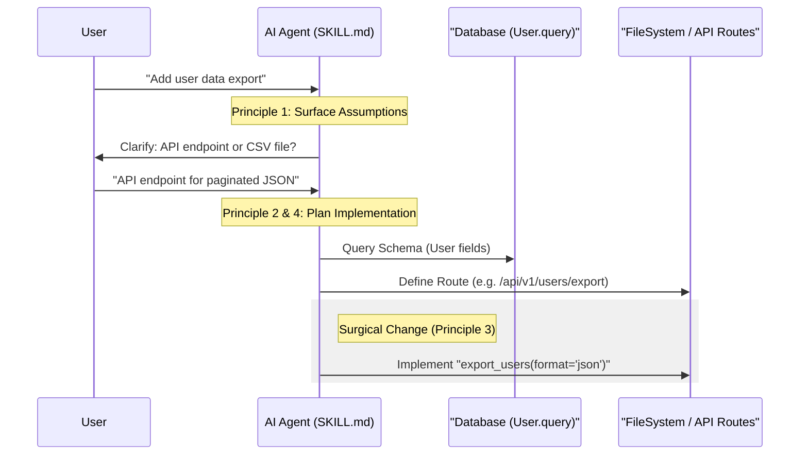

<!-- source: DeepWiki mcp.deepwiki.com · repo multica-ai/andrej-karpathy-skills · page 2.1 Principle 1: Think Before Coding · fetched 2026-10-30 -->

# Principle 1: Think Before Coding

Relevant source files

The following files were used as context for generating this wiki page:

- [CLAUDE.md](CLAUDE.md)
- [EXAMPLES.md](EXAMPLES.md)
- [skills/karpathy-guidelines/SKILL.md](skills/karpathy-guidelines/SKILL.md)

This page provides a deep dive into the first principle of the Karpathy Guidelines. The core objective is to shift the AI's behavior from immediate, imperative execution to a deliberative phase where assumptions are surfaced, multiple interpretations are explored, and complexity is challenged before any code is written [skills/karpathy-guidelines/SKILL.md:13-21]().

## Core Objectives

The "Think Before Coding" principle is designed to prevent the common LLM failure mode of "picking silently" [EXAMPLES.md:61-62](). By enforcing a clarification step, the system reduces the likelihood of implementing the wrong solution efficiently.

### 1. Surface Hidden Assumptions
LLMs often make implicit decisions about scope, data privacy, and infrastructure [EXAMPLES.md:32-37](). This principle requires stating these assumptions explicitly.

### 2. Present Multiple Interpretations
Vague requests (e.g., "make it faster") can be solved at different layers: database, network, or UI [EXAMPLES.md:74-90](). The AI must present these options rather than guessing.

### 3. Push Back on Complexity
If a user request leads to an over-engineered solution, the AI is instructed to suggest a simpler alternative [skills/karpathy-guidelines/SKILL.md:20]().

### 4. Stop When Confused
If the request is ambiguous or the codebase state is unclear, the AI must halt and name the specific source of confusion [CLAUDE.md:15]().

Sources: [skills/karpathy-guidelines/SKILL.md:13-21](), [CLAUDE.md:7-15](), [EXAMPLES.md:9-57]()

---

## Implementation Logic

The following diagram illustrates how a user request is processed under Principle 1 before reaching the "Code Entity Space."

### Logic Flow: Natural Language to Deliberation
This diagram shows the decision gates an agent must pass through as defined in the `karpathy-guidelines` skill.

Sources: [skills/karpathy-guidelines/SKILL.md:13-21](), [EXAMPLES.md:71-93]()

---

## Technical Examples & Anti-Patterns

### Example 1: The "Export" Assumption
When asked to "Add a feature to export user data," a standard LLM might immediately write a script to dump the entire database to a local CSV file [EXAMPLES.md:11-30]().

**The Anti-Pattern (Picking Silently):**
- **File Path:** The LLM assumes `users.json` or `users.csv` in the root directory [EXAMPLES.md:21-24]().
- **Scope:** It queries `User.query.all()`, ignoring potential performance or privacy issues with large datasets [EXAMPLES.md:18]().
- **Format:** It assumes hardcoded fieldnames like `['id', 'email', 'name']` without verifying the model schema [EXAMPLES.md:25]().

**The Corrective Action (Surfacing Assumptions):**
The AI must ask about **Scope** (filtered subset?), **Format** (API vs. File?), **Fields** (sensitive data?), and **Volume** (pagination requirements?) [EXAMPLES.md:41-54]().

### Example 2: The "Faster" Interpretation
A request to "Make the search faster" is a high-level goal that maps to multiple technical implementations [EXAMPLES.md:59-60]().

**Interpretations to Present:**
| Interpretation | Technical Implementation | Estimated Effort |
| :--- | :--- | :--- |
| **Response Time** | Database indexes, `@lru_cache` [EXAMPLES.md:66-79]() | ~2 hours |
| **Throughput** | `async/await`, connection pooling [EXAMPLES.md:81-84]() | ~4 hours |
| **Perceived Speed** | Progressive loading, partial results [EXAMPLES.md:86-89]() | ~3 hours |

Sources: [EXAMPLES.md:9-93]()

---

## Data Flow: Clarification to Execution

This diagram bridges the gap between the "Natural Language Space" (Clarification) and the "Code Entity Space" (Implementation) by showing how specific code symbols are protected by the "Think" phase.

Sources: [EXAMPLES.md:16-51](), [skills/karpathy-guidelines/SKILL.md:13-21](), [CLAUDE.md:39-43]()

## Summary Table: Principle 1 Checklist

| Action | When to use | Source |
| :--- | :--- | :--- |
| **Explicit Assumptions** | Whenever a default choice is made (e.g., file format, library). | [SKILL.md:18]() |
| **Interpretation Menu** | When the goal is qualitative (e.g., "better," "faster," "cleaner"). | [EXAMPLES.md:74]() |
| **Complexity Push-back** | When the requested feature implies heavy abstraction (ABC, Protocols). | [EXAMPLES.md:105-147]() |
| **The "Stop" Command** | When the current codebase state contradicts the user request. | [CLAUDE.md:15]() |

Sources: [skills/karpathy-guidelines/SKILL.md:13-21](), [CLAUDE.md:7-15](), [EXAMPLES.md:1-93]()

---

