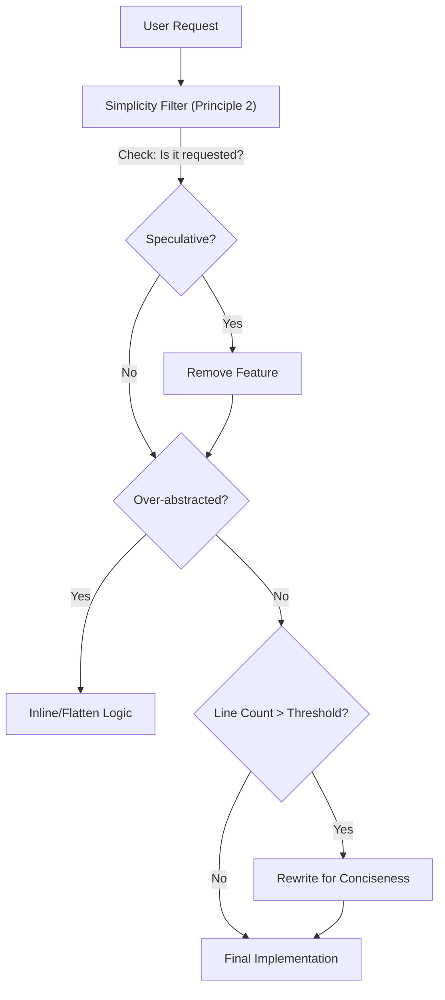
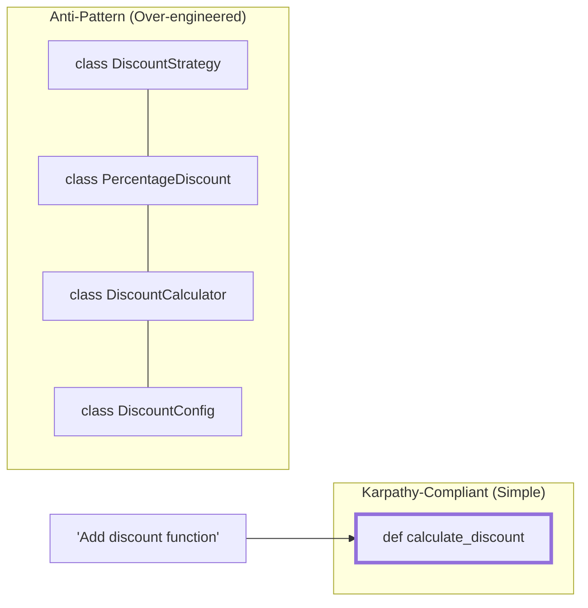
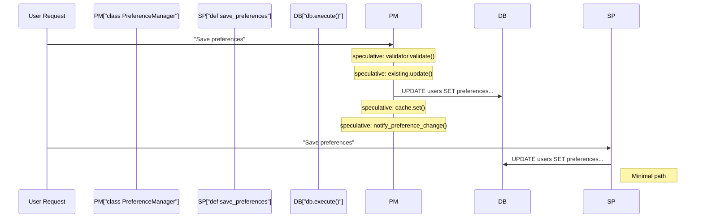

<!-- source: DeepWiki mcp.deepwiki.com · repo multica-ai/andrej-karpathy-skills · page 2.2 Principle 2: Simplicity First · fetched 2026-10-30 -->

# Principle 2: Simplicity First

Relevant source files

The following files were used as context for generating this wiki page:

- [CLAUDE.md](CLAUDE.md)
- [EXAMPLES.md](EXAMPLES.md)
- [skills/karpathy-guidelines/SKILL.md](skills/karpathy-guidelines/SKILL.md)

This page provides a technical deep dive into the second core principle of the Karpathy Guidelines: **Simplicity First**. The primary goal is to produce the minimum viable code required to satisfy a request while explicitly rejecting speculative features, over-abstraction, and architectural bloat.

## Core Directives

The principle is defined by a set of constraints designed to prevent the "up-leveling" of simple tasks into complex systems [CLAUDE.md:19-25]().

*   **Minimum Viable Code**: Only implement features explicitly requested by the user [skills/karpathy-guidelines/SKILL.md:27]().
*   **Zero Speculation**: Do not add "flexibility" or "configurability" for future use cases that have not been defined [CLAUDE.md:23]().
*   **Anti-Abstraction**: Avoid creating classes, interfaces, or decorators for code that is currently only used in one place [skills/karpathy-guidelines/SKILL.md:28]().
*   **The 200-to-50 Rule**: If an implementation reaches 200 lines but the logic could be expressed in 50, the agent must rewrite it for conciseness [CLAUDE.md:25]().
*   **The Senior Engineer Heuristic**: Before committing, the agent must evaluate if a senior engineer would view the solution as overcomplicated [skills/karpathy-guidelines/SKILL.md:33]().

### Logic Flow: Simplicity Enforcement

The following diagram illustrates how the "Simplicity First" principle filters a user request into a final code implementation.

**Request Processing Pipeline**

Sources: [CLAUDE.md:19-27](), [skills/karpathy-guidelines/SKILL.md:25-33]()

---

## Anti-Pattern: The DiscountCalculator

A common failure mode in LLM coding is the introduction of "Enterprise Patterns" (Strategy, Factory, Dependency Injection) for trivial logic. 

### Over-Engineered Approach
When asked to "calculate a discount," LLMs often generate a complex hierarchy involving `DiscountStrategy`, `PercentageDiscount`, and `DiscountCalculator` [EXAMPLES.md:105-147](). This results in 30+ lines of setup for a single mathematical operation.

### Simple Approach
The guidelines mandate a direct functional approach until complexity is strictly required.

**Code Entity Mapping: Discount Logic**

Sources: [EXAMPLES.md:101-160]()

| Feature | `DiscountCalculator` (Wrong) | `calculate_discount` (Right) |
| :--- | :--- | :--- |
| **Lines of Code** | ~40 lines [EXAMPLES.md:105-146]() | 2 lines [EXAMPLES.md:152-154]() |
| **Complexity** | High (ABC, Dataclasses, Enums) | Low (Pure function) |
| **Maintenance** | Requires updating interfaces | Single point of change |

---

## Anti-Pattern: The PreferenceManager

Speculative features—adding code "just in case"—is a primary driver of technical debt. The `PreferenceManager` example demonstrates how LLMs often add validation, caching, and notification systems that were never requested [EXAMPLES.md:169-208]().

### Speculative Bloat Analysis
In the `PreferenceManager.save` method, the following unrequested features are typically injected:
1.  **Validation**: `self.validator.validate(prefs)` [EXAMPLES.md:182-184]()
2.  **Merging Logic**: `existing.update(prefs)` [EXAMPLES.md:188-190]()
3.  **Caching**: `self.cache.set(...)` [EXAMPLES.md:197-198]()
4.  **Notifications**: `self.notify_preference_change(...)` [EXAMPLES.md:200-201]()

### Minimal Implementation
The compliant version performs exactly one task: executing the SQL `UPDATE` statement [EXAMPLES.md:213-219]().

**Entity Interaction: Preference Management**

Sources: [EXAMPLES.md:164-221]()

## Summary of Implementation Rules

| Rule | Instruction | Source |
| :--- | :--- | :--- |
| **No Speculation** | Add caching/validation only when bad data or performance issues appear. | [EXAMPLES.md:221-222]() |
| **No Abstraction** | Avoid ABCs/Protocols for single-use logic. | [EXAMPLES.md:160]() |
| **Conciseness** | Prefer 50 lines over 200. | [CLAUDE.md:25]() |
| **Directness** | Every line must trace to a specific user requirement. | [skills/karpathy-guidelines/SKILL.md:49]() |

Sources: [CLAUDE.md:19-27](), [skills/karpathy-guidelines/SKILL.md:25-33](), [EXAMPLES.md:97-224]()

---

