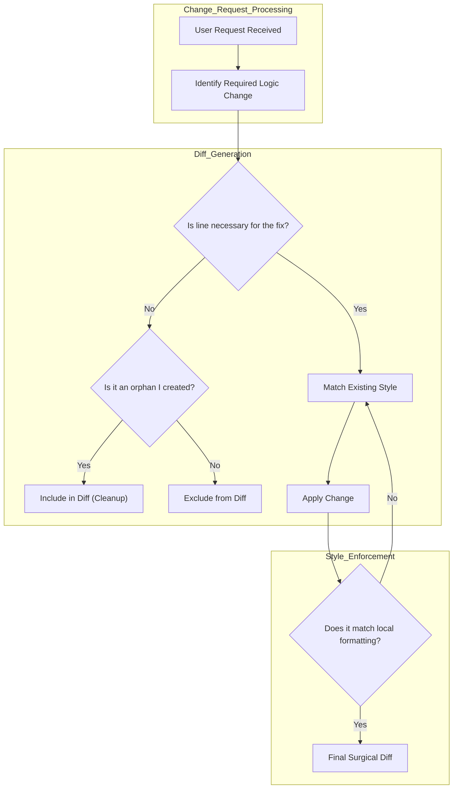
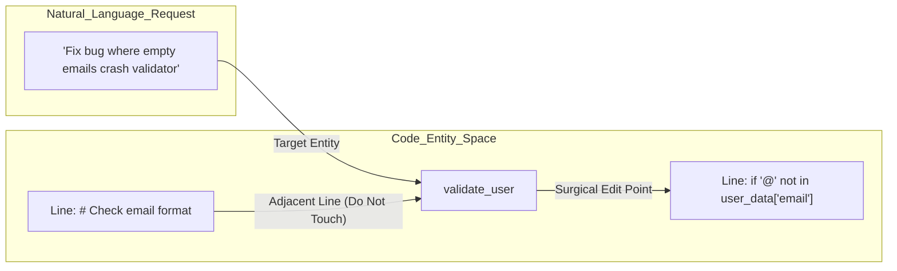

<!-- source: DeepWiki mcp.deepwiki.com · repo multica-ai/andrej-karpathy-skills · page 2.3 Principle 3: Surgical Changes · fetched 2026-10-30 -->

# Principle 3: Surgical Changes

Relevant source files

The following files were used as context for generating this wiki page:

- [CLAUDE.md](CLAUDE.md)
- [EXAMPLES.md](EXAMPLES.md)
- [skills/karpathy-guidelines/SKILL.md](skills/karpathy-guidelines/SKILL.md)

The third principle focuses on minimizing the "blast radius" of code modifications. It mandates that every changed line must trace directly back to the user's specific request, preventing common LLM failure modes like "drive-by refactoring" or stylistic drift that complicates pull reviews and introduces regression risks.

## Core Directives

The principle is built on the philosophy: **"Touch only what you must. Clean up only your own mess."** [skills/karpathy-guidelines/SKILL.md:37-37]().

### Editing Existing Code
When modifying a file, the system follows these constraints:
*   **No Adjacent Improvements:** Do not update comments, formatting, or logic in lines that are not required for the task [skills/karpathy-guidelines/SKILL.md:40-40]().
*   **No Proactive Refactoring:** If a piece of code is not broken and not directly related to the task, it should not be refactored [skills/karpathy-guidelines/SKILL.md:41-41]().
*   **Style Matching:** Match the existing codebase's style, even if you would do it differently [skills/karpathy-guidelines/SKILL.md:42-42]().
*   **Dead Code Reporting:** If unrelated dead code is discovered, mention it to the user rather than deleting it [skills/karpathy-guidelines/SKILL.md:43-43]().

### Managing Orphans
The guidelines distinguish between pre-existing technical debt and debt created by the current change:
*   **Cleanup Own Mess:** If a change makes an import, variable, or function unused, it **must** be removed [skills/karpathy-guidelines/SKILL.md:46-46]().
*   **Ignore Pre-existing Orphans:** Do not remove dead code that was already present before the current session unless explicitly instructed [skills/karpathy-guidelines/SKILL.md:47-47]().

**Sources:** [skills/karpathy-guidelines/SKILL.md:35-49](), [CLAUDE.md:29-43]()

## Data Flow: Surgical Change Validation

The following diagram illustrates the decision logic applied when an LLM prepares a diff to ensure it adheres to Principle 3.

**Surgical Change Decision Logic**

**Sources:** [skills/karpathy-guidelines/SKILL.md:35-49](), [EXAMPLES.md:225-231]()

## Anti-Pattern: Drive-by Refactoring

A common failure mode is "Drive-by Refactoring," where an LLM attempts to "improve" a function while fixing a minor bug. This often involves changing docstrings, variable names, or adding more complex validation logic that wasn't requested.

### Example: `validate_user` Bug Fix
In this scenario, the user asks to fix a crash caused by empty emails [EXAMPLES.md:229-229]().

| Aspect | Incorrect (Non-Surgical) | Correct (Surgical) |
| :--- | :--- | :--- |
| **Logic** | Rewrites validation logic and adds complex splitting [EXAMPLES.md:238-246](). | Only adds the necessary check for the email field [EXAMPLES.md:261-265](). |
| **Formatting** | Changes docstring style and adds whitespace [EXAMPLES.md:237-239](). | Keeps original comments and spacing [EXAMPLES.md:260-261](). |
| **Scope** | Modifies/Adds 10+ lines [EXAMPLES.md:233-252](). | Modifies 2 lines [EXAMPLES.md:258-266](). |

**Code Entity Mapping: `validate_user`**

**Sources:** [EXAMPLES.md:229-268]()

## Anti-Pattern: Style Drift

Style drift occurs when the LLM imposes its own preferred library or syntax over the one already established in the file.

### Example: `upload_file` Implementation
If a file uses `os.path` and the user asks to add a path check, a non-surgical change might introduce `pathlib` [EXAMPLES.md:275-285](). While `pathlib` is modern, mixing both in a single file creates inconsistency.

*   **Non-Surgical:** Imports `pathlib` and converts existing `os` calls [EXAMPLES.md:280-285]().
*   **Surgical:** Uses `os.path.exists()` to match the surrounding context [EXAMPLES.md:294-298]().

**Style Matching Logic**
| File Context | Surgical Choice | Non-Surgical Choice |
| :--- | :--- | :--- |
| Uses `os.path` | `os.path.join()` [EXAMPLES.md:295-295]() | `Path() / "..."` [EXAMPLES.md:284-284]() |
| Uses `dict()` | `dict(a=1)` | `{"a": 1}` |
| Uses `var` (JS) | `var x = 1` | `const x = 1` |

**Sources:** [EXAMPLES.md:270-305](), [skills/karpathy-guidelines/SKILL.md:42-42]()

## The "Surgical" Test
To verify if a change is surgical, the developer or the LLM must answer "Yes" to the following:
> **"Does every changed line trace directly to the user's request?"** [skills/karpathy-guidelines/SKILL.md:49-49]()

If a line was changed to "make it cleaner" or "fix a typo in a comment," it fails the test and should be reverted.

**Sources:** [skills/karpathy-guidelines/SKILL.md:49-49](), [CLAUDE.md:43-43]()

---

